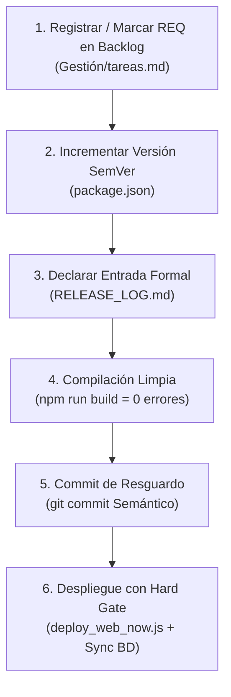

# 🛡️ Estándar Oficial LeanGlobal: Gobernanza de Backlog, Release Log y Hard Gate de Despliegue

> **Principio Fundamental del Ecosistema LeanGlobal:**  
> *"Un cambio no versionado es código pirata. Un despliegue sin requerimiento en Backlog ni entrada en Release Log es una falla crítica de seguridad y trazabilidad. En LeanGlobal, el código no se despliega sin su compuerta determinista."*

---

## 1. Alcance y Filosofía del Estándar

En todas las plataformas y productos del ecosistema LeanGlobal (**Grúas San Pablo, Terracon, Transmac, Bachelet Monasterio, ALS, Besalco, Multi-Tenant**), ningún agente de IA ni desarrollador humano puede desplegar software a los ambientes `dev`, `qa` o `prod` mediante parches improvisados.

Todo cambio transferido a un servidor remoto debe cumplir un **ciclo de vida cerrado de 6 pasos** gobernado por un **Candado Duro en Código (Hard Gate)** que bloquea físicamente la ejecución si falta algún requisito.

---

## 2. El Ciclo de Vida Inviolable de 6 Pasos



1. **Paso 1: Trazabilidad en Backlog Físico (`Gestión/tareas.md`):**  
   Todo cambio debe estar respaldado por un código formal `REQ-XXX` con su alcance detallado y marcado como completado (`[x]`).
2. **Paso 2: Incremento Semántico en `package.json`:**  
   Se debe elevar el número de versión (`1.0.XX ➔ 1.0.XY`) en `package.json` de Frontend o PWA antes de compilar.
3. **Paso 3: Documentación en `RELEASE_LOG.md`:**  
   Declarar el bloque `## [Producto] - Versión X.X.X` vinculando explícitamente el `Requerimiento Backlog: REQ-XXX`, fecha, ambiente y desglose técnico por capas.
4. **Paso 4: Compilación Determinista:**  
   Ejecutar `npm run build` o `vite build` asegurando `exit code 0` y cero warnings bloqueantes.
5. **Paso 5: Git Checkpoint:**  
   Asegurar los cambios en el control de versiones con convención `chore(release): vX.X.X ...`.
6. **Paso 6: Despliegue con Hard Gate:**  
   El script de despliegue valida automáticamente los pasos 1, 2 y 3. Si todo cumple, sube los archivos y sincroniza la base de datos PostgreSQL de forma indivisible.

---

## 3. Modelo de Base de Datos PostgreSQL

Todo tenant y base de datos LeanGlobal cuenta con las tablas maestras `tcfg_backlog` y `tcfg_releases` (esquema del tenant o `sch_leangsp` / `sch_bch`):

### 3.1. DDL de `tcfg_backlog`
```sql
CREATE TABLE IF NOT EXISTS sch_leangsp.tcfg_backlog (
    id SERIAL PRIMARY KEY,
    codigo_req VARCHAR(50) NOT NULL UNIQUE,
    nombre_requerimiento VARCHAR(255) NOT NULL,
    descripcion TEXT,
    prioridad VARCHAR(20) DEFAULT 'Media', -- 'Critica', 'Alta', 'Media', 'Baja'
    fecha_registro DATE DEFAULT CURRENT_DATE,
    fecha_implementacion DATE,
    solicitado_por VARCHAR(100),
    estado VARCHAR(30) DEFAULT 'Pendiente', -- 'Pendiente', 'En Desarrollo', 'Implementado', 'Descartado'
    creado_por VARCHAR(100) DEFAULT 'Sistema',
    created_at TIMESTAMP WITH TIME ZONE DEFAULT NOW(),
    updated_at TIMESTAMP WITH TIME ZONE DEFAULT NOW()
);

CREATE INDEX IF NOT EXISTS idx_tcfg_backlog_codigo ON sch_leangsp.tcfg_backlog(codigo_req);
CREATE INDEX IF NOT EXISTS idx_tcfg_backlog_estado ON sch_leangsp.tcfg_backlog(estado);
```

### 3.2. DDL de `tcfg_releases`
```sql
CREATE TABLE IF NOT EXISTS sch_leangsp.tcfg_releases (
    id SERIAL PRIMARY KEY,
    version VARCHAR(30) NOT NULL UNIQUE, -- ej: 'v1.0.59'
    fecha_release DATE DEFAULT CURRENT_DATE,
    titulo VARCHAR(255) NOT NULL,
    tipo_release VARCHAR(50) DEFAULT 'Feature', -- 'Feature', 'Hotfix', 'Refactor', 'Security'
    descripcion_impacto TEXT,
    requerimientos_asociados JSONB DEFAULT '[]'::jsonb, -- ej: ["REQ-014"]
    publicado_por VARCHAR(100) DEFAULT 'DevOps',
    created_at TIMESTAMP WITH TIME ZONE DEFAULT NOW()
);

CREATE INDEX IF NOT EXISTS idx_tcfg_releases_version ON sch_leangsp.tcfg_releases(version);
CREATE INDEX IF NOT EXISTS idx_tcfg_releases_reqs ON sch_leangsp.tcfg_releases USING GIN(requerimientos_asociados);
```

---

## 4. Capa Backend: Controlador y Rutas API

### 4.1. Controlador Canónico (`backlogController.js`)
```javascript
const client = require('../config/dbConfig.js');

exports.getBacklog = async (req, res) => {
  try {
    const { rows } = await client.query('SELECT * FROM sch_leangsp.tcfg_backlog ORDER BY id DESC');
    res.json({ success: true, data: rows });
  } catch (err) {
    res.status(500).json({ success: false, error: err.message });
  }
};

exports.getReleases = async (req, res) => {
  try {
    const { rows } = await client.query('SELECT * FROM sch_leangsp.tcfg_releases ORDER BY id DESC');
    res.json({ success: true, data: rows });
  } catch (err) {
    res.status(500).json({ success: false, error: err.message });
  }
};

exports.registrarReleaseYReq = async (req, res) => {
  const { version, titulo, tipo_release, descripcion_impacto, requerimientos_asociados, publicado_por } = req.body;
  try {
    await client.query('BEGIN');

    // 1. Insert/Update Release
    const qRel = `
      INSERT INTO sch_leangsp.tcfg_releases (
        version, fecha_release, titulo, tipo_release, descripcion_impacto, requerimientos_asociados, publicado_por
      ) VALUES ($1, CURRENT_DATE, $2, $3, $4, $5::jsonb, $6)
      ON CONFLICT (version) DO UPDATE
      SET fecha_release = CURRENT_DATE,
          titulo = EXCLUDED.titulo,
          descripcion_impacto = EXCLUDED.descripcion_impacto,
          requerimientos_asociados = EXCLUDED.requerimientos_asociados;
    `;
    await client.query(qRel, [version, titulo, tipo_release || 'Feature', descripcion_impacto, JSON.stringify(requerimientos_asociados || []), publicado_por || 'Sistema']);

    // 2. Marcar REQs como Implementados
    if (Array.isArray(requerimientos_asociados) && requerimientos_asociados.length > 0) {
      await client.query(`
        UPDATE sch_leangsp.tcfg_backlog
        SET estado = 'Implementado',
            fecha_implementacion = CURRENT_DATE,
            updated_at = NOW()
        WHERE codigo_req = ANY($1::varchar[])
      `, [requerimientos_asociados]);
    }

    await client.query('COMMIT');
    res.json({ success: true, message: `Release ${version} sincronizado exitosamente.` });
  } catch (err) {
    await client.query('ROLLBACK');
    res.status(500).json({ success: false, error: err.message });
  }
};
```

### 4.2. Rutas Canónicas (`backlogRoutes.js`)
```javascript
const express = require('express');
const router = express.Router();
const ctrl = require('../controllers/backlogController.js');

router.get('/backlog', ctrl.getBacklog);
router.get('/releases', ctrl.getReleases);
router.post('/releases', ctrl.registrarReleaseYReq);

module.exports = router;
```

---

## 5. Implementación del Candado Duro (Hard Gate Pre-Deploy)

El script de despliegue (`deploy_web_now.js` o `deploy_pwa_now.js`) **NO debe conectarse por SSH** sin antes superar la función de auditoría local determinista:

```javascript
const fs = require('fs');
const path = require('path');

function validarGobernanzaAntesDeDesplegar(config) {
  console.log("🛡️ [HARD GATE] Ejecutando verificación obligatoria de gobernanza...");

  // 1. Validar package.json
  if (!fs.existsSync(config.pkgPath)) {
    console.error("❌ ERROR CRÍTICO: No existe package.json en", config.pkgPath);
    process.exit(1);
  }
  const pkg = JSON.parse(fs.readFileSync(config.pkgPath, 'utf8'));
  const versionActual = pkg.version;
  console.log(`📦 Versión detectada en package.json: ${versionActual}`);

  // 2. Validar entrada en RELEASE_LOG.md
  if (!fs.existsSync(config.releaseLogPath)) {
    console.error("❌ ERROR CRÍTICO: No existe RELEASE_LOG.md en", config.releaseLogPath);
    process.exit(1);
  }
  const releaseLogContent = fs.readFileSync(config.releaseLogPath, 'utf8');
  const regexVersion = new RegExp(`##\\s*\\[${config.nombreProducto}\\]\\s*-\\s*Versi[oó]n\\s*${versionActual.replace('.', '\\.')}`, 'i');
  
  if (!regexVersion.test(releaseLogContent)) {
    console.error("\n==========================================================================");
    console.error(`❌ DESPLIEGUE BLOQUEADO: La versión ${versionActual} no está documentada en RELEASE_LOG.md`);
    console.error(`   Debes crear el bloque: "## [${config.nombreProducto}] - Versión ${versionActual}" antes de desplegar.`);
    console.error("==========================================================================\n");
    process.exit(1);
  }

  // 3. Extraer REQ asociado
  const bloqueMatch = releaseLogContent.match(new RegExp(`##\\s*\\[${config.nombreProducto}\\]\\s*-\\s*Versi[oó]n\\s*${versionActual.replace('.', '\\.')}[\\s\\S]*?(?=##\\s*\\[|$)`, 'i'));
  const bloqueTexto = bloqueMatch ? bloqueMatch[0] : '';
  const reqMatch = bloqueTexto.match(/REQ-\d+/i);
  if (!reqMatch) {
    console.error(`❌ DESPLIEGUE BLOQUEADO: El bloque ${versionActual} en RELEASE_LOG.md no indica "REQ-XXX".`);
    process.exit(1);
  }
  const reqCodigo = reqMatch[0].toUpperCase();

  // 4. Validar tareas.md
  if (!fs.existsSync(config.tareasPath)) {
    console.error("❌ ERROR CRÍTICO: No existe Gestión/tareas.md en", config.tareasPath);
    process.exit(1);
  }
  const tareasContent = fs.readFileSync(config.tareasPath, 'utf8');
  const regexReqCompletado = new RegExp(`\\[x\\][^\n]*${reqCodigo}`, 'i');
  if (!regexReqCompletado.test(tareasContent)) {
    console.error(`❌ DESPLIEGUE BLOQUEADO: El requerimiento ${reqCodigo} no existe o no está marcado como completado ([x]) en Gestión/tareas.md.`);
    process.exit(1);
  }

  console.log(`✅ [HARD GATE SUPERADO]: Versión ${versionActual} y ${reqCodigo} validados y trazables.\n`);
  return { version: versionActual, req: reqCodigo };
}
```

---

## 6. Sincronización Automática en Base de Datos

El script de despliegue debe ejecutar inmediatamente tras el `putDirectory` la inyección en PostgreSQL:

```javascript
async function sincronizarMetadatosEnBD(client, info) {
  // Inserción en tcfg_backlog y tcfg_releases
  await client.query(`
    INSERT INTO sch_leangsp.tcfg_backlog (codigo_req, nombre_requerimiento, estado, fecha_implementacion)
    VALUES ($1, $2, 'Implementado', CURRENT_DATE)
    ON CONFLICT (codigo_req) DO UPDATE SET estado = 'Implementado', fecha_implementacion = CURRENT_DATE;
  `, [info.req, info.titulo]);

  await client.query(`
    INSERT INTO sch_leangsp.tcfg_releases (version, fecha_release, titulo, requerimientos_asociados)
    VALUES ($1, CURRENT_DATE, $2, $3::jsonb)
    ON CONFLICT (version) DO UPDATE SET fecha_release = CURRENT_DATE, titulo = EXCLUDED.titulo;
  `, [`v${info.version}`, info.titulo, JSON.stringify([info.req])]);
}
```

---

## 7. Compuerta para Agentes de IA (`AGENTS.md`)

Queda terminantemente prohibido para cualquier agente de IA:
1. Desplegar un frontend o PWA sin haber incrementado la versión en `package.json`.
2. Omitir la creación o cierre del `REQ-XXX` en `Gestión/tareas.md`.
3. Sobrescribir versiones pasadas en `RELEASE_LOG.md`.
4. Eludir o comentar la función `validarGobernanzaAntesDeDesplegar()`.
Cualquier intento de evasión de esta compuerta constituye un incumplimiento directo de la Constitución `.agents/AGENTS.md`.
