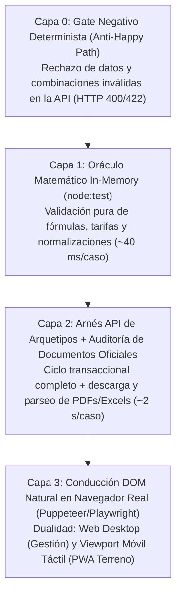
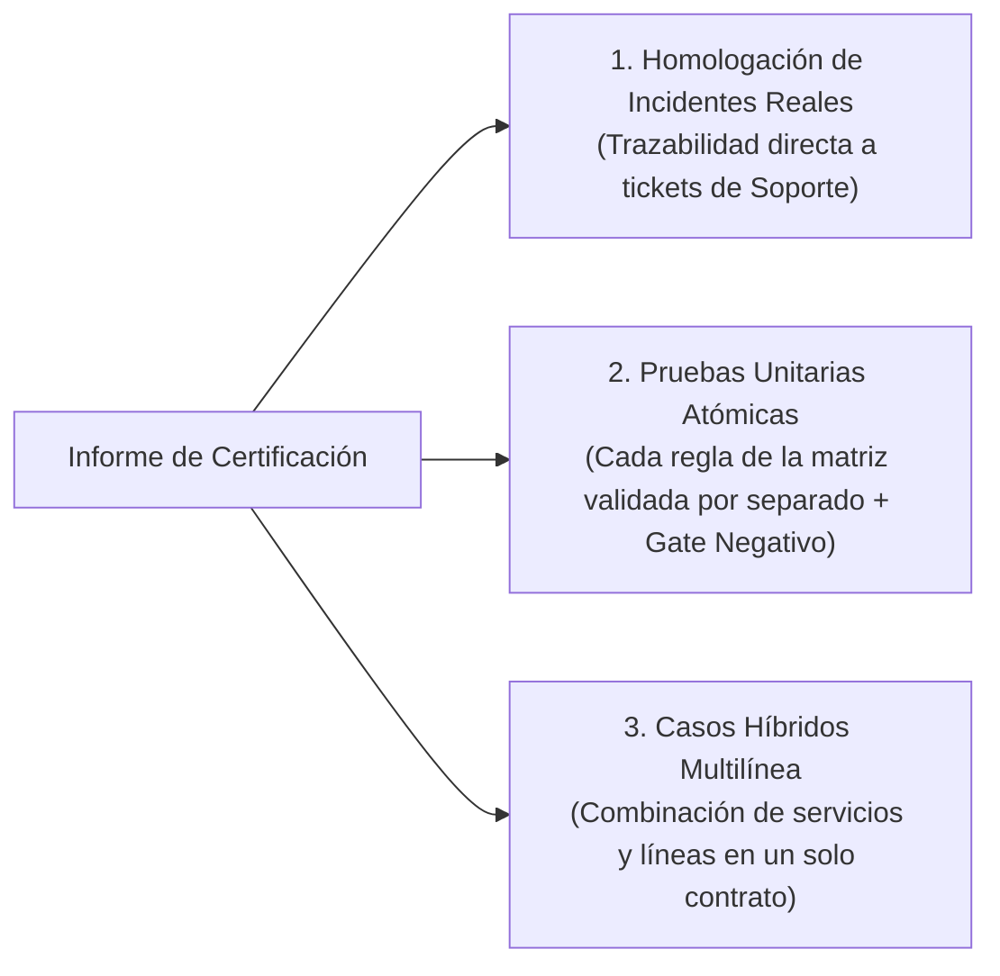

# Framework Oficial LeanGlobal: Estrategia de Ejecución de Pruebas Integrales End-to-End (E2E)

> **Axioma Fundamental de Calidad de Producto LeanGlobal:**  
> *"Una prueba que solo valida una pantalla aislada o un endpoint mockeado es una ilusión de calidad. Ninguna funcionalidad de la plataforma está certificada hasta que se comprueba el ciclo de vida completo del negocio: desde la captura del requerimiento comercial y sus compuertas de rechazo, pasando por la operación en terreno (PWA), hasta el impacto exacto en la facturación y remuneraciones, auditando que la pantalla, el backend y el documento legal impreso (PDF/Excel) coincidan al centavo ($0 de diferencia)."*

---

## 1. Alcance y Propósito

Este estándar define el **framework metodológico y técnico universal** para el diseño, automatización y ejecución de pruebas integrales en cualquier producto, vertical o tenant del ecosistema LeanGlobal (**logística, transporte de carga, arriendo de maquinaria, faenas industriales, obras civiles y core multi-tenant**).

Resuelve los dos vicios crónicos del testing de software empresarial:
1. **La falacia del mock / bypass SQL:** Pruebas que pasan insertando datos directos en base de datos o simulando respuestas, pero que fallan en producción al ejecutar los controladores reales o generar los documentos oficiales.
2. **El cuello de botella del testing manual:** Pruebas artesanales en navegador que toman días, no son reproducibles y colapsan ante matrices con decenas de combinaciones.

---

## 2. La Pirámide de Ejecución en 4 Capas (La Receta)

Cualquier suite de certificación construida sobre LeanGlobal Platform debe estructurarse en **4 capas complementarias de ejecución**:



### Capa 0: Gate Negativo Determinista (Anti-Happy Path)
- **Objetivo:** Garantizar la robustez de la frontera del sistema rechazando activamente lo que el negocio prohíbe.
- **Estrategia:** Someter a la API pública/interna a todas las combinaciones no permitidas por las reglas de negocio (parámetros obligatorios faltantes, unidades incompatibles, transiciones de estado ilegales).
- **Criterio de Aceptación:** Respuesta determinista con código de error cliente (`HTTP 400 Bad Request` o `422 Unprocessable Entity`) y mensaje explicativo. Si la API acepta una combinación prohibida, la prueba **FALLA**.
- **Rendimiento:** Cientos de validaciones en < 1 segundo.

### Capa 1: Oráculo Matemático In-Memory (`node:test`)
- **Objetivo:** Blindar la lógica matemática de cálculo, prorrateo, recargos y tarifas sin fricción de red ni base de datos.
- **Estrategia:** Tests unitarios puros en memoria ejecutados con el runner nativo de Node.js.
  - Validación de **Invariantes de Unidad de Cobro:** Distinción estricta entre ítems de cobro único (fijos por evento: cantidad inmutable) vs ítems periódicos (por horas, días, semanas o meses).
  - Validación de **Invariantes de Costos y Recursos:** Fórmulas de viáticos, horas efectivas vs colación y bonificaciones de operadores/conductores.
- **Criterio de Aceptación:** Tolerancia matemática estricta: **$0 / 0 unidades de error**.
- **Rendimiento:** ~30 a 50 milisegundos por caso.

### Capa 2: Arnés API de Arquetipos + Auditoría de Documentos Oficiales
- **Objetivo:** Probar el ciclo de vida completo del negocio de forma masiva, rápida y desatendida.
- **Estrategia:**
  1. **Técnica de Arquetipos:** Cuando la matriz de negocio tiene decenas o cientos de casos posibles, se sintetiza la matriz en un conjunto mínimo suficiente de **Arquetipos Representativos** que cubran el 100% de las ramas lógicas y modalidades operacionales.
  2. **Transaccionalidad Real (Cero Bypass SQL):** La prueba debe consumir exclusivamente los endpoints REST oficiales del producto, simulando la secuencia exacta que siguen los usuarios (Crear Requerimiento → Aprobar → Asignar Recursos → Registrar Operación → Conciliar → Liquidar).
  3. **Auditoría Documental Automatizada (PDF / Excel):** La prueba no se fía de un `HTTP 200 OK`. Descarga el archivo oficial emitido por el sistema (Factura, Estado de Pago, Orden de Trabajo, Guía de Despacho), parsea su contenido de texto (`pdf-parse` / `exceljs`) y valida mediante expresiones regulares que los montos netos, impuestos, totales y parámetros contractuales coincidan exactamente con lo acordado.
- **Criterio de Aceptación:** $0 de descuadre en toda la cadena transaccional.
- **Rendimiento:** ~1,5 a 2,5 segundos por caso completo.

### Capa 3: Conducción DOM Natural en Navegador Real (Puppeteer / Playwright)
- **Objetivo:** Certificar la experiencia humana, la reactividad de la interfaz y la operabilidad en terreno.
- **Estrategia de Dualidad de Dispositivos:**
  - **PWA Móvil (Terreno):** Se ejecuta con emulación de viewport de smartphone (e.g. 390×844 px). Se autentica con credenciales de operario/chofer, interactúa con controles táctiles (horómetros, odómetros, selectores horarios, contingencias de conectividad) y ejecuta la captura de firma táctil digital.
  - **Portal Web (Backoffice / Gestión):** Viewport desktop (1600×1000 px). Navega por el estructurador comercial, aprueba validaciones y revisa carátulas financieras.
  - **Captura Gráfica Obligatoria:** Generación automática de capturas de pantalla `.png` en alta resolución de los hitos clave para adjuntar a la auditoría.
- **Rendimiento:** ~20 a 40 segundos por flujo visual.

---

## 3. El Mandato de Consistencia Triangular

En sistemas empresariales, el origen más común de reclamos del cliente o descuadres contables es la divergencia entre lo que calcula el backend y lo que recalcula la interfaz web mediante funciones JavaScript locales.

Se define como **regla de producto inviolable**:

$$\text{Monto en Interfaz Web/PWA} \equiv \text{Monto en Backend / API} \equiv \text{Monto en Documento Oficial (PDF/Excel)}$$

Si existe una diferencia de **$1** entre lo que el usuario ve en la pantalla y lo que se imprime en el documento formal, la prueba se califica automáticamente como **DEFECTO CRÍTICO DE SINCRONIZACIÓN**, bloqueando cualquier paso a producción.

---

## 4. Gestión de Datos y Protocolo de Saneamiento FK-Safe

### Persistencia Obligatoria en Entorno de Pruebas (`DEV`)
- **Prohibido el Teardown Ciego:** En `DEV`, los casos de prueba exitosos deben permanecer almacenados en base de datos.
- **Propósito:** El cliente, auditor o Product Owner debe tener la facultad de abrir el sistema en `DEV` inmediatamente después de leer el informe y verificar los registros con sus propios ojos.

### Saneamiento Relacional FK-Safe (Entre Corridas)
Para permitir que las suites de prueba se ejecuten repetidamente sin acumular basura ni romper la base de datos por violaciones de clave foránea (`foreign key`), todo script de prueba debe implementar una rutina de limpieza en **orden relacional inverso estricto**:
1. Eliminar detalles de estados de pago / facturación.
2. Eliminar carátulas y conciliaciones financieras.
3. Eliminar reportes y actas operativas de terreno.
4. Eliminar registros de despacho y asignaciones de personal/equipos.
5. Eliminar líneas de servicio y cotizaciones hijas.
6. Eliminar el proyecto o registro comercial padre.

### Invarianza de Datos Maestros Protegidos
Queda terminantemente prohibido que un script de prueba toque o modifique datos maestros de configuración, registros históricos productivos o casos testigo permanentes. Toda suite debe incluir una verificación de seguridad al inicio que confirme que los registros maestros están intactos.

---

## 5. Taxonomía Estándar para Informes de Certificación al Cliente

Para que los resultados de una certificación integral sean comprensibles y auditables por gerentes, auditores y contrapartes de cualquier cliente, el informe debe estructurarse obligatoriamente en **3 categorías independientes**:



1. **Categoría 1: Homologación de Incidentes de Producción (`Soporte`):**
   - Demuestra cómo cada bug, reclamo o incidencia real sufrida en el pasado fue reproducida, subsanada de fondo y verificada con resultado $0 error.
2. **Categoría 2: Pruebas Unitarias Atómicas por Línea de Servicio:**
   - Demuestra que cada regla y modalidad de cobro individual funciona de forma aislada e independiente, incluyendo la verificación del Gate Negativo.
3. **Categoría 3: Casos Híbridos / Mezcla Multilínea:**
   - Demuestra la robustez del sistema cuando un proyecto del mundo real combina múltiples líneas de servicio bajo un mismo contrato (e.g. Servicios Principales + Arriendos de Apoyo + Movilización/Transporte + Personal Profesional Especializado), liquidando en un único documento consolidado sin colisiones de negocio.

---

## 6. Estructura Física Estándar en Carpeta `QA/`

Todo proyecto que implemente este framework debe almacenar sus artefactos en:

```text
QA/
└── REQ-XXXX_<Descripcion>_<DEV|PROD>/
    ├── REPORTE_QA_INTEGRAL_REQ-XXXX_<DEV|PROD>.md   # Informe ejecutivo y técnico estructurado en las 3 categorías
    ├── capa0_gate_negativo.mjs                      # Verificación de rechazos y compuertas
    ├── capa1_oraculo_unitario.test.js               # Invariantes matemáticas in-memory (node --test)
    ├── capa2_arnes_arquetipos_api.mjs               # Ciclo oficial API + descarga y verificación de PDFs
    ├── capa3_conduccion_dom_puppeteer.mjs           # Navegación PWA móvil táctil y Web desktop
    └── evidencia/                                   # Capturas de pantalla PNG de alta resolución
```
