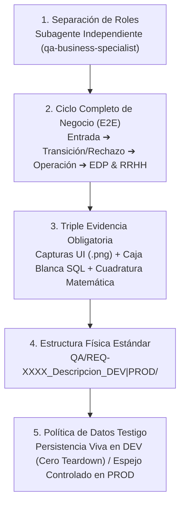

# 🛡️ Estándar Oficial LeanGlobal: Certificación QA End-to-End de Ciclo Completo de Negocio

> **Principio Fundamental del Ecosistema LeanGlobal:**  
> *"Una prueba que solo valida una pantalla o un endpoint aislado es una ilusión de calidad. Ningún requerimiento está certificado hasta que un Agente Especialista QA independiente comprueba el ciclo completo del negocio: desde el dato de entrada, pasando por sus rechazos, notificaciones y reglas de transición, hasta su impacto matemático real en la facturación al cliente (EDP) y en la liquidación de remuneraciones/incentivos de los trabajadores (RRHH), dejando los casos testigo vivos en DEV para inspección humana inmediata."*

---

## 1. Alcance y Propósito Transversal

Este estándar aplica de forma **obligatoria e inviolable** a todos los proyectos, verticales y tenants del ecosistema **LeanGlobal** (**Grúas San Pablo, Terracon, Transmac, Bachelet Monasterio, ALS, Besalco, Core Multi-Tenant**).

Su objetivo es erradicar las pruebas superficiales ("smoke tests", mocks estáticos o validaciones parciales de formulario) y establecer un **Protocolo de Certificación Integral de Negocio (End-to-End Business Certification)** como requisito previo a cualquier pase a Producción (`PROD`).

---

## 2. Los 5 Principios Inviolables de la Certificación QA LeanGlobal



---

### Principio 1: Separación Estricta de Roles (Subagente Especialista QA Independiente)

1. **Prohibición de Auto-Certificación del Desarrollador:**  
   El agente o ingeniero que escribe o modifica el código de una funcionalidad **no puede auto-certificar** su trabajo mediante una revisión superficial.
2. **Invocación Obligatoria de `qa-business-specialist`:**  
   Toda certificación QA debe ser ejecutada por un **Subagente Especialista en Pruebas de Negocio (`qa-business-specialist`)** operando bajo el principio de **Cero Confianza (Zero-Trust Auditing)**:
   - El subagente QA no asume que el código funciona porque "compiló sin errores".
   - Diseña casos de prueba adversarios (intentos de saltar bloqueos obligatorios, devoluciones con motivo, recálculos con valores de borde) y verifica empíricamente cada resultado en UI, API y Base de Datos.

---

### Principio 2: Pruebas Integrales de Ciclo Completo de Negocio (Prohibición de Pruebas Parciales)

Queda **estrictamente prohibido** limitar las pruebas de un requerimiento al componente donde se originó el cambio. Toda suite QA debe recorrer el **flujo de negocio de punta a punta (End-to-End)** a través de sus 4 eslabones:

| Eslabón del Ciclo | Qué se debe ejecutar y comprobar obligatoriamente |
| :--- | :--- |
| **1. Entrada Comercial / Origen** | Creación real del registro de negocio (Cotización, Oportunidad, Contrato o Requerimiento) con todos sus antecedentes base (ej. cliente, obra, distancias, líneas de servicio, tarifas pactadas). |
| **2. Gobernanza, Rechazos y Notificaciones** | • **Bloqueos Obligatorios (Negative Path):** Intentar avanzar de etapa omitiendo definiciones obligatorias (ej. Política Urbana/Rural sin responder) y comprobar que el sistema bloquea la transición.<br>• **Flujo de Rechazo / Devolución:** Ejecutar el rechazo o devolución formal verificando el registro obligatorio de **Motivo de Rechazo**, **Fecha/Hora de Devolución**, **Usuario Responsable**, visibilidad de alertas en pantalla y disparo de notificaciones omnicanal (`tnot_notification_log` / Correo / WhatsApp). |
| **3. Ejecución Operativa** | Avance formal del caso hacia asignación de recursos, despacho, ejecución en terreno y cierre de reportes operativos reales (horarios de salida, inicio, término, colación, standbys, horómetros/odómetros). |
| **4. Impacto Financiero (EDP) y Capital Humano (RRHH)** | • **Impacto en Cobro al Cliente (EDP / Facturación):** Verificar que las horas o unidades a cobrar al cliente se calculen exactamente según la política aplicada y las condiciones contractuales.<br>• **Impacto en Liquidación de Trabajadores (RRHH / Incentivos):** Verificar que el motor de remuneraciones/incentivos calcule exactamente los montos, horas de faena y horas de traslado de cada trabajador según el escenario probado (ej. bajo mínimo vs. sobre mínimo, urbano vs. rural). |

---

### Principio 3: Triple Evidencia Obligatoria (Visual + Caja Blanca BD + Cuadratura Matemática)

Ningún informe QA es válido si solo contiene texto descriptivo. Todo reporte de certificación debe incluir obligatoriamente **tres capas de evidencia verificable**:

1. **Evidencia Visual Real (`evidencia/*.png`):**  
   Capturas de pantalla reales tomadas con navegador automatizado (**Puppeteer / Playwright**) en cada hito crítico del flujo (estado inicial/bloqueo, modal de rechazo con fecha y motivo, banner de alerta tras devolución, selección de política/aprobación, y vista de resultados).
2. **Evidencia de Caja Blanca en Base de Datos (PostgreSQL):**  
   Consultas directas al esquema correspondiente (`sch_leangsp`, `sch_bch`, `sch_tmac`, etc.) extrayendo y mostrando en el informe:
   - Los `id` y folios reales generados en la base de datos.
   - Los bloques JSON persistidos (`json_field.crm_v1`, `json_field.ejecucion_v1`, historial de rechazos, etc.).
   - Los registros reales de auditoría y despacho en tablas de notificaciones (`tnot_notification_log`).
3. **Tablas de Cuadratura Matemática de Negocio:**  
   Tablas comparativas que enfrenten para cada escenario de negocio:
   - **Fórmula Teórica de la Especificación** vs. **Valor Esperado** vs. **Valor Obtenido del Backend/BD** vs. **Veredicto (`PASA` / `FALLA`)**.

---

### Principio 4: Estructura Física Estándar en el Directorio `QA/`

Cada certificación de un requerimiento o release debe almacenarse en una carpeta dedicada dentro del directorio raíz `QA/` del proyecto, diferenciando explícitamente el ambiente (`DEV` o `PROD`):

```text
QA/
└── REQ-XXXX_<Nombre_Corto_Requerimiento>_<DEV|PROD>/
    ├── REPORTE_QA_INTEGRAL_REQ-XXXX_<DEV|PROD>.md   # Informe ejecutivo y técnico con capturas embebidas, SQL y cuadraturas
    ├── run_qa_reqXXXX_<dev|prod>.cjs                # Script reproducible E2E (API + BD + Puppeteer)
    └── evidencia/                                   # Capturas de pantalla reales (.png) numeradas secuencialmente
        ├── 01_estado_inicial_bloqueo.png
        ├── 02_modal_rechazo_fecha_devolucion.png
        ├── 03_banner_devolucion_preventa.png
        ├── 04_politica_seleccionada_aprobada.png
        └── ...
```

---

### Principio 5: Política Diferenciada de Datos Testigo (`DEV` vs. `PROD`)

Los datos generados durante la certificación QA cumplen un rol distinto según el ambiente:

#### A. Ambiente de Desarrollo y Certificación (`DEV`) — **PROHIBIDO HACER TEARDOWN (PERSISTENCIA OBLIGATORIA)**
- **Cero Borrado de Casos Testigo:** En `DEV` queda **estrictamente prohibido** eliminar (`DELETE`) los registros creados por la batería de pruebas al finalizar la ejecución.
- **Propósito:** El usuario, Product Owner o revisor humano debe poder abrir la aplicación en `DEV` inmediatamente después de leer el informe y **ver con sus propios ojos** cada uno de los casos probados en las pantallas reales (Torre de Control, Gestor de Oportunidades, Reportes Diarios, Liquidación EDP/RRHH).
- **Identificación Clara y Tabla de Acceso Directo:**
  - Todo registro testigo debe llevar el prefijo visible `[QA-REQXXXX - ESCENARIO N]` en su nombre o glosa de obra/proyecto.
  - La sección 1 del informe `REPORTE_QA_INTEGRAL_REQ-XXXX_DEV.md` debe incluir obligatoriamente una **Tabla de Casos Testigo Vivos en DEV**, indicando para cada escenario:
    1. **Escenario de Negocio probado** (ej. *Escenario 1: Devuelto a Comercial con Motivo y Fecha*, *Escenario 2: Urbano Aprobado con Report y EDP*, *Escenario 3: Rural Bajo Mínimo*, *Escenario 4: Rural Sobre Mínimo*).
    2. **Folio / Código y `id` de Base de Datos** (ej. `COT-2026-848` / `id_proyecto = 848`).
    3. **Estado actual en que quedó dispuesto** para revisión.
    4. **URL directa clicable** hacia el ambiente `DEV` para abrir ese registro sin buscarlo manualmente.

#### B. Ambiente de Producción (`PROD`) — **EJECUCIÓN ESPEJO CONTROLADA POST-DESPLIEGUE**
- Una vez que el usuario aprueba la certificación en `DEV` y autoriza el despliegue a `PROD`, se ejecuta la suite espejo contra `PROD` (`QA/REQ-XXXX_<Descripcion>_PROD/`).
- En `PROD`, las pruebas validan la disponibilidad de endpoints, integridad de esquemas, motor de cálculo y flujos críticos bajo condiciones controladas que no contaminen la facturación contable ni disparen alertas falsas a clientes externos, documentando su resultado en `REPORTE_QA_INTEGRAL_REQ-XXXX_PROD.md`.

---

## 3. Plantilla Canónica del Informe `REPORTE_QA_INTEGRAL_REQ-XXXX_<DEV|PROD>.md`

Todo informe generado en `QA/REQ-XXXX_<Descripcion>_<DEV|PROD>/` debe contener obligatoriamente las siguientes 7 secciones:

1. **Ficha Ejecutiva y Tabla de Casos Testigo Vivos (con URLs Directas):**  
   Resumen de veredicto global (`100% PASA` / `FALLA`), fecha/hora, versión auditada y tabla de los registros reales dejados en el sistema para inspección directa del usuario.
2. **Matriz de Cobertura End-to-End:**  
   Detalle de todos los casos de prueba ejecutados cubriendo Entrada, Gobernanza/Rechazos/Notificaciones, Operación, Cobro Cliente (EDP) y Pago Trabajador (RRHH).
3. **Auditoría de Gobernanza, Validaciones Obligatorias y Flujo de Rechazo/Devolución:**  
   Evidencia de bloqueo ante campos obligatorios omitidos, captura del modal de rechazo con fecha y motivo, captura de los banners de alerta y traza en `tnot_notification_log`.
4. **Cuadratura Matemática de Cobro al Cliente (EDP / Facturación):**  
   Tabla comparativa con los reportes horarios reales inyectados y la demostración exacta del cobro según la política aplicada (ej. Urbano desde salida de base a término en obra vs. Rural desde inicio a término en obra).
5. **Cuadratura Matemática de Liquidación de Trabajadores (RRHH / Incentivos):**  
   Tabla comparativa demostrando el cálculo de horas de faena, horas de traslado y montos en `$` para todos los casos de borde (ej. Urbano con $0 traslado, Rural con horas reales menores al mínimo pagando solo diferencia positiva, y Rural con horas reales mayores o iguales al mínimo).
6. **Evidencia de Caja Blanca en Base de Datos (PostgreSQL):**  
   Volcado real de las consultas SQL sobre las tablas de negocio y `json_field` de los casos testigo.
7. **Galería de Evidencia Visual Automatizada (`evidencia/*.png`):**  
   Capturas de pantalla reales embebidas en el documento Markdown.
