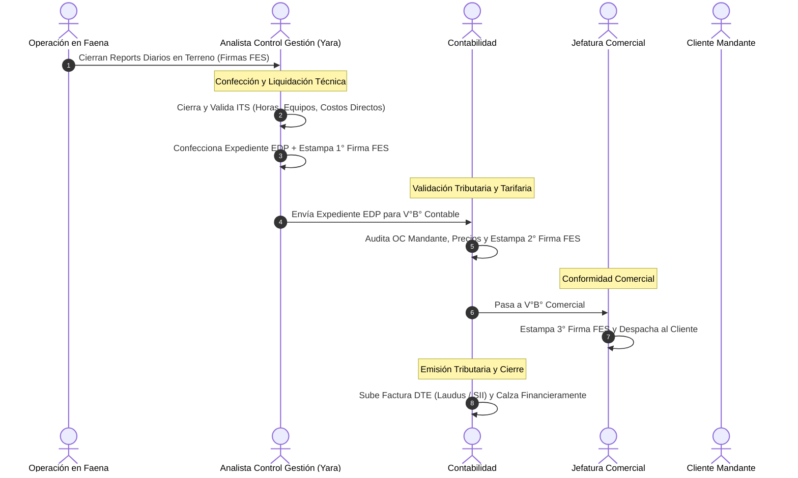

# 📐 Especificación Técnica: Rediseño UX/UI de Perspectiva Contabilidad — Bandejas Operativas por Tarea y Primary Call-to-Action (Spec 102)

**Documento:** `102_usabilidad_bandejas_y_cta_contabilidad_spec.md`  
**Ecosistema:** Grúas San Pablo (GSP) / LeanGlobal Platform  
**Módulo:** Perspectiva Contabilidad & BI Financiero (`PerspectivaContabilidad.vue`)  
**Requerimiento Asociado:** `REQ-1073`  
**Estado:** `CANÓNICO VIGENTE`  
**Versión:** `v1.0.0`  
**Fecha:** 26 de Octubre de 2026  

---

## 1. 📌 Objetivo de Negocio y Fundamento UX

### 1.1. Diagnóstico del Problema
La tabla de procesos en `PerspectivaContabilidad.vue` presentaba una alta densidad informativa (7 columnas con múltiples montos y gráficos), pero sufría de:
1. **Sobrecarga Cognitiva (Ley de Hick):** Entre 6 y 9 elementos cliqueables por fila con el mismo peso visual tenue, provocando "parálisis por análisis".
2. **Affordance Plano:** La interfaz funcionaba como consola de auditoría pasiva, sin clarificar cuál es el próximo paso del usuario contable.
3. **Ruptura Espacial Estado vs. Acción:** El badge de estado se mostraba al extremo derecho (`Calce Financiero`), mientras que el botón para subir la factura estaba en la columna previa (`Facturado DTE`).

### 1.2. Principio Rector: "La Regla de los 2 Segundos"
El usuario de Contabilidad debe identificar y ejecutar su trabajo pendiente en menos de 2 segundos al ingresar a la pantalla:
1. **Segundo 0.5:** Observa la pestaña activa con contador: `[ 🟢 Por Facturar (X) ]`.
2. **Segundo 1.0:** La tabla se filtra instantáneamente mostrando solo las OTs que exigen emisión de DTE.
3. **Segundo 1.5:** La columna derecha destaca con un único botón primario sólido de alto contraste (`Primary CTA`): `[ 🧾 Subir Factura DTE ($X.XXX.XXX) ]`.
4. **Segundo 2.0:** Hace clic en el botón y arrastra el PDF de Laudus / SII al dropzone automático con blindaje anti-descalce.

---

## 2. 🏛️ Gobernanza y Segregación Estricta de Funciones (Internal Controls)

Queda estrictamente ratificada la separación de roles y responsabilidades en el circuito financiero:



1. **ITS:** Confirma horas de faena, equipos y costos directos. Responsabilidad exclusiva del **Analista de Control de Gestión / Jefatura de Operaciones**.
2. **EDP:** Prefactura comercial. Confeccionada por el **Analista** con la **1° Firma FES**.
3. **Contabilidad:**
   - **Valida el EDP** con la **2° Firma FES**.
   - **Emite la Factura DTE** cuando el EDP está visado y la OC está cargada (o el cliente está exento).
4. **Comercial:** Estampa la **3° Firma FES** de conformidad comercial antes o en paralelo al envío al cliente.

---

## 3. 🖥️ Diseño de Interfaz y Nuevos Componentes UX

### 3.1. Barra de Bandejas Operativas por Tarea (Task Buckets)
En la parte superior de la tabla de procesos, se reemplaza la botonera genérica por 5 pestañas de trabajo con contadores reactivos:

| Pestaña | Clave de Estado | Condición Reactiva | Estilo / Identificador |
| :--- | :--- | :--- | :--- |
| **1. Por Facturar** | `POR_FACTURAR` | `p.habilitado_facturar && !p.facturado` | `bg-emerald-500/20 text-emerald-300 border-emerald-500/40` |
| **2. Mi Firma EDP Pendiente** | `FIRMA_CONTABILIDAD` | `!p.firma_2_contabilidad && p.firma_1_analista` | `bg-amber-500/20 text-amber-300 border-amber-500/40` |
| **3. Esperando OC Cliente** | `FALTA_OC` | `p.requiere_oc_hes && !p.tiene_oc && p.monto_devengado_reports > 0` | `bg-orange-500/20 text-orange-300 border-orange-500/40` |
| **4. Facturadas Conforme** | `FACTURADAS` | `p.facturado` | `bg-blue-500/20 text-blue-300 border-blue-500/40` |
| **5. Cartera Total** | `TODAS` | Sin filtro de estado | `bg-slate-800 text-slate-300 border-white/10` |

### 3.2. Rediseño de la Tabla de Procesos (5 Columnas)

```
┌────────────────────────────────┬────────────────────────┬─────────────────────────┬──────────────────────┬─────────────────────────────────────┐
│ 1. Proceso / Mandante / Avance │ 2. Compromiso vs Oper. │ 3. Respaldo Documental  │ 4. Saldo por Facturar│ 5. ACCIÓN REQUERIDA (1 CLIC)        │
└────────────────────────────────┴────────────────────────┴─────────────────────────┴──────────────────────┴─────────────────────────────────────┘
```

1. **Columna 1: Proceso / Mandante / Mini-Sparkline:**
   - Código de OT con enlace directo al PDF Oficial de Cotización Comercial (`p.codi_proyecto ↗`).
   - Nombre de Cliente, Obra y Etiqueta de Semana.
   - Mini-gráfico de 5 barras verticales con tooltip interactivo de montos.
2. **Columna 2: Compromiso vs Operado:**
   - Monto comprometido (Cotización) en CLP.
   - Monto devengado en Reports Diarios y horas operadas.
3. **Columna 3: Respaldo Documental (3 Micro-Badges de Salud):**
   - **OC:** `[📎 OC #12990 ↗]` o `[⚠️ Falta OC]` o `[Exenta OC]`.
   - **ITS:** `[📊 ITS #83 ↗]` o `[S/ITS]`.
   - **EDP:** `[📑 EDP-105 ↗]` con circuito FES `[🔏 FE 2/3]`.
4. **Columna 4: Saldo por Facturar & Desviación:**
   - Saldo pendiente neto en CLP.
   - Porcentaje de variación devengado vs comprometido.
5. **Columna 5: ACCIÓN REQUERIDA (Primary CTA de 1 Clic):**
   - **Caso A (Listo para facturar):** Botón verde esmeralda sólido con sombra:
     `[ 🧾 Subir Factura DTE ($X.XXX.XXX) ]` ➔ Abre directo dropzone DTE.
   - **Caso B (Falta firma de Contabilidad):** Botón ámbar sólido:
     `[ ✍️ Visar EDP (2° Firma FES) ]` ➔ Abre diálogo de firma FES.
   - **Caso C (Falta OC Mandante):** Botón ámbar secundario:
     `[ ⚠️ Cargar OC Mandante ]` ➔ Abre modal de carga de OC.
   - **Caso D (100% Facturado):** Botón gris sobrio:
     `[ ✅ Facturado Conforme (DTE #... ↗) ]` ➔ Abre PDF oficial de la factura.
   - **Caso E (En Faena / Esperando Liquidación):** Badge neutro:
     `[ ⏱️ En Faena / Reports ]`.

---

## 4. 📚 Incorporación del Diagrama de Secuencia en la Web Documental

El diagrama de secuencia del circuito de 3 firmas y segregación de funciones se incorpora de forma textual y nativa en:
1. `ejecucion/frontend/public/manual_contabilidad_edp_y_facturacion_gsp.html` (Bloque 2).
2. `ejecucion/frontend/public/manual_perspectiva_contabilidad_bi_y_facturacion_gsp.html` (Sección 2).

Ambos manuales se configuran con la librería Mermaid (`https://cdn.jsdelivr.net/npm/mermaid@10/dist/mermaid.min.js`) con tema dark corporativo para renderizado SVG nativo.
