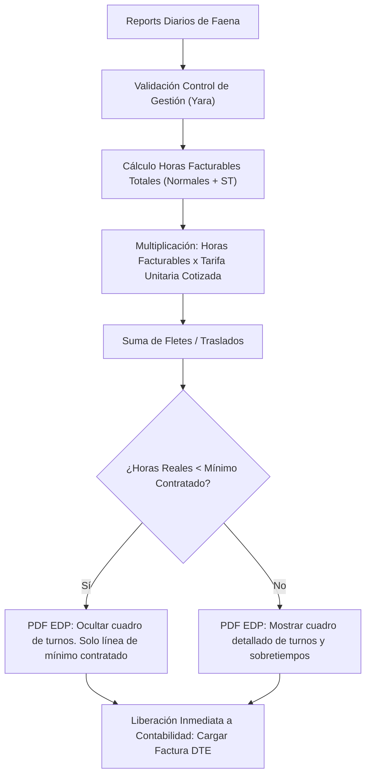

# 📐 Especificación Técnica: Desacople de Facturación EDP, Cuadre Tensacon y Regla de Horas Mínimas en PDF (Spec 103)

**Documento:** `103_desacople_edp_cuadre_tensacon_y_regla_horas_minimas_spec.md`  
**Ecosistema:** Grúas San Pablo (GSP) / LeanGlobal Platform  
**Módulos:** `estadoPagoController.js`, `edpPdfService.js`, `PerspectivaContabilidad.vue`  
**Requerimiento Asociado:** `REQ-1075`  
**Estado:** `CANÓNICO VIGENTE`  
**Versión:** `v1.0.0`  
**Fecha:** 26 de Octubre de 2026  
**Origen:** Acuerdos formales de reunión 2026-10-26 con Maritza Seguel y Jorge Ponce  

---

## 1. 📌 Objetivos y Diagnóstico de Negocio

### 1.1. Erradicación del Defecto Tensacon (`GSP-2610-233-004`)
* **Diagnóstico:** El controlador `estadoPagoController.js` contenía un valor hardcodeado de `$65.000` para sobretiempos, provocando dos errores críticos:
  1. **Tarifa Incongruente:** En servicios de grúas pesadas (ej. 90 Ton a `$150.000/hr`), el PDF mostraba recargos a `$65.000/hr`, lo cual generó el rechazo inmediato de Contabilidad.
  2. **Doble Imputación Matemática:** Las horas de sobretiempo de los reports ya formaban parte de las `horas_facturables` (ej. 38 hrs totales = 36 normales + 2 ST). Al cobrar $38 \times \$150.000 = \$5.700.000$ y adicionalmente sumar $2 \times \$65.000 = \$130.000$, se duplicaba el cobro de esas 2 horas, inflando el neto a `$6.780.000` frente a los `$6.650.000` reales del ITS.
* **Solución Spec 103:** Erradicar cualquier número quemado (`65000`). Las horas facturables consolidadas ya liquidan el total de horas a la tarifa unitaria pactada (`valorUnitario * totalHorasFact`). Solo se agregará una línea de recargo si la cotización estipula expresamente un factor multiplicador de sobretiempo o si existe un ajuste autorizado por Tesorería.

### 1.2. Desacople Total del Estado de Pago y Eliminación de Firma Contable
* **Decisión:** Contabilidad (Maritza) no debe firmar el EDP. La responsabilidad de Contabilidad es emitir la Factura Legal DTE (Laudus / SII).
* **Flujo:** Al validar los Reports Diarios en terreno por Control de Gestión (Yara), el EDP se autogenera y **se libera automáticamente a estado "Listo para Facturar"** (si tiene OC de Comercial o es exento), sin esperar la elaboración ni el cierre del ITS.
* **Frontend:** Se elimina la pestaña `[ 🟡 Mi Firma EDP ]` y el botón de visación contable en `PerspectivaContabilidad.vue`.

### 1.3. Regla de Protección Comercial en el PDF del EDP (Horas Mínimas)
* **Problema:** Mostrar turnos de 3 o 4 horas en el desglose cuando se factura el mínimo contratado de 9 horas provocaba discusiones comerciales con clientes mandantes.
* **Regla:**
  - Si $\text{Horas Trabajadas en Faena} < \text{Horas Mínimas Contratadas}$: **Ocultar el cuadro de desglose horario de turnos en el PDF del cliente**. Mostrar únicamente la línea consolidada: `Servicio de Grúa (Tarifa Mínima Contratada): X Horas a $Y = $Total`.
  - Si $\text{Horas Trabajadas} \ge \text{Horas Mínimas}$: Mostrar el cuadro completo con fechas, horarios y sobretiempos.

### 1.4. Inclusión del Vendedor en el EDP y Exportaciones
* Incluir visiblemente `vendedor_nombre` en el encabezado del EDP y en las columnas de exportación a Excel para la liquidación de comisiones contables.

---

## 2. 🏛️ Arquitectura de Datos y Reglas de Cálculo

---

## 3. 📝 Matriz de Cambios por Archivo

| Archivo | Ubicación | Modificación |
| :--- | :--- | :--- |
| `estadoPagoController.js` | Líneas 280-295 y 2055-2065 | Erradicar `65000`. Evitar doble suma de sobretiempo sobre `totalHorasFact`. Incluir `vendedor_nombre` en payload de EDP. Desacoplar liberación a `LISTO_FACTURAR`. |
| `edpPdfService.js` | Líneas 120-155 | Implementar condicional: si `horas_operadas < horas_minimas`, omitir la tabla de jornadas horarias y desplegar banner de horas mínimas garantizadas. Mostrar Vendedor en cabecera. |
| `PerspectivaContabilidad.vue` | Pestañas y Tabla | Remover botón de visar EDP para Contabilidad y pestaña `Mi Firma EDP`. Pasar a 4 bandejas operativas limpias: `Por Facturar`, `Retenidas por OC`, `Facturadas` y `Todas las OTs`. |

---

## 4. 🧪 Criterios de Aceptación y Auditoría QA
1. **Caso Tensacon Cuadrado:** El EDP de `GSP-2610-233-004` debe calcular exactamente `$6.650.000 Neto` ($38\text{ hrs} \times \$150.000 + \$950.000\text{ traslado}$), calzando al centavo con el ITS.
2. **Cero Números Mágicos:** `git grep 65000` en backend debe arrojar 0 coincidencias en lógica de sobretiempos.
3. **PDF Tensacon:** Al tener días con horas menores al mínimo (7.42, 8.0, 8.8), el PDF debe aplicar la regla acordada protegiendo la presentación comercial.
4. **Vendedor Visible:** `vendedor_nombre` desplegado en la carátula oficial del EDP.
