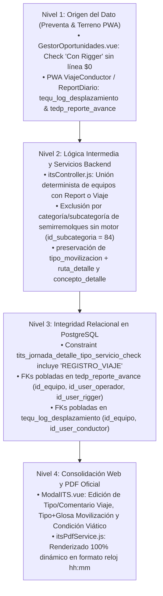

# 📐 Especificación Técnica Canónica: SPEC-125 / REQ-1144
## Gobernanza Integral del ITS en Servicios a Valor Fijo (Suma Alzada), Regla Determinista de Flota con Report/Viaje, Campos de Registro de Viaje y Glosas Operacionales de Sección 3 (Web & PDF Oficial)

* **Identificador de Especificación:** `SPEC-125`
* **Requerimientos Asociados:** `REQ-1144` (y cierre de `REQ-1137`)
* **Caso de Soporte Vinculado:** `CASO-20261109-05`
* **Ecosistema:** Grúas San Pablo (GSP) / LeanGlobal Platform
* **Módulos Impactados:**
  * **Preventa / Estructurador Comercial:** `ejecucion/frontend/src/components/GestorOportunidades.vue`, `ejecucion/backend_remoto/src/models/proyectoModel.js`
  * **Controlador y Motor de Liquidación ITS:** `ejecucion/backend_remoto/src/controllers/itsController.js`
  * **Generador Documental PDF Oficial ITS:** `ejecucion/backend_remoto/src/services/itsPdfService.js`
  * **Cockpit PMO — Editor de ITS:** `ejecucion/frontend/src/components/Operaciones/ModalITS.vue`
  * **Esquema Relacional PostgreSQL:** `sch_leangsp_prod` y `sch_leangsp` (`tits_jornada_detalle`, `tits_costo_operacional`, `tedp_reporte_avance`, `tequ_log_desplazamiento`, `tpry_rel_persona`, `tpry_proyecto`)
* **Versión de Liberación:** `v1.0.206`
* **Fecha de Formalización:** 2026-11-09
* **Fuentes de Entrada (Acuerdos de Reunión):**
  1. [Reunión Sesión 1 (15:08 GMT-03:00 — Yiara Mendoza & Sergio Gajardo)](https://docs.google.com/document/d/1xR4r11l9rU2g0G3s1vK4N9n0x8_X-2q1pY7wZ3mB5vA/edit)
  2. [Reunión Sesión 2 (17:44 GMT-03:00 — Yiara Mendoza, Jorge Ponce & Sergio Gajardo)](https://docs.google.com/document/d/1mP8kL5vT9wQ2xR4n7yJ6c3bF1hG0zD8sA5eW9uV2qX4/edit)
  3. [Reunión Sesión 3 (19:01 GMT-03:00 — Yiara Mendoza & Sergio Gajardo)](https://docs.google.com/document/d/1b3T5JBFVpVQW6714AXK7C5NYqF3-pBptSBppm_JcN8g/edit?usp=drive_web&tab=t.pztk7bx3x5ad)
  4. Minuta Consolidada 360°: [20261109-Reunión-Validación-ITS-Servicios-Fijos-Registros-Viaje-Y-Glosas-Yiara.md](file:///d:/SGajardo/Google%20Drive/Antigravity/Gr%C3%BAas%20San%20Pablo/Propuesta%20Gesti%C3%B3n%20Operaci%C3%B3n%20Gr%C3%BAas/antecedentes_reuniones/reuniones/20261109-Reuni%C3%B3n-Validaci%C3%B3n-ITS-Servicios-Fijos-Registros-Viaje-Y-Glosas-Yiara.md)
* **Estado:** `CANÓNICO VIGENTE — IMPLEMENTADO Y CERTIFICADO EN DEV & PROD`

---

## 1. Contexto de Negocio y Problemas Estructurales Resueltos

Durante las tres sesiones de revisión y certificación en vivo del **09 de noviembre de 2026** sobre el Informe de Término de Servicio (ITS) de la **OT 32 (`GSP-2611-00003` — Gerardo Barthou, servicio a Valor Fijo por `$1.000.000`)** y la **OT 30 (`GSP-2611-00001` — Ferrocarriles del Pacífico S.A., servicio por horas mínimas)**, se definieron y acordaron formalmente las siguientes reglas de negocio e invariantes de arquitectura:

1. **Invariante Comercial de Preventa ("Con Rigger" incluido vs. Línea Comercial Adicional):**
   - Marcar el check técnico `"Con Rigger"` en una línea de equipo indica que el servicio requiere operativamente un Rigger en la tripulación (incluido dentro de la tarifa del equipo), **no** que deba inyectarse una línea comercial separada a `$0` en la cotización ni en el ITS.
   - Si una cotización histórica contenía una línea de Rigger a `$0` sin horas propias en un servicio a Valor Fijo, el motor del ITS no debe heredarle el monto global del negocio (`$1.000.000`), evitando duplicar ficticiamente la venta proyectada (`$2.000.000`).

2. **Modalidad Contractual `Valor Fijo (Suma Alzada)` en ITS (Web y PDF Oficial):**
   - Los contratos pactados a `Valor Fijo` (`VALOR_FIJO` / `SUMA_ALZADA` / `SERVICIO`) **no tienen piso mínimo de horas diarias** (`horas_minimas_diarias = 0`).
   - En la **Sección 1** del ITS y su PDF Oficial debe declararse explícitamente:
     - `TIPO DE SERVICIO`: `SERVICIO VALOR FIJO (SUMA ALZADA)`
     - `HORAS MÍNIMAS PACTADAS`: `NO APLICA (VALOR FIJO)`
     - `VALOR SERVICIO FIJO`: `$1.000.000 (VALOR FIJO)`
   - En la **Sección 2** (*Control de Flota y Conciliación de Horas*), la grúa principal registra las horas físicas reales (`HRS SERVICIO` y `HRS VIÁTICOS`) para control de costos y viáticos, pero su columna `HRS REPORT (Facturables)` es `00:00` con leyenda `Valor Fijo (S/Mín.)`.

3. **Regla Determinista de Despliegue de Flota en Sección 2 (Exclusión de Semirremolques sin Registro):**
   - En la Sección 2 del ITS (Web y PDF) **solo deben desplegarse los vehículos motorizados que posean un Report Diario (`tedp_reporte_avance`) y/o un Registro de Viaje (`tequ_log_desplazamiento`) activo en el proyecto**.
   - Las plataformas, camas bajas o semirremolques no motorizados (`id_subcategoria = 84` o tipos `SEMIRREMOLQUE`, `CAMA BAJA`, `RAMPLA` sin motor, como `JC.2796-2`) carecen de chofer y de bitácora de viaje propia; por tanto, **nunca deben aparecer como fila en la Sección 2** ni reemplazar al tracto camión (`RWJL.23-K`) que ejecutó efectivamente el desplazamiento.

4. **Atributos Obligatorios en Filas de `Registro de Viaje` (Sección 2):**
   - Para todo vehículo de apoyo/traslado cuyo origen sea un `Registro de Viaje` (`tequ_log_desplazamiento`, ej. Tracto Camión `RWJL.23-K`), el sistema debe exponer y persistir dos campos editables adicionales tanto en el editor Web (`ModalITS.vue`) como en el PDF Oficial (`itsPdfService.js`):
     1. **`tipo_viaje` (`Tipo de Viaje / Desplazamiento`):** Selector con opciones `IDA_Y_RETORNO` (`Ida y Retorno`), `SOLO_IDA` (`Solo Ida`), `SOLO_RETORNO` (`Solo Retorno`), `APOYO_CONTRAPESOS` (`Apoyo / Contrapesos`).
     2. **`comentario_viaje` (`Comentario / Glosa del Viaje`):** Campo de texto editable sincronizado con `tequ_log_desplazamiento.obs_termino` y `tits_jornada_detalle.observaciones`.
   - La restricción de base de datos `tits_jornada_detalle_tipo_servicio_check` debe admitir el valor `'REGISTRO_VIAJE'` además de `'OPERACION'`, `'FLETE_IDA'`, `'FLETE_RETORNO'` y `'FLETE_IDA_VUELTA'`.

5. **Glosas Operacionales y Roles en Sección 3 (*Desglose de Costos Operacionales Directos*):**
   - **Movilización y Traslados (`movilizacion`):** El selector de `Tipo de Movilización` (`UBER / TAXI`, `PASAJE BUS`, `CAMIONETA APOYO`, `TRASLADO INTERNO`, `OTRO`) **no debe sobrescribir** la glosa/ruta personalizada digitada por el analista (`ruta_detalle`). Ambos campos deben almacenarse por separado (`tipo_movilizacion` y `ruta_detalle`) y mostrarse simultáneamente en el PDF bajo el formato: `[Tipo Movilización] — [Glosa / Ruta]`.
   - **Viático de Alimentación (`alimentacion`):** La columna `Condición de Movimiento Día` (`concepto_detalle`) debe ser un campo editable (`<input list="datalist-condicion-viatico">`) que permita a la analista ajustar la glosa cuando la condición operativa varíe y se refleje íntegramente en el PDF Oficial.
   - **Costo Valor Hora Operador (`costo_hora_operador`) y Rol `RIGGER`:**
     - El personal con rol `RIGGER` tiene sueldo fijo mensual (`$0` pago por hora de report / `tarifa_no_aplica = true`). Su fila debe conservar explícitamente el rol `RIGGER` (nunca ser reclasificada como `Conductor` ni `Operador`) y mostrar `$0 (Sueldo Fijo)` cuando no tenga bono extraordinario.
     - Exclusión de choferes de camión en la precarga automática de viáticos de alimentación (`REQ-1137`), salvo cuando corresponda por jornada puerta a puerta validada o ingreso manual de Operaciones.
   - **Formato Reloj Universal `hh:mm`:** Todas las columnas de horas (`HRS SERVICIO`, `HRS VIÁTICOS`, `HRS REPORT`, `HRS OPERACIÓN`, `HRS FLETE`) y los subtotales de las tablas del ITS deben formatearse en reloj sexagesimal `hh:mm` (`02:38`, `03:40`, `07:21`).

---

## 2. Arquitectura de 4 Niveles ("Cero Parches" y Cero Hardcoding)

En cumplimiento estricto de la regla constitucional [resolucion_de_fondo_cero_parches.md](file:///d:/SGajardo/Google%20Drive/Antigravity/Gr%C3%BAas%20San%20Pablo/Propuesta%20Gesti%C3%B3n%20Operaci%C3%B3n%20Gr%C3%BAas/.agents/rules/resolucion_de_fondo_cero_parches.md), queda **absolutamente prohibido** el uso de patentes (`PJYY.20-1`, `RWJL.23-K`, `JC.2796-2`, `VCTR.81-9`) o nombres/IDs de trabajadores (`Robert Rodríguez`, `Luis Mercado`, `Matías Barrales`, `Alfonso Maldonado`) codificados en duro en el código fuente. Toda resolución sigue el flujo relacional de 4 niveles:



### 2.1. Nivel 1: Origen del Dato (Preventa y Captura Operativa)
1. **`GestorOportunidades.vue` (`onRequiereRiggerChange`):**
   - Al marcar `"Con Rigger"` en una línea de grúa, se activa el indicador técnico de requerimiento operativo de Rigger (`requiere_rigger = 'SI'`), sin insertar automáticamente una línea comercial separada con precio `$0`.
2. **`proyectoModel.js` (`generarCotizacionVersion`):**
   - Filtra cualquier línea auxiliar con `precioUnitario === 0` que duplique un atributo ya incluido en la máquina principal (`CON RIGGER`), evitando líneas fantasma en el PDF de cotización.

### 2.2. Nivel 2: Lógica Intermedia y Servicios (`itsController.js`)
1. **Detección Determinista de Flota (`consolidarMovimientosProyecto`):**
   - Consulta `tedp_reporte_avance` (reports de operación) y `tequ_log_desplazamiento` (registros de viaje de tracto camiones y vehículos motorizados) vinculados a `id_proyecto`.
   - Evalúa `esAccesorioSinMotor(eq)` verificando `Number(eq.id_subcategoria) === 84` o coincidencia taxonómica de catálogo (`SEMIRREMOLQUE`, `CAMA BAJA`, `RAMPLA`) cuando carece de `tedp_reporte_avance` y `tequ_log_desplazamiento` propios.
   - Si un equipo tiene registros en `tedp_reporte_avance`, se clasifica con `origen_registro = 'REPORT_DIARIO'`.
   - Si un equipo tiene únicamente registros en `tequ_log_desplazamiento`, se clasifica con `origen_registro = 'REGISTRO_VIAJE'` y `tipo_servicio = 'REGISTRO_VIAJE'`, exponiendo `tipo_viaje` y `comentario_viaje`.
2. **Resolución de Tripulación desde Tablas Relacionales:**
   - El operador titular de cada equipo se resuelve desde `tedp_reporte_avance.id_user_operador` $\rightarrow$ `tpry_rel_persona` $\rightarrow$ `ejecucion_v1.tripulacion_asignada`.
   - El conductor del vehículo de apoyo se resuelve desde `tequ_log_desplazamiento.id_user_conductor` $\rightarrow$ `tpry_rel_persona` (`CONDUCTOR` / `CHOFER`).
   - El Rigger se resuelve desde `tedp_reporte_avance.id_user_rigger` $\rightarrow$ `tpry_rel_persona` (`RIGGER`).

### 2.3. Nivel 3: Integridad de Base de Datos PostgreSQL (`sch_leangsp_prod` & `sch_leangsp`)
1. **Constraint `tits_jornada_detalle_tipo_servicio_check`:**
   ```sql
   ALTER TABLE sch_leangsp_prod.tits_jornada_detalle
     DROP CONSTRAINT IF EXISTS tits_jornada_detalle_tipo_servicio_check;
   ALTER TABLE sch_leangsp_prod.tits_jornada_detalle
     ADD CONSTRAINT tits_jornada_detalle_tipo_servicio_check
     CHECK (tipo_servicio::text = ANY (ARRAY[
       'OPERACION'::character varying,
       'FLETE_IDA'::character varying,
       'FLETE_RETORNO'::character varying,
       'FLETE_IDA_VUELTA'::character varying,
       'REGISTRO_VIAJE'::character varying
     ]::text[]));
   ```
   *(Aplicado de forma idéntica en `sch_leangsp.tits_jornada_detalle`).*
2. **Estructura JSONB en `tits_costo_operacional.detalle_json`:**
   - Para categoría `movilizacion`: almacena `{ tipo_movilizacion, ruta_detalle, trabajador_nombre, patente, fecha }`.
   - Para categoría `alimentacion`: almacena `{ concepto_detalle, condicion_label, trabajador_nombre, rol, horas_viatico, fecha }`.
   - Para categoría `costo_hora_operador`: almacena `{ trabajador_nombre, rol, es_rigger, tarifa_no_aplica, horas_operacion, horas_flete, valor_hora, fecha }`.

### 2.4. Nivel 4: Consolidación en Interfaz Web (`ModalITS.vue`) y PDF (`itsPdfService.js`)

| Sección / Componente | Comportamiento en `ModalITS.vue` (Web) | Comportamiento en `itsPdfService.js` (PDF Oficial) |
| :--- | :--- | :--- |
| **Sección 1: Ficha del Servicio (Valor Fijo)** | Muestra `SERVICIO VALOR FIJO (SUMA ALZADA)`, `Piso Mínimo: No Aplica (Valor Fijo)` y monto fijo pactado sin líneas fantasma a `$0`. | Imprime `SERVICIO VALOR FIJO (SUMA ALZADA)`, `HORAS MÍNIMAS PACTADAS: NO APLICA (VALOR FIJO)` y en tabla de equipos `SIN MÍNIMO (VALOR FIJO)` con `$1.000.000 (VALOR FIJO)`. |
| **Sección 2: Flota y Registro de Viaje** | Despliega únicamente equipos con Report Diario o Registro de Viaje. Para filas `REGISTRO_VIAJE`, habilita selector `j.tipo_viaje` e input `j.comentario_viaje`. | Imprime bloque de cada equipo activo con su Chofer/Operador real y Rigger asociado. En vehículos con Registro de Viaje imprime `REGISTRO DE VIAJE (TRACTO CAMIÓN)` junto con `[Tipo de Viaje] — [Comentario]`. |
| **Sección 3.1: Viático Alimentación** | Columna `Condición Movimiento Día` renderizada como `<input type="text" v-model="it.concepto_detalle" list="datalist-condicion-viatico" />`. | Columna `CONDICIÓN / MOVIMIENTO DÍA` imprime el valor exacto de `concepto_detalle` / `condicion_label` editado por la analista, con horas en formato reloj `hh:mm`. |
| **Sección 3.2: Hora Operador y Rigger** | Selector de rol (`OPERADOR`, `RIGGER`, `CONDUCTOR`). Para `RIGGER` mantiene tarifa `$0 (Sueldo Fijo)` salvo bono manual. | Imprime la fila con su rol real (`Operador`, `Rigger`, `Conductor`), horas en formato `hh:mm` (`02:38`, `03:40`) y `$0 (Sueldo Fijo)` para Rigger sin bono. |
| **Sección 3.5: Movilización y Traslados** | Selector `it.tipo_movilizacion` + input independiente `it.ruta_detalle` sincronizados vía `sincronizarGlosaMovilizacion(it)`. | Columna `RUTA / DETALLE DE TRASLADO` imprime simultáneamente `${tipo_movilizacion} — ${ruta_detalle}` (ej. `UBER / TAXI — Traslado personal retorno de planta a domicilio`). |

---

## 3. Criterios de Aceptación y Verificación Determinista

1. **Cero Hardcoding en Código Fuente:** Ningún archivo de `ejecucion/backend_remoto/` ni `ejecucion/frontend/` puede contener patentes ni nombres de trabajadores literales para resolver datos de OTs.
2. **Exactitud en OT 32 (`GSP-2611-00003`):**
   - Sección 1 muestra únicamente la Grúa 100 Ton (`PJYY.20-1`) con `SIN MÍNIMO (VALOR FIJO)` y `$1.000.000 (VALOR FIJO)`.
   - Sección 2 muestra únicamente `PJYY.20-1` (Operador: Robert Rodríguez, Rigger: Matías Barrales, `HRS SERVICIO: 02:38`, `HRS VIÁTICOS: 03:40`, `HRS REPORT: 00:00`) y el Tracto Camión `RWJL.23-K` (Conductor: Luis Mercado, `REGISTRO DE VIAJE`, `HRS VIÁTICOS: 07:21`), sin la rampla `JC.2796-2`.
   - Sección 3 muestra simultáneamente el tipo y la glosa de movilización (`UBER / TAXI — ...`), la condición editable de viáticos de alimentación y los roles exactos (`Operador`, `Rigger`, `Conductor`).
3. **Compilación y Despliegue con Hard Gate:**
   - `package.json` incrementado a `1.0.206`.
   - Entrada formal en `RELEASE_LOG.md` y `Gestión/tareas.md` (`REQ-1144`).
   - Registro sincronizado en `tcfg_backlog` y `tcfg_releases` en `sch_leangsp` (`DEV`) y `sch_leangsp_prod` (`PROD`).
