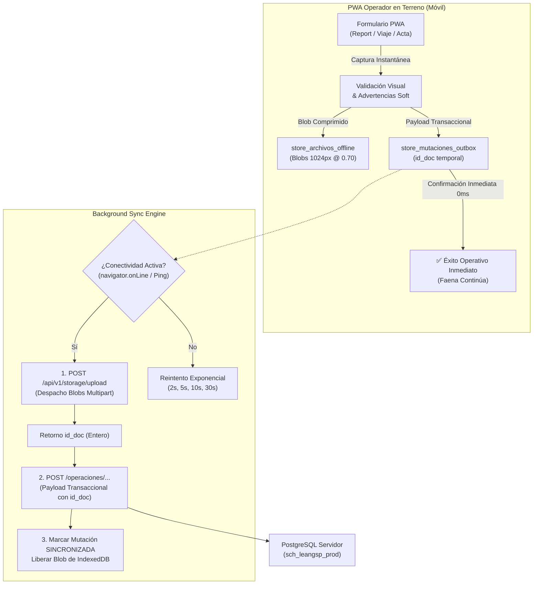
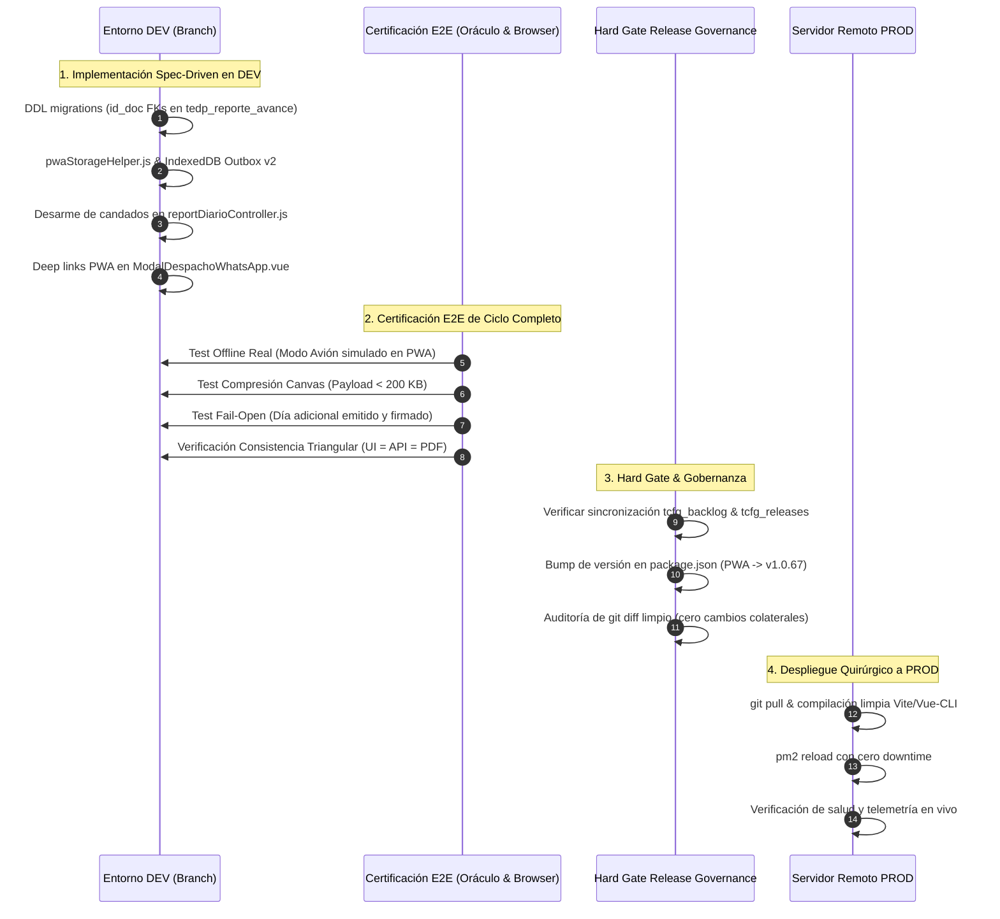

# 📐 Especificación Técnica de Reingeniería Arquitectónica PWA: Offline-First Real, LG-Storage Standard y Filosofía Fail-Open en Terreno (Spec 133)

**Documento:** `133_reingenieria_pwa_offline_first_storage_y_desbloqueo_operativo_spec.md`  
**Ecosistema:** Grúas San Pablo (GSP) / LeanGlobal Platform  
**Componentes Involucrados:**  
* PWA Terreno: `ejecucion/pwa/` (`ReportDiarioIzaje.vue`, `ViajeConductor.vue`, `Surveys.vue`, `utils/viajeOfflineSync.js`, `utils/pwaStorageHelper.js`)  
* Frontend Torre de Control: `ejecucion/frontend/` (`views/CRM/GestorOportunidades.vue`, `views/Torre.vue`, `components/Operaciones/ModalDespachoWhatsApp.vue`)  
* Backend API & Services: `ejecucion/backend_remoto/` (`reportDiarioController.js`, `viajeController.js`, `viajeModel.js`, `storageController.js`, `notificacionService.js`, `actaPlataformaController.js`)  
* Esquema BD: PostgreSQL `sch_leangsp` / `sch_leangsp_prod` (`tedp_reporte_avance`, `tequ_log_desplazamiento`, `tbsm_acta_plataforma`, `tfmg_file`)  
**Versión Base:** `v1.0.66` (PROD & DEV)  
**Estado:** `ESPECIFICACIÓN FORMAL DE INGENIERÍA (SPEC-DRIVEN)`  
**Fecha:** 16 de Noviembre de 2026  
**Autor:** Especialista Senior en Arquitectura PWA y Sistemas Móviles de Misión Crítica (LeanGlobal)  

---

## 1. 📌 Resumen Ejecutivo y Diagnóstico Forense de Producción vs DEV

### 1.1. Contexto Operativo y Misión Crítica
En las operaciones industriales y faenas mineras de Grúas San Pablo (GSP) en Maule, Biobío, Araucanía y Los Lagos (CMPC San Javier, Minera Salfa, Celulosa Arauco, Besalco Puerto Montt, Ferrero, Tensacon), los operadores de grúa y choferes de cama baja desempeñan sus labores en entornos geográficamente hostiles caracterizados por:
1. **Conectividad móvil intermitente o nula (zonas oscuras 3G/Edge/Off-grid).**
2. **Altas presiones de tiempo en maniobras y ventanas de despacho de clientes.**
3. **Firmas y validaciones cara a cara con supervisores mandantes que no esperan retrasos de software.**

Cualquier bloqueo computacional en el teléfono móvil detiene la faena física, genera multas por lucro cesante, degrada la confianza del mandante y arriesga la pérdida de la firma del Report Diario, que constituye el único respaldo legal para el Estado de Pago (EDP) y la facturación.

### 1.2. Diagnóstico Forense: Los 5 Cuellos de Botella Fatales Identificados

#### Patología 1: Ausencia de Offline-First Real en Report Diario
* **Diagnóstico:** Si bien `ViajeConductor.vue` incorporó un motor inicial de sincronización (`viajeOfflineSync.js`), `ReportDiarioIzaje.vue` ejecuta peticiones HTTP síncronas directas (`api.post('/operaciones/report/inicio-jornada')` y `api.post('/operaciones/report/guardar')`).
* **Impacto en Faena:** Ante una caída temporal de red de 2 segundos al presionar "GUARDAR INICIO REPORT" o "SELLAR Y TRANSMITIR REPORT DIARIO", la aplicación lanza una excepción síncrona en pantalla roja, borra o bloquea la transición de fases visuales y no almacena la mutación en una cola duradera con reintentos.

#### Patología 2: Violación del Estándar de Almacenamiento (Base64 Gigantes en JSON)
* **Diagnóstico:** Las capturas de tablero (horómetro inicial, odómetro, horómetro final, fotografías 360° en actas de plataformas y firmas canvas) se codifican como strings DataURL Base64 y se incrustan directamente dentro del cuerpo JSON de la petición HTTP.
* **Impacto en Red y Servidor:** Una sola imagen de cámara de 12 megapíxeles sin procesar o mal comprimida genera un string Base64 de entre 3 MB y 8 MB. Un reporte con dos fotos y firma, o un acta de plataforma con 6 fotos obligatorias de retiro, genera peticiones de 15 MB a 40 MB. Esto provoca:
  - Error HTTP 413 (*Payload Too Large*).
  - Timeouts de conexión (HTTP 504 / ECONNRESET) en redes móviles 3G lentas.
  - Bloqueos de memoria en el hilo de JavaScript de dispositivos móviles de gama media/baja.
  - Violación flagrante de la **Constitución LeanGlobal File Storage Standard**, la cual prohíbe explícitamente almacenar Base64 y rutas en JSON de negocio, exigiendo subida multipart independiente y persistencia relacional por llave foránea `id_doc` (entero) hacia `tfmg_file`.

#### Patología 3: Candados Artificiales "Fail-Closed" en Servidor y Cliente
* **Diagnóstico:** El sistema fue construido bajo una filosofía de rechazo inmediato (*Fail-Closed*) ante discordancias administrativas:
  1. *Límite de días de cotización:* Si `cantReportesTerminados >= totalDiasOT`, el backend rechaza con `HTTP 403 SERVICIO_CONCLUIDO` y el frontend bloquea la interfaz. Si la faena en terreno se extiende un día adicional por lluvia o atraso del cliente, el operador no puede registrar el Día 2 o Día 3, quedándose sin firma del mandante.
  2. *Vencimiento de fecha programada en `tpry_rel_persona`:* Si la fecha del calendario sobrepasa la fecha estimada original en la propuesta comercial, la asignación desaparece del radar de la PWA.
  3. *Bloqueo de "Ya reportó hoy" / 1 servicio activo:* En `guardarInicioJornada`, la verificación `otroServicioActivoRes` rechaza con `HTTP 409 SERVICIO_ACTIVO_OTRA_OT`, impidiendo que un operador atienda una emergencia o realice dos maniobras en distintas OTs en el mismo día.
  4. *Bloqueo de Horómetro Final < Inicial:* En `ReportDiarioIzaje.vue`, si `form.horometro_termino < form.horometro_inicio`, la variable computada evalúa `ERROR_MENOR`, ejecutando un `return` imperativo que bloquea al operador de pasar a la fase de firma del mandante, ignorando fallas mecánicas de marcadores, recambio de tableros o errores de tipeo previos.

#### Patología 4: Acoplamiento Paralizante entre Viajes y Actas de Plataformas
* **Diagnóstico:** En `ViajeConductor.vue`, el inicio del viaje de retorno a base evalúa:
  ```javascript
  :disabled="... (esServicioPlataformaBsm && viaje.tipo_trayecto === 'RETORNO' && !actaBsm?.retiro_sellado)"
  ```
* **Impacto en Terreno:** Si el chofer retira una plataforma elevadora de arriendo pero el supervisor mandante no se encuentra en obra para firmar el acta de recuperación 360°, el sistema bloquea el botón "INICIAR VIAJE (SALIDA DE FAENA)". El chofer queda físicamente atrapado sin poder registrar la telemetría de su viaje de regreso a patio GSP.

#### Patología 5: Ruptura de Sesión por Enlaces WhatsApp a Portal de Escritorio
* **Diagnóstico:** En `GestorOportunidades.vue` (líneas 15288 y 16034) y `ModalDespachoWhatsApp.vue` (línea 220), la Torre de Control despacha mensajes con la URL del portal web de escritorio:
  `https://servidor.leanglobal.cl/lg-gsp-prod/viaje/:token`
* **Impacto en el Usuario Móvil:** Cuando el chofer presiona el enlace en su WhatsApp:
  1. El sistema operativo abre el navegador web genérico en lugar de la PWA instalada.
  2. Se carga la interfaz de escritorio de la suite web, exigiendo credenciales de usuario o redirigiendo a `/login`.
  3. Si el operador ya tenía sesión iniciada en la PWA standalone, el enlace web la ignora por completo, destruyendo la experiencia de usuario y aislando la telemetría local de la PWA.

---

### 1.3. Reconciliación Arquitectónica con la Rama DEV
En la rama actual de desarrollo (`feature/spec130-remediacion-estructural`), convergen hitos críticos recientemente certificados que **NO DEBEN SUFRIR NINGUNA REGRESIÓN**:
1. **Relevos de Maquinaria en Faena (REQ-1176 / REQ-1120):** Algoritmo en `reportDiarioController.js` que preserva la correlación cronológica de días (`dia_correlativo`) cuando un equipo sustituto reemplaza a una grúa dada de baja o derivada a taller.
2. **Líneas Staff / Solo Profesional (SPEC-129 / Plaenge 4.1/4.2/4.4):** Reglas que eximen de la exigencia de grúa, horómetros de maquinaria y fotos de tablero a servicios de consultoría, supervisión técnica y asesoría de maniobras sin equipo.
3. **Carga de Combustible por Hitos (SPEC-129 / REQ-1119):** Módulo de registro de abastecimiento de combustible (estanque camión, grúa o bidones) asociado al token de desplazamiento.
4. **Flexibilización de Horómetros en Salida de Viajes (REQ-1143 / CASO-20261116-01):** Desactivación del `throw new Error` y del `res.status(422)` en `viajeModel.js` y `reportDiarioController.js`, permitiendo horómetros menores como avisos preventivos sin detener el despacho.

Esta reingeniería toma como cimiento inamovible todos los avances de DEV, generalizando su robustez hacia todo el ecosistema de la PWA.

---

## 2. 💾 Arquitectura de Datos: Esquema de Almacenamiento Local (IndexedDB Unificado)

### 2.1. Topología del Almacén IndexedDB: `GSP_OPERACIONES_PWA_DB` (v2)
Se erradica el almacenamiento fragmentado entre `localStorage` y la base de datos parcial `GSP_VIAJE_OFFLINE_DB`. Se establece un motor unificado de IndexedDB denominado **`GSP_OPERACIONES_PWA_DB`**, versión 2, con 4 Object Stores de alta resiliencia:

```
IndexedDB: GSP_OPERACIONES_PWA_DB (v2)
├── 📦 store_sesion
│   └── Llave: clave_sesion (String: 'operador_sesion' | 'token_viaje_ACTIVO')
├── 📦 store_proyectos_cache
│   └── Llave: id_proyecto (Number)
├── 📦 store_mutaciones_outbox
│   ├── Llave: id (UUID v4)
│   ├── Índice: estado_sync (PENDIENTE | SUBIENDO_FOTOS | TRANSMITIENDO | SINCRONIZADO | ERROR)
│   ├── Índice: entidad (REPORT_DIARIO | VIAJE | ACTA_PLATAFORMA | COMBUSTIBLE)
│   └── Índice: created_at (Timestamp)
└── 📦 store_archivos_offline
    ├── Llave: id_local (String: 'file_uuid')
    └── Índice: id_mutacion (UUID v4)
```



### 2.2. Definición Formal de los Object Stores

#### 1. `store_sesion`
Garantiza que el operador o chofer nunca sea expulsado a la pantalla de login por pérdida de señal.
* `keyPath`: `'clave'`
* Estructura:
  ```typescript
  interface SesionLocal {
    clave: string; // 'operador_activo'
    id_user: number;
    nombre_completo: string;
    email: string;
    rol: string;
    rut: string;
    token_jwt: string;
    expiracion_jwt: string;
    fecha_cache: string;
  }
  ```

#### 2. `store_proyectos_cache`
Almacena el contexto operacional completo del proyecto para navegación sin conexión (datos de OT, mandante, faena, equipos asignados, tripulación y correlativo sugerido).
* `keyPath`: `'id_proyecto'`
* Estructura:
  ```typescript
  interface ProyectoCache {
    id_proyecto: number;
    codi_proyecto: string;
    nombre_proyecto: string;
    cliente_nombre: string;
    cliente_rut: string;
    obra_nombre: string;
    obra_direccion: string;
    equipos: Array<{
      id_equipo: number;
      patente: string;
      modelo: string;
      tipo_equipo: string;
      horometro_base: number;
      odometro_base: number;
    }>;
    personas: Array<{
      id_user: number;
      nombre_completo: string;
      rol: string;
    }>;
    dia_sugerido: number;
    total_dias: number;
    horas_minimas: number;
    jornada_activa: Object | null;
    updated_at: string;
  }
  ```

#### 3. `store_mutaciones_outbox`
La cola transaccional que asegura que ninguna acción del operador se pierda.
* `keyPath`: `'id'` (UUIDv4)
* Estructura:
  ```typescript
  interface MutacionOutbox {
    id: string; // 'mut_1731765000000_abc123'
    tipo: 'INICIO_JORNADA' | 'GUARDAR_REPORT' | 'INICIO_VIAJE' | 'LLEGADA_VIAJE' | 'CARGA_COMBUSTIBLE' | 'ACTA_PLATAFORMA';
    entidad_id: number | string; // id_proyecto o token_viaje
    payload: Record<string, any>;
    fotos_pendientes: Array<{
      id_local_file: string;
      campo_destino: string; // ej: 'id_doc_foto_inicio'
    }>;
    estado_sync: 'PENDIENTE' | 'SUBIENDO_FOTOS' | 'SINCRONIZANDO' | 'SINCRONIZADO' | 'ERROR_REINTENTO';
    reintentos: number;
    ultimo_error?: string;
    created_at: string;
    synced_at?: string;
  }
  ```

#### 4. `store_archivos_offline`
Almacena físicamente los Blobs binarios de fotografías capturadas en faena antes de su transmisión.
* `keyPath`: `'id_local'` (String: `file_${uuid}`)
* Estructura:
  ```typescript
  interface ArchivoOffline {
    id_local: string; // 'file_a8f9c2...'
    blob: Blob;
    mimetype: string; // 'image/jpeg' | 'image/png'
    modulo: string; // 'reports' | 'viajes' | 'plataformas' | 'combustible'
    name_orig: string;
    id_doc_remoto?: number; // Asignado tras éxito de POST /api/v1/storage/upload
    estado: 'PENDIENTE' | 'SUBIDO';
  }
  ```

---

## 3. 📸 Estándar de Almacenamiento y Compresión Fotográfica (Canvas 1024px @ 0.70 & LG-Storage)

### 3.1. Prohibición Constitucional de Base64 en Dominio de Negocio
Queda terminantemente prohibido almacenar cadenas de texto Base64 (`data:image/jpeg;base64,...`) en:
1. Columnas de tablas transaccionales PostgreSQL (`tedp_reporte_avance`, `tequ_log_desplazamiento`, `tbsm_acta_plataforma`).
2. Archivos JSON de proyectos (`json_field`).
3. Payload final de mutación de sincronización.

El único identificador persistente válido es la llave foránea **`id_doc` (INTEGER)** referenciando la tabla maestra **`tfmg_file`**, según lo mandata el `leanglobal_file_storage_standard`.

### 3.2. Pipeline de Procesamiento y Compresión en Cliente
Todo archivo proveniente de la cámara (WebRTC in-app o `<input type="file" capture="environment">`) es procesado en el dispositivo del operador antes de almacenarse en IndexedDB o transmitirse:

```javascript
/**
 * Pipeline de Compresión Fotográfica Industrial PWA
 * - Escalamiento proporcional a máx 1024px
 * - Codificación JPEG a calidad 0.70
 * - Retorno de Blob binario optimizado (peso medio: 90 KB - 140 KB)
 */
export async function comprimirImagenABlob(fileOrBlob, maxDimension = 1024, quality = 0.70) {
  return new Promise((resolve, reject) => {
    if (!fileOrBlob) return resolve(null);

    const img = new Image();
    const reader = new FileReader();

    reader.onload = (e) => {
      img.onload = () => {
        let width = img.width;
        let height = img.height;

        if (width > height) {
          if (width > maxDimension) {
            height = Math.round((height * maxDimension) / width);
            width = maxDimension;
          }
        } else {
          if (height > maxDimension) {
            width = Math.round((width * maxDimension) / height);
            height = maxDimension;
          }
        }

        const canvas = document.createElement('canvas');
        canvas.width = width;
        canvas.height = height;
        const ctx = canvas.getContext('2d');
        ctx.drawImage(img, 0, 0, width, height);

        canvas.toBlob((blob) => {
          if (blob) {
            resolve(blob);
          } else {
            reject(new Error('Fallo al generar Blob de imagen comprimida'));
          }
        }, 'image/jpeg', quality);
      };
      img.onerror = () => reject(new Error('Error al decodificar la imagen'));
      img.src = e.target.result;
    };
    reader.onerror = () => reject(reader.error);
    reader.readAsDataURL(fileOrBlob);
  });
}
```

### 3.3. Protocolo de Transmisión hacia `POST /api/v1/storage/upload`
El Sync Engine sube cada fotografía de forma independiente utilizando `multipart/form-data`:
* **URL:** `POST /api/v1/storage/upload`
* **FormData:**
  - `archivo`: `[Binary Blob]`
  - `tenant_code`: `'GSP'`
  - `modulo`: `'reports'` | `'viajes'` | `'plataformas'` | `'combustible'`
  - `tipo_doc`: `'FOTO_HOROMETRO'` | `'FOTO_ODOMETRO'` | `'FIRMA_CLIENTE'` | `'EVIDENCIA_FAENA'` | `'VOUCHER_COMBUSTIBLE'`
  - `name_doc_orig`: `horometro_inicio_ot63_20261116.jpg`
* **Respuesta Exitosa (HTTP 201 Created):**
  ```json
  {
    "status": true,
    "message": "Archivo almacenado exitosamente",
    "data": {
      "id_doc": 14502,
      "name_doc_orig": "horometro_inicio_ot63_20261116.jpg",
      "name_doc_interno": "7b8f9e2a-1c3d-4e5f-9a0b-1c2d3e4f5a6b.jpg",
      "mimetype": "image/jpeg",
      "path_relativo": "GSP/prod/reports/2026/11",
      "url_view": "/api/v1/storage/view/14502",
      "url_download": "/api/v1/storage/download/14502"
    }
  }
  ```
Una vez obtenido el `id_doc` (entero `14502`), este valor numérico se inyecta en el payload de la mutación antes de ser enviada al endpoint de negocio (`/operaciones/report/guardar` o `/operaciones/viaje/...`).

### 3.4. Adaptador de Compatibilidad Bidireccional en Backend
Para mantener interoperabilidad con versiones previas sin romper la operación:
1. Si el backend recibe `id_doc_foto_inicio` (entero), lo enlaza directamente.
2. Si el backend recibe `foto_tablero_inicio` (DataURL Base64 legacy), el controlador de backend ejecuta internamente el guardado físico en `/u05/LeanDocs/GSP/...`, crea el registro en `tfmg_file` mediante `archivoModel.insertarTfmgFile()`, y almacena el `id_doc` resultante.

---

## 4. 🔓 Desarme de Candados en Backend y Frontend (Filosofía Fail-Open con Auditoría Posterior)

### 4.1. Fundamento Constitucional: Filosofía Fail-Open en Terreno
En una operación de izaje de alto tonelaje, una regla de negocio administrativa **NUNCA DEBE DETENER LA FAENA FÍSICA NI IMPEDIR LA OBTENCIÓN DE LA FIRMA DEL CLIENTE MANDANTE**.

| Escenario de Conflicto en Terreno | Comportamiento Anterior (Fail-Closed) | Nuevo Comportamiento Reingeniería (Fail-Open) |
| :--- | :--- | :--- |
| **Límite de días de cotización alcanzado** | `HTTP 403 SERVICIO_CONCLUIDO`. Pantalla de bloqueo total. Operador no puede reportar día extra en faena. | **Permite emisión de Report.** Asigna correlativo sucesivo ($N+1$). Registra flag `alerta_cuota_dias_excedida: true`. Torre Web emite badge `[ ⚠️ Día Adicional No Cotizado ]` para cobro posterior. |
| **Horómetro final menor al inicial** | Alerta en frontend con `return` imperativo. Bloquea paso a firma del mandante. | **Notificación de aviso (Snackbar/Modal).** Permite continuar con confirmación simple. Registra flag `warning_horometro: true`. Torre Web audita inconsistencia sin parar al operador. |
| **Vencimiento de fecha programada** | Asignación desaparece de la PWA. El operador no puede abrir el proyecto. | **Preserva visibilidad del proyecto activo.** Muestra tag `[ Faena Extendida ]`. Permite registrar jornadas con normalidad. |
| **Viaje paralelo o jornada abierta en otra OT** | `HTTP 409 SERVICIO_ACTIVO_OTRA_OT`. Rechazo duro del inicio de jornada. | **Advertencia contextual con botón de absorción:** "¿Deseas cerrar tu jornada previa e iniciar esta faena?". Permite iniciar sin soporte telefónico. |
| **Retorno de Plataforma sin Acta de Retiro** | Deshabilita el botón "Iniciar Viaje (Retorno)" con candado rojo. Chofer no puede volver a base. | **Desacoplamiento total.** Muestra advertencia informativa y permite iniciar el viaje de retorno registrando flag `retorno_sin_acta_firmada: true`. |

---

### 4.2. Especificación Detallada de Cambios por Componente

#### A. Backend: `reportDiarioController.js`
1. **Desarme del candado de cuota de días en `guardarReportDiario`:**
   * *Código anterior:*
     ```javascript
     if (esNuevoConsumo && totalExistentes >= totalDiasPermitidos) {
       return res.status(403).json({ success: false, codigo: 'SERVICIO_CONCLUIDO', ... });
     }
     ```
   * *Nuevo código:*
     ```javascript
     let excedeCuotaDias = false;
     if (esNuevoConsumo && totalExistentes >= totalDiasPermitidos) {
       excedeCuotaDias = true;
       console.warn(`[FAIL-OPEN][CUOTA_EXCEDIDA] OT ${id_proyecto}: Report Día ${dia_correlativo} excede cupo contratado (${totalExistentes}/${totalDiasPermitidos}). Se permite emisión con bandera de auditoría comercial.`);
     }
     // Inyectar en ajustes_analista.alerta_cuota_dias_excedida = true
     ```
2. **Flexibilización de Servicio Activo en Otra OT (`guardarInicioJornada`):**
   * Permitir override mediante parámetro `forzar_inicio_paralelo: true`, cerrando o pausando automáticamente la jornada huérfana anterior en lugar de devolver `HTTP 409`.
3. **Persistencia de Llaves Foráneas `id_doc`:**
   * Soporte oficial de columnas relacionales `id_doc_foto_inicio`, `id_doc_foto_termino`, `id_doc_foto_odometro`, `id_doc_firma_cliente` en `tedp_reporte_avance`.

#### B. Frontend PWA: `ReportDiarioIzaje.vue`
1. **Erradicación del bloqueo en `estadoHorometroTermino`:**
   * Si `termino < inicio`, la variable retorna `{ tipo: 'WARNING_MENOR', diff, mensaje }`.
   * En `irAReportMandante()`, se elimina el `return` bloqueante:
     ```javascript
     if (estadoHorometroTermino.value.tipo === 'WARNING_MENOR') {
       const confirma = window.confirm(`⚠️ Advertencia de Horómetro:\n\nEl valor ingresado (${form.horometro_termino} hrs) es menor al de inicio (${form.horometro_inicio} hrs).\n\n¿Deseas continuar? Se registrará un aviso para el equipo técnico en base.`);
       if (!confirma) return;
       form.warning_horometro_menor = true;
     }
     ```
2. **Apertura de la Vista ante `servicio_concluido`:**
   * Si el backend envía `servicio_concluido: true`, la PWA **NO bloquea** los botones `:disabled`. En su lugar, presenta un banner informativo ámbar: `[ ℹ️ Jornada Adicional a la Cotización Original ]`, permitiendo al operador completar su reporte y obtener la firma física.

#### C. Frontend PWA: `ViajeConductor.vue`
1. **Desarme del candado de retorno de plataformas:**
   * En el botón de inicio de viaje de retorno:
     ```html
     <!-- ANTES -->
     <button @click="ejecutarInicioViaje" :disabled="guardando || !isFormSalidaValido || (esServicioPlataformaBsm && viaje.tipo_trayecto === 'RETORNO' && !actaBsm?.retiro_sellado)">

     <!-- NUEVO: FAIL-OPEN -->
     <button @click="ejecutarInicioViaje" :disabled="guardando || !isFormSalidaValido">
     ```
   * Si `!actaBsm?.retiro_sellado`, se muestra una advertencia visual amarilla, pero el botón permanece habilitado y funcional.

---

## 5. 🌐 Unificación de Rutas y Soberanía PWA (Deep Links WhatsApp a PWA)

### 5.1. El Principio de Soberanía PWA
Todos los flujos operacionales móviles de terreno (conductores de convoy, operadores de grúa, técnicos de inspección y choferes de cama baja) deben residir **exclusivamente dentro de la PWA móvil**.
* Queda terminantemente prohibido generar enlaces hacia el portal web de escritorio (`/lg-gsp-prod/viaje/...` o `/lg-gsp-dev/viaje/...`).
* Queda prohibido el uso de `window.open` que expulse al usuario de su instancia instalada de PWA hacia un navegador externo.

### 5.2. Especificación Canónica de Deep Links por Entorno

| Entorno | Aplicación Destino | Formato de URL Canónico Oficial |
| :--- | :--- | :--- |
| **Producción (`PROD`)** | PWA Móvil Operador | `https://servidor.leanglobal.cl/pwa-gsp-prod/#/viaje/{token}` |
| **Producción (`PROD`)** | PWA Report Directo | `https://servidor.leanglobal.cl/pwa-gsp-prod/#/viaje/{token}?fase=reporte` |
| **Desarrollo (`DEV`)** | PWA Móvil Operador | `https://servidor.leanglobal.cl/pwa-gsp-dev/#/viaje/{token}` |
| **Desarrollo (`DEV`)** | PWA Report Directo | `https://servidor.leanglobal.cl/pwa-gsp-dev/#/viaje/{token}?fase=reporte` |

### 5.3. Intervención en Despacho WhatsApp desde Torre de Control

#### Modificación en `ModalDespachoWhatsApp.vue`:
```javascript
// ANTES (Ruta a Web Desktop que rompía sesión)
const urlCompleta = computed(() => {
  const isProd = window.location.pathname.includes('-prod')
  const base = isProd 
    ? 'https://servidor.leanglobal.cl/lg-gsp-prod/viaje/' 
    : 'https://servidor.leanglobal.cl/lg-gsp-dev/viaje/'
  const token = props.datos?.token || 'vj-demo-1234'
  if (props.datos?.tipo === 'REPORTE') {
    return `${base}${token}?fase=reporte`
  }
  return `${base}${token}`
})

// NUEVO: SOBERANÍA PWA CON HASH ROUTING
const urlCompleta = computed(() => {
  const isProd = window.location.pathname.includes('-prod')
  const basePwa = isProd 
    ? 'https://servidor.leanglobal.cl/pwa-gsp-prod/#/viaje/' 
    : 'https://servidor.leanglobal.cl/pwa-gsp-dev/#/viaje/'
  const token = props.datos?.token || 'vj-demo-1234'
  if (props.datos?.tipo === 'REPORTE') {
    return `${basePwa}${token}?fase=reporte`
  }
  return `${basePwa}${token}`
})
```

#### Modificación en `GestorOportunidades.vue`:
Reemplazar en líneas 15288, 15301, 15313 y 16034 todas las construcciones `${baseApp}/viaje/${token}` para que apunten a `${basePwa}/#/viaje/${token}`, garantizando que tanto el botón "Copiar Enlace", como "Abrir Link" y el mensaje despachado por la API de WhatsApp dirijan a la PWA móvil.

---

## 6. 🔄 Matriz de Compatibilidad y Plan de Despliegue DEV -> PROD con Cero Regresión

### 6.1. Matriz de Compatibilidad Relacional y Datos

```
+------------------------------------+------------------------------------+------------------------------------+
| Entidad / Tabla                    | Estructura Legacy                  | Estructura Optimizada Spec 133     |
+------------------------------------+------------------------------------+------------------------------------+
| tedp_reporte_avance.foto_tablero   | TEXT (Base64 DataURL gigante)      | id_doc_foto_inicio (INTEGER FK)    |
| tedp_reporte_avance.foto_termino   | TEXT (Base64 DataURL gigante)      | id_doc_foto_termino (INTEGER FK)   |
| tedp_reporte_avance.cliente_firma  | TEXT (Base64 DataURL gigante)      | id_doc_firma_cliente (INTEGER FK)  |
| tequ_log_desplazamiento.fotos      | TEXT (Base64 DataURL)              | id_doc_foto_odometro_salida (INT)  |
| tbsm_acta_plataforma.fotos_360     | JSONB (Arreglo Base64 strings)     | JSONB (Arreglo enteros id_doc)     |
+------------------------------------+------------------------------------+------------------------------------+
```
*Regla de Inmutabilidad:* Durante la transición, las columnas legacy de texto permanecen en la base de datos permitiendo `NULL`. La API backend acepta ambos formatos transparentemente, asegurando cero fallas en clientes antiguos.

### 6.2. Plan de Despliegue Paso a Paso (Workflow Determinista)



#### Paso 1: Migración DDL en Base de Datos (Aditiva y No Destructiva)
* Ejecución de script SQL agregando las columnas `id_doc_foto_inicio`, `id_doc_foto_termino`, `id_doc_foto_odometro`, `id_doc_firma_cliente` con FK apuntando a `tfmg_file(id_doc)`.

#### Paso 2: Despliegue de Helpers en PWA (`ejecucion/pwa/`)
* Implementación de `src/utils/pwaStorageHelper.js` integrando compresión Canvas a Blob y wrapper de IndexedDB `GSP_OPERACIONES_PWA_DB`.
* Modificación de `ReportDiarioIzaje.vue` para almacenar el reporte localmente en IndexedDB Outbox antes de cualquier petición de red y responder inmediatamente a la UI.
* Desarme de la validación bloqueante de horómetros en frontend.

#### Paso 3: Despliegue en Backend (`ejecucion/backend_remoto/`)
* Actualización de `reportDiarioController.js` para recibir `id_doc` numéricos, desactivar el 403 de cuota de días y flexibilizar concurrencia de servicios.
* Sincronización con `viajeModel.js` y `actaPlataformaController.js`.

#### Paso 4: Despliegue en Web Frontend (`ejecucion/frontend/`)
* Actualización de `ModalDespachoWhatsApp.vue` y `GestorOportunidades.vue` para asegurar deep links exclusivos hacia la PWA con hash routing.

#### Paso 5: Certificación QA Determinista y Promoción a PROD
* Ejecución del playbook E2E con simulación de pérdida total de red (offline), comprobación de transmisión asíncrona diferida, y auditoría física del PDF generado en Torre de Control.

---

## 7. 📋 Matriz de Verificación y Criterios de Aceptación (DoD)

1. **[Criterio 1 - Offline Real]:** Con el navegador del teléfono en modo avión (sin internet), el operador debe poder abrir el Report Diario desde el caché local, ingresar horas, capturar fotos de tablero, firmar y presionar "SELLAR Y TRANSMITIR". La PWA debe confirmar éxito de inmediato en pantalla verde. Al restablecer la conexión, la mutación debe sincronizarse automáticamente en segundo plano.
2. **[Criterio 2 - Cero Base64 en Red]:** Ninguna petición a `/operaciones/report/guardar` o `/operaciones/viaje/...` debe superar 250 KB de payload JSON. Las imágenes deben viajar exclusivamente vía `POST /api/v1/storage/upload` y enlazarse por `id_doc`.
3. **[Criterio 3 - Fail-Open Total]:** Un operador en terreno con una OT cotizada por 1 día debe poder emitir el Reporte del Día 2 sin recibir error 403 ni ver botones deshabilitados.
4. **[Criterio 4 - Horómetros Flexibles]:** Un horómetro final menor al inicial debe solicitar una confirmación simple en diálogo o snackbar, pero NUNCA abortar la acción ni bloquear el paso al mandante.
5. **[Criterio 5 - Soberanía PWA en WhatsApp]:** Cualquier enlace recibido por el chofer vía WhatsApp debe abrir directamente `https://servidor.leanglobal.cl/pwa-gsp-[env]/#/viaje/:token`, preservando la sesión PWA sin redirecciones al portal de escritorio.
6. **[Criterio 6 - Retorno de Plataformas]:** El chofer de cama baja debe poder registrar su salida de faena y viaje de regreso a base aún cuando el mandante no haya sellado previamente el acta de retiro.
7. **[Criterio 7 - Cero Regresión en DEV]:** Los flujos de Relevo de Maquinaria (`REQ-1120`), Personal Staff (`SPEC-129`) y Carga de Combustible (`SPEC-129`) deben operar al 100% de manera coordinada con la nueva arquitectura.
