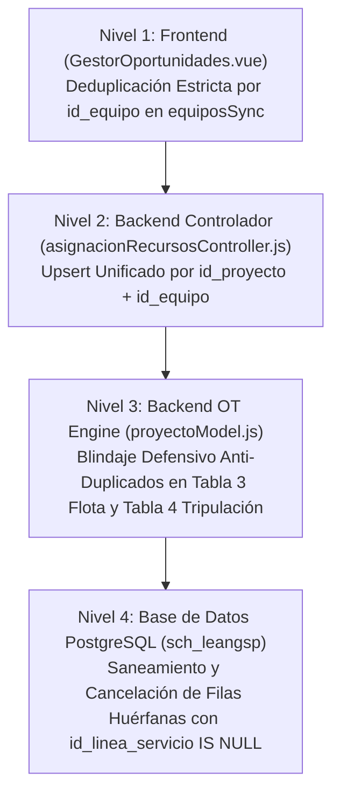

# SPEC-134: Erradicación de Duplicados Relacionales en Asignaciones de Flota y Blindaje Defensivo en Orden de Trabajo (OT)

## 1. 📌 Contexto y Diagnóstico del Problema

### 1.1. Síntoma Reportado
En la interfaz Web del CRM ([GestorOportunidades.vue](file:///d:/SGajardo/Google%20Drive/Antigravity/Gr%C3%BAas%20San%20Pablo/Propuesta%20Gesti%C3%B3n%20Operaci%C3%B3n%20Gr%C3%BAas/ejecucion/frontend/src/views/CRM/GestorOportunidades.vue)), los recursos asignados a la Orden de Trabajo figuran de manera limpia y correcta (1 grúa o plataforma + 1 camión de transporte). Sin embargo, al pulsar **"Imprimir OT"** o **"Generar Orden de Trabajo"**, el documento PDF oficial (`OT-GSP-2611-00139V14-273.pdf`) imprime la flota asignada **duplicada** (4 filas en lugar de 2), mostrando:
- Fila 1: Plataforma Tijera PAD-33 (Rental)
- Fila 2: Camión Traslado DRCX-62 (Traslado)
- Fila 3: Plataforma Tijera PAD-33 (Rental) — *Duplicado*
- Fila 4: Camión Traslado DRCX-62 (Traslado) — *Duplicado*

### 1.2. Análisis de Causa Raíz (Mecánica del Producto Cruz)
El fallo no es visual ni cosmético; reside en una doble iteración no correlacionada que contamina la base de datos relacional:

1. **Frontend (`GestorOportunidades.vue` -> `guardarCambiosAsignacion`):**
   - La función construye el array `equiposSync` iterando primero sobre `linesValidas.value`. En este primer bucle, el equipo 142 tiene `id_linea_servicio = 379` y el equipo 75 tiene `id_linea_servicio = 380`.
   - Inmediatamente después, la función **vuelve a iterar sobre `servicios.value`** (árbol comercial). En este segundo bucle, `s.id_linea_servicio` no se encuentra resuelto (`null`).
   - La clave de deduplicación del frontend (`const clave = `${eqId}_${dbLineaId || 'null'}_...``) evalúa `142_379` como diferente de `142_null`. En consecuencia, el cliente inyecta **ambos registros** en el payload `equiposSync` hacia `/proyectos/:id/asignaciones/sincronizar`.

2. **Backend Controlador (`asignacionRecursosController.js` -> `sincronizarAsignacionesProyecto`):**
   - El controlador ejecuta:
     ```sql
     SELECT id_rel_equipo FROM tpry_rel_equipo 
     WHERE id_proyecto = $1 AND id_equipo = $2 
       AND COALESCE(id_linea_servicio, 0) = COALESCE($3, 0)
       AND COALESCE(estado_real, 'PROGRAMADO') NOT IN ('CANCELADO', 'REEMPLAZADO')
     ```
   - Al buscar la segunda instancia (con `lineaEq = null` -> `0`), la comparación falla contra la fila preexistente (que tenía `lineaEq = 379`). Por tanto, ejecuta un **segundo `INSERT INTO tpry_rel_equipo`**.
   - Ambas filas ingresan al array `equiposVigentesIds`, impidiendo que el paso de purga las marque como `REEMPLAZADO`. Ambas quedan activas con `estado_real = 'PROGRAMADO'`.

3. **Backend Generador de OT (`proyectoModel.js` -> `generarOTVersion`):**
   - El generador consulta la base de datos:
     ```sql
     SELECT re.*, e.patente, e.modelo, e.tipo_equipo
     FROM tpry_rel_equipo re
     INNER JOIN tequ_equipo e ON re.id_equipo = e.id_equipo
     WHERE re.id_proyecto = $1 AND COALESCE(re.estado_real, 'PROGRAMADO') NOT IN ('CANCELADO', 'REEMPLAZADO')
     ORDER BY re.fecha_plan_ini ASC, re.id_rel_equipo ASC
     ```
   - La consulta retorna 4 filas activas. En la rama relacional moderna, el backend recorría `equiposAsignadosBD.forEach(...)` **sin deduplicar por patente o equipo físico**, agregando todas las filas a la Tabla 3 del PDF oficial.

---

## 2. 🏛️ Mandato de Resolución de Fondo en 4 Niveles (Cero Parches)

En estricto cumplimiento de la regla canónica [rules/resolucion_de_fondo_cero_parches.md](file:///d:/SGajardo/Google%20Drive/Antigravity/Gr%C3%BAas%20San%20Pablo/Propuesta%20Gesti%C3%B3n%20Operaci%C3%B3n%20Gr%C3%BAas/.agents/rules/resolucion_de_fondo_cero_parches.md), se interviene de manera coordinada en las 4 capas del sistema:



### 2.1. Nivel 1: Frontend (`GestorOportunidades.vue`)
* En `guardarCambiosAsignacion()`, la función `agregarEquipo` debe registrar la asignación consolidando la línea de servicio. Si un `id_equipo` ya fue agregado desde `linesValidas` con su `id_linea_servicio` real, cualquier iteración posterior sobre `servicios` que intente agregar el mismo equipo con línea nula debe ser ignorada.
* Excepción única para admitir múltiples filas del mismo `id_equipo`: cuando `esReemplazo === true` (relevo de flota formal con ventana de fechas explícita).

### 2.2. Nivel 2: Backend Controlador (`asignacionRecursosController.js`)
* En `sincronizarAsignacionesProyecto`:
  - Un equipo físico (`id_equipo`) no puede coexistir en dos filas activas (`PROGRAMADO`) para el mismo proyecto a menos que una de ellas sea un relevo (`es_reemplazo = TRUE`) o posea rangos de fechas disjuntos.
  - Al buscar si el equipo ya existe:
    ```sql
    SELECT id_rel_equipo, id_linea_servicio FROM tpry_rel_equipo 
    WHERE id_proyecto = $1 AND id_equipo = $2 
      AND COALESCE(estado_real, 'PROGRAMADO') NOT IN ('CANCELADO', 'REEMPLAZADO')
      AND NOT (id_rel_equipo = ANY($3::int[]))
    ORDER BY CASE WHEN id_linea_servicio IS NOT NULL THEN 0 ELSE 1 END, id_rel_equipo ASC LIMIT 1
    ```
  - Si ya existe una fila para ese equipo, se actualiza (`UPDATE`) consolidando el `id_linea_servicio` (priorizando siempre el valor no nulo), en lugar de insertar un clon con `NULL`.

### 2.3. Nivel 3: Backend Generador de OT (`proyectoModel.js` -> `generarOTVersion`)
* En la generación del HTML de la Orden de Trabajo:
  - Crear un set `patentesVistasOT = new Set()`.
  - Al recorrer `equiposAsignadosBD`: si la patente o `id_equipo` ya fue procesado, se omite salvo que se trate de un relevo explícito con fechas distintas.
  - En la Tripulación (Tabla 4): deduplicar por `id_user` / `rut_user` para impedir que un chofer o rigger aparezca repetido en la dotación humana.

### 2.4. Nivel 4: Saneamiento Relacional en PostgreSQL (`sch_leangsp`)
* Ejecutar script de remediación sobre la base de datos DEV:
  ```sql
  -- Cancelar filas duplicadas con línea nula cuando existe una fila legítima con línea asignada
  UPDATE sch_leangsp.tpry_rel_equipo
  SET estado_real = 'CANCELADO'
  WHERE id_rel_equipo IN (223, 224, 203);

  -- Cancelar tripulantes duplicados huérfanos
  UPDATE sch_leangsp.tpry_rel_persona
  SET estado_real = 'CANCELADO'
  WHERE id_rel_persona IN (210, 211);
  ```
* Regenerar la OT v15 de la OT 139 (Proyecto 204) y verificar empíricamente con `pdftotext` que `total_equipos` sea exactamente 2.

---

## 3. 🧪 Matriz de Certificación y Criterios de Aceptación

| ID Prueba | Escenario de Verificación | Resultado Esperado | Criterio de Éxito |
| :--- | :--- | :--- | :---: |
| **TC-01** | Auditoría SQL tras guardar asignaciones en OT 139 | Exactamente 2 filas activas en `tpry_rel_equipo` (PAD-33 y DRCX-62) | `cant = 1` por equipo |
| **TC-02** | Generación de OT v15 en Proyecto 204 | El PDF contiene exactamente 2 filas en Tabla 3 Flota | Sin duplicados |
| **TC-03** | Compatibilidad con Relevos (REQ-1120 / OT 138) | Equipo titular y equipo de relevo coexisten legítimamente con fechas distintas | 2 filas con badge RELEVO |
| **TC-04** | Tripulación de Obra (Tabla 4) | Manuel Guzmán asignado al camión DRCX-62 en Tabla 3; no se duplica en Tabla 4 | Cero duplicidad |
