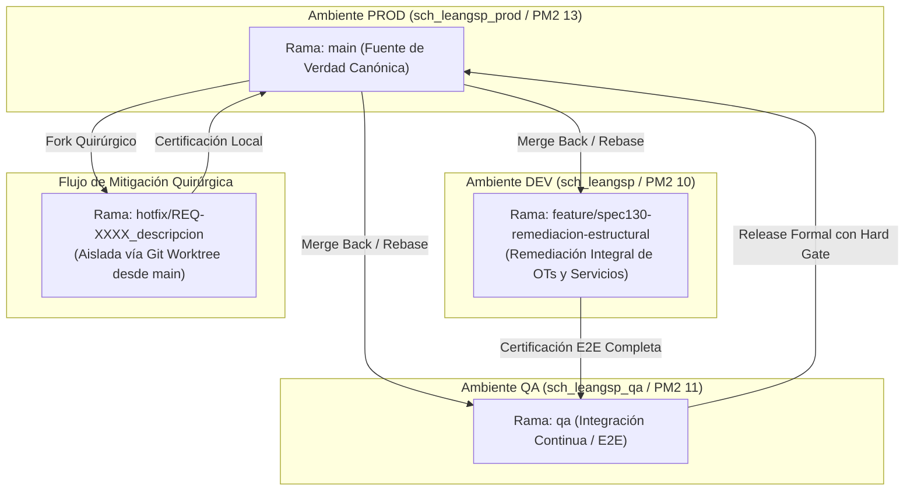

# 🛡️ SPEC-135: Estrategia de Ramas Git, Aislamiento de Entornos y Convergencia de la Remediación Estructural de OTs hacia Producción

- **Código:** `SPEC-135`
- **Requerimiento Backlog:** `REQ-1182`
- **Fecha:** 16 de Noviembre de 2026
- **Autor:** Antigravity Architect & Enterprise Governance Specialist
- **Tenant / Producto:** Grúas San Pablo (LeanGlobal Platform)
- **Estado:** CANÓNICO / EN VIGOR
- **Ramas Principales Involucradas:** `main`, `qa`, `feature/spec130-remediacion-estructural`, `hotfix/*`

---

## 1. Declaración de Propósito y Filosofía del Estándar

> **"Un cambio no versionado es código pirata. Un despliegue a Producción sin correspondencia exacta en Git contamina la historia, anula la reproducibilidad y causa regresiones silenciosas en terreno. En LeanGlobal, cada línea en Producción nace de una rama limpia, certificada y gobernada por un Hard Gate determinista."**

Esta especificación establece el protocolo formal e inviolable para la gestión de Git durante la ejecución concurrente de:
1. **La Gran Remediación Estructural:** Rama activa `feature/spec130-remediacion-estructural`, la cual contiene intervenciones estructurales profundas en el ciclo de vida de las Órdenes de Trabajo (OT), formularios unificados (`GestorOportunidades.vue`, `AsignadorArbolRecursos.vue`), motores de valorización y sincronización relacional en 4 niveles.
2. **La Estabilidad Inmutable de Producción (`main`):** El entorno productivo (`sch_leangsp_prod`, PM2 13, `lg-gsp-prod`) que atiende la operación diaria en tiempo real de Grúas San Pablo.
3. **El Tratamiento de Incidentes Críticos en Caliente (Hotfixes):** Procedimiento estricto para mitigar descalces sin mezclar features incompletas ni sobrescribir los avances arquitecturales de la remediación.

---

## 2. Mapa de Ramas y Topología de Entornos



### 2.1. Funciones Específicas de Cada Rama

| Rama | Propósito | Base de Datos Asociada | Procesos PM2 / Rutas Web | Política de Escritura |
| :--- | :--- | :--- | :--- | :--- |
| **`main`** | **Producción Canónica.** Solo alberga código probado, certificado E2E y validado por gerencia. | `sch_leangsp_prod` | `pm2 id 13` (`lean-services-gsp-prod`)<br/>`/var/www/html/lg-gsp-prod/`<br/>`/var/www/html/pwa-gsp-prod/` | **Protegida.** Solo merge desde `qa` o `hotfix/*` mediante pull request / revisión formal. |
| **`qa`** | **Certificación E2E de Ciclo Completo.** Entorno idéntico a producción para correr oráculos de prueba y validación de usuarios clave. | `sch_leangsp_qa` (o DEV isolado) | `pm2 id 11` (o staging)<br/>`/var/www/html/lg-gsp-qa/` | Protegida contra push directo sin tests limpios. |
| **`feature/spec130-remediacion-estructural`** | **Tronco de Remediación Estructural.** Contiene la convergencia de SPEC-129, SPEC-130, SPEC-131, SPEC-132, SPEC-133 y SPEC-134. | `sch_leangsp` (DEV) | `pm2 id 10` (`lean-services-gsp`)<br/>`/var/www/html/lg-gsp-dev/`<br/>`/var/www/html/pwa-gsp/` | Activa. Checkpoints obligatorios por cada hito (`npm run build = 0 errores`). |
| **`hotfix/*`** | **Ramas efímeras de emergencia.** Creadas puntualmente desde `main` en carpetas de trabajo aisladas (`git worktree`) para solucionar fallas bloqueantes de PROD. | `sch_leangsp_prod` (test espejo) | Ambiente temporal de compilación limpia | Se eliminan inmediatamente tras mergearse a `main` y a `feature/*`. |

---

## 3. Inventario de Intervenciones Estructurales en la Rama de Remediación

Es de vital importancia entender que **la rama `feature/spec130-remediacion-estructural` no es una rama cosmética**. Contiene modificaciones estructurales que redefinieron el comportamiento de las OTs y sus servicios:

### 3.1. En el Frontend Web (`GestorOportunidades.vue` & `AsignadorArbolRecursos.vue`)
1. **Sincronización Relacional Atómica Pre-OT (REQ-1180 / SPEC-131 §2.3):**
   - Antes de generar el PDF de la OT (`generarPDFOT`), la interfaz invoca obligatoriamente `guardarCambiosAsignacion(true)`.
   - Se erradicó el almacenamiento exclusivo en JSON; los recursos ahora se envían directamente a `/proyectos/:id/asignaciones/sincronizar`.
2. **Purga Reactiva de Líneas Eliminadas (CASO-20261116-02):**
   - Al suprimir una tarjeta o rama de equipo/traslado, el array reactivo `props.lines` se purga en caliente para evitar que la OT arrastre servicios borrados.
3. **Soporte Nativo de Relevos de Maquinaria y Personal (REQ-1176 / SPEC-16 §27.6):**
   - Introducción del botón interactivo `+ Relevo`, ventanas de fechas escalonadas (`fecha_ini` a `fecha_fin`) y semáforos de acreditación por titular y relevo.

### 3.2. En el Backend de Servicios (`proyectoModel.js`, `asignacionRecursosController.js`)
1. **Generación 100% Relacional del PDF de Orden de Trabajo (REQ-1172 / SPEC-134):**
   - La tabla 3 (Flota Asignada) y tabla 4 (Tripulación de Obra) del PDF ya no dependen del JSON desactualizado, sino que consultan directamente `tpry_rel_equipo` y `tpry_rel_persona` en PostgreSQL.
2. **Deduplicación Estricta por Patente y Roster Humano (SPEC-134):**
   - Supresión matemática de duplicados relacionales al clonar cotizaciones o sincronizar traslados.
3. **Erradicación del Motor Duplicado de Tarifas:**
   - Unificación bajo `motorValorizacionService.js`, garantizando paridad matemática exacta entre Preventa, Validación, OT, Report Diario, ITS y EDP.

---

## 4. Matriz de Decisiones: ¿Cómo Actuar ante un Incidente en Producción?

Cuando se presenta una contingencia en caliente en Producción (por ejemplo: la fecha deformada `11/16/202616` o el rigger `OMAR SOFFIA` en OT 51), el equipo debe clasificar el escenario bajo la siguiente matriz:

```
                                  ¿El origen del fallo reside en...?
                                                   │
                   ┌───────────────────────────────┴───────────────────────────────┐
                   ▼                                                               ▼
        [Caso 1: Defecto en 'main']                                  [Caso 2: Defecto en la Remediación]
       Existe en PROD y NO depende de                               El código ya incorporó avances de la
      la lógica nueva de la remediación.                            remediación pero falló un caso borde.
                   │                                                               │
                   ▼                                                               ▼
       Flujo A: Hotfix Aislado                                        Flujo B: Hotfix de Convergencia
        1. Worktree desde 'main'                                       1. Resolver en 'feature/spec130'
        2. Corrección mínima pura                                      2. Certificar en DEV (Pry 50/51)
        3. Release formal con Hard Gate                                3. Cherry-pick / Merge a 'main'
        4. Merge back a 'feature/spec130'                              4. Despliegue con Hard Gate
```

---

## 5. El Protocolo Inviolable de Trabajo: Paso a Paso

### 5.1. Protocolo para Trabajar desde `main` sin Contaminar la Remediación (`git worktree`)

Queda **estrictamente prohibido** ejecutar `git checkout main` directamente en la carpeta de trabajo actual si existen archivos sucios o builds intermedios de la remediación. El procedimiento oficial exige **Git Worktree**:

```bash
# 1. Asegurar que la rama de remediación tenga su checkpoint al día
git status -s

# 2. Crear un espacio de trabajo aislado apuntando a main en una ruta hermana
git worktree add ../gsp-hotfix-prod main

# 3. Moverse al directorio del worktree
cd ../gsp-hotfix-prod

# 4. Crear la rama de hotfix desde main
git checkout -b hotfix/REQ-1182_correccion_fechas_y_rigger

# 5. Aplicar la corrección quirúrgica aprobada por el usuario
# (Editar únicamente los archivos implicados)

# 6. Compilar y verificar
npm run build # Debe arrojar 0 errores

# 7. Checkpoint formal y merge a main
git commit -m "fix(crm,ot): correccion sanitizacion fechas y supresion rigger fantasma (REQ-1182)"
git checkout main
git merge --ff-only hotfix/REQ-1182_correccion_fechas_y_rigger

# 8. Eliminar el worktree al finalizar
cd "../Propuesta Gestión Operación Grúas"
git worktree remove ../gsp-hotfix-prod
```

### 5.2. Protocolo para Propagar Correcciones hacia la Rama de Remediación

Inmediatamente después de que un cambio aterriza en `main`:
1. El agente debe sincronizar la rama de desarrollo:
   ```bash
   git checkout feature/spec130-remediacion-estructural
   git merge main -m "chore(sync): integrar hotfix de produccion REQ-1182 desde main"
   ```
2. Ejecutar `npm run build` en Frontend y PWA para asegurar que la integración no provocó colisiones de sintaxis.

---

## 6. Blindaje contra Parches Sucios y "Cero Modificaciones Autónomas"

En estricto apego a la Constitución del Proyecto:

1. **Aislamiento de Servidores:**
   - La rama `main` compila única y exclusivamente hacia `/var/www/html/lg-gsp-prod/` y corre sobre PM2 ID 13 (`lean-services-gsp-prod`).
   - La rama `feature/spec130-remediacion-estructural` compila hacia `/var/www/html/lg-gsp-dev/` y corre sobre PM2 ID 10 (`lean-services-gsp`).
2. **Candado Duro de Despliegue (Hard Gate):**
   Ningún commit de `main` ni de `feature/*` puede ser subido al servidor remoto sin:
   - Registro en `Gestión/tareas.md` con su `[x] REQ-XXX`.
   - Incremento en `package.json`.
   - Entrada formal en `RELEASE_LOG.md`.
   - Auditoría previa de `git diff` aprobada explícitamente por el usuario en el chat.
3. **Prohibición de Reparaciones Manuales en Base de Datos:**
   Queda terminantemente prohibido alterar filas de `tpry_rel_persona` o `tpry_proyecto` en producción mediante comandos manuales de psql para esconder un error de la interfaz. La corrección se realiza **en el código de origen (Frontend y Backend)**, asegurando que la base de datos se sanee mediante el propio flujo transaccional del sistema.

---

## 7. Registro de Aprobación y Vigencia

| Rol | Nombre | Decisión | Fecha |
| :--- | :--- | :--- | :--- |
| **Director Técnico / Product Owner** | Alfonso Porperello / S. Gajardo | Aprobada | 16/11/2026 |
| **Líder de Operaciones** | Jorge Ponce | En Conocimiento | 16/11/2026 |
| **Arquitecto de Solución AI** | Antigravity Engine | En Vigor | 16/11/2026 |
