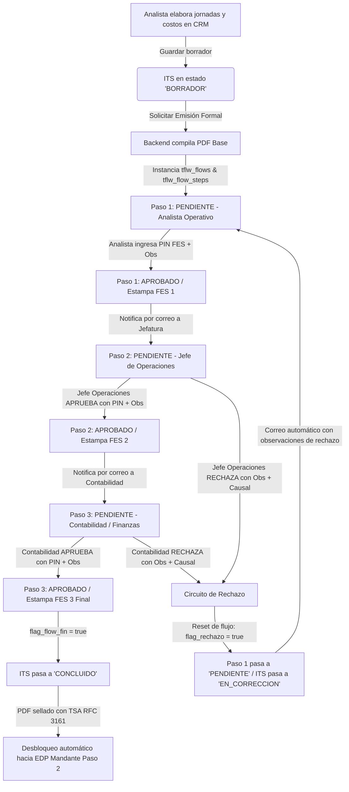

# 📐 Especificación Canónica: Flujo de Aprobación FES y Generación de PDF para ITS (Spec 47)

**Documento:** `47_its_pdf_flujo_aprobacion_fes_spec.md`  
**Ecosistema:** Grúas San Pablo (GSP) / LeanGlobal Platform  
**Módulo:** Torre de Control CRM / Liquidación de Operaciones (`ModalITS.vue` & `itsController.js`)  
**Subpestaña Asociada:** Subpestaña 7: `7. Valorización, ITS & Facturación` (Paso 1 del Pipeline Canónico)  
**Fase de Dominio:** Fases 5 & 6 - Cierre Técnico, Liquidación Interna de Costos, Determinación de Margen y Gobernanza Documental (`id_proyecto_estado = 6`)  
**Estado:** `CANÓNICO VIGENTE`  
**Fecha de Creación:** 9 de Septiembre de 2026  
**Documento Fuente de Antecedentes:** [`bosquejo_firma.md`](file:///d:/SGajardo/Google%20Drive/Antigravity/Grúas%20San%20Pablo/Propuesta%20Gestión%20Operación%20Grúas/bosquejo_firma.md)  
**Estándares Canónicos Aplicados:**
- [`leanglobal_approval_flow_standard`](file:///D:/SGajardo/Google%20Drive/Antigravity/LeanGlobal%20-%20Product/.agents/skills/leanglobal_approval_flow_standard/SKILL.md) (Motor de flujos, transiciones y transaccionalidad `tflw_*`).
- [`generar_pdf_fes_sin_survey`](file:///D:/SGajardo/Google%20Drive/Antigravity/LeanGlobal%20-%20Product/.agents/skills/generar_pdf_fes_sin_survey/SKILL.md) (PDF temporal, diálogo 2 columnas, cifrado SHA-256 en cliente, estampado `pdf-lib` y TSA RFC 3161).
- [`gsp_pdf_and_email_standards`](file:///d:/SGajardo/Google%20Drive/Antigravity/Grúas%20San%20Pablo/Propuesta%20Gestión%20Operación%20Grúas/.agents/skills/pdf_and_email_standards/SKILL.md) (Logos Base64 paramétricos por empresa emisora, formato A4 imprimible y despacho Nodemailer).

---

## 1. 📌 Resumen Ejecutivo y Propósito de Negocio

El **Informe de Término de Servicio (ITS)** es el instrumento oficial interno de Grúas San Pablo para:
1. **Auditar el cumplimiento operativo:** Cotejar los reportes de terreno (PWA) contra lo cotizado y programado.
2. **Imputar todos los costos directos reales:** Registrar gastos de viáticos, peajes, pensiones, personal externo, feriados, subcontrataciones y costo de horas operador asignadas a la OT.
3. **Calcular la rentabilidad real inmediata:** Producir el balance de **Utilidad Bruta ($)** y **Margen Operacional (%)** del servicio antes de emitir cobro alguno.
4. **Validar y Sellar Legalmente:** Ejecutar un circuito formal de **Triple Firma Electrónica Simple (FES)** con PIN OTP de 4 dígitos, estampado de sellos digitales con QR y sellado de tiempo TSA RFC 3161 sobre el documento PDF generado.
5. **Garantizar la Gobernanza con Circuito de Rechazo:** Si la Jefatura o Contabilidad rechaza el balance por inconsistencias, el flujo regresa automáticamente al responsable operativo (**Analista de Operaciones**) con el detalle de observaciones para su subsanación.

---

## 2. 🔄 Ciclo de Vida y Máquina de Estados del Flujo (`tflw_*`)

Dado que el ITS es una entidad relacional financiera y **no una encuesta móvil (`tsrv_survey`)**, se implementa bajo la arquitectura **FES Sin Survey**, desacoplando el motor de flujos para asociarlo al identificador único del ITS (`id_its`).



### 👥 Roles y Secuencia de Firmantes

| Paso | Denominación del Paso | Rol Responsable (`id_rol`) | Acción al Aprobar | Acción al Rechazar |
| :--- | :--- | :--- | :--- | :--- |
| **Paso 1** | **Elaboración & Liquidación Técnica** | `Analista de Operaciones` (`GSP_PROG`) | Emite el PDF base, estampa firma FES 1 e inicia el flujo. | N/A (Es quien origina o subsana el requerimiento). |
| **Paso 2** | **V°B° & Aprobación Jefatura** | `Jefe de Operaciones` (`GSP_ADMIN` / `GSP_JEFE_OPERACIONES`) | Valida coherencia de horas, tarifas, sobretiempos y márgenes. Estampa FES 2. | Dispara el circuito de rechazo hacia el Analista con observaciones. |
| **Paso 3** | **Recepción Conforme & Imputación** | `Contabilidad / Facturación` (`GSP_CONTABILIDAD` / `GSP_FINANZAS`) | Valida cuadratura de costos de compras, peajes y viáticos. Estampa FES 3 (final). | Dispara el circuito de rechazo hacia el Analista con observaciones. |

---

## 3. ↩️ Protocolo de Rechazo y Retorno al Analista Operativo

Cuando el **Jefe de Operaciones (Paso 2)** o **Contabilidad (Paso 3)** presiona la opción `RECHAZAR`:

1. **Captura Obligatoria de Motivo y Observaciones:**
   - Selección obligatoria de causal desde el catálogo `tflw_motivo_rechazo` (ej. *Inconsistencia en horas facturables*, *Falta respaldo de comprobante de peaje/pensión*, *Margen inferior al umbral pactado*).
   - Ingreso obligatorio de `observaciones` detallando exactamente qué debe modificarse.
2. **Mutación Transaccional en Base de Datos:**
   - El paso actual se actualiza a `estado = 'RECHAZADO'`, guardando su `id_motivo_rechazo`, `flow_step_obs` y `fecha_event = NOW()`.
   - La cabecera del ITS (`sch_leangsp.tits_informe_termino`) pasa a `estado_its = 'EN_CORRECCION'`.
   - **Reset de Pasos:** El **Paso 1 (Analista Operativo)** se reactiva a estado `'PENDIENTE'`, desbloqueando la edición de jornadas y costos en `ModalITS.vue`. Los demás pasos se restablecen a `'EN ESPERA'`.
3. **Despacho Inmediato de Alerta por Correo (Nodemailer):**
   - El sistema despacha una notificación por correo al Analista responsable (`id_user_elaborado`) con:
     * Nombre y rol de quien rechazó.
     * Causal formal y texto completo de las observaciones.
     * Enlace directo (Magic Link) a la pantalla del ITS en el CRM para su rápida subsanación.
4. **Reingreso al Flujo:**
   - Tras ajustar las jornadas o gastos, el Analista vuelve a ingresar su PIN FES para re-firmar el Paso 1, generando un nuevo PDF actualizado (versión incremental) que reinicia la secuencia hacia el Paso 2.

---

## 4. 📄 Estándar de Diseño del Documento PDF del ITS

El PDF se genera en el backend mediante `wkhtmltopdf` (vía `xvfb-run`) o Puppeteer headless sobre hojas A4 limpias, respetando rigurosamente el estándar visual de la plataforma:

### A. Membrete Paramétrico Multi-Tenant y Gobernanza de Logos
1. **Resolución Dinámica de Empresa Emisora:**
   - La empresa emisora del servicio **nunca se hardcodea**.
   - Se consulta dinámicamente desde `sch_leangsp.tpar_empresas` mediante la relación `tpry_proyecto.id_empresa`.
   - Soporta multi-empresa nativo: **Grúas San Pablo** (`id_empresa = 9`), **Bestmaq Arriendos** (`id_empresa = 7`), **Logística del Sur** (`id_empresa = 8`), **Royal Rental** (`id_empresa = 11`), etc.
2. **Inyección Obligatoria de Logo en Base64 Data URI:**
   - Siguiendo la regla inviolable de `leanglobal_pdf_standards`, el archivo de imagen física (`logo_empresa`) se lee desde el directorio de estáticos (`/home/nodeadmin/proyectos/lean-services-gsp/public/`) y se convierte in-memory a **Base64 Data URI** (`data:image/png;base64,...`).
   - El logo se despliega directamente sobre el **fondo blanco del documento**, con altura máxima controlada (48-52px), **sin cajas negras, sin marcos artificiales y sin gráficos inventados**.
3. **Datos Fiscales Verídicos:**
   - El encabezado fiscal renderiza la `razon_social`, `rut_empresa`, `giro` y `direccion` almacenados en `tpar_empresas`.
4. **Paleta Cromática Oficial de Izaje Pesado:**
   - **Naranja / Ámbar Industrial (`#F59E0B` / `#FF6B00`):** Líneas divisorias sobrias, acentos de subtotales y badges de estado.
   - **Grafito / Carbón Profundo (`#0F172A` / `#1E293B`):** Tipografía de alto contraste sobre fondo blanco.
   - **Erradicación del Azul Eléctrico:** Queda prohibido el uso de azul rey/eléctrico o contenedores negros masivos en los membretes.
5. **Regla Iconográfica Inviolable:**
   - **PROHIBICIÓN TOTAL DE ICONOS DE GRÚA TORRE DE CONSTRUCCIÓN (`🏗️`):** La flota corresponde exclusivamente a **Grúas Telescópicas de Alto Tonelaje**. Todo rótulo o reporte utiliza terminología industrial precisa (*Grúa Telescópica*, *Superestructura*, *Chasis*).

### B. Anatomía del Documento (Hoja A4)

```
+-------------------------------------------------------------------------+
| [ LOGO OFICIAL BASE64 ]            [ DATOS FISCALES EMPRESA EMISORA ]   |
| (Ej. logo-sanpablo.png)            Razón Social Oficial (tpar_empresas) |
| Sin cajas negras                   RUT: XX.XXX.XXX-X • Dirección        |
| Sobre fondo blanco                 Giro: Arriendo de Maquinarias        |
+-------------------------------------------------------------------------+
| FOLIO N° ITS-XXXX-001 (v1.0)           [ 🚜 SERVICIO RURAL / 🏢 URBANO ] |
| INFORME DE AUDITORÍA Y LIQUIDACIÓN INTERNA         Emisión: DD/MM/YYYY  |
+-------------------------------------------------------------------------+
| 1. ANTECEDENTES GENERALES DEL SERVICIO                                  |
| Cliente Mandante: Cartulinas CMPC  RUT Cliente: 96.731.890-6            |
| Obra / Faena: Planta Valdivia      Cotización Origen: COT-2026-REF      |
| Orden de Trabajo: GSP-2608-042     Empresa Emisora: SAN PABLO           |
+-------------------------------------------------------------------------+
| 2. RESUMEN ECONÓMICO Y BALANCE DE MARGEN (P&L)                          |
| Venta Neta Pactada:  $ 2.860.000 | Horas: 48.0h @ $45.000 + Flete       |
| Costos Directos:   - $   945.200 | 9 Categorías Consolidadas            |
| ----------------------------------------------------------------------- |
| UTILIDAD BRUTA OPERACIONAL:                          $ 1.914.800        |
| MARGEN DE CONTRIBUCIÓN:                              66.95% [🟢 ÓPTIMO] |
+-------------------------------------------------------------------------+
| 3. CONCILIACIÓN DE JORNADAS DE TERRENO (REPORTS PWA VALIDADOS)          |
| Fecha      OT       Equipo / Patente  Salida  Llegada  Término Horas Nº Rep |
| 01/09/2026 OT-2608  LTM-1070 (GR-99)  07:30   08:15    18:00   9.5h  REP-01 |
| 02/09/2026 OT-2608  LTM-1070 (GR-99)  08:00   08:30    17:30   8.5h  REP-02 |
+-------------------------------------------------------------------------+
| 4. DESGLOSE DE COSTOS DIRECTOS (LAS 9 CATEGORÍAS OFICIALES)             |
| 1. Combustible (Chasis/Grúa/Bidón)  6. Pago Feriados y Bonos            |
| 2. Movilización Personal OT         7. Subcontratación Fletes           |
| 3. Peajes y TAG de Ruta             8. Gastos Extraordinarios           |
| 4. Pensiones Faena (Alimentación)   9. Costo Valor Hora Operador        |
| 5. Personal Externo / Riggers                                           |
+-------------------------------------------------------------------------+
| 5. OBSERVACIONES GENERALES DE CIERRE                                    |
| Redacción de cierre según contexto [ Urbano ] o [ Rural ].              |
+-------------------------------------------------------------------------+
| 6. CUADRO DE APROBACIÓN CON TRIPLE FIRMA ELECTRÓNICA SIMPLE (FES)       |
| [ 1. ELABORADO POR ]       [ 2. V°B° JEFATURA ]     [ 3. RECEPCIÓN CONTABLE ]|
| Analista de Operaciones    Jefe de Operaciones      Contabilidad y Finanzas |
| RUT: XX.XXX.XXX-X          RUT: XX.XXX.XXX-X        RUT: XX.XXX.XXX-X       |
| 🔏 Firmado Electrónica     🔏 Firmado Electrónica   🔏 Firmado Electrónica  |
| Fecha y Hora CL            Fecha y Hora CL          Fecha y Hora CL         |
| Código Validación FES      Código Validación FES    Código Validación FES   |
+-------------------------------------------------------------------------+
| Sello Temporal TSA RFC 3161 • Verificable en Validador Oficial LeanGlobal|
+-------------------------------------------------------------------------+
```

---

## 5. 🖥️ Experiencia de Usuario en Frontend (`ModalITS.vue`)

### A. Naturaleza de la Consola Web
- **La vista modal del ITS es una consola de auditoría y cálculo:** Permite conciliar jornadas de terreno, imputar y verificar las 9 categorías de costos con sus respectivos comprobantes, y balancear el P&L del servicio.
- **Exclusión de Widgets de Firma en Pantalla:** A diferencia de la versión preliminar, la interfaz web **no renderiza el bloque interactivo de 3 cajas de firma FES** en su pie. La aprobación formal se administra a nivel de gobernanza documental y transición de estados del pipeline general.

---

## 6. 🗄️ Modelo de Base de Datos y Endpoints API

### A. Tablas PostgreSQL (`sch_leangsp`)

1. **`tits_informe_termino`**:
   - `estado_its`: Actualizar check para contemplar:
     `'BORRADOR'`, `'EN_REVISION_OPERACIONES'`, `'EN_REVISION_CONTABILIDAD'`, `'CONCLUIDO'`, `'EN_CORRECCION'`.
   - `id_flow`: Referencia a la instancia `tflw_flows`.
   - `id_doc_pdf_actual`: Referencia al archivo PDF vigente en `tfmg_file`.
2. **`tflw_flows` y `tflw_flow_steps`**:
   - Se reutiliza la estructura del motor de flujos canónico de LeanGlobal (`id_flow`, `id_flow_stp`, `flow_tmpl_step_orden`, `estado`, `id_user`, `id_rol`, `flow_step_obs`, `id_doc_in`, `id_doc_out`, `id_fes`).
3. **`tfes_signatures`**:
   - Persiste cada firma FES: `id_flow_stp`, `id_flow`, `id_user`, `hash_pdf`, `codigo_validacion`, `observaciones`, `aprueba_rechaza`, `id_motivo_rechazo`, `tsa_token`, `ip_firma`, `user_agent`.

### B. Consumo Canónico del Motor FES Existente (`/api/signature`)

En cumplimiento estricto de la Regla 6 (Prohibición de Servicios Paralelos), el flujo del ITS no crea controladores redundantes y se apoya 100% en el motor central de LeanGlobal:

1. **`GET /api/operaciones/its/preview-pdf/:id_proyecto`** (Existente en `itsController.js`):
   - Renderiza el PDF temporal del ITS con logo oficial en Base64 Data URI y retorna su URL para previsualización en el visor de firma.
2. **`POST /api/signature`** (Existente en `signatureController.js` / `SignatureModel.js`):
   - Endpoint canónico que recibe `{ origenPath, id_flow_stp, id_flow, id_user, pass_fes, aprueba_rechaza, id_motivo_rechazo, observaciones }`.
   - Valida `pass_hash_fes` (SHA-256) en `tsec_users`.
   - Estampa cuadro de firma legal + QR con `pdf-lib` en la última página.
   - Obtiene y estampa sello de tiempo TSA RFC 3161 (`obtenerSelloTiempo`).
   - Persiste en `sch_leangsp.tfes_signatures`.
   - Avanza el paso en `sch_leangsp.tflw_flow_steps` (Template 90: Analista ➔ Jefe Operaciones ➔ Contabilidad).
   - En caso de rechazo: transacciona estado a `RECHAZADO`, devuelve ITS a `EN_CORRECCION`, resetea el Paso 1 al Analista y encola notificación por correo en `sch_leangsp.tnot_queue`.

---

## 7. 🚀 Plan de Implementación de Fases

1. **Fase 1 (DDL & Seeding):** Crear template de flujo ITS en `tflw_templates` y `tflw_template_steps` para los 3 roles de GSP.
2. **Fase 2 (Generador PDF & wkhtmltopdf):** Plantilla HTML corporativa con inyección Base64 de logos paramétricos.
3. **Fase 3 (Instanciación de Flujo):** Al solicitar emisión del ITS en `itsController.js`, instanciar `tflw_flows` (Template 90) asociando `id_flow` a `tits_informe_termino`, conectando directamente con el motor `/api/signature`.
4. **Fase 4 (Frontend UI & Diálogo 2 Columnas):** Componente `<FirmaDialogFES>` en `ModalITS.vue` con previsualizador PDF y panel PIN.
5. **Fase 5 (QA & Certificación):** Pruebas end-to-end de las 3 firmas consecutivas, rechazo inducido en Paso 2 y retorno reactivo al Analista.
