# 📦🛠️ ESPECIFICACIÓN TÉCNICA CANÓNICA (V3.0): MANTENIMIENTO DE FLOTA (OTs) E INVENTARIO WMS-LITE

> **Spec N°**: 48 (Revisión 3.0 Canónica Integral)  
> **Módulos**: Mantenimiento de Flota (Taller Propio) + Inventario WMS-Lite (Repuestos MRO)  
> **Sistema**: Grúas San Pablo (GSP) / LeanGlobal Platform  
> **Esquema DB**: `sch_leangsp` & `sch_leangsp_prod`  
> **Estado**: ✅ ESPECIFICACIÓN CANÓNICA APROBADA (Absorbe auditoría experta WMS y maqueta web interactiva)  
> **Última Actualización**: 2026-10-12  

---

## 1. Alcance, Filosofía y Reglas de Dominio Inmutables

### 1.0 ⚠️ REGLA DE DOMINIO RECTOR: SEGREGACIÓN TOTAL DE OTs (NEGOCIO GSP vs MANTENIMIENTO)

Queda estrictamente prohibido confundir o mezclar las dos tipologías de "Orden de Trabajo" (OT) que coexisten en el sistema:

```mermaid
flowchart TD
    subgraph DOMINIO_A["🏢 DOMINIO A: OTs de Negocio Comercial GSP (Ingresos / Clientes Mandantes)"]
        A1["Cliente Mandante (Arauco, Pocuro, Minera)"] --> A2["Cotización CRM (tpry_proyecto)"]
        A2 --> A3["OT Comercial de Servicio (tpry_orden_trabajo)<br/>Folio: GSP-2610-4851-001"]
        A3 --> A4["Operación en Faena: Report FES Diario"]
        A4 --> A5["Liquidación: ITS ➔ EDP ➔ OC ➔ Factura DTE"]
        A5 --> A6["💰 NATURALEZA: INGRESO DEVENGADO (IFRS 15)"]
    end

    subgraph DOMINIO_B["🔧 DOMINIO B: OTs de Mantenimiento Taller (Costos / Flota Propia)"]
        B1["Activo Físico de Flota (tequ_equipo)<br/>110 Equipos: Grúas Móviles, Camiones Pluma"] --> B2["Gatillante: Horómetro / Pauta 250h/500h o Avería de Terreno"]
        B2 --> B3["OT de Mantenimiento (tmnt_ot)<br/>Folio: MNT-2610-001"]
        B3 --> B4["Ejecución Taller: Tareas + Repuestos PMP + HH Mecánicos + Terceros"]
        B4 --> B5["Cierre Supervisado con PIN (tmnt_ot_cierre)"]
        B5 --> B6["📉 NATURALEZA: COSTO / EGRESO OPERATIVO DEL ACTIVO"]
    end
```



| Dimensión de Negocio | 🏢 OTs del Negocio GSP (Operaciones Comerciales) | 🔧 OTs de Mantenimiento (Taller Interno) |
|---|---|---|
| **Tabla DB Principal** | `tpry_proyecto` / `tpry_orden_trabajo` | `tmnt_ot` (`sch_leangsp`) |
| **Folio Oficial** | `GSP-YYMM-XXXX-XXX` | `MNT-YYMM-XXX` |
| **Destinatario** | Cliente Mandante externo (Pocuro, Arauco, Asenav, etc.) | **Ninguno**. Activo de flota propia (`tequ_equipo`). |
| **Naturaleza Financiera** | **Ingreso** (Venta, Arriendo de Grúa, Devengado IFRS 15). | **Costo / Egreso** (Gasto operacional de mantenimiento de activo). |
| **Cadena Documental** | Cotización ➔ OT ➔ Tripulación ➔ Report FES ➔ ITS ➔ Factura DTE. | Alerta Horómetro/Avería ➔ Apertura OTM ➔ Tareas ➔ Insumos ➔ HH ➔ Cierre PIN. |
| **Facturación / Cobro** | Se factura al mandante según horas trabajadas o mínimo pactado. | **No se factura**. Se imputa a la ficha de costo del activo (`tequ_equipo`). |

---

### 1.1 Decisiones de Arquitectura de Inventario WMS-Lite (Post-Auditoría)

| Dimensión | Enfoque Anterior (V2) | Enfoque Canónico (V3.0 Válido) |
|---|---|---|
| **Formato SKU** | Semántico rígido `{FAM}-{MAR}-{ID}` o correlativo mudo genérico | **SKU Mnemotécnico por Familia MRO (`{FAMILIA}-{CORRELATIVO_5D}`)** (ej: `FILT-00042`, `LUBR-00015`, `MEC-00128`) + campo `codigo_legado` indexado |
| **Definición de Existencia** | 1 fila = 1 lote físico ingresado con OC | **Quant:** `producto × ubicación × (lote/serie opcional) × estado_stock` |
| **Ubicaciones** | Texto libre `ubicacion_fisica VARCHAR(100)` no persistido | **Maestro Jerárquico:** Bodega › Estantería (E1-E9) › Nivel (A-G) › Posición (1-6) + Áreas Especiales |
| **Unidades de Medida** | Unitaria rígida (INTEGER) | **Unidad Base mínima** (`L`, `m`, `kg`, `UN`) + **Presentación de Compra** con factor (ej. TAMBOR = 208 L) |
| **Valorización / Costeo** | Costo unitario fijo de lote | **Precio Medio Ponderado (PMP)** recalcula en cada recepción; salidas imputadas al PMP vigente |
| **Trazabilidad Kardex** | Registros editables, `stock_anterior=0` fijo | **Ledger Inmutable Append-Only** (sin UPDATE/DELETE); correcciones vía movimiento `REVERSO` |
| **Regla de Ingreso OC** | Constraint rígido `OC NOT NULL` y `costo > 0` | **Documento Condicional según Tipo:** OC en compras; Acta en carga inicial; Costo congelado en devoluciones |
| **Rotables y Reparables** | Inexistente | Trazabilidad por **Número de Serie** (bombas, cilindros, motores) con estado nuevo/reparado/reparación |
| **Bloqueo de OTs** | Bloqueaba crear OT si faltaba repuesto crítico | **Apertura garantizada:** la OT se abre en estado `ESPERA_REPUESTOS` para no ocultar la avería |
| **Seguridad y RBAC** | Sin autenticación ni segregación | JWT obligatorio, tenant por token, y SoD con rol aprobador `GSP_BODEGA_APROB` |

---

## 2. Modelo de Datos Relacional — Módulo Inventario (`tinv_*`)

### A. Tabla: `tinv_bodega`
Instalaciones físicas de almacenamiento vinculadas a una empresa del grupo.

```sql
CREATE TABLE sch_leangsp.tinv_bodega (
    id_bodega BIGSERIAL PRIMARY KEY,
    id_empresa BIGINT NOT NULL,
    id_sucursal BIGINT NOT NULL,
    nombre VARCHAR(100) NOT NULL,
    tipo_bodega VARCHAR(30) NOT NULL DEFAULT 'TALLER_CENTRAL' 
        CHECK (tipo_bodega IN ('TALLER_CENTRAL', 'FAENA', 'MOVIL_CAMION', 'EXTERNA')),
    consolida_stock BOOLEAN NOT NULL DEFAULT true,
    estado VARCHAR(20) NOT NULL DEFAULT 'ACTIVO' CHECK (estado IN ('ACTIVO', 'INACTIVO')),
    created_at TIMESTAMPTZ NOT NULL DEFAULT NOW(),
    CONSTRAINT uq_bodega_empresa_nombre UNIQUE (id_empresa, nombre)
);
```

---

### B. Tabla: `tinv_ubicacion` (Maestro Jerárquico de Posiciones / Bins)
Estructura física de 4 niveles que mapea exactamente la realidad de bodega (`E1-A1` a `E9-G6`).

```sql
CREATE TABLE sch_leangsp.tinv_ubicacion (
    id_ubicacion BIGSERIAL PRIMARY KEY,
    id_bodega BIGINT NOT NULL REFERENCES sch_leangsp.tinv_bodega(id_bodega),
    codigo VARCHAR(30) NOT NULL, -- Ej: 'E4-F2', 'CORRAL', 'PAÑOL', 'CUARENTENA', 'SIN-UBICAR'
    estanteria VARCHAR(10),       -- Ej: 'E1', 'E2' ... 'E9'
    nivel VARCHAR(5),             -- Ej: 'A', 'B' ... 'G'
    posicion VARCHAR(5),          -- Ej: '1', '2' ... '6'
    tipo_zona VARCHAR(30) NOT NULL DEFAULT 'RACK'
        CHECK (tipo_zona IN ('RACK', 'PISO_VOLUMEN', 'PAÑOL_HERRAMIENTAS', 'CORRAL_PATIO', 'RECEPCION', 'CUARENTENA', 'TRANSITO', 'VIRTUAL')),
    permite_mezcla_sku BOOLEAN NOT NULL DEFAULT true,
    estado VARCHAR(20) NOT NULL DEFAULT 'OPERATIVA' CHECK (estado IN ('OPERATIVA', 'BLOQUEADA', 'MANTENCION')),
    created_at TIMESTAMPTZ NOT NULL DEFAULT NOW(),
    CONSTRAINT uq_ubicacion_bodega_codigo UNIQUE (id_bodega, codigo)
);

CREATE INDEX idx_tinv_ubicacion_busqueda ON sch_leangsp.tinv_ubicacion(id_bodega, estanteria, nivel, posicion);
```

---

### C. Tabla: `tinv_producto` (Catálogo Maestro Desacoplado)
Ficha maestra donde el SKU es inmutable y los atributos taxonómicos y de equivalencia viven en relaciones o campos editables.

```sql
CREATE TABLE sch_leangsp.tinv_producto (
    id_producto BIGSERIAL PRIMARY KEY,
    id_empresa BIGINT NOT NULL,
    sku VARCHAR(30) NOT NULL,            -- Formato mnemotécnico canónico: '{FAMILIA}-{CORRELATIVO_5D}' (ej: 'FILT-00042', inmutable)
    codigo_legado VARCHAR(50),           -- Código histórico migrado: 'FCM0005', 'TMR0058'
    nombre VARCHAR(255) NOT NULL,
    descripcion TEXT,
    familia VARCHAR(50) NOT NULL,        -- 'Filtros', 'Aceites y Lubricantes', 'Repuestos Taller', etc.
    subfamilia VARCHAR(50),
    unidad_medida_base VARCHAR(20) NOT NULL DEFAULT 'UN', -- 'UN', 'L', 'm', 'kg', 'PAR'
    presentacion_compra VARCHAR(20),     -- 'TAMBOR', 'ROLLO', 'BALDE', 'CAJA'
    factor_conversion NUMERIC(12,4) DEFAULT 1.0000, -- Ej: 1 TAMBOR = 208 L -> factor = 208
    tipo_control VARCHAR(20) NOT NULL DEFAULT 'NINGUNO' 
        CHECK (tipo_control IN ('NINGUNO', 'LOTE', 'SERIE')),
    es_rotable BOOLEAN NOT NULL DEFAULT false, -- True para componentes mayores (bombas, cilindros, motores)
    impacto_operacional VARCHAR(15) NOT NULL DEFAULT 'NORMAL' 
        CHECK (impacto_operacional IN ('CRITICO', 'IMPORTANTE', 'NORMAL')),
    lead_time VARCHAR(10) NOT NULL DEFAULT 'CORTO' 
        CHECK (lead_time IN ('LARGO', 'MEDIO', 'CORTO')),
    clase_abc VARCHAR(2) NOT NULL DEFAULT 'C' CHECK (clase_abc IN ('A', 'B', 'C')),
    stock_minimo NUMERIC(14,4) NOT NULL DEFAULT 1 CHECK (stock_minimo >= 0),
    stock_maximo NUMERIC(14,4) NOT NULL DEFAULT 5 CHECK (stock_maximo >= stock_minimo),
    punto_reorden NUMERIC(14,4) NOT NULL DEFAULT 2 CHECK (punto_reorden >= stock_minimo),
    costo_pmp_vigente NUMERIC(15,2) NOT NULL DEFAULT 0.00,
    estado VARCHAR(20) NOT NULL DEFAULT 'ACTIVO' CHECK (estado IN ('ACTIVO', 'INACTIVO')),
    created_at TIMESTAMPTZ NOT NULL DEFAULT NOW(),
    CONSTRAINT uq_producto_empresa_sku UNIQUE (id_empresa, sku),
    CONSTRAINT uq_producto_empresa_legado UNIQUE (id_empresa, codigo_legado)
);

CREATE INDEX idx_tinv_producto_filtro ON sch_leangsp.tinv_producto(id_empresa, familia, impacto_operacional, estado);
```

#### C.1 Tabla Canónica de Prefijos SKU por Familia MRO
| Familia de Catálogo (GSP) | Prefijo Canónico | Formato SKU Oficial | Rango Correlativo |
|:---|:---:|:---:|:---:|
| **Filtros** (Aire, Aceite, Combustible, Hidráulico) | `FILT` | `FILT-00042` | `FILT-00001` a `99999` |
| **Aceites, Grasas y Lubricantes** | `LUBR` | `LUBR-00015` | `LUBR-00001` a `99999` |
| **Repuestos Taller Mecánico** (Motor, Transmisión, Hidráulica) | `MEC` | `MEC-00128` | `MEC-00001` a `99999` |
| **Repuestos Eléctricos y Sensores** | `ELEC` | `ELEC-00085` | `ELEC-00001` a `99999` |
| **Material de Desgaste** (Pernos, Cintas, Golillas, Frenos) | `DESG` | `DESG-00019` | `DESG-00001` a `99999` |
| **Neumáticos y Ruedas** | `NEUM` | `NEUM-00007` | `NEUM-00001` a `99999` |
| **Herramientas y Accesorios de Izaje** (Estrobos, Grilletes) | `HERR` | `HERR-00011` | `HERR-00001` a `99999` |
| **Insumos Taller de Soldadura** | `SOLD` | `SOLD-00034` | `SOLD-00001` a `99999` |
| **Insumos Taller de Pinturas y Químicos** | `PINT` | `PINT-00022` | `PINT-00001` a `99999` |
| **Elementos de Protección Personal (EPP)** | `EPP` | `EPP-00053` | `EPP-00001` a `99999` |
| **Materiales Varios / Consumibles Generales** | `VARI` | `VARI-00041` | `VARI-00001` a `99999` |
| **Activos Administrativos / Oficina / TI** | `OFIC` / `COMP` | `OFIC-00005` | `OFIC-00001` a `99999` |

*Reglas Inmutables:*
1. El SKU es generado automáticamente por el sistema al seleccionar la Familia.
2. Longitud exacta de 10 caracteres (`AAAA-00000`).
3. El código previo de GSP se preserva en `codigo_legado` para resolución de búsquedas transparentes.

---

### D. Tabla: `tinv_producto_referencia` (Referencias Cruzadas OEM / Alternativos)
Elimina la necesidad de incrustar números de parte en el título del producto.

```sql
CREATE TABLE sch_leangsp.tinv_producto_referencia (
    id_referencia BIGSERIAL PRIMARY KEY,
    id_producto BIGINT NOT NULL REFERENCES sch_leangsp.tinv_producto(id_producto) ON DELETE CASCADE,
    tipo_referencia VARCHAR(20) NOT NULL CHECK (tipo_referencia IN ('OEM', 'ALTERNATIVO', 'PROVEEDOR_LOCAL')),
    marca VARCHAR(100) NOT NULL,          -- Ej: 'Donaldson', 'Fleetguard', 'MANN', 'Parker'
    codigo_referencia VARCHAR(100) NOT NULL, -- Ej: 'P553004', 'FF42000', 'W712'
    created_at TIMESTAMPTZ NOT NULL DEFAULT NOW(),
    CONSTRAINT uq_prod_ref UNIQUE (id_producto, tipo_referencia, codigo_referencia)
);

CREATE INDEX idx_tinv_ref_codigo ON sch_leangsp.tinv_producto_referencia(codigo_referencia);
```

---

### E. Tabla: `tinv_producto_compatibilidad` (Matriz con Flota `tequ_equipo`)
Permite saber qué insumos aplican a qué modelos de grúa sin forzar la marca en el SKU.

```sql
CREATE TABLE sch_leangsp.tinv_producto_compatibilidad (
    id_compatibilidad BIGSERIAL PRIMARY KEY,
    id_producto BIGINT NOT NULL REFERENCES sch_leangsp.tinv_producto(id_producto) ON DELETE CASCADE,
    modelo_equipo VARCHAR(100) NOT NULL, -- Ej: 'Liebherr LTM 1100-4.2', 'Grove GMK 5250L', 'Flota Completa'
    notas VARCHAR(255),
    CONSTRAINT uq_prod_compat UNIQUE (id_producto, modelo_equipo)
);
```

---

### F. Tablas: `tinv_lote` y `tinv_serie` (Trazabilidad Condicional)

```sql
CREATE TABLE sch_leangsp.tinv_lote (
    id_lote BIGSERIAL PRIMARY KEY,
    id_producto BIGINT NOT NULL REFERENCES sch_leangsp.tinv_producto(id_producto),
    numero_lote VARCHAR(50) NOT NULL,
    fecha_fabricacion DATE,
    fecha_vencimiento DATE,
    fecha_ingreso TIMESTAMPTZ NOT NULL DEFAULT NOW(),
    CONSTRAINT uq_lote_producto UNIQUE (id_producto, numero_lote)
);

CREATE TABLE sch_leangsp.tinv_serie (
    id_serie BIGSERIAL PRIMARY KEY,
    id_producto BIGINT NOT NULL REFERENCES sch_leangsp.tinv_producto(id_producto),
    numero_serie VARCHAR(100) NOT NULL,
    estado_rotable VARCHAR(30) NOT NULL DEFAULT 'NUEVO_DISPONIBLE'
        CHECK (estado_rotable IN ('NUEVO_DISPONIBLE', 'USADO_OPERATIVO', 'INSTALADO_EN_EQUIPO', 'EN_REPARACION_EXTERNA', 'DE_BAJA')),
    id_equipo_instalado BIGINT REFERENCES sch_leangsp.tequ_equipo(id_equipo),
    horometro_instalacion NUMERIC(10,2),
    created_at TIMESTAMPTZ NOT NULL DEFAULT NOW(),
    CONSTRAINT uq_serie_producto UNIQUE (id_producto, numero_serie)
);
```

---

### G. Tabla: `tinv_stock` (Quants: Saldo Físico por Posición)
Representa exactamente cuánta cantidad de un producto existe en una coordenada física.

```sql
CREATE TABLE sch_leangsp.tinv_stock (
    id_stock BIGSERIAL PRIMARY KEY,
    id_empresa BIGINT NOT NULL,
    id_producto BIGINT NOT NULL REFERENCES sch_leangsp.tinv_producto(id_producto),
    id_ubicacion BIGINT NOT NULL REFERENCES sch_leangsp.tinv_ubicacion(id_ubicacion),
    id_lote BIGINT REFERENCES sch_leangsp.tinv_lote(id_lote),
    id_serie BIGINT REFERENCES sch_leangsp.tinv_serie(id_serie),
    estado_stock VARCHAR(20) NOT NULL DEFAULT 'LIBRE'
        CHECK (estado_stock IN ('LIBRE', 'CALIDAD_CUARENTENA', 'EN_REPARACION', 'EN_TRANSITO')),
    cantidad_fisica NUMERIC(14,4) NOT NULL DEFAULT 0.0000 CHECK (cantidad_fisica >= 0),
    cantidad_reservada NUMERIC(14,4) NOT NULL DEFAULT 0.0000 CHECK (cantidad_reservada >= 0),
    updated_at TIMESTAMPTZ NOT NULL DEFAULT NOW()
);

CREATE UNIQUE INDEX uq_tinv_stock_quant ON sch_leangsp.tinv_stock(
    id_empresa, id_producto, id_ubicacion, 
    COALESCE(id_lote, 0), COALESCE(id_serie, 0), estado_stock
);
```

---

### H. Tabla: `tinv_movimiento` (Ledger Kardex Inmutable Append-Only)
Fuente única de verdad contable y de auditoría. No se permiten `UPDATE` ni `DELETE`.

```sql
CREATE TABLE sch_leangsp.tinv_movimiento (
    id_movimiento BIGSERIAL PRIMARY KEY,
    id_empresa BIGINT NOT NULL,
    fecha_movimiento TIMESTAMPTZ NOT NULL DEFAULT NOW(),
    tipo_movimiento VARCHAR(30) NOT NULL CHECK (tipo_movimiento IN (
        'RECEPCION_COMPRA', 'CARGA_INICIAL', 'SALIDA_OT', 'DEVOLUCION_OT', 
        'TRASPASO_SALIDA', 'TRASPASO_ENTRADA', 'AJUSTE_CONTEO', 'BAJA_OBSOLESCENCIA', 'REVERSO'
    )),
    documento_tipo VARCHAR(30) NOT NULL, -- 'OC', 'ACTA_CONTEO', 'OT_MNT', 'GUIA_TRASPASO', 'REVERSO'
    documento_folio VARCHAR(100) NOT NULL, -- Ej: 'OC-4512', 'MNT-2610-014', 'ACTA-INV-20261001'
    id_producto BIGINT NOT NULL REFERENCES sch_leangsp.tinv_producto(id_producto),
    id_ubicacion BIGINT NOT NULL REFERENCES sch_leangsp.tinv_ubicacion(id_ubicacion),
    id_lote BIGINT REFERENCES sch_leangsp.tinv_lote(id_lote),
    id_serie BIGINT REFERENCES sch_leangsp.tinv_serie(id_serie),
    cantidad NUMERIC(14,4) NOT NULL,     -- Positivo (entrada), Negativo (salida)
    costo_unitario_pmp NUMERIC(15,2) NOT NULL DEFAULT 0.00,
    costo_total NUMERIC(15,2) GENERATED ALWAYS AS (ROUND(ABS(cantidad) * costo_unitario_pmp, 2)) STORED,
    stock_anterior NUMERIC(14,4) NOT NULL,
    stock_posterior NUMERIC(14,4) NOT NULL,
    id_usuario BIGINT NOT NULL,
    id_movimiento_reversado BIGINT REFERENCES sch_leangsp.tinv_movimiento(id_movimiento),
    observaciones TEXT,
    created_at TIMESTAMPTZ NOT NULL DEFAULT NOW()
);

CREATE INDEX idx_tinv_mov_auditoria ON sch_leangsp.tinv_movimiento(id_empresa, id_producto, fecha_movimiento DESC);
```

---

### I. Tablas: `tinv_recepcion` y `tinv_recepcion_linea`
Gestión documental de ingresos multilínea que reemplaza el registro unitario informal.

```sql
CREATE TABLE sch_leangsp.tinv_recepcion (
    id_recepcion BIGSERIAL PRIMARY KEY,
    id_empresa BIGINT NOT NULL,
    numero_folio VARCHAR(50) NOT NULL, -- 'REC-2610-0012'
    tipo_ingreso VARCHAR(30) NOT NULL CHECK (tipo_ingreso IN ('COMPRA', 'CARGA_INICIAL', 'DEVOLUCION_OT', 'GARANTIA', 'REPARACION_ROTABLE')),
    proveedor_o_origen VARCHAR(150) NOT NULL,
    documento_referencia VARCHAR(150),  -- 'OC 4512 · Guía 88213' o 'Acta INV-20261001'
    estado VARCHAR(20) NOT NULL DEFAULT 'BORRADOR' CHECK (estado IN ('BORRADOR', 'CONFIRMADA', 'ANULADA')),
    id_usuario_recepcion BIGINT NOT NULL,
    id_usuario_aprobacion BIGINT,      -- Obligatorio para CARGA_INICIAL y GARANTIA
    created_at TIMESTAMPTZ NOT NULL DEFAULT NOW(),
    CONSTRAINT uq_rec_folio UNIQUE (id_empresa, numero_folio)
);

CREATE TABLE sch_leangsp.tinv_recepcion_linea (
    id_linea BIGSERIAL PRIMARY KEY,
    id_recepcion BIGINT NOT NULL REFERENCES sch_leangsp.tinv_recepcion(id_recepcion) ON DELETE CASCADE,
    id_producto BIGINT NOT NULL REFERENCES sch_leangsp.tinv_producto(id_producto),
    cantidad_recibida NUMERIC(14,4) NOT NULL CHECK (cantidad_recibida > 0),
    unidad_presentacion VARCHAR(20) NOT NULL, -- 'TAMBOR', 'UN', 'ROLLO'
    factor_conversion NUMERIC(12,4) NOT NULL DEFAULT 1.0000,
    cantidad_base NUMERIC(14,4) GENERATED ALWAYS AS (cantidad_recibida * factor_conversion) STORED,
    costo_unitario_moneda NUMERIC(15,2) NOT NULL DEFAULT 0.00,
    costo_unitario_base NUMERIC(15,2) GENERATED ALWAYS AS (ROUND(costo_unitario_moneda / factor_conversion, 2)) STORED,
    id_ubicacion_destino BIGINT NOT NULL REFERENCES sch_leangsp.tinv_ubicacion(id_ubicacion),
    lote_texto VARCHAR(50),
    serie_texto VARCHAR(100)
);
```

---

### J. Tablas: `tinv_conteo` y `tinv_conteo_linea` (Procesos de Inventario y Carga Inicial)

```sql
CREATE TABLE sch_leangsp.tinv_conteo (
    id_conteo BIGSERIAL PRIMARY KEY,
    id_empresa BIGINT NOT NULL,
    id_bodega BIGINT NOT NULL REFERENCES sch_leangsp.tinv_bodega(id_bodega),
    codigo_proceso VARCHAR(50) NOT NULL, -- 'INV-2026-001'
    descripcion VARCHAR(255) NOT NULL,   -- 'Inventario de Apertura 2026'
    tipo_conteo VARCHAR(30) NOT NULL CHECK (tipo_conteo IN ('APERTURA_CARGA_INICIAL', 'CICLICO_ABC', 'GENERAL_ANUAL')),
    es_ciego BOOLEAN NOT NULL DEFAULT true,
    estado VARCHAR(25) NOT NULL DEFAULT 'PLANIFICADO' 
        CHECK (estado IN ('PLANIFICADO', 'EN_CONTEO', 'EN_RECONTEO', 'PENDIENTE_APROBACION', 'APROBADO_CONCILIADO', 'CANCELADO')),
    fecha_corte TIMESTAMPTZ NOT NULL DEFAULT NOW(),
    id_supervisor_aprobador BIGINT,
    created_at TIMESTAMPTZ NOT NULL DEFAULT NOW(),
    CONSTRAINT uq_conteo_codigo UNIQUE (id_empresa, codigo_proceso)
);

CREATE TABLE sch_leangsp.tinv_conteo_linea (
    id_conteo_linea BIGSERIAL PRIMARY KEY,
    id_conteo BIGINT NOT NULL REFERENCES sch_leangsp.tinv_conteo(id_conteo) ON DELETE CASCADE,
    id_producto BIGINT NOT NULL REFERENCES sch_leangsp.tinv_producto(id_producto),
    id_ubicacion BIGINT NOT NULL REFERENCES sch_leangsp.tinv_ubicacion(id_ubicacion),
    stock_sistema_congelado NUMERIC(14,4) NOT NULL DEFAULT 0.0000,
    conteo_1 NUMERIC(14,4),
    conteo_recuento NUMERIC(14,4),
    conteo_final NUMERIC(14,4) GENERATED ALWAYS AS (COALESCE(conteo_recuento, conteo_1)) STORED,
    diferencia NUMERIC(14,4) GENERATED ALWAYS AS (COALESCE(conteo_recuento, conteo_1) - stock_sistema_congelado) STORED,
    costo_pmp_congelado NUMERIC(15,2) NOT NULL DEFAULT 0.00,
    valor_diferencia NUMERIC(15,2) GENERATED ALWAYS AS (ROUND((COALESCE(conteo_recuento, conteo_1) - stock_sistema_congelado) * costo_pmp_congelado, 2)) STORED,
    estado_linea VARCHAR(20) NOT NULL DEFAULT 'PENDIENTE' 
        CHECK (estado_linea IN ('PENDIENTE', 'CONCILIADA_OK', 'DIFERENCIA', 'SOBRANTE', 'RECONTAR', 'AJUSTADA'))
);
```

---

## 3. Modelo de Datos — Módulo Mantenimiento (`tmnt_*`) e Integración con WMS

### A. Tabla: `tmnt_ot` — Orden de Trabajo de Taller
Representa la intervención técnica del activo de flota (`tequ_equipo`).

```sql
CREATE TABLE sch_leangsp.tmnt_ot (
    id_ot BIGSERIAL PRIMARY KEY,
    id_empresa BIGINT NOT NULL,
    numero_folio VARCHAR(50) NOT NULL, -- 'MNT-2610-001'
    id_equipo BIGINT NOT NULL REFERENCES sch_leangsp.tequ_equipo(id_equipo),
    tipo_mantenimiento VARCHAR(20) NOT NULL CHECK (tipo_mantenimiento IN ('PREVENTIVO', 'CORRECTIVO', 'PREDICTIVO', 'ESPECIAL')),
    horometro_inicio NUMERIC(10,2) NOT NULL,
    pauta_intervalo_horas INTEGER,     -- 250, 500, 1000
    descripcion_falla TEXT NOT NULL,
    estado VARCHAR(25) NOT NULL DEFAULT 'ABIERTA' 
        CHECK (estado IN ('ABIERTA', 'EN_PROCESO', 'ESPERA_REPUESTOS', 'CERRADA', 'CANCELADA')),
    id_supervisor BIGINT NOT NULL,
    created_at TIMESTAMPTZ NOT NULL DEFAULT NOW(),
    CONSTRAINT uq_ot_empresa_folio UNIQUE (id_empresa, numero_folio)
);
```

### B. Tabla: `tmnt_ot_actividad` (Checklist Operativo)
```sql
CREATE TABLE sch_leangsp.tmnt_ot_actividad (
    id_actividad BIGSERIAL PRIMARY KEY,
    id_ot BIGINT NOT NULL REFERENCES sch_leangsp.tmnt_ot(id_ot) ON DELETE CASCADE,
    descripcion_actividad VARCHAR(255) NOT NULL,
    horas_estimadas NUMERIC(6,2) DEFAULT 1.0,
    estado VARCHAR(20) NOT NULL DEFAULT 'PENDIENTE' CHECK (estado IN ('PENDIENTE', 'EN_PROCESO', 'COMPLETADA')),
    created_at TIMESTAMPTZ NOT NULL DEFAULT NOW()
);
```

### C. Tabla: `tmnt_ot_repuesto` (Repuestos e Insumos Imputados)
Permite doble modalidad: **Manual Libre** (Fase 1) o **Despachado desde WMS** (Fase 2).

```sql
CREATE TABLE sch_leangsp.tmnt_ot_repuesto (
    id_ot_repuesto BIGSERIAL PRIMARY KEY,
    id_ot BIGINT NOT NULL REFERENCES sch_leangsp.tmnt_ot(id_ot) ON DELETE CASCADE,
    id_producto BIGINT REFERENCES sch_leangsp.tinv_producto(id_producto), -- Opcional en Fase 1, FK en Fase 2
    id_movimiento_salida BIGINT REFERENCES sch_leangsp.tinv_movimiento(id_movimiento), -- Auditoría WMS
    descripcion_material VARCHAR(255) NOT NULL,
    cantidad NUMERIC(12,4) NOT NULL CHECK (cantidad > 0),
    unidad_medida VARCHAR(20) NOT NULL DEFAULT 'UN',
    costo_unitario NUMERIC(15,2) NOT NULL DEFAULT 0.00,
    costo_total NUMERIC(15,2) GENERATED ALWAYS AS (ROUND(cantidad * costo_unitario, 2)) STORED,
    es_despacho_wms BOOLEAN NOT NULL DEFAULT false,
    estado_despacho VARCHAR(20) NOT NULL DEFAULT 'ENTREGADO' CHECK (estado_despacho IN ('PLANIFICADO', 'ENTREGADO', 'DEVUELTO')),
    created_at TIMESTAMPTZ NOT NULL DEFAULT NOW()
);
```

### D. Tablas: `tmnt_ot_hh`, `tmnt_ot_servicio_ext` y `tmnt_ot_cierre`
```sql
CREATE TABLE sch_leangsp.tmnt_ot_hh (
    id_hh BIGSERIAL PRIMARY KEY,
    id_ot BIGINT NOT NULL REFERENCES sch_leangsp.tmnt_ot(id_ot) ON DELETE CASCADE,
    id_usuario_tecnico BIGINT,
    tecnico_nombre VARCHAR(100) NOT NULL,
    descripcion_trabajo VARCHAR(255) NOT NULL,
    horas_reales NUMERIC(6,2) NOT NULL CHECK (horas_reales > 0),
    tarifa_hora NUMERIC(12,2) NOT NULL CHECK (tarifa_hora >= 0),
    costo_calculado NUMERIC(15,2) GENERATED ALWAYS AS (ROUND(horas_reales * tarifa_hora, 2)) STORED,
    created_at TIMESTAMPTZ NOT NULL DEFAULT NOW()
);

CREATE TABLE sch_leangsp.tmnt_ot_servicio_ext (
    id_servicio BIGSERIAL PRIMARY KEY,
    id_ot BIGINT NOT NULL REFERENCES sch_leangsp.tmnt_ot(id_ot) ON DELETE CASCADE,
    proveedor VARCHAR(150) NOT NULL,
    descripcion_servicio VARCHAR(255) NOT NULL,
    numero_documento VARCHAR(50),
    costo NUMERIC(15,2) NOT NULL CHECK (costo >= 0),
    created_at TIMESTAMPTZ NOT NULL DEFAULT NOW()
);

CREATE TABLE sch_leangsp.tmnt_ot_cierre (
    id_cierre BIGSERIAL PRIMARY KEY,
    id_ot BIGINT NOT NULL UNIQUE REFERENCES sch_leangsp.tmnt_ot(id_ot),
    costo_repuestos NUMERIC(15,2) NOT NULL,
    costo_hh NUMERIC(15,2) NOT NULL,
    costo_servicios_ext NUMERIC(15,2) NOT NULL,
    costo_total_ot NUMERIC(15,2) NOT NULL,
    id_supervisor BIGINT NOT NULL,
    pin_hash VARCHAR(64) NOT NULL,
    fecha_cierre TIMESTAMPTZ NOT NULL DEFAULT NOW()
);
```

---

## 4. Arquitectura QR y Etiquetado Térmico (50 × 30 mm)

### 4.1 Principio de Privacidad e Inmutabilidad del QR
El código QR almacena **únicamente el identificador de localización o producto**. Queda terminantemente prohibido incrustar costos, valores contables o nombres de bodega (mutables) en el payload.

1. **QR de Ubicación (Pegado en Estante / Bin):**
   * Payload: `UB:{codigo_ubicacion}` (ejemplo: `UB:E4-F2`).
   * Imprimible una sola vez por estantería o bloque.
2. **QR de Producto (Pegado en Caja / Insumo):**
   * Payload: `PROD:{sku}` (ejemplo: `PROD:GSP-000158`).
3. **QR de Componente Seriado Rotable:**
   * Payload: `SN:{sku}:{numero_serie}` (ejemplo: `SN:GSP-000410:7781-2231`).

### 4.2 Flujo PWA Móvil para el Operador de Taller
```
① Técnico/Bodeguero abre PWA móvil -> [Despacho a OT]
② Escanea QR de la OT (o selecciona del listado de OTs activas)
③ Escanea QR de la Ubicación física (ej: UB:E4-F2) -> El sistema filtra los ítems de esa posición
④ Escanea QR del Producto o digita SKU/Código legado
⑤ Ingresa la cantidad consumida -> Valida stock disponible
⑥ Confirma despacho -> Se genera movimiento SALIDA_OT, se imputa costo PMP a la OT y rebaja stock
```

---

## 5. Política de Reposición y Quiebres — Disponible Neto

El motor de alertas no evalúa el stock físico estático, sino el **Disponible Neto**:

$$\text{Stock Neto} = \text{Stock Físico Libre} - \text{Stock Reservado para OTs} + \text{Stock en Tránsito}$$

### 5.1 Matriz de Criticidad Operacional (Impacto × Lead Time)

| Impacto | Lead Time | Disparador | Comportamiento del Sistema |
|---|---|---|---|
| 🔴 **CRÍTICO** | 🔴 **LARGO** (>15d) | `Stock Neto <= Stock Mínimo` | ⚡ Alerta roja en Consola. Al abrir una OT preventiva/correctiva que requiera este insumo, la OT se crea automáticamente en estado **`ESPERA_REPUESTOS`** (sin bloquear la creación de la OT). |
| 🔴 **CRÍTICO** | 🟡 **MEDIO** (5-15d) | `Stock Neto <= Stock Mínimo` | 🔔 Alerta naranja prioritaria en Consola. Sugerencia de compra urgente. |
| 🟡 **IMPORTANTE**| 🔴 **LARGO** (>15d) | `Stock Neto <= Punto Reorden` | ⚠️ Alerta preventiva en panel de compras. |
| 🟢 **NORMAL** | Cualquier Lead | `Stock Neto <= Stock Mínimo` | 📋 Inclusión en reporte semanal de reposición rutinaria. |

---

## 6. Reglas de Negocio Duras y Validaciones de API (HTTP 422)

| Código Error | Causa de Rechazo | Tratamiento y Regla de Negocio |
|---|---|---|
| `MOVIMIENTO_SIN_DOCUMENTO` | Movimiento sin documento origen válido | Todo movimiento exige `documento_tipo` y `documento_folio` según el flujo. |
| `CARGA_INICIAL_REQUIERE_APROBACION` | Usuario `_EJEC` intenta ejecutar carga inicial | Requiere firma y autorización formal de rol `GSP_BODEGA_APROB`. |
| `STOCK_INSUFICIENTE` | Despacho supera `cantidad_fisica - cantidad_reservada` | Bloqueo transaccional de retiro. |
| `REVERSO_YA_EJECUTADO` | Intento de reversar un movimiento ya anulado | Un asiento en el ledger solo puede ser reversado una única vez. |
| `OT_ACTIVIDADES_PENDIENTES` | Intento de cerrar OT con tareas no completadas | Todas las tareas de `tmnt_ot_actividad` deben estar en `COMPLETADA`. |
| `PIN_SUPERVISOR_INVALIDO` | Hash SHA-256 de PIN de 4 dígitos incorrecto | Cierre de OT denegado. |
| `UBICACION_BLOQUEADA` | Intento de ubicar material en posición no operativa | Solo se admiten ubicaciones en estado `OPERATIVA`. |

---

## 7. Contrato de API REST Canónico (Backend Oficial `backend_remoto`)

Montado en el prefijo oficial: `/api/inventario` y `/api/mantenimiento`.

### 7.1 Endpoints Inventario WMS-Lite
* `GET /api/inventario/bodegas` — Listado de bodegas de la empresa.
* `GET /api/inventario/ubicaciones?id_bodega=1` — Árbol jerárquico y mapa de celdas.
* `GET /api/inventario/productos` — Catálogo maestro (con filtros por familia, criticidad, búsqueda por SKU o código legado).
* `POST /api/inventario/productos` — Creación de nuevo producto (asigna SKU mudo correlativo inmutable).
* `GET /api/inventario/existencias` — Grilla de quants (producto × ubicación × estado).
* `POST /api/inventario/recepciones` — Creación de documento de recepción multilínea.
* `POST /api/inventario/recepciones/:id/confirmar` — Confirmación de ingreso, actualización de stock y recálculo de PMP.
* `POST /api/inventario/despacho-ot` — Salida de insumos hacia OT con validación de reservas y PWA.
* `POST /api/inventario/devolucion-ot` — Reingreso de insumos desde OT al costo congelado.
* `POST /api/inventario/traspasos` — Despacho inter-bodega o inter-empresa (`EN_TRANSITO`).
* `POST /api/inventario/traspasos/:id/recibir` — Recepción física en destino.
* `GET /api/inventario/conteos` — Listado de procesos de inventario físico.
* `POST /api/inventario/conteos/:id/lineas/:id_linea/captura` — Captura de conteo ciego desde PWA.
* `POST /api/inventario/conteos/:id/aprobar-ajustes` — Generación de movimientos de balance (solo `_APROB`).
* `GET /api/inventario/movimientos` — Auditoría completa del kardex inmutable.
* `POST /api/inventario/movimientos/:id/reversar` — Anulación auditada de un movimiento anterior.

### 7.2 Endpoints Mantenimiento OTs
* `GET /api/mantenimiento/ots` — Tablero de OTs con filtros de estado y equipo.
* `POST /api/mantenimiento/ots` — Apertura de OT (si falta repuesto crítico pasa a `ESPERA_REPUESTOS`).
* `GET /api/mantenimiento/ots/:folio` — Ficha consolidada (actividades, repuestos, HH, servicios externos).
* `POST /api/mantenimiento/ots/:folio/actividades` — Agregar tarea al checklist.
* `PUT /api/mantenimiento/ots/:folio/actividades/:id` — Actualizar estado de tarea.
* `POST /api/mantenimiento/ots/:folio/repuestos-manual` — Imputación libre de materiales (Fase 1).
* `POST /api/mantenimiento/ots/:folio/hh` — Imputación de horas hombre.
* `POST /api/mantenimiento/ots/:folio/servicios` — Imputación de servicios externos.
* `POST /api/mantenimiento/ots/:folio/cerrar` — Cierre seguro con PIN de 4 dígitos y liquidación final.

---

## 8. Matriz de Roles y Segregación de Funciones (SoD)

En cumplimiento de los estándares RBAC de LeanGlobal Platform:

| Acción Operativa | `GSP_TALLER_ADMIN` | `GSP_BODEGA_APROB` (Jefe Bodega) | `GSP_BODEGA_EJEC` (Bodeguero) | `GSP_TALLER_EJEC` (Mecánico PWA) |
|---|---|---|---|---|
| Crear Bodegas y Ubicaciones | ✅ | ✅ | ❌ | ❌ |
| Crear / Editar Ficha Producto | ✅ | ✅ | ❌ | ❌ |
| Recepción de Compras (OC) | ✅ | ✅ | ✅ | ❌ |
| Autorizar Carga Inicial | ✅ | ✅ | ❌ | ❌ |
| Despachar a OT (PWA / Web) | ✅ | ✅ | ✅ | ✅ |
| Devolución de OT a Bodega | ✅ | ✅ | ✅ | ❌ |
| Despacho / Recepción Traspaso | ✅ | ✅ | ✅ | ❌ |
| Registrar Conteo Ciego PWA | ✅ | ✅ | ✅ | ✅ |
| Aprobar Ajustes de Conteo | ✅ | ✅ (SoD) | ❌ | ❌ |
| Reversar Movimientos Kardex | ✅ | ✅ (SoD) | ❌ | ❌ |
| Abrir OT de Mantenimiento | ✅ | ❌ | ❌ | ❌ |
| Cerrar OT con PIN de Supervisor| ✅ (PIN) | ❌ | ❌ | ❌ |

---

## 9. Estrategia ETL y Carga Inicial (Los Datos Reales)

Para migrar la planilla `Inventario actualizado de bodega al 08-07-2026.xlsx` (2.801 filas):

1. **Depuración de Catálogo:**
   * **660 ítems con stock activo:** Migran en estado `ACTIVO` vinculados a su código legado (`TMR`, `FAM`, `FCM`).
   * **2.038 ítems sin movimiento histórico:** Migran en estado `INACTIVO` para no ensuciar la operación diaria pero permitir búsqueda histórica.
   * **94 ítems con precio legado <= $1:** Se marcan con flag `requiere_revalorizacion = true` para aprobación formal con finanzas.
2. **Normalización de Ubicaciones:**
   * Las entradas que cumplen el patrón `BODEGA E{n}-{L}{n}` se asocian directamente a las coordenadas del maestro `tinv_ubicacion`.
   * Las entradas genéricas (`BODEGA`, `0`, `.`, `-`) se mapean a la ubicación física de tránsito **`SIN-UBICAR`** para que el personal las etiquete en el conteo de apertura.
3. **Generación del Proceso `INV-2026-001`:**
   * La carga inicial genera un proceso formal de inventario en `tinv_conteo` y asienta los movimientos en `tinv_movimiento` bajo el documento `ACTA-INV-20261001` con la valorización inicial de \$74.692.217 CLP.

---

> *Especificación canónica aprobada y sincronizada con la Maqueta Web `maqueta_inventario_gsp.html` en conformidad con la Constitución Spec-Driven de Grúas San Pablo.*  
> *Sustituye en su totalidad las versiones previas de Spec 48, Spec 17 y Spec 18.*
