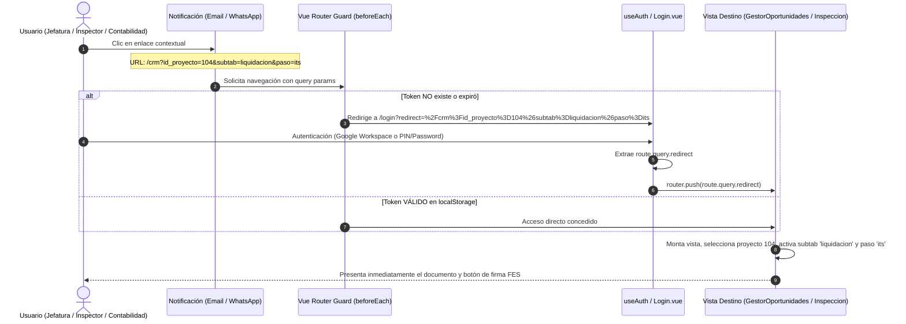

# Especificación Técnica N° 52: Sistema de Notificaciones Omnicanal (Email + WhatsApp) con Deep Linking Contextual

* **Código de Especificación**: `Spec 52`
* **Archivo**: `.agents/specs/52_notificaciones_omnichannel_deep_linking_spec.md`
* **Versión**: `1.0.0`
* **Fecha**: `24 de Septiembre de 2026`
* **Autor / Responsable**: Sergio Gajardo / Arquitectura de Software LeanGlobal
* **Módulos Afectados**:
  * Backend: `src/services/notificacionService.js`, `src/controllers/visitaTerrenoController.js`, `src/controllers/itsController.js`, `src/models/surveyModel.js`, `src/models/signatureModel.js`
  * Frontend Web: `src/router/index.js`, `src/composables/useAuth.js`, `src/views/CRM/GestorOportunidades.vue`, `src/views/Torre.vue`
  * Frontend PWA: `src/router/index.js`, `src/views/Inspeccion.vue`, `src/views/FirmaElectronica.vue`, `src/views/Login.vue`
  * Microservicios: `gsp-whatsapp` (Baileys en puerto 3085)
* **Especificaciones Previas Relacionadas**:
  * `Spec 16`: CRM Gestor de Oportunidades y Cotizaciones
  * `Spec 19`: Notificaciones por Email (Transaccional SMTP)
  * `Spec 41`: Gestión Avanzada de Visitas a Terreno y Asignación Dinámica
  * `Spec 46`: Informe de Término de Servicio (ITS - 8 Costos Directos)
  * `Spec 47`: Flujo de Aprobación FES de ITS con PIN de Seguridad
  * `Spec 50`: Despacho WhatsApp desde Torre de Control y Captura Telefónica
  * `Spec 51`: Módulo Ejecutivo de Backlog & Release Log de Marcha Blanca

---

## 1. Diagnóstico y Necesidad Operativa

### 1.1. Contexto Actual
El ecosistema de Grúas San Pablo ha venido operando las notificaciones bajo un esquema exclusivamente basado en correo electrónico (gobernado históricamente por la `Spec 19`). Si bien el flujo de enrolamiento FES funciona correctamente hacia la web, las notificaciones transaccionales asociadas a cambios de estado operativos adolecen de severas limitaciones de experiencia de usuario (UX) y eficacia de campo.

### 1.2. Deficiencias Detectadas
1. **Descontextualización de Enlaces (Ausencia de Deep Links)**:
   * En `visitaTerrenoController.js` (asignación y reasignación de visitas), el botón de acción apunta a la raíz de la PWA (`https://servidor.leanglobal.cl/pwa-gsp-dev/`). El inspector en terreno aterriza en la pantalla inicial y debe buscar manualmente su inspección.
   * En `itsController.js` (liquidación, V°B° jefatura y recepción contable), las notificaciones apuntan a la raíz del frontend web (`https://servidor.leanglobal.cl/lg-gsp-dev/`). La jefatura o contabilidad aterriza en el Dashboard genérico y debe navegar por el CRM, buscar la cotización, abrir la Sub-tab 7 y localizar el ITS.
   * En `signatureModel.js`, persisten referencias residuales a URLs de otros tenants (`lg-transmac-dev/`).

2. **La "Doble Falla de la Web" ante Sesión Expirada**:
   * **Falla A (Pérdida de Parámetros)**: Si el usuario pulsa un enlace contextual sin sesión activa en el navegador, el guard de Vue Router (`router.beforeEach`) detecta ausencia de token y ejecuta `next({ name: 'login' })`, descartando los query parameters (`id_proyecto`, `subtab`, `paso`).
   * **Falla B (Redirección Forzada)**: Al autenticarse exitosamente (Google OAuth o credenciales), `useAuth.js` ejecuta `router.push({ name: 'dashboard' })`, anulando el destino original.

3. **Inoperancia del Correo Electrónico en Terreno**:
   * En faenas mineras, industriales y de izaje, operadores de grúa, riggers, choferes e inspectores de terreno no leen correos en sus teléfonos durante el servicio.
   * La tasa de apertura de email en campo es inferior al 30% con demoras de 4 a 12 horas.
   * WhatsApp presenta una tasa de apertura superior al 95% con respuesta en menos de 2 minutos.
   * El microservicio `gsp-whatsapp` (puerto 3085, PM2 id 17) ya se encuentra desplegado y conectado a la red de WhatsApp vía Baileys, pero su uso ha estado restringido a la Torre de Control (`Spec 50`), sin integrarse a los flujos transaccionales de visitas, firmas e ITS.

---

## 2. Arquitectura de Resolución del Deep Linking

### 2.1. Resolución Integral de la Doble Falla en Vue Router



### 2.2. Implementación en Frontend Web (`ejecucion/frontend`)

1. **`src/router/index.js` — Guard con Preservación de Intención**:
   ```javascript
   router.beforeEach((to, from, next) => {
     const token = localStorage.getItem('token');
     const isPublic = to.name === 'login' || to.meta?.layout === 'public' || to.meta?.layout === 'print';

     if (!token && !isPublic) {
       return next({
         name: 'login',
         query: { redirect: to.fullPath }
       });
     }
     next();
   });
   ```

2. **`src/composables/useAuth.js` — Retorno Contextual Post-Login**:
   ```javascript
   const handleLoginSuccess = (data) => {
     localStorage.setItem('token', data.token);
     localStorage.setItem('user', JSON.stringify(data.user));

     const isEnrolPending = data.user?.flag_proc_enrol === true || data.user?.flag_proc_enrol === 't';
     if (isEnrolPending) {
       return router.push({ name: 'enrolamiento' });
     }

     const redirectUrl = route?.query?.redirect;
     if (redirectUrl && typeof redirectUrl === 'string' && redirectUrl.startsWith('/')) {
       router.push(redirectUrl);
     } else {
       router.push({ name: 'dashboard' });
     }
   };
   ```

3. **`src/views/CRM/GestorOportunidades.vue` — Consumo de Parámetros**:
   * Interpreta `route.query.id_proyecto` cargando la cotización/proyecto correspondiente.
   * Si `route.query.subtab` está presente (`validacion`, `asignacion`, `preparacion_salida`, `reports`, `liquidacion`), conmuta `topTab = 'operaciones'` y `operacionesSubTab = route.query.subtab`.
   * Si `route.query.paso` está presente dentro de liquidación (`its`, `edp`, `oc`, `factura`), activa `pasoCierreActivo = route.query.paso`.

4. **`src/views/Torre.vue` — Apertura Automática desde Enlace**:
   * Si la Torre de Control se invoca con `?id_proyecto=XX`, en `onMounted` ejecuta `abrirProyecto(route.query.id_proyecto, route.query.subtab)`.

### 2.3. Implementación en PWA Terreno (`ejecucion/pwa`)

1. **Estructura Hash**:
   * Deep link canónico: `https://servidor.leanglobal.cl/pwa-gsp-dev/#/inspeccion?id_survey=XX`
   * Deep link de firmas: `https://servidor.leanglobal.cl/pwa-gsp-dev/#/firmas?id_survey=XX`
2. **Carga Reactiva Directa en `Inspeccion.vue`**:
   * Si `route.query.id_survey` existe y el store local `surveyDetail` no contiene los datos del survey, el componente ejecuta de forma autónoma `GET /api/survey/:id_survey`, precarga la estructura en memoria y renderiza la encuesta de visita a terreno sin obligar al técnico a buscar en la lista.

---

## 3. Matriz Canónica de Eventos, Canales y Deep Links

| ID Evento | Suceso / Transición | Destinatario | Canales | Aplicación | Deep Link Canónico |
| :--- | :--- | :--- | :--- | :--- | :--- |
| **EVT-01** | Enrolamiento FES Usuario | Usuario nuevo | Email + WhatsApp | Web Pública | `/enrolamiento?email={email}&rut={rut}` |
| **EVT-02** | Asignación de Visita a Terreno | Inspector Técnico | **WhatsApp + Email** | PWA Terreno | `/#/inspeccion?id_survey={id_survey}` |
| **EVT-03** | Reasignación de Visita | Nuevo Inspector | **WhatsApp + Email** | PWA Terreno | `/#/inspeccion?id_survey={id_survey}` |
| **EVT-04** | Solicitud de Visita desde Preventa | Coordinador Operaciones | Email + WhatsApp | Web Pública | `/asignar-visita/{token}` |
| **EVT-05** | Firma FES Requerida en Survey | Mandante / Supervisor | **WhatsApp + Email** | PWA Terreno | `/#/firmas?id_survey={id_survey}` |
| **EVT-06** | Cotización Ganada pasa a OT | Operaciones / Planificador | Email | Web Privada | `/crm?id_proyecto={id}&subtab=asignacion` |
| **EVT-07** | ITS Liquidado listo para V°B° | Jefatura Operaciones (Richard) | **WhatsApp + Email** | Web Privada | `/crm?id_proyecto={id}&subtab=liquidacion&paso=its` |
| **EVT-08** | ITS Aprobado (Recepción Contable) | Contabilidad / Facturación | Email + WhatsApp | Web Privada | `/crm?id_proyecto={id}&subtab=liquidacion&paso=factura` |
| **EVT-09** | ITS Rechazado con Observaciones | Analista Operativo | **WhatsApp + Email** | Web Privada | `/crm?id_proyecto={id}&subtab=liquidacion&paso=its` |
| **EVT-10** | Hoja de Ruta / Despacho Contrapesos | Chofer de Camión | **WhatsApp Exclusivo**| Web Móvil | `/viaje/{token}` |
| **EVT-11** | Inicio Faena / Report Diario | Operador de Grúa | **WhatsApp** | PWA Terreno | `/#/reportDiario?id_proyecto={id}` |

---

## 4. Arquitectura Backend: Microservicio `notificacionService.js`

Se establece un servicio unificado en `ejecucion/backend_remoto/src/services/notificacionService.js` que desacopla a los controladores de la lógica de construcción de correos y WhatsApp.

### 4.1. Responsabilidades del Servicio
1. **Generador Canónico de URLs**: Centraliza las variables `BASE_URL_WEB` (`https://servidor.leanglobal.cl/lg-gsp-dev`) y `BASE_URL_PWA` (`https://servidor.leanglobal.cl/pwa-gsp-dev`).
2. **Normalizador Telefónico**: Convierte números locales chilenos (`912345678`, `+56 9 1234 5678`) al estándar E.164 requerido por Baileys (`56912345678`).
3. **Despachador Concurrente**: Ejecuta el envío vía SMTP (`MessageModel.js`) y vía HTTP hacia el bot local de WhatsApp (`http://127.0.0.1:3085/enviar`), capturando errores de forma independiente para que un fallo en WhatsApp no impida el envío de correo y viceversa.

### 4.2. Estructura de Mensajes WhatsApp
Los mensajes deben poseer diseño conciso, títulos claros en negrita y enlace visible:

```text
⚡ *GRÚAS SAN PABLO — OPERACIONES*
----------------------------------------
Estimado(a) *{nombre}*, se requiere su gestión:

📋 *Asunto:* {asunto}
🏗️ *Proyecto:* {codigo_proyecto} — {cliente}
📌 *Detalle:* {detalle}

Acceda directamente mediante el siguiente enlace:
👉 {deep_link}
----------------------------------------
_Mensaje automático del Sistema GSP_
```

---

## 5. Matriz de Seguridad y Privacidad

1. **Validación de Sesión y Expiración**: Los deep links que conducen a áreas privadas respetan el ciclo de vida del JWT. Si el token expiró, la pantalla de login solicita credenciales y reanuda la navegación hacia la URL protegida.
2. **Protección de Enlaces Públicos**: Los enlaces de asignación de visita (`/asignar-visita/{token}`) y hoja de ruta (`/viaje/{token}`) emplean tokens criptográficos UUIDv4 con expiración temporal o por un solo uso, evitando accesos indebidos.
3. **RBAC en Pantallas de Destino**: Si un usuario con rol de técnico hace clic en un deep link de facturación o ITS, el router y la API bloquean la vista y devuelven código `403 Forbidden`.

---

## 6. Fases de Despliegue y Validación

1. **Fase 1**: Implementación del guard con memoria `redirect` en `frontend` y `pwa`.
2. **Fase 2**: Creación de `notificacionService.js` en backend y conexión con `gsp-whatsapp`.
3. **Fase 3**: Refactorización de controladores (`visitaTerrenoController.js`, `itsController.js`, `signatureModel.js`, `surveyModel.js`).
4. **Fase 4**: Pruebas integrales de flujo en caliente (verificación de llegada simultánea de correo y WhatsApp con aterrizaje contextual).
5. **Fase 5**: Registro en el Backlog ejecutivo (`REQ-006`) y publicación en el Release Log (`v1.0.50`).
