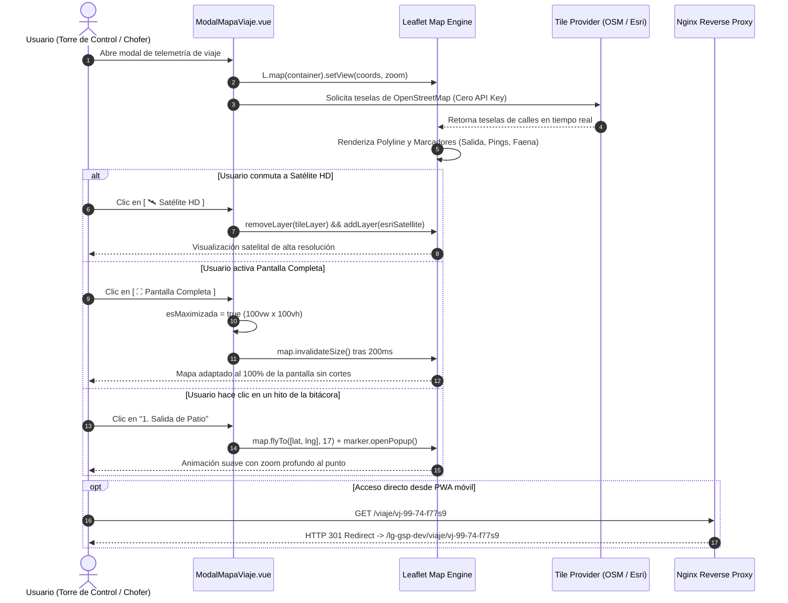

# Especificación Técnica N° 53: Visor de Mapa de Telemetría OSM, Capas Híbridas y Modo Pantalla Completa

* **Código de Especificación**: `Spec 53`
* **Archivo**: `.agents/specs/53_visor_mapa_telemetria_osm_pantalla_completa_spec.md`
* **Versión**: `1.0.0`
* **Fecha**: `24 de Septiembre de 2026`
* **Autor / Responsable**: Sergio Gajardo / Arquitectura de Software LeanGlobal
* **Módulos Afectados**:
  * Frontend Web: `src/components/Operaciones/ModalMapaViaje.vue`, `src/views/Operaciones/ViajeConductor.vue`
  * Frontend PWA: `src/views/Surveys.vue`
  * Infraestructura / Nginx: `/etc/nginx/default.d/base.conf` (`location /viaje/`)
  * Microservicios: `gsp-whatsapp-service` (Puerto 3085, Endpoint `/desvincular`)
* **Especificaciones Previas Relacionadas**:
  * `Spec 32`: Desplazamiento, Monitoreo de Viaje & Carga Combustible Copec Offline-First
  * `Spec 49`: Simplificación PWA Chofer y Report Secuencial con Combustible
  * `Spec 50`: Despacho WhatsApp desde Torre de Control y Captura Telefónica
  * `Spec 52`: Sistema de Notificaciones Omnicanal con Deep Linking Contextual

> [!NOTE]
> **Consolidación Canónica:** Esta especificación técnica se encuentra consolidada orgánicamente en la [**Spec 16 (Sección 13: Subpestaña 5 - Control de Flota, Despacho y Visor de Telemetría GPS)**](file:///D:/SGajardo/Google%20Drive/Antigravity/Gr%C3%BAas%20San%20Pablo/Propuesta%20Gesti%C3%B3n%20Operaci%C3%B3n%20Gr%C3%BAas/.agents/specs/16_crm_gestor_oportunidades_spec.md), como parte integral del Gestor de Oportunidades y Operaciones GSP.

---

## 1. Diagnóstico y Necesidad Operativa

### 1.1. Contexto y Hallazgo en Faena
Durante las pruebas de marcha blanca en terreno y monitoreo de la Hoja de Ruta (`/viaje/:token`), se identificaron tres fallas críticas de visualización y experiencia de usuario que impedían el seguimiento efectivo de la flota de grúas y camiones de apoyo:

1. **Inoperancia de CartoDB por Exigencia de API Key**:
   * El visor modal de telemetría (`ModalMapaViaje.vue`) consumía teselas cartográficas de `basemaps.cartocdn.com/rastertiles/voyager/{z}/{x}/{y}{r}.png`.
   * El proveedor CartoDB comenzó a exigir autenticación obligatoria, renderizando una marca de agua persistente e invasiva: *"API KEY REQUIRED carto.com/basemaps/apikey"* que degradaba la visibilidad operativa y bloqueaba la lectura de caminos rurales y faenas.
2. **Restricción de Espacio Visual (Viewport Pequeño)**:
   * En monitores de escritorio de la Torre de Control y notebooks de supervisores, el modal estaba acotado a un ancho máximo `max-w-5xl` con altura fija, dividiendo la pantalla a la mitad con el panel de bitácora.
   * Esto impedía a los despachadores y jefes de operaciones apreciar la panorámica completa del convoy, los accesos a faena y las curvas complejas del trayecto.
3. **Falla de Enlace Corto en PWA y Nginx**:
   * En `Surveys.vue` (PWA móvil), el enlace directo al viaje apuntaba a `/viaje/:token` en la raíz del servidor (`https://servidor.leanglobal.cl/viaje/...`), pero Nginx en el servidor no tenía configurada la regla de redirección hacia `/lg-gsp-dev/viaje/:token`, provocando un error 404 Not Found al hacer clic desde la app móvil.

---

## 2. Requerimientos Funcionales (RF)

### RF-53.1: Sustitución de CartoDB por OpenStreetMap y Capas Híbridas Gratuitas (Cero API Key)
* **Descripción**: Erradicar toda dependencia de proveedores de mapas de pago o con marcas de agua restrictivas. El visor debe soportar 3 capas base 100% abiertas, gratuitas y de alta disponibilidad:
  1. **Calles (OSM)** (*Capa por defecto*):
     - URL Template: `https://{s}.tile.openstreetmap.org/{z}/{x}/{y}.png`
     - Atribución: `&copy; <a href="https://www.openstreetmap.org/copyright">OpenStreetMap</a> contributors`
     - Zoom Máximo: 19.
  2. **Satélite HD (Esri World Imagery)**:
     - URL Template: `https://server.arcgisonline.com/ArcGIS/rest/services/World_Imagery/MapServer/tile/{z}/{y}/{x}`
     - Atribución: `Tiles &copy; Esri &mdash; Source: Esri, i-cubed, USDA, USGS, AEX, GeoEye, Getmapping, Aerogrid, IGN, IGP, UPR-EGP, and the GIS User Community`
     - Zoom Máximo: 19.
  3. **Topográfico (Esri World Topo Map)**:
     - URL Template: `https://server.arcgisonline.com/ArcGIS/rest/services/World_Topo_Map/MapServer/tile/{z}/{y}/{x}`
     - Atribución: `Tiles &copy; Esri &mdash; Esri, DeLorme, NAVTEQ, TomTom, Intermap, iPC, USGS, FAO, NPS, NRCAN, GeoBase, Kadaster NL, Ordnance Survey, Esri Japan, METI, Esri China (Hong Kong), and the GIS User Community`
     - Zoom Máximo: 18.
* **Control de Capas**: Botonera flotante en la esquina inferior derecha del mapa (`[ 🗺️ Calles (OSM) ]`, `[ 🛰️ Satélite HD ]`, `[ ⛰️ Topográfico ]`), con realce visual activo (azul Tailwind `bg-blue-600`) y conmutación reactiva inmediata sin destruir la instancia de Leaflet.

### RF-53.2: Modo Pantalla Completa / Maximización con Redibujado Automático
* **Descripción**: Permitir alternar el modal entre el tamaño estándar de ventana flotante (`max-w-5xl`, `max-h-[92vh]`) y el modo Pantalla Completa inmersivo (`100vw × 100vh`, `fixed inset-0 z-[100]`).
* **Redibujado de Canvas Leaflet**: Al alternar el modo, se debe invocar obligatoriamente `nextTick()` seguido de `setTimeout(() => map.invalidateSize(), 200)` para recalcular las dimensiones físicas del contenedor DOM y evitar cuadros grises o desalineación de teselas.
* **Iconografía y Tooltips**: Botón de alternancia en cabecera: `[ ⛶ Pantalla Completa ]` ➔ `[ 🗗 Restaurar ]`.

### RF-53.3: Panel de Bitácora Colapsible (100% Ancho al Mapa)
* **Descripción**: Permitir ocultar el panel lateral de bitácora y waypoints mediante un control flotante `[ 📋 Ocultar Bitácora ]` / `[ 📋 Ver Bitácora ]`.
* **Comportamiento**:
  * Si la bitácora está oculta (`!mostrarBitacora`), el contenedor del mapa toma `col-span-12` (100% del ancho del modal).
  * Si la bitácora está visible, el mapa toma `col-span-9` en pantalla completa o `col-span-7` en tamaño normal.
  * Se invoca automáticamente `map.invalidateSize()` tras la transición.

### RF-53.4: Navegación Interactiva por Hitos (FlyTo a Waypoints)
* **Descripción**: Cada hito en la bitácora cronológica (1. Salida de Patio, 2. Telemetría en Ruta, 4. Arribo a Faena) debe ser cliqueable.
* **Comportamiento de Animación**:
  * Al hacer clic en un hito, el mapa ejecuta una transición suave `map.flyTo([lat, lng], 17, { animate: true, duration: 1.2 })`.
  * Abre automáticamente el popup descriptivo asociado al marcador correspondiente con los datos de odómetro, horómetro, velocidad y estampa de tiempo.
* **Botón Centrar Ruta**: Botón flotante `[ 🎯 Centrar Ruta ]` que ejecuta `map.fitBounds(polyline.getBounds(), { padding: [40, 40] })` para re-encuadrar instantáneamente toda la trayectoria recorrida.

### RF-53.5: Redirección Canónica de Enlaces Cortos en Nginx y PWA
* **Descripción**:
  1. En `/etc/nginx/default.d/base.conf`, registrar la regla de reescritura:
     ```nginx
     location = /viaje {
         return 301 https://$host/lg-gsp-dev/viaje/;
     }
     location /viaje/ {
         rewrite ^/viaje/(.*)$ /lg-gsp-dev/viaje/$1 permanent;
     }
     ```
  2. En `ejecucion/pwa/src/views/Surveys.vue`, el método `abrirViajeNativo` debe construir la URL canónica directa: `${baseOrigin}/lg-gsp-dev/viaje/${token}` garantizando resolución instantánea en navegadores móviles.

---

## 3. Arquitectura Técnica y Flujo de Interacción



---

## 4. Matriz de Componentes y Capas

| Componente / Archivo | Versión | Tipo de Intervención | Responsabilidad |
| :--- | :---: | :---: | :--- |
| `ModalMapaViaje.vue` | `v1.2.0` | Frontend Component | Leaflet OSM por defecto, capas Esri, Pantalla Completa, centrado dinámico, waypoints flyTo. |
| `Surveys.vue` (PWA) | `v1.0.26` | PWA View | Generación de enlace canónico `/lg-gsp-dev/viaje/:token`. |
| `base.conf` (Nginx) | `v1.1.0` | Infraestructura | Redirección 301 permanente `/viaje/*` ➔ `/lg-gsp-dev/viaje/*`. |
| `server.js` (`gsp-whatsapp`) | `v1.1.0` | Microservicio (3085) | Endpoint `/desvincular` y botón de reinicio para administración QR Baileys. |

---

## 5. Plan de Verificación y Criterios de Aceptación

1. **Verificación de Mapa Libre de Marcas de Agua**:
   - Abrir el modal de telemetría de viaje en la OT `GSP-2609-2164-010`.
   - Constatar ausencia absoluta de mensajes *"API KEY REQUIRED"*.
   - Comprobar correcta carga de teselas OSM en calles y Esri en satélite/topo.
2. **Verificación de Pantalla Completa**:
   - Pulsar `[ ⛶ Pantalla Completa ]`: el modal debe expandirse a `100vw × 100vh` sin márgenes residuales.
   - Pulsar `[ 🗗 Restaurar ]`: el modal debe regresar al tamaño centrado sin desalineación visual.
3. **Verificación de Redirección Nginx**:
   - Ejecutar `curl -I -L https://servidor.leanglobal.cl/viaje/vj-99-74-f77s9`.
   - Respuesta esperada: `HTTP/1.1 301 Moved Permanently` ➔ `HTTP/1.1 200 OK`.
4. **Verificación de Compilación**:
   - `vite build` en Frontend: 0 errores de sintaxis, 0 fallas de tipos.
