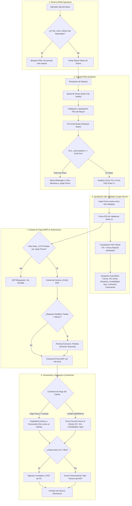

# Especificación Técnica Nº 57: Ciclo Integral de Gobernanza Operacional y Financiera — Reports Diarios de Faena, Informes Técnicos de Servicio (ITS), Estados de Pago (EDP), Órdenes de Compra (OC) y Facturación

* **Código de Especificación**: `Spec 57`
* **Archivo**: `.agents/specs/57_ciclo_integral_reports_its_edp_y_facturacion_spec.md`
* **Versión**: `1.2.0`
* **Fecha**: `28 de Octubre de 2026`
* **Requerimientos Asociados**: `REQ-1081` (Anticipación de Liquidación Diaria de Personal y Viáticos en Report Diario y Traspaso al ITS)
* **Estado**: `APROBADA E IMPLEMENTADA EN PRODUCCIÓN (v1.0.170)`
* **Autores / Stakeholders**:
  * Sergio Gajardo (Líder de Proyecto LeanGlobal)
  * Jorge Ponce (Contraparte Técnica y Patrocinador GSP)
  * Omar Ghiselini (Gerente General GSP)
  * Yiara Mendoza (Control de Gestión de Flota / PMO)
  * Pamela (Gerencia de Tesorería GSP)
* **Módulos Afectados**:
  * **Frontend Web**:
    * Cockpit PMO / Analista: `ejecucion/frontend/src/views/Operaciones/CockpitPMO.vue`, `ejecucion/frontend/src/components/Operaciones/ModalVisorReport.vue`
    * CRM / Gestor de Oportunidades: `ejecucion/frontend/src/views/CRM/GestorOportunidades.vue`
    * PWA Móvil Operador: `ejecucion/frontend/src/views/PWA/Surveys.vue` (Portal PWA)
  * **Backend API & Microservicios**:
    * Reportes Diarios: `ejecucion/backend_remoto/src/controllers/reportDiarioController.js`, `services/reportDiarioPdfService.js`
    * Informe Técnico de Servicio (ITS): `ejecucion/backend_remoto/src/controllers/itsController.js`, `services/itsPdfService.js`
    * Estado de Pago (EDP): `ejecucion/backend_remoto/src/controllers/edpController.js`, `services/edpPdfService.js`
    * Facturación & OC: `ejecucion/backend_remoto/src/controllers/facturacionController.js`
    * Notificaciones & SLA Bot: `ejecucion/backend_remoto/src/services/whatsappNotificationService.js`, `cron/slaNotificationWorker.js`
  * **Base de Datos (PostgreSQL `sch_leangsp`)**:
    * `topr_report_diario`, `topr_its`, `topr_its_detalle`, `topr_edp`, `topr_facturacion`, `tsec_users`, `tsec_roles`
* **Especificaciones Previas Relacionadas**:
  * `Spec 16`: CRM Gestor de Oportunidades y Pipeline Operativo
  * `Spec 34`: Report Diario de Faena con Firma Manual y Horómetros
  * `Spec 38`: Liquidación de EDP y Facturación
  * `Spec 46` & `Spec 47`: Informe de Término de Servicio (ITS) y Flujo FES
  * `Spec 52`: Notificaciones Omnichannel con Deep Linking

---

## 1. Diagnóstico, Contexto y Motivación de Negocio

El modelo de control de faenas de Grúas San Pablo exige una cadena de custodia inquebrantable entre el trabajo físico ejecutado en faena y la liquidación contable de los servicios prestados.

Durante la operación y marcha blanca se identificaron puntos críticos que requerían una estandarización técnica determinista:

1. **Ambigüedad de Interfaces (Edición vs Consulta):**  
   Existía dispersión en los puntos de modificación de datos de faena. Era indispensable decretar que los elementos de control operacional y financiero (validación de horas, horas extras, descuentos de colación, horas de traslado) se gestionen **única y exclusivamente en el Cockpit del Analista (PMO)**, manteniendo el Kanban de Oportunidades estrictamente como un visor de seguimiento de solo lectura.
2. **Defecto de Desplazamiento de Zona Horaria (GMT-3 America/Santiago):**  
   La presentación de horas extraídas en crudo de marcas UTC de base de datos provocaba desfases de +3 horas en visores de reports respecto a la trazabilidad y el Kanban. Es mandatorio unificar el parseo y renderizado bajo `America/Santiago`.
3. **PWA Terreno — Control de Emisión Post-Término:**  
   En servicios concluidos (de 1 día o faenas que ya reportaron su última jornada comprometida), la PWA del operador continuaba permitiendo la creación de nuevos reports huérfanos. Se requiere un filtro dinámico que discrimine y bloquee OTs cerradas.
4. **ITS Incremental y Cumplimiento de SLA Operativo:**  
   Los servicios multi-día requieren que el Analista ingrese información día a día de forma incremental sin cerrar el documento. Asimismo, la validación final del ITS cuenta con un SLA perentorio de cierre: **hasta las 13:00 hrs del día posterior al término del servicio**, gatillando escalamiento inmediato por WhatsApp ante atrasos.
5. **Cadena de Doble Firma FES en ITS y Anexación Documental:**  
   El ITS debe ser sellado con PIN FES primero por el Analista y luego validado y firmado por Jorge Ponce (2do Validador Técnico), anexando automáticamente todos los Reports Diarios aprobados en un expediente único despachado a Gerencia General (Omar Ghiselini), Contabilidad, Operaciones, Comercial y Facturación.
6. **Gobernanza de EDP y Facturación:**  
   El EDP posee un Hard Gate que impide su emisión sin el ITS completamente aprobado por Jorge Ponce. Su emisión corresponde al Comercial, pero la modificación de valores económicos está restringida de forma exclusiva a **Pamela (Gerente de Tesorería)**. Por último, clientes que ya cancelaron de forma anticipada no deben recibir correos de cobro de EDP, y la carencia de Orden de Compra (OC) no debe detener la emisión de Factura, asumiendo el valor liquidado del EDP.

---

## 2. Arquitectura de Dominio y Reglas de Negocio



---

## 3. Especificación Detallada por Capas y Componentes

### 3.1. Separación de Roles: Cockpit PMO vs Kanban de Oportunidades
1. **Regla de Inmutabilidad en Kanban (`GestorOportunidades.vue`):**
   * En el Kanban de OTs, las columnas y modales de inspección de Reports, ITS, EDP y Facturación se presentan en **Modo Solo Lectura**.
   * No existen botones de mutación como `[Ajustar Horario]`, `[Aprobar Report]`, `[Emitir EDP]` ni `[Modificar Valores]` en el Kanban general de ventas.
   * Su función es puramente de visibilidad operativa (badges de avance, estado de firmas y descarga de PDFs emitidos).
2. **Exclusividad del Cockpit PMO (`CockpitPMO.vue` & `ModalVisorReport.vue`):**
   * El Analista de Control de Gestión dispone del entorno exclusivo para auditar las marcas horarias de faena reportadas por los operadores.
   * Cuando el Analista ajusta un horario (ej. descuento por almuerzo o corrección de inicio real de maniobra), el visor documenta el cambio de forma visual y auditable:
     - Horario reportado original en faena: tachado en rojo suave (`08:30 ➔ 18:00`).
     - Horario vigente del analista: resaltado en verde esmeralda (`08:00 ➔ 18:00`) acompañado del badge `[AJUSTADO]`.
     - Trazabilidad inferior con autor, fecha, hora y justificación del ajuste.

### 3.2. Normalización de Zona Horaria (America/Santiago)
1. **Frontend (`ModalVisorReport.vue`):**
   * Toda cadena de tiempo ISO (`YYYY-MM-DDTHH:mm:ss.sssZ`) debe formatearse mediante:
     ```javascript
     const formatHoraChile = (isoStr) => {
       if (!isoStr) return '--:--';
       const date = new Date(isoStr);
       return date.toLocaleTimeString('es-CL', {
         timeZone: 'America/Santiago',
         hour: '2-digit',
         minute: '2-digit',
         hour12: false
       });
     };
     ```
   * Queda estrictamente prohibido realizar `split('T')[1].slice(0, 5)` sobre cadenas UTC para representar horas locales de faena.
2. **Backend & Generación de PDF (`reportDiarioPdfService.js`):**
   * Los servicios de renderizado de PDF en Node.js formatean las marcas horarias y fechas con `timeZone: 'America/Santiago'`, garantizando paridad milimétrica entre la pantalla web y el PDF impreso.

### 3.3. PWA Terreno: Regla de Cómputo de Inicio (Urbano vs Rural), Término de Faena y Filtrado de Pendientes
1. **Regla de Cómputo de Inicio de Servicio en Momento 1 (Urbano vs Rural):**
   * **Servicio Urbano (≤ 30 km desde Base GSP):** El cómputo de horas del servicio y el horómetro inicial corren **desde que el equipo sale de la base de Grúas San Pablo** (cómputo base a base). El cobro de flete se rige estrictamente según lo pactado en la cotización comercial (p. ej. movilización de contrapesos, traslado en cama baja para grúas de alto tonelaje o flete urbano acordado).
   * **Servicio Rural (> 30 km desde Base GSP):** El cómputo de horas corre **exclusivamente en faena (portón a portón)**: inicia cuando la grúa arriba y se posiciona en obra/faena, y concluye al terminar la maniobra. Los traslados de ida y vuelta se facturan como flete / movilización según cotización (cama baja o traslado de apoyo).
   * En ambos regímenes, el operador o rigger registra en la PWA la fecha, hora de salida de base, hora de arribo a faena, horómetro inicial y odómetro del equipo con respaldo fotográfico del tablero.
2. **Discriminación de OTs Pendientes en Home PWA (`Surveys.vue`):**
   * Al abrir la PWA móvil del operador, el endpoint `GET /api/pwa/reportes-pendientes` analiza los servicios asignados al operador:
     * Si la OT está planificada por 1 jornada y ya cuenta con un Report Diario emitido para esa fecha $\rightarrow$ la OT **no se muestra** en la lista de pendientes de reporte.
     * Si la OT es multi-día y ya cuenta con el número total de días pactados reportados (o la fecha actual es posterior al `fecha_termino` y se completaron los días) $\rightarrow$ se desactiva y bloquea la creación de nuevos reports para esa OT.
3. **Bloqueo en Endpoint de Creación (`reportDiarioController.js`):**
   * Antes de insertar un nuevo report en `tedp_reporte_avance`, el backend valida que la OT no haya superado su cuota de días o que no se encuentre en estado liquidado/cerrado, retornando HTTP 403 con mensaje de negocio amigable: *"Esta orden de trabajo ya completó sus jornadas de faena autorizadas"*.

### 3.3.B. Verificación de Liquidación Diaria de Personal y Viáticos en el Report Diario y Traspaso al ITS (`REQ-1081`)
1. **Propósito de Negocio (Independencia del Cierre Mensual de Remuneraciones frente al Cierre del ITS):**
   * En faenas multi-día que cruzan el cierre de mes (ej. un servicio de 20 días que lleva 10 días ejecutados al día 30 o 31 del mes), el ITS no se cerrará sino hasta el mes siguiente.
   * Para garantizar que **RRHH / Remuneraciones (Tesalia Malatesta)** liquide sueldos, horas de operador y viáticos el último día calendario de cada mes (o ante finiquitos a mitad de mes), la **verificación de costos de personal y viáticos se anticipa y ejecuta directamente en cada Report Diario** al momento en que **Control de Gestión (Yiara)** valida el report antes de las 13:00 hrs del día hábil siguiente.
2. **Sección 3 en `ModalVisorReport.vue` ("3. Liquidación Diaria de Personal y Viáticos — RRHH / Remuneraciones"):**
   * Al abrir cualquier Report Diario en el Visor del Analista (`ModalVisorReport.vue`), el backend (`reportDiarioController.js -> construirLiquidacionPersonalDiaReport`) cruza automáticamente el **Registro de Viaje del día** (`tequ_log_desplazamiento`: `hora_salida_base`, `hora_llegada_obra`, `hora_retorno_base`), las **Horas del Report Diario** (`hora_inicio`, `hora_termino`, `horas_colacion`, `horas_standby_cliente`, `horas_standby_gsp`), la **línea comercial cotizada** (`crm_v1.lineas_servicio` $\rightarrow$ `tpar_tarifa_operador`) y el régimen territorial (**Urbano $\le 30\text{ km}$** vs. **Rural $> 30\text{ km}$**).
   * Presenta los tiempos consolidados del día (`Salida Base`, `Llegada Obra`, `Inicio Obra`, `Término Obra`, `Retorno Base`, `Condición Día`) y una tabla editable para el **Operador** y, cuando participa en el report, para el **Rigger**:
     - **Operador:** `Hrs Faena / Servicio`, `Hrs Flete`, `Total Hrs Pagar`, `Tarifa $/hr` (resuelta según equipo comercial vendido en `tpar_tarifa_operador`), `Total Hrs ($)`, `Hrs Efectivas Viático` y `Viático Alimentación ($)` (escala oficial: $<8\text{h} = \$0$; $8\text{h} = \$7.000$; $+\$1.000/\text{h}$ adicional hasta tope $\$18.000$).
     - **Rigger:** `Hrs Faena / Servicio`, `Hrs Flete`, `Total Hrs Medidas`, `Tarifa $/hr = $0 (Sueldo Fijo)`, `Total Hrs ($) = $0`, `Hrs Efectivas Viático` y `Viático Alimentación ($)`.
   * Cuando el Analista modifica las horas de inicio, término o colación en la Sección 2 del Visor de Report, la Sección 3 recalcula reactivamente las horas a pagar y el viático sugerido, permitiendo además la edición manual directa de cualquier monto o cantidad de horas antes de firmar.
3. **Persistencia en `tedp_reporte_avance.ajustes_analista.liquidacion_personal_dia`:**
   * Al validar el Report Diario con PIN FES (`PUT /api/operaciones/report/:id_report/validar-analista`), se persiste el objeto `liquidacion_personal_dia` dentro de `tedp_reporte_avance.ajustes_analista` con `validado_rrhh: true`, `fecha_validacion` y los sub-objetos auditados de `operador` y `rigger`.
4. **Traspaso Automático al ITS (`itsController.js` & `ModalITS.vue`):**
   * Al abrir o generar el ITS del servicio, `itsController.js` lee `ajustes_analista.liquidacion_personal_dia` de cada Report Diario y **traspasa directamente** esos valores verificados a la pestaña `Hora Operador` y a la pestaña `Viático Alimentación` del ITS, marcando cada fila con el badge **`✓ Report`** (`origen_verificacion: 'REPORT_DIARIO'`).
   * Los campos en el ITS se mantienen editables por excepción con trazabilidad (`⚠️ Modificado`).

### 3.4. ITS (Informe Técnico de Servicio)
1. **Ingreso Incremental y Autosave (Exclusivo Analista):**
   * Tabla `tits_informe_termino`: campos de cabecera, id_proyecto, observaciones generales, horómetros finales, estado (`BORRADOR`, `EN_REVISION_OPERACIONES`, `EN_REVISION_CONTABILIDAD`, `CONCLUIDO`).
   * El Analista puede actualizar el informe diariamente tras validar cada report de la jornada sin cerrar el documento.
2. **SLA Operacional (13:00 hrs del día posterior):**
   * **Regla de Negocio:** La validación completa del ITS debe finalizar antes de las 13:00 hrs del día hábil posterior a la fecha de término del servicio en faena.
3. **Alerta Automática por WhatsApp (Bot Microservicio 3085):**
   * Un cron worker ejecuta a las 13:01 hrs un barrido de OTs con servicios terminados en la jornada previa cuyo ITS se mantenga en estado borrador o sin firma del analista.
   * Dispara mensaje instantáneo por WhatsApp a los números oficiales de:
     * **Yiara Mendoza** (Control de Flota / PMO)
     * **Jorge Ponce**
   * Formato del mensaje:
     ```text
     ⚠️ ALERTA SLA ITS - GRÚAS SAN PABLO
     La OT {codigo_ot} ({cliente}) finalizó sus servicios en faena pero su ITS aún no ha sido validado y cerrado por el Analista.
     ⏰ Plazo máximo: Hoy 13:00 hrs (VENCIDO).
     Favor coordinar cierre inmediato para no retrasar la facturación.
     🔗 Ver OT: https://leanglobal.cl/lg-gsp-dev/pmo/{id_proyecto}
     ```
4. **Flujo de Doble Firma FES:**
   * **Paso 1 (Firma Analista):** El Analista concluye el informe, ingresa su PIN FES de 4 dígitos. Se genera hash criptográfico SHA-256 en `tfes_signatures`. El estado transiciona a `EN_REVISION_OPERACIONES`.
   * **Paso 2 (Firma Jorge Ponce):** Jorge Ponce accede desde su bandeja de validación, revisa el contenido técnico, da su conformidad y sella con su PIN FES. El estado transiciona a `EN_REVISION_CONTABILIDAD`.
5. **Compilación PDF con Anexo Documental Completo:**
   * Al consolidarse la firma de Jorge Ponce, `itsPdfService.js` genera el documento PDF oficial del ITS.
   * **Estructura del PDF:**
     * Página 1-2: Carátula ejecutiva, resumen de maniobras, equipos participantes, horómetros iniciales/finales, sellos FES de Analista y Jorge Ponce.
     * Páginas siguientes (Anexo): Concatena e incrusta de forma obligatoria los PDFs oficiales de **todos los Reports Diarios aprobados** de la faena con sus respectivas firmas de faena y registro fotográfico.
6. **Despacho Multicanal del Expediente ITS:**
   * Se despacha un correo automatizado adjuntando el PDF consolidado a las siguientes casillas:
     * **Gerencia General (Omar Ghiselini)**
     * **Contabilidad**
     * **Operaciones**
     * **Comercial**
     * **Facturación**

### 3.5. EDP (Estado de Pago)
1. **Hard Gate Determinista de ITS Firmado:**
   * La emisión de un EDP está condicionada estrictamente a `topr_its.estado === 'APROBADO_OPS'`.
   * Si no existe ITS o no cuenta con la firma de Jorge Ponce, el botón `[Emitir Estado de Pago]` se encuentra inhabilitado (`disabled`), informando con tooltip: *"Requiere ITS aprobado con visto bueno técnico"*.
2. **Responsable de Emisión:**
   * La emisión inicial del EDP es efectuada por el **Ejecutivo Comercial** a cargo de la cuenta.
3. **Gobernanza de Modificación de Valores (Exclusividad Pamela / Tesorería):**
   * Una vez generado el EDP preliminar a partir de las horas liquidadas del ITS, **ningún comercial ni analista puede modificar tarifas, recargos o aplicar descuentos**.
   * **Permiso Exclusivo:** Únicamente **Pamela (Gerente de Tesorería)**, bajo el rol `GSP_TESORERIA` (o usuario expresamente autorizado), tiene la potestad de desbloquear los inputs de tarifas y montos del EDP.
   * Cualquier ajuste económico deja una traza en `topr_edp_log` con usuario, monto anterior, monto nuevo y justificación.
4. **Firma FES del Comercial:**
   * El Comercial revisa las condiciones comerciales finales y firma con su PIN FES.
5. **Bifurcación de Envío según Condición de Pago:**
   * **Escenario A — Cliente con Pago Previo / Contado / Transferencia Anticipada:**
     - Si el cliente ya pagó la totalidad del servicio previo a la faena, el EDP no se despacha al cliente (para evitar confusión comercial innecesaria).
     - El EDP se almacena como respaldo de liquidación interna y pasa de forma automática a la bandeja de **Facturación**.
   * **Escenario B — Cliente a Crédito (30 / 60 / 90 días):**
     - Se genera el PDF formal del EDP firmado y se envía por correo al cliente solicitando su visado / Orden de Compra.
     - Destinatarios en copia (CC): **Gerencia General, Contabilidad y Operaciones**.

### 3.6. Órdenes de Compra (OC / HES) y Facturación
1. **Tratamiento ante Ausencia de OC:**
   * Si el cliente NO emite Orden de Compra (OC) o Hoja de Entrada de Servicios (HES) por tratarse de un cliente recurrente de confianza o particular:
     - El sistema **no bloquea el flujo**.
     - Se asume como base imponible el **Valor Factura liquidado en el EDP**.
     - El campo `numero_oc` se registra automáticamente como `"S/OC - ASUME EDP"` o `"VENTA DIRECTA"`.
2. **Tratamiento con OC Existente:**
   * Si el cliente emite OC, el administrativo ingresa el número correlativo y adjunta el archivo PDF de la OC del cliente, validando consistencia con el monto neto del EDP antes de la generación del folio de Facturación Electrónica.
3. **Emisión de Factura:**
   * El módulo de Facturación registra el folio de factura del SII, fecha de emisión, monto neto, IVA y monto total, cerrando el ciclo operacional y financiero de la OT.

---

## 4. Matriz de Roles y Permisos RBAC

| Función / Operación | Operador Terreno | Analista PMO | Coord. Operaciones (Jorge P.) | Comercial | Gerente Tesorería (Pamela) | Contabilidad / Facturación |
| :--- | :---: | :---: | :---: | :---: | :---: | :---: |
| **Emitir Report Diario (PWA)** | ✅ (Faena activa) | ❌ | ❌ | ❌ | ❌ | ❌ |
| **Ajustar Horas de Faena Reportadas** | ❌ | ✅ (Cockpit PMO) | ❌ | ❌ | ❌ | ❌ |
| **Aprobar Report Diario con PIN FES** | ❌ | ✅ (Cockpit PMO) | ❌ | ❌ | ❌ | ❌ |
| **Ingreso Incremental de ITS** | ❌ | ✅ | ❌ | ❌ | ❌ | ❌ |
| **Firma FES de ITS (Paso 1)** | ❌ | ✅ | ❌ | ❌ | ❌ | ❌ |
| **Firma FES de ITS (Paso 2 / Cierre)** | ❌ | ❌ | ✅ | ❌ | ❌ | ❌ |
| **Emitir Estado de Pago (EDP)** | ❌ | ❌ | ❌ | ✅ (Gate ITS OK) | ❌ | ❌ |
| **Modificar Tarifas / Montos EDP** | ❌ | ❌ | ❌ | ❌ | ✅ (Exclusivo) | ❌ |
| **Firma FES Comercial de EDP** | ❌ | ❌ | ❌ | ✅ | ❌ | ❌ |
| **Emitir Folio de Factura** | ❌ | ❌ | ❌ | ❌ | ❌ | ✅ |

---

## 5. Matriz de Casos de Prueba (QA Acceptance Criteria)

| ID | Escenario | Entrada / Acción | Resultado Esperado | Criterio de Aceptación |
| :--- | :--- | :--- | :--- | :--- |
| **TC-57.1** | Bloqueo de emisión en PWA post-término | Operador intenta emitir report en OT de 1 día que ya tiene report enviado. | PWA no muestra la OT en lista de pendientes; si intenta forzar petición, backend responde HTTP 403. | `PASSED`: Cero emisión de reports huérfanos. |
| **TC-57.2** | Formateo horario America/Santiago | Carga de report con marca UTC `"2026-10-01T11:00:00Z"`. | En pantalla y PDF muestra exactamente `08:00 hrs` (horario Chile continental GMT-3). | `PASSED`: Cero desfases de +3 horas. |
| **TC-57.3** | Visualización de ajustes del analista | Analista modifica horario reportado `08:30` por `08:00`. | Se muestra `08:30` tachado en rojo y `08:00` en verde con badge `[AJUSTADO]`. Trazabilidad consistente. | `PASSED`: Auditoría transparente sin confusión. |
| **TC-57.4** | Alerta SLA ITS por WhatsApp | OT terminada el día anterior y reloj marca 13:01 hrs sin ITS cerrado. | Worker dispara mensaje de WhatsApp a Yiara Mendoza y Jorge Ponce con link de acceso a la OT. | `PASSED`: Escalamiento proactivo automático. |
| **TC-57.5** | Hard Gate de emisión de EDP | Comercial intenta emitir EDP de OT con ITS en borrador o sin firma de Jorge Ponce. | Botón `[Emitir EDP]` bloqueado con advertencia de dependencia de visto bueno técnico. | `PASSED`: Imposible emitir EDP sin validación técnica. |
| **TC-57.6** | Restricción de edición de montos EDP | Comercial intenta alterar tarifas del EDP emitido. | Campos deshabilitados (`readonly`). Solo usuario con rol de Tesorería (Pamela) puede desbloquearlos. | `PASSED`: Gobernanza financiera blindada. |
| **TC-57.7** | Cliente con pago previo vs cliente crédito | Emisión de EDP en cliente contado vs cliente crédito 30 días. | Cliente contado: no se envía correo a cliente, transiciona a Facturación. Cliente crédito: despacha correo con CC a GG, Conta y Ops. | `PASSED`: Lógica comercial inteligente. |
| **TC-57.8** | Facturación sin Orden de Compra (OC) | Transición a Facturación de OT donde el cliente no emitió OC formal. | Sistema asume valor liquidado del EDP y permite registrar folio de factura sin trabar el proceso. | `PASSED`: Flujo continuo de caja y cobranza. |

---

## 6. Elementos Pendientes para el Backlog

* **Modelo de Servicios Recurrentes / Largo Aliento (Modo Arriendo):**  
  Diseñar la extensión estructural del modelo de datos para permitir que servicios de arriendo mensual o faenas de larga duración continúen bajo el mismo ID de negocio/proyecto, con cortes periódicos de facturación (EDP mensual/quincenal) sin necesidad de recrear una nueva OT cada mes.
