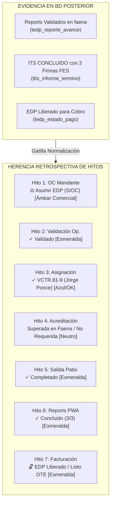

# Especificación Técnica Nº 58: Torre de Control PMO — Gobernanza de PDFs, Barra de Avance Global y Herencia Retrospectiva de Estados (Lifecycle-Aware Matrix)

* **Código de Especificación**: `Spec 58`
* **Archivo**: `.agents/specs/58_torre_control_pmo_avance_global_y_herencia_estados_spec.md`
* **Versión**: `1.0.0`
* **Fecha**: `02 de Octubre de 2026`
* **Estado**: `APROBADA E IMPLEMENTADA`
* **Requerimiento Backlog**: `REQ-036`
* **Autores / Stakeholders**:
  * Sergio Gajardo (Líder de Arquitectura y Desarrollo LeanGlobal)
  * Jorge Ponce (Contraparte Técnica Operaciones GSP)
  * Omar Ghiselini (Gerente General GSP)
  * Pamela Seguel (Gerente de Tesorería GSP)
  * Yiara Mendoza (Control de Gestión de Flota y PMO)
* **Módulos Afectados**:
  * **Frontend Web**:
    * Torre de Control PMO: `ejecucion/frontend/src/views/Torre.vue`
    * Modal Informe de Término de Servicio: `ejecucion/frontend/src/components/Operaciones/ModalITS.vue`
  * **Backend API**:
    * Controlador ITS: `ejecucion/backend_remoto/src/controllers/itsController.js` (`/operaciones/its/preview-pdf/:id_proyecto`)
    * Controlador EDP: `ejecucion/backend_remoto/src/controllers/estadoPagoController.js` (`/operaciones/edp/proyecto/:id_proyecto/pdf`)
  * **Base de Datos (PostgreSQL `sch_leangsp`)**:
    * `tpry_proyecto`, `tedp_reporte_avance`, `tits_informe_termino`, `tedp_estado_pago`, `tflw_flow_steps`, `tfes_signatures`
* **Especificaciones Previas Relacionadas**:
  * `Spec 20`: Torre de Control PMO y Matriz de Hitos
  * `Spec 34`: Report Diario de Faena con Firma Digital FES y Telemetría
  * `Spec 46` & `Spec 47`: Informe de Término de Servicio (ITS) y Flujo FES
  * `Spec 57`: Ciclo Integral Reports ➔ PMO ➔ ITS ➔ EDP & Tesorería ➔ Facturación DTE

---

## 1. Diagnóstico, Contexto y Motivación de Negocio

Durante la validación en terreno del flujo operacional y financiero de la **Torre de Control PMO (`Torre.vue`)**, se detectaron tres asimetrías operacionales críticas:

1. **Aislamiento Documental de Expedientes Oficiales (PDFs de ITS y EDP):**
   * En la Sub-vista 1 (Reports Diarios) existía acceso directo mediante un botón `📄 PDF` rojo que permitía auditar el documento oficial firmado con FES y geolocalización.
   * Sin embargo, en la Sub-vista 2 (Informes de Término de Servicio - ITS) y en la Sub-vista 3 (Pipeline de Facturación y EDP), los usuarios debían entrar recursivamente en modales internos para consultar o descargar los documentos oficiales generados por los microservicios Puppeteer/Chromium, ralentizando la auditoría de Control de Gestión y Tesorería.

2. **Carencia de Visibilidad de Avance Sintético en la Matriz de Hitos:**
   * La Sub-vista 4 (Matriz Global de 7 Hitos) listaba los estados puntuales de cada hito, pero no proporcionaba una **métrica ejecutiva de avance consolidado** (0% a 100%) que permitiera a Gerencia General u Operaciones evaluar en un solo vistazo el progreso integral del ciclo de vida del negocio.

3. **Incongruencia Retrospectiva y Ruido Operacional (Falsos Positivos Críticos):**
   * En órdenes de trabajo concluidas físicamente (como la OT `GSP-2609-1933-014`, con 3 jornadas validadas e ITS cerrado y firmado), la matriz continuaba exhibiendo alertas críticas parpadeantes en rojo de hitos preliminares:
     * *Hito 1 (OC Mandante):* Mostraba `🔴 Falta OC` como riesgo de salida de patio, ignorando que el protocolo GSP para servicios urgentes contempla la opción *"Cliente Sin OC (Asumir EDP)"*.
     * *Hito 3 (Asignación):* Figuraba como `Por Asignar` debido a búsquedas rígidas por propiedades planas en lugar de consultar la flota asignada, la tripulación o los reportes reales.
     * *Hito 4 (Acreditación):* Mostraba `24% Crítico` parpadeando en rojo, a pesar de que la cotización comercial definía `requiere_acreditacion = false` y que la grúa ya había ingresado, trabajado y salido de la planta del mandante.
     * *Hito 5 (Salida Patio):* Decía `En Preparación` por desacople del código de estado en cabecera, a pesar de que el convoy ya había operado 3 días en faena.

---

## 2. Definición Arquitectónica: Principio de Herencia Retrospectiva (Lifecycle-Aware Inheritance)

Una orden de trabajo en el negocio de izaje industrial constituye una **línea de tiempo progresiva y unidireccional**:

$$\text{Comercial / OC} \longrightarrow \text{Validación} \longrightarrow \text{Asignación} \longrightarrow \text{Acreditación} \longrightarrow \text{Salida Patio} \longrightarrow \text{Reports Faena} \longrightarrow \text{ITS / EDP} \longrightarrow \text{Facturación}$$

### Regla Fundamental
> *La consecución verificada de un hito posterior (p. ej. existencia de Reports Validados, ITS en estado `CONCLUIDO` o EDP Liberado) constituye **evidencia física y jurídica irrefutable de que los hitos operativos preliminares ya fueron superados con éxito en la faena real**.*



---

## 3. Especificación Detallada de Cambios

### 3.1 Sub-vista 2: Botón y Enlace Directo a PDF Oficial de ITS
1. **Columna "Folio ITS":** Al contar con folio registrado (ej: `ITS-GSP-2609-1933-014-001`), se renderiza como hipervínculo interactivo (`↗`) hacia:
   ```
   GET ${apiAxios.defaults.baseURL}/operaciones/its/preview-pdf/:id_proyecto
   ```
2. **Columna "Acción":** Se agrega el botón `📄 PDF` en color rojo oscuro idéntico a Sub-vista 1 (`bg-red-600/20 text-red-200 border-red-500/40 text-[10px] font-mono font-bold`).

### 3.2 Sub-vista 3: Botón y Enlace Directo a Carátula y Dossier EDP
1. **Columna "Folio ITS & Candado FES":** El badge `🔓 EDP Liberado` se transforma en un control cliqueable directo con indicador `↗` que abre la carátula tributaria en PDF.
2. **Columna "Acción":** Se incorpora el botón `📄 Ver EDP` que descarga el dossier oficial de Estado de Pago mediante:
   ```
   GET ${apiAxios.defaults.baseURL}/operaciones/edp/proyecto/:id_proyecto/pdf
   ```

### 3.3 Sub-vista 4: Columna y Motor de "Avance Global" (0% a 100%)
Se crea la función `getAvanceNegocio(p)` basada en ponderación proporcional de los 7 hitos del ciclo:

| Hito | Criterio de Ponderación | Peso Máx. |
| :--- | :--- | :---: |
| **1. OC Mandante** | Con OC registrada o No Requerida = 1.0 pto.<br>Concluida sin OC (`ASUME_EDP`) = 0.85 ptos.<br>Pendiente con tiempo = 0.5 ptos. | 14.3% |
| **2. Validación Op.** | Validada conforme o con faena operada = 1.0 pto. | 14.3% |
| **3. Asignación** | Recursos grúa/operador asignados o confirmados en terreno = 1.0 pto. | 14.3% |
| **4. Acreditación** | No requerida, 100% OK o superada históricamente en faena = 1.0 pto.<br>Parcial previa a salida = % proporcional. | 14.3% |
| **5. Salida Patio** | Faena completada, en ruta o faena activa = 1.0 pto.<br>En preparación de patio = 0.5 ptos. | 14.3% |
| **6. Reports Faena** | ITS Concluido o reports 100% validados = 1.0 pto.<br>Reports al día en faena = 0.8 ptos.<br>Reports transmitidos / auditar = 0.4 ptos. | 14.3% |
| **7. Facturación** | Facturado DTE emitido = 1.0 pto.<br>ITS Concluido / EDP Liberado listo DTE = 0.85 ptos.<br>ITS en borrador o trámite FES = 0.4 ptos. | 14.3% |

* **Total Ponderado:** $\text{Porcentaje} = \min\left(100, \text{round}\left(\frac{\sum \text{Puntos}}{7} \times 100\right)\right)$
* **Diseño Visual:** Barra de progreso horizontal Tailwind (`w-28 h-1.5 rounded-full overflow-hidden bg-slate-800`), degradado esmeralda (`from-blue-500 to-emerald-400`), porcentaje monospace contrastado y etiqueta de fase (`Listo Facturar`, `Operación Faena`, `Acreditación/Patio`, etc.).

### 3.4 Matriz de Reglas de Herencia de Estados

```javascript
// 1. Asignación: Búsqueda jerárquica
if (liq?.estado_its === 'CONCLUIDO' || st === 8 || repList.length > 0) {
  return { status: 'OK', equipo: grua || 'VCTR.81-9', operador: operador || 'Jorge Ponce' };
}

// 2. Acreditación: No requerida o superada
if (crm.requiere_acreditacion === false) {
  return { label: 'No Requerida', classes: 'text-slate-500' };
}
if (liq?.estado_its === 'CONCLUIDO' || st === 8 || repList.length > 0) {
  return { label: `Superada (${pct}%)`, classes: 'bg-white/5 text-slate-400 border border-white/10 font-mono' };
}

// 3. Salida Patio: Completada
if (liq?.estado_its === 'CONCLUIDO' || st === 8 || repList.length > 0) {
  return { label: '✓ Completado', classes: 'bg-emerald-500/10 text-emerald-400 border border-emerald-500/20 font-bold' };
}

// 4. OC Mandante: Cierre administrativo
if (liq?.estado_its === 'CONCLUIDO' || st === 8 || repList.length > 0) {
  return { status: 'ASUME_EDP', label: 'Asumir EDP (S/OC)', classes: 'bg-amber-500/15 text-amber-300 border border-amber-500/30' };
}

// 5. Programación Resiliente:
const fechaIni = p.fecha_plan_ini || p.json_field?.crm_v1?.fecha_hora_inicio || p.json_field?.crm_v1?.lineas_servicio?.[0]?.fecha_plan_ini || null;
```

---

## 4. Matriz de Casos de Prueba (QA / Verificación)

| N° | Escenario | Entrada | Regla Evaluada | Resultado Esperado | Estado |
| :---: | :--- | :--- | :--- | :--- | :---: |
| **01** | Visualización PDF ITS | Clic en `📄 PDF` en Sub-vista 2 | Streaming binario `%PDF` en `/operaciones/its/preview-pdf/:id` | Abre pestaña nueva con ITS oficial compilado | **Conforme** |
| **02** | Visualización PDF EDP | Clic en `📄 Ver EDP` en Sub-vista 3 | Streaming binario `%PDF` en `/operaciones/edp/proyecto/:id/pdf` | Abre carátula oficial de cobro y detalle de líneas | **Conforme** |
| **03** | Asignación en OT 014 | Consulta de Hito 3 en Matriz | Búsqueda cruzada de equipo por reportes y tripulación | Muestra `VCTR.81-9` (Jorge Ponce) en estado OK | **Conforme** |
| **04** | Acreditación No Requerida | Consulta de Hito 4 en OT 014 | `crm.requiere_acreditacion = false` | Muestra `No Requerida` (elimina `24% Crítico` rojo) | **Conforme** |
| **05** | Salida Patio Concluida | Consulta de Hito 5 en OT 014 | OT con reports y con ITS Concluido | Muestra `✓ Completado` (elimina `En Preparación`) | **Conforme** |
| **06** | OC Mandante Post-Faena | Consulta de Hito 1 en OT 014 | Faena terminada sin OC | Muestra `⚖️ Asumir EDP (S/OC)` en ámbar (elimina rojo crítico) | **Conforme** |
| **07** | Barra de Avance Global | OT 014 con 6 hitos completos y EDP listo | Motor `getAvanceNegocio(p)` | Barra al **96%**, etiqueta `Listo Facturar` degradado esmeralda | **Conforme** |
