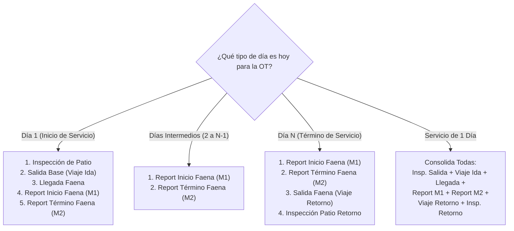

# Especificación Técnica Nº 63: Control Operativo en Vivo (Plan vs Real) — Opción 3 Híbrida, Gobernanza de Candado Operacional, Sanación de Datos y Notificaciones Web

* **Código de Especificación**: `Spec 63`
* **Requerimiento Asociado**: `REQ-042`
* **Archivo**: `.agents/specs/63_control_operativo_vivo_hibrido_spec.md`
* **Versión**: `1.0.0`
* **Fecha**: `03 de Octubre de 2026`
* **Estado**: `ESPECIFICADO - LISTO PARA IMPLEMENTACIÓN`
* **Autores / Stakeholders**:
  * Sergio Gajardo (Director de Proyecto LeanGlobal)
  * Yiara Mendoza (Analista de Control de Gestión de Operaciones / PMO)
  * Jorge Ponce (Contraparte Técnica y Operaciones GSP)
* **Módulos Afectados**:
  * **Frontend Web**:
    * `ejecucion/frontend/src/views/Torre.vue` (Integración de sub-vista `control_vivo` en módulo PMO)
    * `ejecucion/frontend/src/views/Operaciones/ControlOperativoVivo.vue` (Nuevo componente Opción 3 Híbrida)
    * `ejecucion/frontend/src/views/CRM/GestorOportunidades.vue` (Plan diario en Asignación y llegada planificada)
    * `ejecucion/frontend/src/views/Operaciones/ViajeConductor.vue` (Timestamp del dispositivo, depuración de flujo legado)
  * **Frontend PWA Móvil**:
    * `ejecucion/pwa/src/views/ReportDiarioIzaje.vue` (Timestamp de captura en dispositivo, blindaje de candado fail-closed)
  * **Backend API & Microservicios**:
    * `ejecucion/backend_remoto/src/controllers/controlVivoController.js` (Nuevo controlador agregado)
    * `ejecucion/backend_remoto/src/routes/controlVivoRoutes.js` (Rutas del control en vivo)
    * `ejecucion/backend_remoto/src/controllers/reportDiarioController.js` (Función única de cupo, exclusión de FLETE, timestamp Momento 2)
    * `ejecucion/backend_remoto/src/controllers/viajeController.js` (Exclusión de FLETE en cuota, timestamps de captura)
    * `ejecucion/backend_remoto/src/controllers/patioController.js` (Vinculación de template 79 a OT)
    * `ejecucion/backend_remoto/src/index.js` (Registro de rutas y worker de actualización)
  * **Base de Datos (PostgreSQL `sch_leangsp`)**:
    * `tedp_reporte_avance` (Columna `fecha_transmision_termino`, `device_timestamp`)
    * `tequ_log_desplazamiento` (Columna `device_timestamp_salida`, `device_timestamp_llegada`)
    * `tnot_notification_web` (Tabla para notificaciones in-web)
* **Especificaciones Previas Relacionadas**:
  * `Spec 35`: Despacho Escalonado y Recursos Múltiples por OT
  * `Spec 43`: Checklist Autónomo de Salida de Patio (Template 79)
  * `Spec 50`: Trazabilidad GPS, Despacho y WhatsApp Conductor
  * `Spec 52`: Notificaciones Omnichannel con Deep Linking
  * `Spec 54` & `Spec 55`: Registro de Viaje y Reporte Secuencial en 2 Momentos
  * `Spec 57`: Ciclo Integral de Gobernanza Operacional y Financiera
  * `Spec 58`: Trazabilidad Retrospectiva (Regla: no aplica a semáforos en vivo)
  * `Spec 60`: Aislamiento de Control Financiero
  * `Spec 61`: Perspectiva Temporal de Flota (Gantt)

---

## 1. Diagnóstico, Contexto y Necesidad de Negocio

El flujo documental posterior de faenas (`Report Diario de Terreno > ITS > EDP > Facturación`) se encuentra consolidado y protegido bajo las especificaciones previas. Sin embargo, la Torre de Control carecía de una herramienta de **Control Operativo en Vivo** que permitiera a **Yiara Mendoza (Analista de Control de Gestión de Operaciones)** supervisar en tiempo real durante la mañana y a lo largo de la jornada si los servicios programados se desarrollan fielmente según lo planificado.

### Objetivos Clave del Requerimiento REQ-042:
1. **Monitoreo Matinal y Continuo Plan vs Real:** Visibilidad inmediata de si los equipos salieron a la hora fijada, si se ejecutó la inspección preoperacional de patio, si se activó el registro telemétrico de viaje y si los operadores emitieron los reportes diarios de inicio y término de jornada.
2. **Semáforo Cromático de 5 Estados:** Clasificación visual inequívoca:
   - 🔵 **Azul:** Falta $\ge 1$ hora para vencer.
   - 🟡 **Amarillo:** Menos de 1 hora para vencer.
   - 🔴 **Rojo:** Vencido (no ejecutado habiendo alcanzado la hora planificada).
   - 🟢 **Verde:** Realizado a tiempo (marca real $\le$ hora planificada, sin margen de tolerancia).
   - ⚫ **Negro:** Realizado después de la hora planificada.
   - ⚪ **Sin Plan (Gris rayado):** Sin programación explícita en Asignación (nunca se asume verde).
   - 🔒 **Terminado (Gris candado):** Servicio concluido operacionalmente.
3. **Opción 3 Híbrida (Formato Visual Seleccionado):** Matriz de tarjetas por OT y por día, ordenadas por excepción (`ROJO > AMARILLO > SIN PLAN > NEGRO > AZUL > VERDE > TERMINADO`), cada una con una mini-franja multi-día (`[R][R][▶][ ][FIN]`) y un panel lateral interactivo con la cronología horaria detallada (07:00 a 20:00) y cálculo de desfases en minutos.
4. **Candado Operacional Determinista:** Cómputo estricto del cupo de días hábiles entre Salida Base y Término Faena. Una vez alcanzados los reportes de faena autorizados, se bloquea la emisión de nuevos reportes tanto en la PWA como en el backend (**fail-closed**), marcando la OT como operacionalmente concluida y liberándola a la mesa de liquidación (ITS/EDP).
5. **Reporte de FLETE Neutral:** El reporte automático generado al arribo de viaje se desvincula formalmente del cómputo de días del servicio; no consume cuota de faena de izaje.
6. **Notificaciones In-Web:** Alertas visuales con campana reactiva en la Torre de Control para todos los eventos operacionales y para todos los usuarios.
7. **Ventana de Monitoreo:** Operativa activa de 07:00 a 20:00 hrs (`America/Santiago`), con ciclo de refresco automático cada 5 minutos y botón manual compacto (sólo ícono).

---

## 2. Fase 0: Sanación y Blindaje de Datos (H1 a H15)

Antes de desplegar el control en vivo se corrigen los defectos estructurales identificados en el análisis:

| Código | Defecto Detectado | Solución Técnica Normada |
|---|---|---|
| **H1** | El reporte automático de FLETE por arribo en `viajeController.js:246-296` consumía la cuota del candado. | En los conteos de `reportDiarioController.js` se excluyen filas de flete mediante `WHERE token_report NOT LIKE 'FLT-%'` y `coalesce(incluye_flete_independiente, false) = false`. Si el traslado se cobra va valorizado al ITS; si no, va vacío sin consumir cupo de días de izaje. |
| **H2 - H4** | Candado burlable en Momento 2 (UPDATE) e inicio de jornada; validación inconsistente y fail-open. | Creación de función canónica única `validarCupoReportesOT(id_proyecto, id_equipo)` con política **fail-closed** (ante error, rechaza con HTTP 403). Se aplica en: `GET /contexto`, `POST /inicio-jornada`, `POST /guardar` (INSERT y UPDATE) y `GET /usuario/pendientes`. |
| **H5** | Horas reales de viaje tomaban la hora del servidor (`CURRENT_TIMESTAMP`), falseando retrasos en zonas sin cobertura. | Se incorpora `device_timestamp` capturado en el dispositivo móvil del operador (`ViajeConductor.vue` y `ReportDiarioIzaje.vue`). El backend almacena `fecha_captura_dispositivo` y la utiliza para evaluar los semáforos. |
| **H6** | El Momento 2 no registraba la hora de transmisión del reporte de término. | Se añade columna `fecha_transmision_termino TIMESTAMP WITH TIME ZONE DEFAULT CURRENT_TIMESTAMP` en `sch_leangsp.tedp_reporte_avance` que se sella al momento del UPDATE del reporte final. |
| **H8** | Placeholders fijos en Matriz PMO (`'VCTR.81-9'`, `'Jorge Ponce'`). | Sustitución completa por los datos dinámicos de la OT, cuadrilla asignada y equipo principal. |
| **H12** | Checklist de portón (template 79) guardado bajo proyecto genérico "PATIO". | Se asocia formalmente al `id_proyecto` de la OT activa correspondiente mediante cruce de patente y fecha de servicio. |
| **H13** | Duplicidad de endpoints de telemetría GPS y flujo legado en viaje. | Unificación sobre `/operaciones/viaje/:token/ping`. Retiro del endpoint redundante `/estado-pago/telemetria/ping` y desactivación de la ruta de reporte directo dentro de `ViajeConductor.vue`. |

---

## 3. Modelo del Plan Diario en la Asignación

En el formulario de asignación de recursos del CRM (`GestorOportunidades.vue` Subtab 5):

1. **Salida Base:** Se utiliza el campo existente `operacionesAssignment.fecha_salida_plan` y `hora_salida_plan` (por defecto `08:00`).
2. **Llegada a Faena Planificada:** Nuevo campo `hora_llegada_plan` en la Asignación para establecer el plan de arribo del equipo.
3. **Término Faena:** Se utiliza el campo existente `operacionesAssignment.fecha_fin_plan` y `hora_fin_plan` (por defecto `18:00`).
4. **Grilla "Plan Diario" (Persistencia en `json_field.ejecucion_v1.plan_diario`):**
   - Al definir Salida Base y Término Faena, el sistema genera automáticamente una fila por cada **día hábil** (lunes a viernes, excluyendo fines de semana):
   ```json
   "plan_diario": [
     { "dia": 1, "fecha": "2026-10-05", "hora_inicio_jornada": "08:00", "hora_termino_jornada": "18:00" },
     { "dia": 2, "fecha": "2026-10-06", "hora_inicio_jornada": "08:00", "hora_termino_jornada": "18:00" },
     { "dia": 3, "fecha": "2026-10-07", "hora_inicio_jornada": "08:00", "hora_termino_jornada": "18:00" }
   ]
   ```
   - El coordinador puede ajustar las horas de inicio y término para cada jornada individual antes de aprobar la asignación.
5. **Cálculo de Días Hábiles:** El total de días autorizados de la OT corresponde estrictamente a la cantidad de días hábiles comprendidos entre `fecha_salida_plan` y `fecha_fin_plan`.

---

## 4. Actividades y Hitos por Tipo de Jornada

Para cada OT en el día bajo análisis se auditan las actividades según la naturaleza del día dentro del plan:



### Reglas de Evidencia Real:
* **Inspección de Patio:** `tsrv_survey.estado_srv` en estado completado/aprobado (template 76 o portón template 79).
* **Salida de Base:** `tequ_log_desplazamiento.fecha_salida_patio` (con hora de dispositivo).
* **Llegada a Faena:** `tequ_log_desplazamiento.fecha_llegada_faena` (con hora de dispositivo).
* **Report Inicio de Faena (Momento 1):** Existencia de registro en `tedp_reporte_avance` con `estado_jornada = 'JORNADA_EN_CURSO'`.
* **Report Término de Faena (Momento 2):** Registro en `tedp_reporte_avance` con `estado_jornada = 'FINALIZADA'`.

---

## 5. Algoritmo del Motor de Semáforo Cromático

Para cada actividad individual con hora planificada $P$ y hora actual de evaluación $N$:

| Condición Lógica | Estado Resultante | Código Cromático |
|---|---|---|
| Actividad ejecutada y $Real \le Plan$ | **VERDE** (A tiempo) | `#16a34a` (`bg-green-600`) |
| Actividad ejecutada y $Real > Plan$ | **NEGRO** (Realizado tarde) | `#000000` con borde slate |
| Actividad no ejecutada y $N \ge Plan$ | **ROJO** (Vencido) | `#dc2626` (`bg-red-600 animate-pulse`) |
| Actividad no ejecutada y $(Plan - N) < 60 \text{ min}$ | **AMARILLO** (Por vencer) | `#eab308` (`bg-yellow-500`) |
| Actividad no ejecutada y $(Plan - N) \ge 60 \text{ min}$ | **AZUL** (En plazo) | `#2563eb` (`bg-blue-600`) |
| OT sin horas definidas en Asignación | **SIN PLAN** | Fondo transparente, borde discontinuo |
| OT con candado activo | **TERMINADO** | `#334155` (`bg-slate-700`) con ícono candado |

### Consolidación del Semáforo Global de la Tarjeta:
El estado de la tarjeta de la OT adopta **el peor estado** de sus actividades programadas para la jornada, según la jerarquía estricta:
$$\text{ROJO} \succ \text{AMARILLO} \succ \text{SIN PLAN} \succ \text{NEGRO} \succ \text{AZUL} \succ \text{VERDE} \succ \text{TERMINADO}$$

---

## 6. Candado Operacional Determinista y Transición a Término

1. **Fórmula de Consumo:**
   $$\text{Reports Consumidos} = \text{COUNT}(\text{reports válidos en faena de la OT con } estado \neq \text{'JORNADA\_EN\_CURSO'} \land token \not\approx \text{'FLT-\%')}$$
2. **Condición de Candado:**
   $$\text{Reports Consumidos} \ge \text{Días Hábiles Autorizados}$$
3. **Acción ante Candado:**
   * En Backend: `validarCupoReportesOT` devuelve HTTP 403 con mensaje de negocio: *"La OT {código} ha completado sus {N} jornadas autorizadas. Operacionalmente concluida."*
   * En PWA Móvil: Se oculta la OT de la bandeja de pendientes y se rechaza cualquier envío con advertencia no reintentable en cola offline.
   * En Torre de Control: La tarjeta pasa a estado **TERMINADO**, mostrando el badge de candado y habilitando su pase directo a la auditoría de ITS y facturación de EDP.

---

## 7. Endpoint Agregado Backend: `GET /api/operaciones/control-vivo`

* **Ruta:** `GET /api/operaciones/control-vivo?fecha=YYYY-MM-DD`
* **Control de Acceso:** Requiere token JWT con roles `ADMIN`, `ANALISTA_PMO`, `OPERACIONES` o `DIRECTOR`.
* **Estructura de Retorno JSON:**
```json
{
  "fecha": "2026-10-05",
  "generado_en": "2026-10-05T09:42:00-03:00",
  "kpis": {
    "total_ots": 10,
    "rojo": 2,
    "amarillo": 2,
    "sinplan": 1,
    "negro": 1,
    "azul": 2,
    "verde": 0,
    "terminado": 2
  },
  "servicios": [
    {
      "id_proyecto": 2451,
      "codigo_ot": "OT-2451",
      "id_negocio": "N-1030",
      "cliente": "Constructora Los Robles",
      "obra": "Edificio Plaza Oriente, Las Condes",
      "equipo_principal": "Grúa LTM 1100 · PFXK-21",
      "operador": "J. Muñoz",
      "telefono_operador": "+56912345678",
      "dia_actual": 1,
      "dias_totales": 3,
      "tipo_dia": "INICIO",
      "reports_consumidos": 0,
      "estado_global": "rojo",
      "candado_activo": false,
      "franja_multidia": [
        { "dia": 1, "fecha": "2026-10-05", "estado": "rojo", "es_hoy": true, "tiene_report": false },
        { "dia": 2, "fecha": "2026-10-06", "estado": "futuro", "es_hoy": false, "tiene_report": false },
        { "dia": 3, "fecha": "2026-10-07", "estado": "futuro", "es_hoy": false, "tiene_report": false }
      ],
      "actividades": [
        { "clave": "INSPECCION_PATIO", "nombre": "Inspección de patio", "hora_plan": "07:30", "hora_real": null, "estado": "rojo", "desvio_minutos": 132 },
        { "clave": "SALIDA_BASE", "nombre": "Salida patio (inicio viaje)", "hora_plan": "08:00", "hora_real": null, "estado": "rojo", "desvio_minutos": 102 },
        { "clave": "LLEGADA_FAENA", "nombre": "Llegada faena (fin viaje)", "hora_plan": "09:30", "hora_real": null, "estado": "rojo", "desvio_minutos": 12 },
        { "clave": "REPORT_INICIO", "nombre": "Report inicio jornada", "hora_plan": "10:00", "hora_real": null, "estado": "amarillo", "desvio_minutos": -18 },
        { "clave": "REPORT_TERMINO", "nombre": "Report término jornada", "hora_plan": "18:00", "hora_real": null, "estado": "azul", "desvio_minutos": -498 }
      ]
    }
  ]
}
```

---

## 8. Arquitectura Frontend: Componente `ControlOperativoVivo.vue`

El componente se ubica en `ejecucion/frontend/src/views/Operaciones/ControlOperativoVivo.vue` y se monta como la sub-vista 5 de PMO en `Torre.vue` (`pmoVistaSecundaria = 'control_vivo'`).

### Estructura de la Interfaz:
1. **Header de Control:**
   - Selector de fecha de consulta (por defecto hoy).
   - Reloj activo con indicación de zona horaria (`America/Santiago`).
   - Contador regresivo de refresco automático (5:00 a 0:00) y botón de actualización manual (sólo ícono).
   - Barra de KPIs de semáforo con conteo exacto de OTs por color y animación pulsante en rojos.
   - Campana de notificaciones in-web interactiva con badge de eventos críticos no atendidos.
2. **Matriz de Tarjetas de Servicios:**
   - Grilla reactiva con orden prioritario por criticidad (`ROJO` primero).
   - Borde izquierdo y badges cromáticos según estado global.
   - Mini-franja multi-día compacta: badges correlativos de días pasados con estado de reporte, indicador del día actual (`▶`), días futuros y delimitador vertical `[FIN]`.
   - Desglose de actividades del día con hora planificada, hora real y badge de color.
   - Barra de acciones contextuales:
     - `[ 🔍 Abrir OT ]`: Invoca `abrirProyecto(s.id_proyecto, 'ejecucion')`.
     - `[ 📋 Ver Report ]`: Invoca `ModalVisorReport`.
     - `[ 🗺️ Ver Ruta ]`: Invoca `ModalMapaViaje`.
     - `[ 💬 WhatsApp ]`: Invoca `ModalDespachoWhatsApp` con mensaje prellenado sobre la desviación detectada.
3. **Panel Lateral Deslizable (Slide-Over Audit):**
   - Se abre al hacer clic sobre cualquier tarjeta de servicio.
   - Despliega la línea de tiempo vertical de la jornada (07:00 a 20:00) con la posición de la hora actual (`NOW`), marcadores romboidales por hito y cálculo explícito de retraso: *"Vencido hace X min"* o *"A tiempo (-Y min)"*.
   - Franja multi-día expandida con fechas completas y estado del candado operacional.

---

## 9. Sistema de Notificaciones In-Web

1. **Tabla de Notificaciones (`sch_leangsp.tnot_notification_web`):**
   - Registra eventos detectados por el motor de semáforos: `id_notificacion`, `id_proyecto`, `codigo_ot`, `evento_tipo` (`VENCIDO`, `POR_VENCER`, `TARDE`, `SIN_PLAN`, `CANDADO`), `mensaje`, `severidad`, `creado_en`, `leido_por` (array de IDs de usuario).
2. **Generación Determinista:** En cada ciclo de cómputo del endpoint `/control-vivo`, se comparan las desviaciones y se insertan registros evitando duplicados en la misma jornada para el mismo hito.
3. **Campana Interactiva:**
   - La campana en la barra superior muestra el badge con el conteo de eventos de alta severidad (rojos y amarillos).
   - Al pulsar la campana se despliega el menú flotante con la lista de eventos, enlace directo a la OT y timestamp del evento.

---

## 10. Matriz de Casos de Prueba QA (Acceptance Criteria)

| ID | Escenario | Entrada / Acción | Resultado Esperado | Criterio de Aceptación |
|---|---|---|---|---|
| **TC-63.1** | Aislamiento de Report FLETE | Operador completa viaje con arribo a faena; se genera fila FLETE automática. | FLETE no descuenta días del servicio. El cupo de reportes de izaje permanece intacto. | `PASSED`: Cero consumo indebido de cupo. |
| **TC-63.2** | Candado Fail-Closed en Momento 1 | Operador intenta iniciar jornada en OT con cupo de días agotado. | Backend responde HTTP 403; PWA muestra advertencia de servicio concluido y bloquea ingreso. | `PASSED`: Candado hermético en creación. |
| **TC-63.3** | Candado Fail-Closed en Momento 2 | Intento de UPDATE de reporte de término en OT con cuota superada. | Backend rechaza la mutación con HTTP 403. | `PASSED`: Sin bypass por actualización. |
| **TC-63.4** | Detección de Hito Vencido (Rojo) | Inspección de patio con plan 07:30; reloj marca 07:31 sin survey completado. | Actividad pasa a ROJO; tarjeta adopta ROJO pulsante; evento emitido a la campana. | `PASSED`: Alerta visual inmediata sin tolerancia excedida. |
| **TC-63.5** | Detección de Cumplimiento a Tiempo (Verde) | Salida planificada 08:00; hora real de dispositivo marca 07:58. | Actividad pasa a VERDE; desvío registrado como 0 retraso. | `PASSED`: Reconocimiento exacto $\le$ plan. |
| **TC-63.6** | Detección de Ejecución Tarde (Negro) | Salida planificada 08:00; salida real registrada a las 08:15. | Actividad pasa a NEGRO con badge `+15 min`. | `PASSED`: Traza histórica visible sin pulsación. |
| **TC-63.7** | Desfase Offline con Device Timestamp | Operador registra salida a las 07:55 sin conexión; sincroniza a las 08:40. | Sistema evalúa con `07:55` (dispositivo), calificando la salida como VERDE y no como ROJO/NEGRO. | `PASSED`: Resiliencia offline sin falsos positivos. |
| **TC-63.8** | Ventana de Refresco Automático | Pestaña abierta a las 20:05 hrs. | Refresco automático en pausa; reloj y botón manual disponibles. | `PASSED`: Respeto estricto a ventana 07:00–20:00. |

---

## 11. Plan de Implementación Seguro (Paso a Paso)

Siguiendo la gobernanza estricta de `AGENTS.md` (§3, §9-14), la ejecución se realizará en turnos individuales con autorización previa de diff para cada archivo:

1. **Paso 1 (BD DDL):** Crear script DDL para `fecha_transmision_termino` y `tnot_notification_web`. Presentar script y solicitar autorización escrita antes de ejecutar en PostgreSQL.
2. **Paso 2 (Backend Fase 0):** Modificar `reportDiarioController.js` para aplicar `validarCupoReportesOT` excluyendo FLETE y sellando `fecha_transmision_termino`.
3. **Paso 3 (Backend Endpoint):** Crear `controlVivoController.js` y `controlVivoRoutes.js` e integrarlos en `index.js`.
4. **Paso 4 (Frontend Asignación):** Incorporar campos de plan diario y llegada en `GestorOportunidades.vue`.
5. **Paso 5 (Frontend Vista Híbrida):** Construir `ControlOperativoVivo.vue` e integrarlo como sub-vista en `Torre.vue`.
6. **Paso 6 (PWA & Conductor):** Incorporar `device_timestamp` en `ViajeConductor.vue` y `ReportDiarioIzaje.vue`.
7. **Paso 7 (Gobernanza y Hard Gate):** Registrar REQ-042 en `Gestión/tareas.md`, actualizar `package.json` a versión `1.0.78` y documentar en `RELEASE_LOG.md`.

---

## 12. Protocolo de Regularización de Jornadas y Linaje Financiero (Control en Vivo ➔ ITS ➔ EDP ➔ Facturación)

### 12.1. El Principio de Fe Pública Operacional
1. **Monitoreo vs. Respaldo Legal:** Registrar o corregir horas en Control en Vivo sirve para **supervisar desvíos y semáforos operativos en tiempo real**, pero no reemplaza el título ejecutivo de cobro que otorga la firma digital del mandante en el Report Diario.
2. **Prohibición de Facturación "en el Aire":** Ninguna jornada puede liquidarse en el Estado de Pago (EDP) ni facturarse al cliente sin contar con un **Linaje Probatorio Válido**.

### 12.2. Manejo de Jornadas sin Report Digital (Modelo Híbrido B + C)
Cuando una jornada fue monitoreada o ajustada en Torre de Control pero el operador no emitió el Report Digital en PWA (por falta de señal, daño de equipo o negligencia), el sistema aplica el siguiente protocolo de dos vías en la mesa del ITS:

1. **Vía B — Regularización con Documento Físico / Mensajería (Report por Excepción):**
   - **Cuándo aplica:** El operador trabajó con reporte en papel o el ITO mandante aprobó la faena por WhatsApp/correo.
   - **Flujo:** Yiara ingresa al ITS, activa la regularización, digita los horómetros leídos de la boleta de papel y **adjunta obligatoriamente la fotografía o PDF del documento firmado**.
   - **Persistencia:** Se genera un registro formal en `tedp_reporte_avance` con `tipo_emision = 'REGULARIZADO_DOC_FISICO'` y estado `VALIDADO_ANALISTA`.
   - **En el PDF:** La jornada se marca con el sello `[📄 DOC FÍSICO REGULARIZADO]` y el documento escaneado se anexa al expediente de cobro.

2. **Vía C — Cobro por Piso Mínimo Contractual (Standby / Imputabilidad Mandante):**
   - **Cuándo aplica:** La máquina estuvo a disposición en faena pero no operó por causas ajenas a GSP (lluvia, bloqueo de obra, falta de permisos o ausencia de supervisor mandante para firmar).
   - **Flujo:** Yiara imputa la jornada al ITS invocando la **cláusula de horas mínimas contractuales** (ej. 8 horas diarias) pactada en la cotización CRM.
   - **Persistencia:** La jornada se registra en `tits_jornada_detalle` como `tipo_servicio = 'Hora Standby (Piso Mínimo Contractual)'`. No requiere firma de terreno porque su respaldo legal es la Orden de Compra y el contrato comercial vigente.
   - **En el PDF:** La jornada se destaca con el sello `[⚖️ PISO MÍNIMO CONTRACTUAL]`.

### 12.3. Trazabilidad y Seguridad
- **Trazabilidad Inalterable:** Todo ajuste manual registra `modificado_por`, `timestamp` y `motivo`.
- **Inmutabilidad Post-Emisión:** Al emitirse formalmente el ITS, las jornadas quedan selladas y pasan de modo editable a solo lectura.

