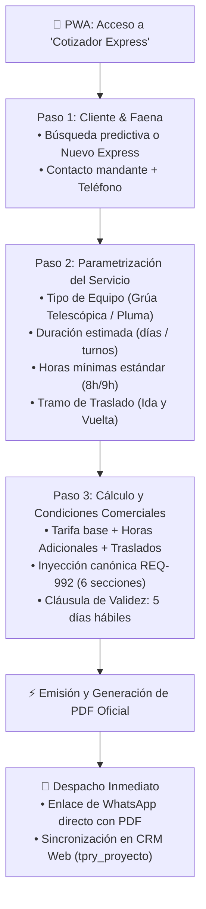

# 📱 Especificación Técnica 64: Cotizador Express Móvil en PWA (Mobile Quotation Generator)

**Código de Requerimiento:** `REQ-994`  
**Estado:** `Especificación Lista para Revisión`  
**Autor:** Sergio Gajardo / Antigravity Agent  
**Fecha:** 05 de Octubre de 2026  
**Versión:** 1.0.0  
**Impacto Arquitectónico:** PWA (`ejecucion/pwa`), Backend GSP (`ejecucion/backend_remoto`), Base de Datos PostgreSQL (`sch_leangsp` / `sch_leangsp_prod`).

---

## 1. Resumen Ejecutivo y Caso de Uso de Terreno

Actualmente, la plataforma cuenta con un robusto motor comercial y estructurador de tarifas en la consola de escritorio ([GestorOportunidades.vue](file:///D:/SGajardo/Google%20Drive/Antigravity/Grúas%20San%20Pablo/Propuesta%20Gestión%20Operación%20Grúas/ejecucion/frontend/src/views/Comercial/GestorOportunidades.vue)). No obstante, cuando los ejecutivos comerciales, supervisores de maniobra o el Director se encuentran en terreno (visitando obras mineras, puertos, o reuniones imprevistas con mandantes), la experiencia de escritorio es impráctica en pantallas móviles.

El objetivo de esta especificación es crear el módulo **Cotizador Express Móvil** dentro de la PWA que permita cotizar un servicio de grúa o camión pluma en **60 segundos** y despacharlo de inmediato al WhatsApp del cliente como un documento PDF formal con la validez estricta de 5 días hábiles.

---

## 2. Diagrama de Flujo del Proceso



---

## 3. Experiencia de Usuario Móvil (Wizard de 3 Pasos)

### Paso 1: Cliente y Localización (20 segundos)
- **Selector de Empresa Mandante:** Input con búsqueda reactiva (`v-autocomplete` o filtrado de clientes registrados en `tpar_empresas`).
- **Botón `+ Prospecto Rápido`:** Permite registrar en un modal de 3 campos:
  - Nombre Empresa o Razón Social.
  - Nombre Contacto y Teléfono Móvil (WhatsApp).
  - Correo electrónico.
- **Faena / Ubicación:** Comuna / Faena (ej: "Minera Escondida", "Puerto Mejillones", "Santiago Centro").

### Paso 2: Configuración del Servicio de Izaje (25 segundos)
- **Tarjetas de Selección Rápida de Equipo:**
  - 🏗️ **Grúa Telescópica:** Selector de tonelaje (ej: 30t, 50t, 70t, 100t, 130t, 220t).
  - 🚛 **Camión Pluma:** Selector de capacidad (ej: 10t, 15t, 20t).
- **Parámetros Operacionales:**
  - **Días de servicio:** Stepper numérico `[-] 1 [+]` (días).
  - **Horas Mínimas Diarias:** Selector rápido `[8h]` `[9h (Estándar)]` `[10h]`.
  - **Valor Turno / Día (CLP o UF):** Precargado según tarifa de catálogo pero editable con candado de rol.
  - **Traslados / Desplazamientos:** Switch `[X] Incluye Movilización y Desmovilización` con origen y destino predeterminados y tarifa fija.

### Paso 3: Totalización, Condiciones Comerciales y Despacho (15 segundos)
- **Resumen Financiero Claro:**
  - Subtotal Equipos: `$ X.XXX.XXX`
  - Subtotal Traslados: `$ XXX.XXX`
  - **Total Neto:** `$ X.XXX.XXX` + IVA (19%).
- **Condiciones Comerciales Oficiales:**
  - Inyección no editable en PDF de las 6 cláusulas canónicas (Personal Técnico, Seguros, Cláusulas Específicas, Combustible, etc.).
  - **Validez de la oferta:** Estrictamente **5 días hábiles**.
- **Acciones Finales:**
  - 📄 **Ver Preview PDF.**
  - 💬 **Enviar por WhatsApp:** Dispara `https://api.whatsapp.com/send?phone=569XXXX&text=Hola%20...%20te%20adjunto%20la%20cotizaci%C3%B3n%20formal%20GSP...` con el link directo de descarga.
  - 💾 **Guardar Oportunidad:** Queda creada automáticamente en estado `BORRADOR` o `COTIZADO` en `tpry_proyecto` visible en la Torre de Control y Gestor de Oportunidades web.

---

## 4. Estructura de Datos (JSON Schema Payload)

```json
{
  "$schema": "http://json-schema.org/draft-07/schema#",
  "title": "CotizacionExpressPwaPayload",
  "type": "object",
  "required": [
    "cliente",
    "servicio",
    "valores",
    "origen"
  ],
  "properties": {
    "origen": {
      "type": "string",
      "enum": ["PWA_EXPRESS"]
    },
    "id_empresa_emisora": {
      "type": "integer",
      "description": "ID de la empresa del grupo (1: Grúas San Pablo, 2: Transportes San Pablo, etc.)",
      "default": 1
    },
    "cliente": {
      "type": "object",
      "required": ["nombre", "telefono"],
      "properties": {
        "id_empresa": { "type": ["integer", "null"] },
        "nombre": { "type": "string" },
        "rut": { "type": "string" },
        "contacto_nombre": { "type": "string" },
        "telefono": { "type": "string" },
        "email": { "type": "string" },
        "obra_nombre": { "type": "string" },
        "comuna": { "type": "string" }
      }
    },
    "servicio": {
      "type": "object",
      "required": ["tipo_equipo", "dias_servicio", "horas_minimas_dia"],
      "properties": {
        "tipo_equipo": { "type": "string", "enum": ["GRUA_TELESCOPICA", "CAMION_PLUMA"] },
        "tonelaje_o_modelo": { "type": "string" },
        "dias_servicio": { "type": "integer", "minimum": 1 },
        "horas_minimas_dia": { "type": "number", "default": 9.0 },
        "fecha_estimada_inicio": { "type": "string", "format": "date" },
        "incluye_traslado": { "type": "boolean", "default": true },
        "origen_traslado": { "type": "string", "default": "Base San Pablo" },
        "destino_traslado": { "type": "string" }
      }
    },
    "valores": {
      "type": "object",
      "required": ["neto", "total"],
      "properties": {
        "moneda": { "type": "string", "enum": ["CLP", "UF"], "default": "CLP" },
        "tarifa_dia": { "type": "number" },
        "valor_hora_adicional": { "type": "number" },
        "valor_traslado": { "type": "number" },
        "neto": { "type": "number" },
        "iva": { "type": "number" },
        "total": { "type": "number" }
      }
    },
    "condiciones": {
      "type": "object",
      "properties": {
        "dias_validez": { "type": "integer", "default": 5 },
        "forma_pago": { "type": "string", "default": "30 días contra factura previa orden de compra" }
      }
    }
  }
}
```

---

## 5. Endpoints Backend Requeridos

1. `POST /api/comercial/express/cotizar`:
   - Valida el payload según el esquema.
   - Crea el registro formal en `tpry_proyecto` con correlativo automático `GSP-COT-YYYY-XXXX`.
   - Inyecta la metadata completa en `json_field.crm_v1` y las condiciones comerciales estándar.
   - Genera el documento PDF formal mediante el servicio `pdfService`.
   - Retorna: `{ success: true, id_proyecto, codi_proyecto, pdf_url, whatsapp_share_link }`.

2. `GET /api/comercial/express/catalogo-rapido`:
   - Devuelve la lista simplificada de equipos tipos (Grúas y Plumas) con sus tarifas base sugeridas y horas mínimas para poblar los selectores móviles sin sobrecargar la red.

---

## 6. Criterios de Aceptación (BDD / Gherkin)

### Escenario 1: Cotización express exitosa en 60 segundos
```gherkin
Dado que el ejecutivo comercial ingresa a la PWA y pulsa "Cotizador Express"
Cuando busca el cliente "BHP Billiton", selecciona "Grúa Telescópica 100 TON", fija 3 días de servicio y marca traslado incluido
Y pulsa "Generar Cotización"
Entonces el sistema crea la oportunidad formal en tpry_proyecto con folio "GSP-COT-2026-XXXX"
Y genera el PDF oficial con las 6 secciones de condiciones comerciales y "Validez de la Oferta: 5 días hábiles"
Y muestra el botón "Enviar por WhatsApp" con el enlace directo al número del contacto.
```

### Escenario 2: Creación de prospecto express sin RUT obligatorio inicial
```gherkin
Dado que el mandante en terreno no tiene a mano el RUT de la empresa
Cuando el comercial ingresa "Constructora del Norte", contacto "Carlos Ruiz" y celular "+56912345678"
Y emite la cotización express
Entonces el sistema registra el prospecto provisionalmente sin bloquear la emisión del presupuesto
Y queda marcado en la Consola Web para que administración complete el RUT antes de emitir la OT definitiva.
```
