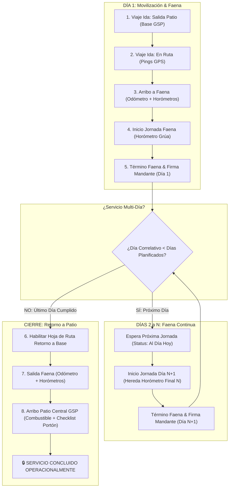

# Especificación Técnica & Modelo Operacional 66: Ribbon Horizontal de Jornadas en Control en Vivo, Navegación Multi-Día Reactiva, Acceso Directo a Telemetría de Viaje y Reports, y Gobernanza de Secuencia Cronológica en Terreno PWA

> **Estado:** ESPECIFICACIÓN CANÓNICA CORE — LISTA PARA IMPLEMENTACIÓN  
> **Código de Especificación:** `SPEC-066`  
> **Requerimiento Asociado:** `REQ-1012`  
> **Fecha:** 2026-10-08  
> **Área:** Control de Gestión Operacional (PMO), Operaciones Terreno, Torre de Control, PWA Móvil, Telemetría GPS  
> **Módulos Core:** `ControlOperativoVivo.vue`, `ModalMapaViaje.vue`, `ModalVisorReport.vue`, `Surveys.vue`, `ReportDiarioIzaje.vue`, `controlVivoController.js`, `reportDiarioController.js`, `viajeModel.js`  
> **Especificaciones Relacionadas:** `SPEC-063` (Control Operativo en Vivo Híbrido), `SPEC-065` (Matriz Logística de Asignación y Reports), `SPEC-049` (Secuencia Viaje y Combustible), `SPEC-034` (Report Diario de Izaje), `SPEC-035` (Despacho Escalonado Multi-Equipo), `SPEC-038` (Liquidación EDP y Facturación)  
> **Tablas Afectadas:** `tpry_proyecto`, `tequ_log_desplazamiento`, `tedp_reporte_avance`, `tequ_rel_proyecto_equipo`  
> **Versión de Release Proyectada:** `v1.0.110` / `REQ-1012`

---

## 1. Alcance, Contexto y Necesidad de Negocio

El despliegue de la vista **Control Operativo en Vivo (Opción 3 Híbrida - Spec 63)** dotó a la organización (y en particular a **Yiara Mendoza, Analista de Control de Gestión**, y a **Jorge Ponce, Jefe de Operaciones**) de una visión intradía de los servicios planificados de 07:00 a 20:00 hrs. 

No obstante, el análisis operativo en caliente derivado de la operación real reveló cuatro limitaciones críticas que motivan este desarrollo Core:

1. **Rigidez de la Franja Multi-Día:**  
   La mini-franja actual en `ControlOperativoVivo.vue` desplegaba cápsulas informativas compactas (`[D1][D2]...`), pero funcionaba como un componente estático orientado únicamente al día consultado en el filtro superior. No existía la posibilidad de hacer clic en una jornada específica (por ejemplo, auditar el Día 1 en un servicio que va en el Día 3) para inspeccionar sus hitos particulares, desviaciones de horario ni contrastar sus semáforos.
2. **Aislamiento de la Telemetría de Viaje:**  
   Cuando un equipo se encuentra en desplazamiento o arribado a faena, la Torre de Control no disponía de un acceso directo a la telemetría satelital (mapa de ruta GPS Leaflet, waypoints OSRM, odómetros, horómetros y fotos de tablero). Para revisar la ruta del conductor, el analista debía abandonar Control en Vivo e ingresar a la Pestaña C del CRM o a Despacho.
3. **Desacoplamiento de Reports Históricos por Tarjeta:**  
   El botón `[ 📋 Report ]` del pie de tarjeta apuntaba de forma genérica al último reporte emitido o al día activo, imposibilitando abrir directamente el visor oficial (`ModalVisorReport.vue`) del día seleccionado por el analista en la franja temporal.
4. **Vulnerabilidad de Secuencia Cronológica en Terreno (PWA):**  
   En faenas multi-día, los operadores en terreno requieren una conducción guiada y determinista:
   - No se puede iniciar la jornada del Día $N+1$ si el reporte del Día $N$ no ha sido concluido y firmado con el cliente mandante.
   - No se puede iniciar la Hoja de Ruta de Retorno a Base (`tipo_trayecto = 'RETORNO'`) si restan jornadas de izaje contratadas.
   - Debe asegurarse la continuidad estricta de horómetros entre jornadas sucesivas ($\text{Horómetro Inicial}_{N+1} \ge \text{Horómetro Final}_{N}$).

---

## 2. Ribbon Horizontal de Jornadas en Control en Vivo

### 2.1. Arquitectura Visual & Ergonómica

En cada tarjeta de servicio de `ControlOperativoVivo.vue`, se reemplaza la mini-franja estática por un **Ribbon Horizontal Interactivo de Alta Densidad Operacional**:

```
+---------------------------------------------------------------------------------------------------------+
| OT: GSP-2610-4853-004  •  ALTUMAQ SA  •  Obra: Puente Cautín                        [ 🔴 RETRASO +45M ] |
+---------------------------------------------------------------------------------------------------------+
| [🚜 LTM 1070 (Robert Rodríguez)]  [🚛 CAMIÓN PLUMA (Carlos Muñoz)]                                      |
+---------------------------------------------------------------------------------------------------------+
| RIBBON DE JORNADAS:                                                                                     |
| +--------------------+ +--------------------+ +--------------------+ +--------------------------------+ |
| |  ✓ DÍA 1 • 05-OCT  | |  ▶ DÍA 2 • 06-OCT  | |    DÍA 3 • 07-OCT  | |  🔒 FIN • 08-OCT               | |
| |  [🟢 CONCLUIDO]    | |  [🔴 EN CURSO]     | |  [🔵 PROGRAMADO]   | |  [⏳ CIERRE BASE]              | |
| |  📋 Rep #45 • 🛰️   | |  📋 En Izaje       | |  Sin Iniciar       | |  Retorno Planificado         | |
| +--------------------+ +--------------------+ +--------------------+ +--------------------------------+ |
+---------------------------------------------------------------------------------------------------------+
| ACTIVIDAD JORNADA SELECCIONADA: DÍA 2 (06-Oct-2026)                                                     |
| • 🚜 Report Inicio Jornada    Plan: 08:00 ➔ Real: 08:45  [🔴 Retraso +45m] ✏️                           |
| • 🚜 Report Término Jornada   Plan: 18:00 ➔ Real: --:--  [🔵 En Espera]                                 |
+---------------------------------------------------------------------------------------------------------+
| [ ⏱️ Timeline ]   [ 🛰️ Telemetría Viaje ]   [ 📋 Ver Report D2 ]   [ 📂 Abrir OT ]                     |
+---------------------------------------------------------------------------------------------------------+
```

### 2.2. Taxonomía de Estados en las Cápsulas del Ribbon

Cada cápsula de jornada en el Ribbon refleja el estado integral del día:

| Estado Semáforo | Borde / Fondo | Iconografía | Condición Operativa |
| :--- | :--- | :---: | :--- |
| **🟢 VERDE** | `border-emerald-500/40 bg-emerald-500/10 text-emerald-300` | `✓` | Reporte diario firmado y sellado por mandante dentro del horario planificado; o jornada finalizada en norma. |
| **🔴 ROJO** | `border-red-500/50 bg-red-500/15 text-red-300 animate-pulse` | `⚠️` | Hito vencido sin ejecución (ej. hora de inicio sobrepasada sin reporte), o reporte con retraso severo. |
| **🟡 AMARILLO** | `border-amber-500/40 bg-amber-500/10 text-amber-300` | `⏳` | Faltan menos de 60 minutos para alcanzar la hora límite planificada del hito. |
| **⚫ NEGRO** | `border-slate-400/40 bg-slate-500/15 text-slate-300` | `✓` | Hito ejecutado y reportado pero después de la hora fijada en la planificación. |
| **🔵 AZUL** | `border-blue-500/30 bg-blue-500/10 text-blue-300` | `📅` | Jornada futura o con más de 1 hora restante para el inicio de actividades. |
| **⚪ SIN PLAN** | `border-slate-600 bg-slate-800/40 text-slate-400` | `?` | OT sin horarios específicos en `plan_diario`. |
| **🔒 CONCLUIDO**| `border-purple-500/40 bg-purple-500/15 text-purple-300` | `🔒` | Candado operacional cerrado; cupo de días agotado y liberado a facturación. |

---

## 3. Navegación Multi-Día Reactiva & Desglose Dinámico de Hitos

### 3.1. Estado Reactivo en el Frontend (`ControlOperativoVivo.vue`)

Se implementa un mapa de selección por OT y por equipo:

```javascript
// Llave: `${id_proyecto}_${id_equipo}` ➔ Valor: dia_correlativo (entero)
const diaSeleccionadoByOtEquipo = ref({});

const getDiaSeleccionado = (s, eq) => {
  const key = `${s.id_proyecto}_${eq.id_equipo || 0}`;
  if (diaSeleccionadoByOtEquipo.value[key]) {
    return diaSeleccionadoByOtEquipo.value[key];
  }
  // Fallback por defecto: día actual de la OT o día correspondiente a fechaFiltro
  return eq.dia_actual || s.dia_actual || 1;
};

const seleccionarDiaJornada = (s, eq, diaNum) => {
  const key = `${s.id_proyecto}_${eq.id_equipo || 0}`;
  diaSeleccionadoByOtEquipo.value[key] = diaNum;
};
```

### 3.2. Cómputo de Actividades según Jornada Seleccionada

Al seleccionar un día específico en el Ribbon:
1. Si el día seleccionado es **Día 1 (INICIO o ÚNICO)**:  
   Se despliegan los hitos de movilización y faena:
   - `INSPECCION_PATIO` (Checklist Template 79 en patio base).
   - `SALIDA_BASE` (Inicio de viaje de ida con Odómetro y Horómetro Chasis).
   - `LLEGADA_FAENA` (Arribo con Odómetro, Horómetros y Telemetría GPS).
   - `REPORT_INICIO` (Horómetro de izaje en obra).
   - `REPORT_TERMINO` (Horómetro final, cálculo de horas y firma mandante).
2. Si el día seleccionado es **Día Intermedio ($1 < \text{Día} < \text{Total}$)**:  
   El equipo ya pernocta o permanece en faena; se suprimen los viajes carreteros y se concentran los hitos de izaje:
   - `REPORT_INICIO` (Inicio de jornada en faena con herencia de horómetro).
   - `REPORT_TERMINO` (Término de jornada, horómetro final y firma mandante).
3. Si el día seleccionado es **Día Final (TÉRMINO o ÚNICO)**:  
   - `REPORT_INICIO` (Última jornada de izaje).
   - `REPORT_TERMINO` (Cierre definitivo de maniobras con mandante).
   - `VIAJE_RETORNO` (Hoja de ruta regreso de faena a Patio Base GSP).

---

## 4. Acceso Directo a Telemetría de Viaje y Reports Oficiales

### 4.1. Integración Nativa de Telemetría GPS (`ModalMapaViaje.vue`)

En lugar de delegar la consulta de rutas a otras vistas, `ControlOperativoVivo.vue` incorpora directamente la instancia de `ModalMapaViaje`:

```html
<!-- Modal Telemetría de Viaje GPS / Hoja de Ruta -->
<ModalMapaViaje 
  v-if="modalMapaViajeAbierto"
  v-model:visible="modalMapaViajeAbierto"
  :viaje="viajeSeleccionadoTelemetria"
  @close="modalMapaViajeAbierto = false"
/>
```

#### Disparadores de Apertura:
- **Clic en Hito de Viaje:** Al hacer clic en el nombre o botón `[ 🛰️ ]` de `SALIDA_BASE`, `LLEGADA_FAENA` o `VIAJE_RETORNO`.
- **Botón Contextual en Pie de Tarjeta:** Botón `[ 🛰️ Telemetría Viaje ]` activo siempre que la jornada seleccionada o la OT disponga de registro en `tequ_log_desplazamiento`.

### 4.2. Integración Nativa del Visor de Reports (`ModalVisorReport.vue`)

`ControlOperativoVivo.vue` incorpora el componente oficial de auditoría documental:

```html
<!-- Modal Visor Oficial de Report Diario con Firma Digital y Validación -->
<ModalVisorReport 
  v-if="modalVisorReportAbierto"
  :visible="modalVisorReportAbierto"
  :report="reportSeleccionadoVisor"
  :readonly="!esAnalistaOAdmin"
  @close="modalVisorReportAbierto = false"
  @report-validado="onReportValidadoEnVivo"
/>
```

#### Comportamiento Determinista de Apertura:
1. Al hacer clic en `[ 📋 Ver Report D{X} ]`, el sistema busca en el array de jornadas (`franja_multidia`) el reporte emitido correspondiente al `dia_correlativo` seleccionado.
2. Si el reporte ya cuenta con ID (`id_reporte_avance`), se solicita el contexto completo a `/api/operaciones/report/:id` y se abre el modal en alta resolución con firmas digitales, fotos de horómetros y cálculo de horas base/sobretiempo.
3. El analista puede auditar y validar directamente con su PIN FES de 4 dígitos sin tener que desplazarse a la bandeja de pendientes de PMO.

---

## 5. Gobernanza de Secuencia Cronológica en Terreno (PWA)

### 5.1. Máquina de Estados Finita (FSM) Secuencial

El flujo en terreno gobernado en `ejecucion/pwa/src/views/Surveys.vue` y `ReportDiarioIzaje.vue` obedece estrictamente a la siguiente máquina de estados lineal:



### 5.2. Reglas Duras de Validación (Fail-Closed)

1. **Invariante de Precedencia (Día $N+1$ Bloqueado):**  
   Queda terminantemente prohibido habilitar la apertura o creación del Report Diario del Día $N+1$ si el Día $N$ no se encuentra en estado `EMITIDO_SELLADO`, `VALIDADO_ANALISTA` o `REGULARIZADO_MANUAL` con firma registrada del cliente.
2. **Rechazo en Backend (`reportDiarioController.js`):**  
   Al recibir una solicitud de inicio de jornada (`POST /api/operaciones/report/inicio-jornada`):
   ```sql
   -- Verificación estricta de día previo cerrado
   SELECT id_reporte_avance, estado_reporte, estado_jornada, horometro_grua_termino
   FROM tedp_reporte_avance
   WHERE id_proyecto = $1 
     AND id_equipo = $2 
     AND dia_correlativo = ($3 - 1)
     AND (token_report IS NULL OR token_report NOT LIKE 'FLT-%');
   ```
   Si el reporte previo no existe o se encuentra en `JORNADA_EN_CURSO`, el backend rechaza la operación con código **`HTTP 409 Conflict`**:
   `"No es posible iniciar el Día ${dia}: El reporte del Día ${dia - 1} aún no ha sido concluido y firmado por el cliente mandante."`
3. **Monotonía Creciente de Horómetros:**  
   El horómetro inicial de izaje del Día $N+1$ debe satisfacer:
   $$\text{Horómetro Inicial}_{N+1} \ge \text{Horómetro Final}_{N}$$
   Si el valor ingresado es menor, la PWA bloquea el botón de envío y emite una alerta roja bloqueante.
4. **Candado Duro de Retorno a Base:**  
   El botón de generación de Hoja de Ruta de Retorno a Base (`/operaciones/viaje/crear-retorno`) solo es ejecutable si:
   $$\text{dia\_correlativo} \ge \text{total\_dias\_planificados} \quad \land \quad \text{estado\_reporte} \neq \text{'JORNADA\_EN\_CURSO'}$$
   En caso contrario, el botón permanece deshabilitado informando: *"Pendiente: Restan jornadas operativas en faena"*.

---

## 6. Especificación de Endpoints y Modelo de Datos

### 6.1. Extensión del Payload en `GET /api/operaciones/control-vivo`

El backend enriquecerá el objeto de cada equipo (`equiposEvaluados`) agregando en `franja_multidia` la información completa de cada jornada:

```json
{
  "dia": 2,
  "fecha": "2026-10-06",
  "tipo_dia": "INTERMEDIO",
  "es_hoy": true,
  "estado": "rojo",
  "tiene_report": true,
  "id_reporte_avance": 485,
  "estado_reporte": "JORNADA_EN_CURSO",
  "hora_inicio_real": "08:45",
  "hora_termino_real": null,
  "tiene_viaje": false,
  "id_log_desplazamiento": null,
  "actividades": [
    {
      "clave": "REPORT_INICIO",
      "nombre": "Report inicio jornada",
      "hora_plan": "08:00",
      "hora_real": "08:45",
      "ejecutado": true,
      "estado": "rojo",
      "desvio_minutos": 45
    },
    {
      "clave": "REPORT_TERMINO",
      "nombre": "Report término jornada",
      "hora_plan": "18:00",
      "hora_real": null,
      "ejecutado": false,
      "estado": "azul",
      "desvio_minutos": 0
    }
  ]
}
```

### 6.2. Endpoint de Detalle de Viaje para Modal (`GET /api/operaciones/viaje/:id/telemetria`)

Permite recuperar el registro completo de `tequ_log_desplazamiento` incluyendo el GeoJSON de pings de ruta para inyectar en `ModalMapaViaje.vue`.

---

## 7. Matriz de Casos de Prueba Deterministas (QA)

| ID | Escenario de Prueba | Entrada / Acción | Resultado Esperado |
| :--- | :--- | :--- | :--- |
| **TC-01** | Visualización de Ribbon Horizontal | Abrir Control en Vivo con OT de 3 días (`GSP-2610-4853-004`). | Se despliega el Ribbon con 3 cápsulas interactivas (`D1`, `D2`, `D3`) con semáforos individuales y badges de report/viaje. |
| **TC-02** | Alternancia reactiva entre días | Clic en cápsula `D1` estando en `D2`. | La sección de actividades actualiza instantáneamente los hitos mostrando Salida Patio, Llegada Faena y Report D1 sin recargar la página. |
| **TC-03** | Apertura de Telemetría GPS en Vivo | Clic en botón `[ 🛰️ Telemetría ]` o en hito `LLEGADA_FAENA`. | Se abre el modal `ModalMapaViaje.vue` en pantalla completa con la traza de ruta OSRM, pings y fotos de tablero. |
| **TC-04** | Apertura de Visor de Report D1 | Clic en botón `[ 📋 Ver Report D1 ]`. | Se abre `ModalVisorReport.vue` cargando el reporte formal de izaje con firma del mandante y cálculo de horas. |
| **TC-05** | Validación de Secuencia PWA (Bloqueo Día 2) | Operador intenta iniciar Día 2 en PWA mientras Día 1 está `JORNADA_EN_CURSO`. | La PWA bloquea el botón "Iniciar Día 2" y el backend responde con `HTTP 409 Conflict`. |
| **TC-06** | Bloqueo de Retorno Prematuro | Operador concluye Día 1 de un servicio de 3 días e intenta solicitar retorno a base. | El paso 3 en `Surveys.vue` permanece bloqueado mostrando "Al Día Hoy - Esperando Próxima Jornada Día 2". |
| **TC-07** | Cierre Conforme Último Día | Operador concluye y firma Report del Día 3 (Final). | Se desbloquea automáticamente el Paso 3 habilitando la Hoja de Ruta de Retorno a Patio Central San Pablo. |

---

## 8. Plan de Implementación por Fases

1. **Fase 1: Backend API & Enriquecimiento de Datos:**
   - Modificación de `controlVivoController.js` para armar el desglose de actividades por cada día del array `franja_multidia`.
   - Modificación de `reportDiarioController.js` para compuerta estricta de secuencia cronológica fail-closed (`HTTP 409`).
2. **Fase 2: Frontend Web (`ControlOperativoVivo.vue`):**
   - Construcción del Ribbon Horizontal de Jornadas con selección reactiva.
   - Vinculación e importación de `ModalMapaViaje.vue` y `ModalVisorReport.vue`.
3. **Fase 3: Frontend PWA Móvil (`Surveys.vue` & `ReportDiarioIzaje.vue`):**
   - Refuerzo de la máquina de estados secuencial 1-2-3 y blindaje de apertura de jornadas consecutivas.
4. **Fase 4: Certificación QA y Verificación de Compilación:**
   - Auditoría de compilación con Vite sin errores y verificación en ambientes DEV/PROD.
