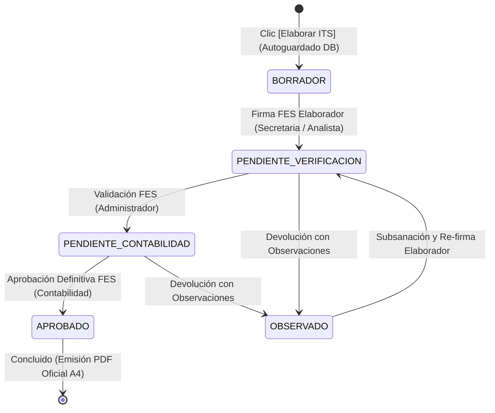

# 🏢📜 SPEC-066: ESPECIFICACIÓN MAESTRA INTEGRAL DE ITS TRANSICIÓN (GERALSOFT BRIDGE)
## Sistema Unificado de Ingesta, Bóveda Corporativa, Conciliación Operativa, Tarifario de Costos, Flujo Tripartito FES y Documentación Oficial A4

> **Código Canónico:** `SPEC-066` *(Consolidación Integral Vigente)*  
> **Módulo:** Operaciones — Informe de Término de Servicio (ITS Transición Geralsoft Bridge)  
> **Sistema:** Grúas San Pablo (GSP) / LeanGlobal Platform  
> **Esquemas PostgreSQL:** `sch_leangsp` (DEV) & `sch_leangsp_prod` (PROD)  
> **Ruta Consola Web:** `/its-transicion` (`ItsTransicionView.vue`)  
> **Versión Vigente:** Consola Web `v1.0.126` / Backend PM2 `10` (DEV) y `13` (PROD)  
> **Requerimientos Históricos Consolidados:** `REQ-1014`, `REQ-1015`, `REQ-1016`, `REQ-1017`, `REQ-1018`, `REQ-1019`, `REQ-1022`, `REQ-1028`  
> **Fecha de Consolidación:** 13 de Octubre de 2026  
> **Estado:** 🏛️ **ESPECIFICACIÓN MAESTRA VIGENTE Y ÚNICA FUENTE DE LA VERDAD (SSOT)**  
> **Aprobadores de Negocio:** Jorge Ponce (Gerencia de Operaciones), Yiara Mendoza (Control de Flota), Maritza Seguel (Contabilidad y Finanzas), Marcelo Reyes (Gerencia Comercial).  
> **Arquitectura de Software:** Sergio Gajardo (LeanGlobal)  

---

## 🎯 1. Naturaleza del Módulo, Propósito y Criterios de Decomisión

### 1.1 Naturaleza del Módulo (Bridge Transicional)
El módulo **ITS Transición** es un subsistema desacoplado y transicional diseñado para interoperar con las planillas de cálculo históricas del software legado **GeraldSoft** (`CONTROLES [MES].XLS` y `OT [MES].xlsx`). 

Su propósito primordial es **eliminar de inmediato el cuello de botella administrativo** que reducía la producción a solo 2-3 informes en 4 horas, permitiendo procesar y liquidar en minutos servicios multi-día y multi-grúa con plena exactitud financiera.

```
       +-----------------------------------------------------------------------+
       |                  ARQUITECTURA DE TRANSICIÓN VIGENTE                   |
       +-----------------------------------------------------------------------+
       |                                                                       |
       |   [Planillas Excel GeralSoft]                                         |
       |   • CONTROLES [MES].XLS  ---------\                                   |
       |   • OT [MES].xlsx       ----------> [Bóveda de Ingesta Incremental]   |
       |                                                 |                     |
       |                                                 v                     |
       |   [Colaboración Multi-Usuario] <------> [Matriz de Conciliación]     |
       |   (Yiara, Jorge, Maritza, Marcelo)              |                     |
       |                                                 v                     |
       |                                     [Formulario 4 Bloques]            |
       |                                     (Tarifario Maestro Jorge 10 Cat)  |
       |                                                 |                     |
       |                                                 v                     |
       |   [PDF Oficial A4 wkhtmltopdf] <------- [Flujo Tripartito FES]        |
       |   (Depósito Gestor Documental)          (Elabora ➔ Verifica ➔ Aprueba)|
       |                                                                       |
       +-----------------------------------------------------------------------+
```

### 1.2 Frontera Arquitectónica: Régimen Transición vs. Régimen Normal
Este módulo es **estrictamente transicional** y coexiste temporalmente con la plataforma definitiva de LeanGlobal:

| Dimensión | ITS Transición (Geralsoft Bridge) | ITS Régimen Definitivo (PWA / CRM Normal) |
|---|---|---|
| **Especificación Canónica** | **SPEC-066 (Este Documento Único)** | **SPEC-046, SPEC-047 y SPEC-057** |
| **Fuente de Datos** | Archivos Excel externos cargados en Bóveda Central. | Reportes de Avance digitales móviles (`tedp_reporte_avance`) emitidos en terreno con GPS y canvas de firma. |
| **Entidad Primaria** | N° de Cotización y Pareo Heurístico de Patentes. | Proyecto CRM (`tpry_proyecto`) y Orden de Trabajo (`tpry_orden_trabajo`). |
| **Persistencia** | `tits_transicion_historial` y `tits_geraldsoft_planillas`. | `tits_informe_termino`, `tits_jornada_detalle` y `tits_costo_operacional`. |
| **Ciclo de Vida** | **Efímero:** Se utiliza mientras la operación en faena migra al 100% a la PWA. | **Permanente:** Conectado a Torre de Control, Carátula EDP y Facturación DTE. |

### 1.3 Criterios Deterministas de Decomisión (Apagado del Módulo)
El módulo **ITS Transición** será apagado y archivado de forma limpia únicamente cuando se cumplan las siguientes condiciones:
1. El 100% de los operadores y choferes registren sus jornadas y firmas de cliente exclusivamente a través de la PWA Móvil de GSP.
2. Cese definitivo de la digitación en planillas locales de GeraldSoft.
3. Liquidación y cierre contable de todos los folios históricos en `tits_transicion_historial`.
4. Cumplidas estas condiciones, el acceso `/its-transicion` se redirigirá transparentemente a `/crm` (subtab Liquidación ITS).

---

## 🗄️ 2. Bóveda Corporativa y Motor de Ingesta Geralsoft

### 2.1 Modelo de Datos en PostgreSQL
La centralización de planillas opera sobre la tabla `tits_geraldsoft_planillas`, replicada idénticamente en los esquemas `sch_leangsp` (DEV) y `sch_leangsp_prod` (PROD):

```sql
CREATE TABLE IF NOT EXISTS tits_geraldsoft_planillas (
  id_planilla SERIAL PRIMARY KEY,
  tipo_planilla VARCHAR(50) NOT NULL, -- 'CONTROLES' u 'ORDENES'
  nombre_archivo VARCHAR(255) NOT NULL,
  total_registros INT NOT NULL DEFAULT 0,
  data_json JSONB NOT NULL,
  id_usuario INT REFERENCES tsec_users(id_user),
  fecha_carga TIMESTAMP WITH TIME ZONE DEFAULT CURRENT_TIMESTAMP,
  activo BOOLEAN DEFAULT TRUE,
  modo_carga VARCHAR(30) DEFAULT 'INCREMENTAL', -- 'INCREMENTAL' o 'REEMPLAZO'
  registros_nuevos INT DEFAULT 0,
  registros_actualizados INT DEFAULT 0
);

CREATE INDEX IF NOT EXISTS idx_geraldsoft_tipo_activo ON tits_geraldsoft_planillas (tipo_planilla, activo);
```

### 2.2 Modalidad de Carga y Algoritmo de Fusión Incremental Diaria
El sistema ofrece un selector de modalidad de carga con dos comportamientos:

1. **Fusión Incremental Diaria (Modo Predeterminado):**
   * Diseñado para la rutina operativa diaria en la que cada tarde se sube la planilla con las jornadas añadidas en el día.
   * **Algoritmo de Deduplicación por Clave Natural:**
     * Para `CONTROLES`: $\text{Clave} = \text{lower}(\text{cotizacion}\_\text{orden}\_\text{fecha}\_\text{patente}\_\text{item})$.
     * Para `ORDENES`: $\text{Clave} = \text{lower}(\text{orden}\_\text{cotizacion})$.
   * Si la clave ya existe en la versión activa previa, se actualizan sus valores (horas corregidas, notas). Si no existe, se añade como registro nuevo.
   * La versión previa se marca como inactiva (`activo = false`) y la nueva consolidada se guarda activa con sus métricas (`registros_nuevos`, `registros_actualizados`).
2. **Reemplazo Total del Mes:**
   * Sustituye íntegramente los datos anteriores de ese tipo de planilla, ideal al iniciar un nuevo mes contable.

### 2.3 Endpoints Oficiales de la Bóveda
* `GET /api/operaciones/its/transicion/planillas/activas`: Retorna el último archivo activo consolidado de `CONTROLES` y `ORDENES` con su metadata (usuario que cargó, fecha y modo).
* `POST /api/operaciones/its/transicion/planillas/subir`: Recibe el archivo parseado en JSON, ejecuta la fusión/reemplazo y persiste en PostgreSQL.
* `GET /api/operaciones/its/transicion/planillas/historial`: Retorna la bitácora histórica de las últimas 20 cargas realizadas.

---

## 📊 3. Matriz Operativa de Conciliación y Colaboración Multi-Usuario

### 3.1 Construcción Reactiva del Pipeline de Servicios
A partir de las planillas activas en la bóveda, el frontend ejecuta un agrupador relacional que vincula OTs con Controles mediante el N° de Cotización o N° de Orden:
* **Entidad Servicio:** Agrupa todas las jornadas, patentes participantes, choferes, riggers y valores pactados correspondientes a una misma cotización mandante.

### 3.2 Semáforo Operativo y KPIs
El encabezado de la matriz presenta un embudo de estados en tiempo real:
* **Total Servicios:** Cantidad global de cotizaciones detectadas en las planillas activas.
* **⚪ Pendientes ITS:** Servicios que aún no tienen informe creado en el servidor.
* **🟡 En Trámite:** Informes en estado `BORRADOR`, `PENDIENTE_VERIFICACION` o `PENDIENTE_CONTABILIDAD`.
* **🔴 Observados:** Informes devueltos con observaciones formales pendientes de subsanación.
* **🟢 Concluidos:** Informes aprobados por Contabilidad (`APROBADO`).

### 3.3 Colaboración Universal y Visibilidad Multi-Usuario
Para garantizar que **ningún trabajo quede aislado en el computador de un solo usuario**:

1. **Autocreación Inmediata en Servidor:** Al presionar `[➕ Elaborar ITS]`, se ejecuta de inmediato un guardado silencioso en PostgreSQL en estado `BORRADOR`, asociando el `id_usuario_elaborador` y su nombre legible.
2. **Trazabilidad en la Grilla:** En la columna "Estado ITS" se despliega la identidad del elaborador o verificador:
   * Ej: `🟡 BORRADOR (👤 Yiara Mendoza)` o `⏳ PEND. VERIFICACIÓN (👤 Jorge Ponce)`.
3. **Botón Continuar Colaborativo:** Si un informe ya fue iniciado por cualquier miembro del equipo, el botón se transforma en `[✏️ Continuar]`, permitiendo que cualquier rol autorizado abra el informe con todas las jornadas, tarifas y costos ya registrados.
4. **Erradicación del Aislamiento Local:** Se eliminó la dependencia de `localStorage`. Todo cambio y observación viaja directamente a `tits_transicion_historial`. Si la red falla, el sistema emite una alerta explícita impidiendo falsos positivos de guardado.

### 3.4 Asistente Automático de Migración de Informes Locales a la Nube
Para incorporar informes históricos preexistentes en los computadores o navegadores locales de los usuarios (elaborados con versiones previas a la persistencia en nube):
1. **Respaldo Inmutable Preventivo:** Al iniciar el escaneo local, el cliente genera automáticamente una copia de seguridad en `localStorage.getItem('its_transicion_historial_backup_seguridad')`.
2. **Detección Determinista:** El cliente contrasta la lista local contra el listado relacional devuelto por el servidor (`/operaciones/its/transicion/list`). Se catalogan como pendientes aquellos informes locales no presentes en el servidor o aquellos donde el servidor posee un borrador sin costos y el local contiene datos avanzados.
3. **Banner Superior No Invasivo:** Si existen pendientes, se despliega una tarjeta superior con el conteo de informes locales, las cotizaciones identificadas y los botones de acción: `[ ☁️ Subir al Servidor Central ]` y `[ 💾 Respaldo JSON ]`.
4. **Ingesta por Lotes a PostgreSQL:** La acción de subida invoca el endpoint oficial `POST /operaciones/its/transicion/save` para cada informe local, inyectando la marca `data_json.migrado_desde_local = true` y asociando al usuario en sesión como elaborador si no existía uno.
5. **Conciliación y Limpieza:** Al finalizar la subida exitosa de todos los elementos, se recarga el historial desde el servidor (`cargarHistorialDesdeServidor`), se actualiza la matriz en vivo y se limpian los pendientes.

---

## 📑 4. Formulario Oficial de 4 Bloques y Tarifario Maestro

El formulario en pantalla y la compilación impresa oficial respetan estrictamente la división en 4 bloques funcionales:

```
+-----------------------------------------------------------------------------------+
| BLOQUE 1: DATOS DEL SERVICIO INTEGRAL                                             |
| Folio: [ ITS-XXXX ] | Cotización: [ #XXXX ] | Versión: [ V1 ]                     |
| Cliente Mandante: [ Razón Social ] | RUT: [ XX.XXX.XXX-X ]                        |
| Empresa Emisora: [ ARRIENDOS SAN PABLO / BESTMAQ / LOGÍSTICA DEL SUR / ROYAL ]    |
| Ejecutivo Comercial: [ MARCELO REYES / WILSON NAVARRETE / NATALIA GHISELLINI... ] |
| Período: [ Fecha Inicio ] al [ Fecha Término ] | Ciudad Faena: [ Ciudad ]         |
| Régimen Operacional: [ SERVICIO URBANO (<=30km) / SERVICIO RURAL (>30km) ]        |
| Valores Pactados Cabecera: Valor Fijo ($) | Valor Flete / Traslado ($)            |
| Grilla de Equipos Involucrados:                                                   |
| Patente | Subcategoría/Tonelaje | Horas Mínimas | Valor Hora ($) | OTs | Tripulación|
+-----------------------------------------------------------------------------------+
| BLOQUE 2: CONTROL DE FLOTA Y VALIDACIÓN DE HORAS                                  |
| Grilla de Jornadas Operativas:                                                    |
| Fecha | N° OT | Tipo Servicio | Patente | Salida | Llegada | Término | Retorno     |
| Colación | Hrs Reales (Cálculo) | Hrs Report (Input Editable) | N° Report Físico  |
| Totales: Subtotal Horas Report por Patente y Gran Total Horas Report Faena        |
+-----------------------------------------------------------------------------------+
| BLOQUE 3: PLANILLA DE COSTOS OPERACIONALES A PAGAR (8 RUBROS + MANO DE OBRA)      |
| 1. Viáticos de Alimentación Personal (Fecha, Personal, Concepto, Monto)           |
| 2. Peajes y TAG de Ruta (Fecha, Patente, Personal, Detalle, Monto o "NO REEMB")   |
| 3. Pensiones Faena (Fecha, Personal, Desayuno, Almuerzo, Cena, Alojamiento, OC)  |
| 4. Movilización Personal (Fecha, Personal, Tipo Movilización, Monto)              |
| 5. Personal Externo (Fecha, Personal, Servicio/Función, Monto)                    |
| 6. Feriados y Bonos Especiales (Fecha, Personal, Causal/Detalle, Monto)           |
| 7. Subcontrato Flete / Cama Baja (Fecha, Proveedor, N° OC, Monto)                 |
| 8. Gastos Extraordinarios (Fecha, Detalle Faena/Vulcanización/Repuestos, Monto)   |
| 9. Costo Valor Hora Operador: Catálogo Maestro 10 Categorías ($3.000 - $12.000)   |
| 10. Mano de Obra por Horas de Traslado Adicionales                                |
+-----------------------------------------------------------------------------------+
| BLOQUE 4: RESULTADO DEL SERVICIO, OBSERVACIONES Y GOBERNANZA FES                  |
| A. Resumen de Ingresos Totales (Venta): Horas Report + Fijo + Flete (100%)        |
| B. Resumen de Costos Operacionales (Egresos): Suma Rubros 1 al 10 (% s/ Venta)    |
| C. Balance: Utilidad Bruta ($) y Margen Operacional (%) [Rentable / Pérdida]     |
| D. Observación del Servicio: Bitácora inmutable respaldada en PostgreSQL          |
| E. Sellos Tripartitos FES: Elaborado (Secretaría) | Verificado (Admin) | Aprobado |
+-----------------------------------------------------------------------------------+
```

### 4.1 Catálogo Maestro Canónico de Tarifas de Operador (Sistema Jorge)
Para liquidar con rigor el costo de la mano de obra de los operadores según las horas reportadas en terreno, se implementó el catálogo canónico de 10 categorías extraído del sistema original de Jorge Ponce:

| ID Categoría | Nombre Oficial de Categoría | Tarifa Horaria Base | Regla de Auto-Detección Heurística |
|---|---|:---:|---|
| `HORQUILLA` | **GRUA HORQUILLA** | **$3.000 / hr** | Subcategoría contiene `HORQUILLA` |
| `CAMION_PLUMA` | **CAMION PLUMA** | **$5.000 / hr** | Subcategoría contiene `PLUMA` o `CAMION` |
| `CAMION_PLUMA_10` | **CAMION PLUMA 10 TON** | **$5.000 / hr** | Subcategoría contiene `PLUMA` y `10` |
| `MANITOU` | **MANITU / TELEHANDLER** | **$5.000 / hr** | Subcategoría contiene `MANITU`, `TELEHANDLER`, `ALZA` |
| `GRUA_70` | **GRUA TELESCOPICA 70 TON** | **$6.000 / hr** | Subcategoría contiene `70`, `75` o `50` |
| `GRUA_80` | **GRUA TELESCOPICA 80 TON** | **$7.000 / hr** | Subcategoría contiene `80` |
| `TRACTO` | **TRACTOCAMION** | **$7.000 / hr** | Subcategoría contiene `TRACTO` |
| `GRUA_100` | **GRUA TELESCOPICA 100 TON** | **$8.000 / hr** | Subcategoría contiene `100` |
| `GRUA_220` | **GRUA TELESCOPICA 220 TON** | **$12.000 / hr** | Subcategoría contiene `220` o `250` |
| `GRUA_OTRA` | **OTRA MAQUINARIA / GENERAL** | **$8.500 / hr** | Valor por defecto ante maquinarias no tipificadas |

* **Selector Interactivo y Sobreescritura:** La grilla dispone de un dropdown `<select>` interactivo para reclasificar la máquina en tiempo real, adaptando la tarifa horaria sugerida y permitiendo sobreescrituras numéricas directas de horas o valores si el servicio así lo pactó.
* **Cálculo Financiero:**
  $$\text{Costo Operador Máquina} = \text{Horas Reportadas} \times \text{Tarifa Horaria Categoría}$$

### 4.2 Tipificación y Edición Libre de Trayectos (Ida y Vuelta, Solo Ida, Solo Vuelta)
Para reflejar fielmente la realidad logística de movilización y desmovilización de flota y equipos auxiliares:
1. **Grilla de Jornadas Operativas (Bloque 2):**
   * La columna `Tipo de Servicio` se implementa como un **campo editable asistido por datalist**, permitiendo seleccionar con un clic las modalidades operativas o escribir cualquier glosa personalizada:
     * `Ida y Vuelta` (o `Flete Ida y Vuelta`)
     * `Solo Ida` (o `Flete Solo Ida`)
     * `Solo Vuelta` (o `Flete Solo Retorno`)
     * `Hora`, `Fijo`, `Standby`
2. **Costos de Traslado / Conducción (Bloque 3):**
   * En la subtabla de horas de conducción y traslados de operadores (Art. 25 bis, chofer de cama baja, tracto de contrapesos), el concepto es igualmente asistido por sugerencias de trayecto (`Ida y Vuelta`, `Solo Ida`, `Solo Vuelta`) y 100% editable.
3. **Consistencia en Compilación A4:**
   * La glosa editada se plasma idéntica en la tabla oficial del PDF de Contabilidad y Gerencia General.

### 4.3 Asociación Determinista Mono-Equipo y Pareo Resiliente de Ingresos (REQ-1058 / v1.0.150)
Para erradicar discrepancias donde los ingresos facturables por horas resultaban en \$0 debido a omisiones tipográficas en las celdas de patente de las jornadas:
1. **Regla de Oro Mono-Equipo:**
   * Cuando un servicio registra un único equipo en la Sección 1 (`informe.equipos.length === 1`, ej. Cotización 11308 con 1 Tractocamión a \$130.000/hr), **la totalidad de las horas reportadas en las jornadas se valoriza automáticamente contra la tarifa horaria de dicho equipo**, sin supeditar el cálculo a que el usuario digite o replique la patente exacta en cada fila diaria de la Sección 2.
2. **Pareo Resiliente Multi-Equipo:**
   * Cuando existen dos o más maquinarias asignadas, las patentes se normalizan alfanuméricamente (suprimiendo espacios, guiones y mayúsculas/minúsculas).
   * Si una jornada carece de patente, el motor aplica la tarifa del equipo principal por defecto (`primerEquipoConTarifa`), evitando la pérdida silenciosa de ingresos facturables.
3. **Homologación Bivalente:**
   * Esta misma resiliencia opera en el cálculo de horas base de mano de obra del operador (`manoObraCalculada`) y en la plantilla del PDF oficial (`generarHtmlDocumentoOficial`).

---

## 🔏 5. Flujo de Aprobación Tripartito FES y Gobernanza de Roles

### 5.1 Circuito de Estados y Roles RBAC
El informe transiciona a través de tres etapas formales blindadas por Firma Electrónica Simple (FES):



1. **Etapa 1: Elaboración (Secretaría / Analista de Operaciones):**
   * Confección, ajuste de jornadas, tarifas y carga de gastos.
   * Acción: `[✍️ Firmar FES y Enviar a Verificación]`.
   * Endpoint: `POST /api/operaciones/its/transicion/firmar-elaborador`.
   * Pasa a estado: `PENDIENTE_VERIFICACION`.
2. **Etapa 2: Verificación Operativa (Administrador de Operaciones - Rol ADMINISTRADOR):**
   * Jorge Ponce o Marcelo Reyes revisan la concordancia de horas de grúa y traslados.
   * Facultades:
     * Puede editar datos directamente y pulsar `[💾 Guardar Cambios]`.
     * Puede devolver con causal obligatoria mediante `[⚠️ Devolver con Observaciones]` (`POST /transicion/devolver`), pasando el informe a estado `OBSERVADO` y notificando al elaborador.
     * Puede visar mediante `[✅ Validar FES y Enviar a Contabilidad]` (`POST /transicion/validar-admin`), pasando el informe a `PENDIENTE_CONTABILIDAD`.
3. **Etapa 3: Aprobación Financiera (Contabilidad & Finanzas - Rol CONTABILIDAD):**
   * Maritza Seguel audita la planilla de egresos, comprobantes de peaje y viáticos.
   * Facultades:
     * Puede devolver al elaborador para corrección de gastos.
     * Puede aprobar definitivo mediante `[🏆 Aprobar Definitivo con FES]` (`POST /transicion/aprobar-contabilidad`).
     * Pasa a estado: `APROBADO` (Informe cerrado e inmutable).

### 5.2 Sellos Digitales y Seguridad FES
* **Autenticación FES:** Ingreso de PIN de 4 dígitos cifrado en el cliente mediante `SHA-256`.
* **Sello Digital en Documento:** Cada firma genera un código de validación único `FES-GSP-[ROL]-[UUID8]`, registrando nombre del firmante, RUT, cargo y marca de tiempo ISO 8601 (RFC 3161).
* **Notificaciones Omnicanal:** Despacho automatizado de alertas vía WhatsApp y Correo Electrónico B2B con Magic Link directo (`/its-transicion?folio=ITS-XXXX&cot=YYYY`).

---

## 🖨️ 6. Motor de Compilación de Documento Oficial A4 (wkhtmltopdf)

### 6.1 Especificación de Formato Impreso
El informe oficial generado para presentación a clientes o respaldo contable cumple con:
* **Formato de Hoja:** A4 Vertical con márgenes de 8 mm.
* **Encabezado Corporativo:** Logotipo oficial de Grúas San Pablo en Base64 Data URI, Folio formal en tipografía monoespaciada de alta visibilidad, y datos de emisión.
* **Maquetación Tabular Blindada:** Tablas con anchos porcentuales fijos, bordes `#cbd5e1`, tipografía corporativa (Inter/Roboto), subtotales sombreados y reglas CSS estrictas de salto de página:
  ```css
  .print-section { break-inside: avoid; page-break-inside: avoid; }
  ```
* **Bitácora de Devoluciones:** Si el informe tuvo observaciones durante el flujo, éstas se imprimen al pie como historial de transparencia y auditoría resuelta.

### 6.2 Almacenamiento Particionado en Gestor Documental
Al aprobar o compilar el documento oficial:
1. El backend compila el HTML a PDF mediante `wkhtmltopdf` (`POST /api/operaciones/its/compilar-pdf`).
2. El archivo resultante se deposita en la estructura particionada del Gestor Documental:
   `GSP/{dev|prod}/ITS-TRANSICION/{AÑO}/{MES}/{FOLIO}-V{VERSION}.pdf`
3. Se genera el registro relacional en `tfmg_file` y se asocia `id_doc` en `tits_transicion_historial`.
4. El PDF queda accesible públicamente bajo token o endpoint seguro `/api/v1/storage/view/:id_doc`.

---

## 🗃️ 7. Esquema Relacional de Persistencia Histórica

La tabla `tits_transicion_historial` almacena la totalidad de los informes emitidos en el esquema activo:

```sql
CREATE TABLE IF NOT EXISTS tits_transicion_historial (
  id_transicion SERIAL PRIMARY KEY,
  folio_its VARCHAR(50) NOT NULL,
  numero_cotizacion VARCHAR(50) NOT NULL,
  version INT DEFAULT 1,
  cliente_nombre VARCHAR(255),
  cliente_rut VARCHAR(50),
  empresa_facturacion VARCHAR(255),
  ejecutivo_comercial VARCHAR(255),
  ciudad_obra VARCHAR(255),
  fecha_inicio DATE,
  fecha_termino DATE,
  total_venta NUMERIC(15,2) DEFAULT 0,
  total_costos NUMERIC(15,2) DEFAULT 0,
  utilidad_bruta NUMERIC(15,2) DEFAULT 0,
  margen NUMERIC(5,2) DEFAULT 0,
  estado VARCHAR(50) DEFAULT 'BORRADOR',
  id_doc INT REFERENCES tfmg_file(id_doc),
  data_json JSONB, -- Contiene snapshot íntegro de informe, costos, sobreescrituras y observaciones
  firmas_fes JSONB, -- Sellos digitales de elaborador, verificador y aprobador
  historial_observaciones JSONB, -- Bitácora de devoluciones y respuestas
  id_usuario_elaborador INT REFERENCES tsec_users(id_user),
  id_usuario_verificador INT REFERENCES tsec_users(id_user),
  id_usuario_aprobador INT REFERENCES tsec_users(id_user),
  fecha_guardado TIMESTAMP WITH TIME ZONE DEFAULT CURRENT_TIMESTAMP,
  fecha_actualizacion TIMESTAMP WITH TIME ZONE DEFAULT CURRENT_TIMESTAMP,
  CONSTRAINT uk_transicion_folio_ver UNIQUE (folio_its, version)
);

CREATE INDEX IF NOT EXISTS idx_tits_transicion_cot ON tits_transicion_historial (numero_cotizacion);
```

---

## 🚦 8. Matriz de Requerimientos y Trazabilidad

| Código Requerimiento | Descripción Canónica | Estado | Especificación Consolidada |
|---|---|:---:|---|
| **REQ-1014** | Formulario de Captura Manual V1 en 4 Bloques y exportación PDF | Concluido | Capítulo 4 y 6 |
| **REQ-1015** | Motor de Ingesta Geralsoft y auto-poblado desde planillas Excel | Concluido | Capítulo 2 y 3 |
| **REQ-1016** | Persistencia relacional en PostgreSQL (`tits_transicion_historial`) | Concluido | Capítulo 7 |
| **REQ-1017** | Flujo Tripartito de Firmas FES (Secretaria ➔ Admin ➔ Contabilidad) | Concluido | Capítulo 5 |
| **REQ-1018** | Corrección de fórmula de mano de obra y tabla `tits_geraldsoft_planillas` | Concluido | Capítulo 2 y 4 |
| **REQ-1019** | Catálogo Maestro Canónico de 10 Tarifas de Operador (Sistema Jorge) | Concluido | Capítulo 4.1 |
| **REQ-1022** | Bóveda Corporativa, Ingesta Incremental Diaria y Matriz de Conciliación | Concluido | Capítulo 2 y 3 |
| **REQ-1028** | Colaboración Universal, Autoguardado en Nube y Erradicación de Aislamiento | Concluido | Capítulo 3.3 y 5 |

---

> **Declaración de Unicidad y Vigencia:**  
> A partir de la fecha de emisión de este documento, **SPEC-066** constituye la **ÚNICA ESPECIFICACIÓN TÉCNICA VÁLIDA Y AUTORIZADA** para el subsistema de ITS Transición. Quedan absorbidas y deprecadas formalmente las micro-especificaciones parciales previas (Specs 67, 68, 69, 70 y 73).
