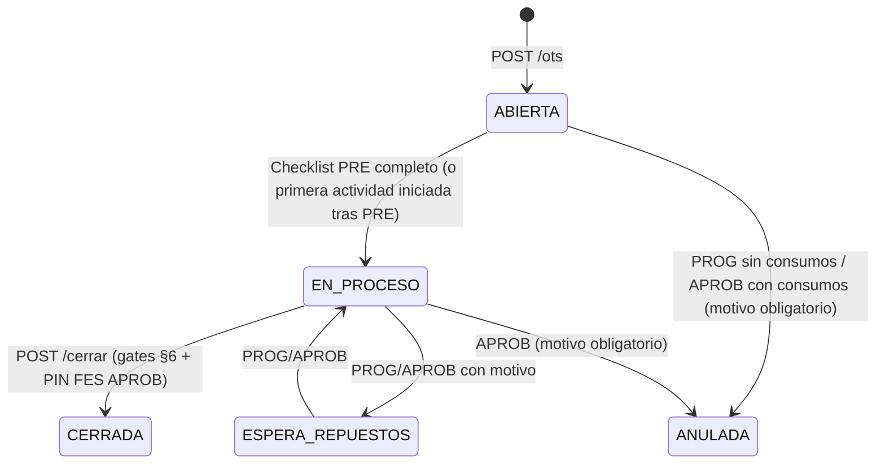

# 🔧 SPEC 67 — MANTENIMIENTO DE FLOTA ENTERPRISE (OTs de Taller, Hallazgos, Pautas, Liberación y PWA Taller)

> **Estado:** ✅ APROBADA (Autorización explícita del usuario 10-Oct-2026, Opción B).
> **Supersede:** Spec 48 §6, §7, §9, §10, §11, §12 y §14 (dominio Mantenimiento). **Spec 48 queda vigente solo para Inventario WMS-Lite.**
> **Esquema:** `sch_leangsp` (DEV). Producción fuera de alcance de esta spec.
> **Fuente de buenas prácticas:** Informe del asesor `maintenance_senior_advisor` (ISO 55000, ISO 14224, EN 13306/15341, SMRP, ASME B30.5, ISO 9927-1, Ley 16.744, DS 40, DS 594).

---

## 0. Principios inmutables

1. **Segregación de dominios (se mantiene Spec 48 §1.0):** OT de Mantenimiento (`tmnt_ot`, folio `MNT-YYMM-XXX`, costo interno) ≠ OT Comercial (`tpry_*`, ingreso). Solo la *reportería* puede cruzar costo vs ingreso; nunca se mezclan tablas ni flujos.
2. **Cero datos falsos:** prohibido mock, valores por defecto de equipo, fallback local silencioso, certificación ficticia o PIN fijo. Si la API falla → error visible, nada se registra.
3. **El código y la BD real mandan:** los nombres de columna de esta spec son los que usa hoy `mantenimientoModel.js` (`numero_ot`, `descripcion_falla`, `fecha_creacion`, `tmnt_ot_actividad.descripcion`, `tmnt_ot_hh.horas/tarifa`, `tmnt_ot_servicio_ext.costo/numero_documento_compra`, `id_actividad`, `id_hh`, `id_servicio_ext`, `id_cierre`). El paso 1 (consulta de solo lectura en DEV) confirma el DDL antes de migrar; toda migración es idempotente (`IF NOT EXISTS`).
4. **Reutilización obligatoria (sin servicios paralelos):**
   - Autenticación: `src/middleware/authMiddleware.js` → `verifyToken` (inyecta `req.user` con `id_user`, `id_empresa`, `roles[]` desde `tsec_user_roles`/`tsec_roles.name_rol`).
   - PIN: Firma Electrónica Simple existente, `tsec_users.pass_hash_fes` (SHA-256 de PIN 4 dígitos), mismo algoritmo que `reportDiarioController.js` L1292-1317.
   - Notificaciones: `src/services/notificacionService.js` (EMAIL + WHATSAPP, deep links, `tnot_notification_log`).
   - Checklists: motor de surveys `tsrv_templates` / `tsrv_survey` con tipos de atributo verificados en Template 79: `textField`, `comboBox`, `photoCapture`, `matrizCheck`.
   - Certificaciones de equipo: documentación existente `TEQU_DOCUMENTACION_EQUIPO` (no se crea tabla nueva de certificados; paso 1 verifica columna de vencimiento).
   - Scheduler: patrón `setInterval` ya usado en `index.js` para `slaAuditorService`.

---

## 1. Roles (RBAC estándar LeanGlobal, `tsec_roles.name_rol`)

| Rol | Persona | Permisos |
|---|---|---|
| `GSP_TALLER_PROG` | **Jefe de Taller** | Abrir/planificar/asignar OTs, programar, gestionar backlog, registrar avisos, decidir hallazgos C2–C4, editar parámetros y pautas, ver costos y KPIs, anular OT ABIERTA sin consumos. |
| `GSP_TALLER_APROB` | **Supervisor** | Todo lo de PROG + decidir hallazgos **C1**, cerrar/liberar OT con PIN FES, definir estado resultante del equipo (incl. FUERA_DE_SERVICIO), anular OT con consumos. |
| `GSP_TALLER_EJEC` | **Mecánico** | Ver sus OTs, completar checklists PRE/POST, avanzar actividades, registrar HH propias, registrar hallazgos con foto, registrar materiales **sin costo**, firmar. **No ve costos.** |

- Roles administradores globales existentes de la plataforma conservan acceso total (lectura de KPIs).
- Regla de segregación: quien **cierra/libera** (APROB) debe ser **distinto** de quien registró la última actividad completada. Si es la misma persona → HTTP 422 `SEGREGACION_FUNCIONES`.
- Si un usuario no tiene ninguno de estos roles → HTTP 403 en `/api/mantenimiento/*`.

---

## 2. Parámetros (`tmnt_parametro`, editables por Jefe de Taller)

| Clave | Valor inicial | Uso |
|---|---|---|
| `capacidad_mecanicos` | **5** | Backlog en semanas |
| `capacidad_horas_dia` | **8** | Backlog en semanas |
| `capacidad_dias_semana` | **5** | Backlog en semanas |
| `factor_disponibilidad_hh` | 0.85 | Capacidad efectiva = 5 × 8 × 5 × 0.85 = **170 h/semana** |
| `tarifa_hh_default` | **15000** (provisional) | Precarga tarifa al imputar HH (editable por PROG/APROB) |
| `umbral_costo_ot_clp` | **2000000** | Notificación de cierre sobre umbral |
| `pm_ventana_proxima_pct` | 10 | Pauta "PRÓXIMA" si faltan ≤ 10 % del intervalo base (25 h) |
| `ot_envejecida_dias_correctiva` | 7 | Aging / notificación |
| `ot_envejecida_dias_espera_repuestos` | 3 | Aging / notificación |
| `ot_envejecida_dias_general` | 15 | Aging / notificación |
| `cert_alerta_dias` | `60,30,15,7` | Alertas de certificación |

---

## 3. Modelo de datos

### 3.1 `tmnt_ot` (ALTER ADD COLUMN IF NOT EXISTS)
| Columna | Tipo | Regla |
|---|---|---|
| `prioridad` | SMALLINT NOT NULL DEFAULT 3 CHECK (1..4) | 1 Emergencia (<4 h) · 2 Urgente (<24 h) · 3 Programable (<7 d) · 4 Oportunidad |
| `equipo_detenido` | BOOLEAN NOT NULL DEFAULT false | Obligatorio informar en CORRECTIVO |
| `fecha_hora_detencion` | TIMESTAMPTZ NULL | Requerido si `equipo_detenido=true` |
| `fecha_hora_liberacion` | TIMESTAMPTZ NULL | Se fija al cerrar con liberación |
| `sistema_falla` | VARCHAR(3) NULL CHECK (catálogo §5.1) | Obligatorio al cerrar CORRECTIVO |
| `modo_falla` | VARCHAR(25) NULL CHECK (catálogo §5.2) | Obligatorio al cerrar CORRECTIVO |
| `causa_falla` | VARCHAR(25) NULL CHECK (catálogo §5.3) | Obligatorio al cerrar CORRECTIVO |
| `codigo_pauta` | VARCHAR(10) NULL CHECK ('PM250','PM500','PM1000','PM2000','ANUAL') | Obligatorio si PREVENTIVO |
| `id_aviso_origen` | BIGINT NULL FK `tmnt_aviso` | OT generada desde aviso |
| `id_hallazgo_origen` | BIGINT NULL FK `tmnt_hallazgo` | OT derivada de hallazgo |
| `motivo_anulacion` | TEXT NULL | Obligatorio si ANULADA |
| `id_user_creador` | BIGINT NULL | Desde token |
| `estado` | CHECK ampliado | `ABIERTA`,`EN_PROCESO`,`ESPERA_REPUESTOS`,`CERRADA`,`ANULADA` |
| Índice | UNIQUE (`id_empresa`,`numero_ot`) | Si no existe |

### 3.2 `tmnt_ot_cierre` (ALTER ADD COLUMN IF NOT EXISTS)
`id_user_cierre BIGINT`, `diagnostico_final TEXT NOT NULL`, `estado_equipo_resultante VARCHAR(30) CHECK ('OPERATIVO','OPERATIVO_CON_RESTRICCION','FUERA_DE_SERVICIO')`, `restriccion_texto TEXT`, `requiere_recertificacion BOOLEAN DEFAULT false`, `checklist_liberacion JSONB`, `id_survey_post BIGINT NULL`. Columnas existentes se conservan (`usuario_cierre` pasa a guardar el nombre real del token; `observacion_final` recibe el diagnóstico).

### 3.3 `tmnt_ot_hh` / `tmnt_ot_repuesto` / `tmnt_ot_actividad` (ALTER)
- `tmnt_ot_hh.id_tecnico BIGINT NULL` (FK lógica `tsec_users`); `nombre_tecnico` se llena desde el usuario. `rut_tecnico` desde `tsec_users.rut`.
- `tmnt_ot_repuesto.id_user_registro BIGINT NULL`; si lo registra un EJEC, `costo_unitario` queda 0 y `pendiente_valorizar=true` (nueva col BOOLEAN DEFAULT false) hasta que PROG/APROB lo valorice. **No se puede cerrar con materiales pendientes de valorizar** (`MATERIAL_SIN_VALORIZAR`).
- `tmnt_ot_actividad.id_user_completa BIGINT NULL`, `fecha_inicio` (si no existe), `foto_url TEXT NULL`.

### 3.4 `tequ_equipo` (ALTER, compatibilidad con módulos existentes)
- **No se alteran los valores actuales de `tequ_equipo.estado`** (`OPERATIVO`, `EN_MANTENCION`, `DISPONIBLE`) usados por Asignación/Operaciones.
- Nuevas: `estado_mnt VARCHAR(30) DEFAULT 'OPERATIVO' CHECK ('OPERATIVO','OPERATIVO_CON_RESTRICCION','EN_MANTENCION','FUERA_DE_SERVICIO')`, `restriccion_operacion TEXT NULL`.
- Mapeo: `FUERA_DE_SERVICIO` o `EN_MANTENCION` ⇒ `estado='EN_MANTENCION'` (queda excluido de asignación); `OPERATIVO` u `OPERATIVO_CON_RESTRICCION` ⇒ `estado='OPERATIVO'`. La restricción se muestra en la ficha del equipo.
- El equipo pasa a `EN_MANTENCION` cuando la OT pasa a `EN_PROCESO` o si `equipo_detenido=true` al abrir (no al crear una OT programada a futuro).

### 3.5 Tablas nuevas (CREATE TABLE IF NOT EXISTS)

**`tmnt_hallazgo`**: `id_hallazgo BIGSERIAL PK`, `id_empresa`, `id_equipo`, `id_ot_origen` (FK tmnt_ot), `sistema` (§5.1), `componente VARCHAR(150)`, `modo_falla` (§5.2), `descripcion TEXT`, `criticidad ('C1','C2','C3','C4')`, `afecta_izaje BOOLEAN`, `fotos JSONB` (≥1 URL), `decision ('RESUELTO_EN_OT','OT_DERIVADA','BACKLOG','RESTRICCION_OPERACION','FUERA_DE_SERVICIO')`, `restriccion_texto`, `id_ot_derivada`, `fecha_limite DATE`, `requiere_recertificacion BOOLEAN DEFAULT false`, `estado ('ABIERTO','EN_GESTION','CERRADO','DESCARTADO') DEFAULT 'ABIERTO'`, `id_user_reporta`, `fecha_registro`, `id_user_decide`, `fecha_decision`, `id_user_cierra`, `fecha_cierre`, `foto_cierre`, `motivo_descarte`.

**`tmnt_aviso`** (avisos de avería reales, reemplaza el mock): `id_aviso BIGSERIAL PK`, `id_empresa`, `folio_aviso` (`AV-YYMM-XXX`), `id_equipo`, `ubicacion TEXT`, `criticidad ('PARADA_MAQUINA','DEGRADADO','OBSERVACION')`, `descripcion TEXT`, `horometro NUMERIC`, `fotos JSONB`, `id_user_reporta`, `fecha_reporte`, `estado ('PENDIENTE','CON_OT','DESCARTADO')`, `id_ot`, `motivo_descarte`.

**`tmnt_pauta_tarea`** (plantillas de tareas por pauta, genéricas iniciales para ajuste de Jorge): `id_pauta_tarea BIGSERIAL PK`, `id_empresa`, `codigo_pauta`, `familia_equipo VARCHAR(50) DEFAULT 'GENERICA'`, `descripcion`, `horas_estimadas`, `orden`, `activo`.

**`tmnt_ot_estado_log`**: `id_log BIGSERIAL PK`, `id_ot`, `estado_anterior`, `estado_nuevo`, `id_user`, `motivo`, `fecha`.

**`tmnt_ot_survey`**: `id_ot_survey BIGSERIAL PK`, `id_ot`, `id_survey` (FK lógica `tsrv_survey`), `tipo ('PRE','POST')`, `estado_resultado`, `fecha`. UNIQUE (`id_ot`,`tipo`).

**`tmnt_parametro`**: `id_empresa`, `clave`, `valor TEXT`, `fecha_actualizacion`, `id_user`. PK (`id_empresa`,`clave`).

---

## 4. Máquina de estados de la OT

- Toda transición se registra en `tmnt_ot_estado_log`.
- `CERRADA` y `ANULADA` son **inmutables**: cualquier POST/PUT/DELETE sobre actividades, materiales, HH, servicios, hallazgos de esa OT → HTTP 422 `OT_CERRADA_INMUTABLE`.
- `ANULADA` se excluye de todos los KPIs.

---

## 5. Taxonomía de fallas (ISO 14224 simplificada para grúas)

**5.1 Sistema:** `MOT` Motor/tren potencia · `TRA` Transmisión/ejes/dirección · `FRE` Frenos · `HID` Hidráulico · `PLU` Pluma/telescópico/plumín · `IZA` Izaje (winche, tambor, freno winche, cable, poleas, gancho) · `GIR` Giro · `EST` Estabilizadores · `ELE` Eléctrico/electrónico · `SEG` Dispositivos de seguridad (LMI/PAT, anti-two-block, fines de carrera, alarmas) · `CHA` Chasis/cabina · `NEU` Neumáticos · `OTR` Otros.

**5.2 Modo:** `FUGA`, `ROTURA_FISURA`, `DESGASTE`, `DEFORMACION`, `CORROSION`, `FALLA_ELECTRICA`, `INDICACION_ERRONEA`, `RUIDO_VIBRACION`, `SOBRECALENTAMIENTO`, `NO_OPERA`, `OPERACION_ERRATICA`, `OTRO`.

**5.3 Causa (solo cierre CORRECTIVO):** `DESGASTE_NORMAL`, `FALTA_MANTENIMIENTO`, `OPERACION_INCORRECTA`, `DEFECTO_MATERIAL`, `MONTAJE_INCORRECTO`, `CONTAMINACION`, `DANO_EXTERNO`, `DESCONOCIDA`.

---

## 6. Reglas duras (HTTP 422 salvo indicación)

| Código | Regla |
|---|---|
| `EQUIPO_CON_OT_ACTIVA` | No se abre OT si el equipo tiene otra OT en `ABIERTA`/`EN_PROCESO`/`ESPERA_REPUESTOS`. |
| `EQUIPO_REQUERIDO` | `id_equipo` obligatorio y debe pertenecer a `req.user.id_empresa`. |
| `PAUTA_REQUERIDA` | PREVENTIVO exige `codigo_pauta`. |
| `DETENCION_REQUERIDA` | CORRECTIVO exige `equipo_detenido` explícito; si true, `fecha_hora_detencion`. |
| `OT_CERRADA_INMUTABLE` | Ver §4. |
| `PRE_CHECKLIST_REQUERIDO` | No pasa a EN_PROCESO sin survey PRE vinculado y completo. |
| `OT_CON_ACTIVIDADES_PENDIENTES` | No cierra con actividades ≠ COMPLETADA. **Se elimina `forzar_cierre`.** |
| `HALLAZGO_SIN_DECISION` | No cierra con hallazgos `ABIERTO` sin decisión. |
| `HALLAZGO_CRITICO_ABIERTO` | No se libera como OPERATIVO/CON_RESTRICCION si existe hallazgo C1 sin cerrar en el equipo. C1 solo admite `RESUELTO_EN_OT` o `FUERA_DE_SERVICIO`. |
| `MATERIAL_SIN_VALORIZAR` | No cierra con materiales `pendiente_valorizar=true`. |
| `POST_CHECKLIST_REQUERIDO` | No cierra sin survey POST vinculado y completo. |
| `CAUSA_FALLA_REQUERIDA` | CORRECTIVO exige sistema, modo y causa al cerrar. |
| `HOROMETRO_INVALIDO` | `horometro_cierre` obligatorio y ≥ `horometro_inicio`. |
| `RESTRICCION_REQUERIDA` | `OPERATIVO_CON_RESTRICCION` exige `restriccion_texto`. |
| `RECERTIFICACION_PENDIENTE` | Si `requiere_recertificacion=true`, el estado resultante se fuerza a `FUERA_DE_SERVICIO` (motivo "Pendiente certificación"). |
| `SEGREGACION_FUNCIONES` | §1. |
| `PIN_INVALIDO` (401) / `PIN_NO_ENROLADO` (400) | Validación FES contra `pass_hash_fes` del **usuario autenticado** con rol APROB. |
| 403 `ROL_NO_AUTORIZADO` | Acción fuera del rol (§1). |

**Criterio de re-certificación (sugerido automáticamente, confirmado por APROB):** hallazgo o falla en sistemas `PLU`, `IZA`, `GIR`, `EST`, `SEG` con componente portante o dispositivo de seguridad intervenido, o incidente (sobrecarga, volcamiento, golpe estructural).

---

## 7. Hallazgos — flujo y matriz

1. EJEC registra (foto ≥1, sistema, componente, modo, criticidad propuesta, `afecta_izaje`).
2. PROG (C2–C4) o APROB (C1) confirma criticidad y decide (`decision`). Quien decide ≠ quien reporta.
3. Efectos de la decisión:
   - `RESUELTO_EN_OT` → crea actividad en la OT actual vinculada al hallazgo; el hallazgo se cierra al completarse la actividad (foto de cierre).
   - `OT_DERIVADA` → crea OT CORRECTIVA con `id_hallazgo_origen` (respeta `EQUIPO_CON_OT_ACTIVA`: si la OT origen sigue abierta, la derivada queda creada en `ABIERTA` con `fecha_programada` posterior y se valida al cierre de la origen — **excepción explícita**: OT derivada de hallazgo no bloquea por la OT origen).
   - `BACKLOG` → `fecha_limite` obligatoria; prohibido en C1.
   - `RESTRICCION_OPERACION` → `restriccion_texto` obligatorio; se aplica al equipo al cerrar; prohibido en C1.
   - `FUERA_DE_SERVICIO` → equipo `estado_mnt=FUERA_DE_SERVICIO` inmediato.

| Nivel | Criterio | Decisiones permitidas | Plazo | Notificación |
|---|---|---|---|---|
| **C1** | Riesgo a personas / integridad de izaje / incumplimiento legal | RESUELTO_EN_OT, FUERA_DE_SERVICIO | Inmediato | WhatsApp + email a Jefe de Taller y Supervisor |
| **C2** | Afecta función, puede escalar | RESUELTO_EN_OT, OT_DERIVADA, RESTRICCION_OPERACION | ≤ 72 h | Email + in-app Jefe de Taller |
| **C3** | Degradación sin impacto inmediato | Todas excepto FUERA_DE_SERVICIO | ≤ 30 d | Digest diario |
| **C4** | Cosmético | BACKLOG, RESUELTO_EN_OT, DESCARTADO | Próxima PM | Ninguna |

---

## 8. Plan preventivo cíclico (genérico, ajustable por Jorge)

- Último PM del equipo = `MAX(horometro_cierre)` de OTs **PREVENTIVO CERRADA** con `codigo_pauta` ≠ `ANUAL` (corrige el error actual de contar correctivas).
- Próximo hito = `(FLOOR(ultimo_pm / 250) + 1) × 250`. Código de pauta del hito = mayor de {2000, 1000, 500, 250} que divida el hito.
- Estado: `VENCIDA` si `horometro_actual ≥ hito`; `PROXIMA` si `hito − horometro_actual ≤ 25`; `AL_DIA` en otro caso; `SIN_DATO` si no hay horómetro.
- `ANUAL`: `VENCIDA` si no hay PREVENTIVO `ANUAL` cerrada en 365 días; `PROXIMA` si faltan ≤ 30 días.
- Horómetro actual = `MAX(último horometro_termino de tedp_reporte_avance, último horometro_cierre de tmnt_ot)` del equipo.
- Al abrir PREVENTIVO, se inyectan tareas de `tmnt_pauta_tarea` de la pauta **y de las pautas menores** (PM500 incluye PM250, etc.).

**Tareas genéricas iniciales (seed):**
- **PM250:** cambio aceite motor y filtro; filtro combustible y drenaje separador de agua; engrase general (pluma, pasadores, corona de giro); inspección visual de fugas hidráulicas; inspección de cable, poleas y gancho; verificación LMI/PAT y anti-two-block; niveles (refrigerante, hidráulico, reductores).
- **PM500 (+PM250):** filtros de aire primario; filtros de retorno hidráulico; aceite de reductores de winche y giro (revisión/relleno); torque pernos de corona de giro; inspección de frenos del carrier.
- **PM1000 (+PM500):** aceite de transmisión y diferenciales; filtro de aire secundario; muestra de aceite hidráulico para análisis; inspección de desgaste de telescópicos y patines; baterías y sistema de carga.
- **PM2000 (+PM1000):** cambio aceite hidráulico y respiraderos; aceite de reductores de winche y giro; inspección estructural detallada de pluma y soldaduras; calibración de LMI/PAT.
- **ANUAL:** inspección estructural completa y preparación para certificación de tercero; revisión de documentación del equipo.

---

## 9. Checklists PRE y POST (motor de surveys)

- Templates nuevos en `tsrv_templates` (id_empresa 9, mismo `id_flow_tmpl` que Template 79, a confirmar en paso 1): `TMPL-GSP-MNT-PRE` y `TMPL-GSP-MNT-POST`, con tipos ya existentes (`textField`, `comboBox`, `photoCapture`, `matrizCheck`).
- **PRE (recepción y seguridad):** OT/patente; horómetro + foto display; fotos condición inicial; pluma recogida/apoyada, sin carga, estabilizadores recogidos; motor detenido, llave retirada, freno y cuñas; LOTO por mecánico; energía cero verificada (hidráulica/acumuladores, eléctrica, potencial); AST/ART firmado; permisos especiales (altura/caliente/confinado: SI/NO/N/A); EPP; herramientas y elementos de levante con código de color.
- **POST (liberación):** torque de pernos intervenidos; niveles y sin fugas tras presurizar; guardas reinstaladas; orden, limpieza y residuos peligrosos; retiro de LOTO; prueba funcional sin carga de todos los movimientos y frenos; LMI/PAT, anti-two-block, fines de carrera, mínimo 2 vueltas de cable, indicadores, alarmas/luces; cable inspeccionado si se intervino; horómetro final + foto; fotos post.
- Respuesta "MALO/NO" en ítems de seguridad del POST ⇒ el survey queda `CON_OBSERVACIONES` y bloquea el cierre (`POST_CHECKLIST_REQUERIDO`) hasta registrar hallazgo y decisión.
- El cierre en consola muestra el resumen del POST y exige además: estado resultante, diagnóstico, horómetro de cierre, (CORRECTIVO) sistema/modo/causa, re-certificación SI/NO, PIN FES. `checklist_liberacion` guarda el snapshot.

---

## 10. KPIs (`GET /api/mantenimiento/kpis?desde&hasta&id_equipo`, calculados en SQL; excluye ANULADA)

| KPI | Fórmula |
|---|---|
| Disponibilidad mecánica | (HC − HD) / HC; HC = días × 24 × N° equipos activos; HD = Σ horas de OTs con equipo detenido (`fecha_hora_detencion`→`fecha_hora_liberacion`, fallback `fecha_creacion`→`fecha_cierre_real`/now) recortadas al período |
| Disponibilidad instantánea | equipos con `estado_mnt` ∈ (OPERATIVO, OPERATIVO_CON_RESTRICCION) / equipos activos |
| Fuera de servicio | N° equipos `estado_mnt=FUERA_DE_SERVICIO` |
| Pautas vencidas / próximas | Conteo según §8 |
| Backlog (h y semanas) | Σ `horas_estimadas` actividades ≠ COMPLETADA en OTs abiertas / 170 |
| OTs > 7 días | Conteo por tipo y tramo (0–2, 3–7, 8–15, 16–30, >30) |
| Costo del mes | Σ materiales + HH + servicios de OTs cerradas en el período (desglosado) |
| % Preventivo | HH (PREVENTIVO+PREDICTIVO) / HH totales |
| MTTR (MDT) | Σ (liberación − detención) de CORRECTIVAS cerradas con detención / N° |
| MTBF | HO / N° fallas (CORRECTIVO con `equipo_detenido=true`); HO desde `tedp_reporte_avance` |
| Reincidencia | CORRECTIVAS del mismo equipo y mismo `sistema_falla` abiertas ≤ 30 d tras otra / total CORRECTIVAS |
| Cumplimiento de programa | OTs cerradas ≤ fin de semana de `fecha_programada` / OTs programadas en la semana |
| Precisión estimación | Σ HH reales / Σ horas estimadas (OTs cerradas) |
| Costo por hora operada | Costo período / HO período, por equipo |
| Calidad del dato | % CORRECTIVAS cerradas con sistema+modo+causa |
| Hallazgos abiertos por criticidad | Conteo C1–C4 |
| Certificaciones por vencer | Desde `TEQU_DOCUMENTACION_EQUIPO` (≤ 60 d / vencidas) |

---

## 11. Notificaciones (vía `notificacionService`, log en `tnot_notification_log`)

- Destinatarios = usuarios activos con el rol indicado en la empresa (email y teléfono de `tsec_users`; columna de teléfono confirmada en paso 1). Sin teléfono → solo email.
- Deduplicación: mismo evento + entidad + destinatario no se repite en 24 h (consulta a `tnot_notification_log`). Silencio 21:00–07:00 (America/Santiago) excepto eventos críticos.
- Scheduler: `setInterval` cada 15 min en `index.js` invocando `mantenimientoAlertasService.auditar()`; digest diario 07:30.

| Evento | Disparador | Rol destinatario | Canal |
|---|---|---|---|
| `MNT_HALLAZGO_C1` | Registro de hallazgo C1 | Jefe de Taller, Supervisor | WhatsApp + Email (crítico) |
| `MNT_EQUIPO_FUERA_SERVICIO` | Cambio a FUERA_DE_SERVICIO | Jefe de Taller, Supervisor | WhatsApp + Email (crítico) |
| `MNT_AVISO_PARADA` | Aviso `PARADA_MAQUINA` | Jefe de Taller, Supervisor | WhatsApp + Email (crítico) |
| `MNT_OT_ASIGNADA` | `id_tecnico_responsable` asignado | Mecánico asignado | WhatsApp (+ deep link PWA) |
| `MNT_OT_LISTA_CIERRE` | Actividades completas + POST completo | Supervisor | WhatsApp |
| `MNT_PM_VENCIDA` | Pauta VENCIDA (1×/día) | Jefe de Taller | Email; WhatsApp si > +10 % |
| `MNT_PM_PROXIMA` | Pauta PRÓXIMA | Jefe de Taller | Digest diario email |
| `MNT_OT_ENVEJECIDA` | Umbrales §2 | Jefe de Taller | Digest diario email |
| `MNT_CERT_POR_VENCER` | 60/30/15/7 d y vencida | Jefe de Taller, Supervisor | Email; WhatsApp ≤ 7 d |
| `MNT_CIERRE_SOBRE_UMBRAL` | Costo OT > $2.000.000 | Supervisor | Email |
| `MNT_EQUIPO_LIBERADO` | Cierre con liberación | Jefe de Taller | Email |

- Deep links: Web `{TENANT_BASE_URL_WEB}/mantenimiento?id_ot={id}` y `/mantenimiento/equipo/{id_equipo}`; PWA `{TENANT_BASE_URL_PWA}/taller/ot/{id_ot}` (formato exacto según `notificacionService` existente).
- En DEV los mensajes WhatsApp llevan prefijo `[DEV]` (comportamiento ya existente en el servicio).

---

## 12. API REST `/api/mantenimiento` (todas con `verifyToken`; `id_empresa` SOLO desde `req.user`)

| Método | Ruta | Rol mínimo |
|---|---|---|
| GET | `/ots` (filtros tipo, estado, prioridad, id_equipo, search) | EJEC (solo asignadas) / PROG |
| GET | `/ots/:id` (sin costos para EJEC) | EJEC / PROG |
| POST | `/ots` | PROG |
| PUT | `/ots/:id` (planificación: prioridad, técnico, fecha_programada, descripción) | PROG |
| POST | `/ots/:id/transicion` `{estado, motivo}` | PROG (ANULADA según §4) |
| POST | `/ots/:id/cerrar` | APROB |
| POST/PUT/DELETE | `/ots/:id/actividades[/:idActividad]` | EJEC (estado) / PROG (crear/eliminar) |
| POST/PUT/DELETE | `/ots/:id/materiales[/:idRepuesto]` (PUT = valorizar) | EJEC registra / PROG valoriza y elimina |
| POST/DELETE | `/ots/:id/hh[/:idHh]` | EJEC (propias) / PROG |
| POST/DELETE | `/ots/:id/servicios-externos[/:idServicioExt]` | PROG |
| GET/POST | `/ots/:id/hallazgos` · PUT `/hallazgos/:id/decision` · PUT `/hallazgos/:id/cerrar` | EJEC registra / PROG-APROB decide |
| GET | `/hallazgos` (backlog global) | PROG |
| GET/POST | `/avisos` · POST `/avisos/:id/generar-ot` · PUT `/avisos/:id/descartar` | EJEC registra / PROG gestiona |
| POST | `/ots/:id/checklist` `{tipo, id_survey}` (vincula survey PRE/POST) | EJEC |
| GET | `/flota/radar` (estado_mnt, pauta §8, OT activa, certificación real, hallazgos abiertos) | PROG |
| GET | `/equipos/:id/hoja-vida` | PROG |
| GET | `/kpis` | PROG |
| GET/PUT | `/parametros` · GET/POST/PUT `/pautas-tareas` | PROG |
| GET | `/tecnicos` (usuarios con rol EJEC) | PROG |

Rutas antiguas (`/actividades/:id/estado`, `/materiales/:id`, `/hh/:id`, `/servicios-externos/:id`) se reemplazan por las anidadas con validación de empresa + estado de OT.

---

## 13. Consola web (corporativa)

**Eliminar:** banner "Regla de Dominio", badge "GSP ENTERPRISE", emojis, numeración de pestañas, "Estado FSM", badges "Fase 1", `animate-pulse`, gradientes, `hover:scale`, exceso de `font-black/uppercase/font-mono`, "PIN de prueba", todos los mocks y fallbacks.
**Estilo:** colores solo semánticos (rojo FS/crítico/vencido · ámbar alerta/restricción/espera · verde operativo/al día · azul en proceso · gris cerrada/anulada); tipo de mantención con badge neutro + icono lucide; cifras `tabular-nums` alineadas a la derecha; `font-mono` solo folios/patentes; tablas compactas con encabezado fijo, paginación y exportar Excel; estados vacíos y de error explícitos.

**Estructura `/mantenimiento`:** pestañas **Resumen · Órdenes de trabajo · Flota y pautas · Avisos · Hallazgos y backlog · Parámetros** (Parámetros solo PROG).
- **Resumen:** 6 tarjetas (Disponibilidad, Fuera de servicio, Pautas vencidas, Backlog semanas, OTs > 7 d, Costo del mes) con variación vs período anterior; lista "Requiere atención" (C1 abiertos, detenidos, vencidas, certificaciones ≤ 30 d, OTs envejecidas); distribución de estado de flota; Top 10 equipos por costo y por horas detenidas; tabla de KPIs secundarios.
- **OTs:** tabla (Folio, Equipo, Tipo, Pauta, Prioridad, Estado, Técnico, Avance, Antigüedad, Costo) + vista Kanban opcional.
- **Ficha OT:** cabecera fija (estado, equipo, prioridad, técnico, costo acumulado, acciones según rol) y secciones: Checklist PRE · Actividades · Hallazgos · Materiales · Mano de obra · Servicios externos · Checklist POST · Cierre y liberación.
- **Modal Nueva OT:** equipo obligatorio (buscador, sin valor por defecto), tipo, pauta (PREVENTIVO), prioridad, equipo detenido + fecha/hora (CORRECTIVO), horómetro (precargado del radar, editable), descripción, técnico responsable, fecha programada.
- **Modal Cierre:** resumen de costos, resumen POST, gates en vivo (✓/✗ por regla §6), estado resultante, restricción, diagnóstico, horómetro, sistema/modo/causa (CORRECTIVO), re-certificación, PIN FES.
- **Hoja de vida `/mantenimiento/equipo/:id`:** cabecera (patente, modelo, capacidad, estado_mnt + restricción, horómetro, próxima pauta, certificación real), pestañas Historial OTs · Costos (mensual y CLP/h) · Fallas por sistema (Pareto) · Hallazgos · Documentos/Certificados.

---

## 14. PWA Taller (`/taller`, rol `GSP_TALLER_EJEC`)

- **Mis OTs** (asignadas, ordenadas por prioridad) y **escaneo QR** del equipo (QR de flota existente) → abre OT activa del equipo o permite **registrar aviso**.
- **Ficha OT móvil:** iniciar checklist PRE (survey) → actividades (iniciar/completar con observación y foto) → registrar HH propias → registrar material (sin costo) → registrar hallazgo con cámara → checklist POST → firma técnico.
- **Offline:** cola en IndexedDB con `client_uuid` (idempotencia en backend por columna `client_uuid` UNIQUE en actividades/HH/materiales/hallazgos/avisos), fotos comprimidas (≤1600 px, JPEG 0.7), indicador "pendiente de sincronizar". Se reutiliza el mecanismo offline existente de la PWA si aplica (verificar en implementación).

---

## 15. Archivos a intervenir (orden de ejecución)

| # | Archivo | Acción |
|---|---|---|
| 0 | `.agents/specs/67_mantenimiento_enterprise_spec.md` | Crear (este documento aprobado) |
| 1 | Consulta solo lectura DDL DEV (`tmnt_*`, `tequ_equipo`, `TEQU_DOCUMENTACION_EQUIPO`, `tsec_users`, `tsec_roles`, `tsrv_templates` id 79) | SSH/BD lectura |
| 2 | `ejecucion/bd/20261010_mnt_enterprise.sql` | Crear + ejecutar en DEV (idempotente) |
| 3 | `ejecucion/bd/seed_mnt_enterprise.sql` (roles, parámetros, pautas, templates PRE/POST) | Crear + ejecutar en DEV |
| 4 | `backend_remoto/src/models/mantenimientoModel.js` | Reescribir |
| 5 | `backend_remoto/src/controllers/mantenimientoController.js` | Reescribir |
| 6 | `backend_remoto/src/routes/mantenimientoRoutes.js` | Reescribir (verifyToken + RBAC) |
| 7 | `backend_remoto/src/services/mantenimientoAlertasService.js` | Crear |
| 8 | `backend_remoto/index.js` | Agregar scheduler (bloque acotado) |
| 9 | `frontend/src/views/MantenimientoView.vue` | Reescribir |
| 10 | `frontend/src/views/mantenimiento/*.vue` (FichaOt, ModalNuevaOt, ModalCierre, HojaVidaEquipo, KpiResumen) | Crear |
| 11 | `frontend/src/router/index.js` | Agregar ruta hoja de vida |
| 12 | `pwa/src/views/taller/*.vue` + `pwa/src/router/index.js` | Crear / agregar rutas |
| 13 | Build frontend y PWA (0 errores), `git pull` + `pm2 restart 10` DEV, pruebas E2E §16 | Verificación |
| 14 | `Gestión/tareas.md`, `RELEASE_LOG.md`, `package.json`, `tcfg_backlog` | Gobernanza |

---

## 16. Verificación empírica (criterio de "terminado")

1. Llamadas sin token a `/api/mantenimiento/*` → 403.
2. Usuario EJEC no ve costos ni puede cerrar → 403.
3. Abrir OT en equipo con OT activa → 422 `EQUIPO_CON_OT_ACTIVA`.
4. Ciclo PREVENTIVO PM250 completo: PRE → actividades → material EJEC sin costo → valorización PROG → HH → POST → cierre con PIN FES real → equipo `OPERATIVO`, pauta recalculada.
5. Ciclo CORRECTIVO con hallazgo C1: intentar liberar OPERATIVO → 422 `HALLAZGO_CRITICO_ABIERTO`; decidir FUERA_DE_SERVICIO → equipo excluido de asignación; notificación WhatsApp/email registrada en `tnot_notification_log`.
6. PIN incorrecto → 401; misma persona completa y cierra → 422 `SEGREGACION_FUNCIONES`.
7. Modificar OT CERRADA → 422 `OT_CERRADA_INMUTABLE`.
8. KPIs devuelven valores coherentes con los datos de prueba.
9. PWA: escanear QR → OT → registrar hallazgo con foto offline → sincroniza sin duplicar.
10. Build Vite frontend y PWA con 0 errores; captura visual de consola y PWA.

---

## 17. Puntos abiertos (no bloquean; quedan parametrizados)

- Confirmar interpretación **5 mecánicos × 8 h × 5 días**.
- Confirmar **tarifa HH** (provisional $15.000).
- Usuarios reales para los 3 roles (enrolamiento) y teléfono para WhatsApp.
- Validación posterior de matriz C1–C4, checklists y tareas de pauta por Dayana y Jorge (ajuste por datos, sin código).
