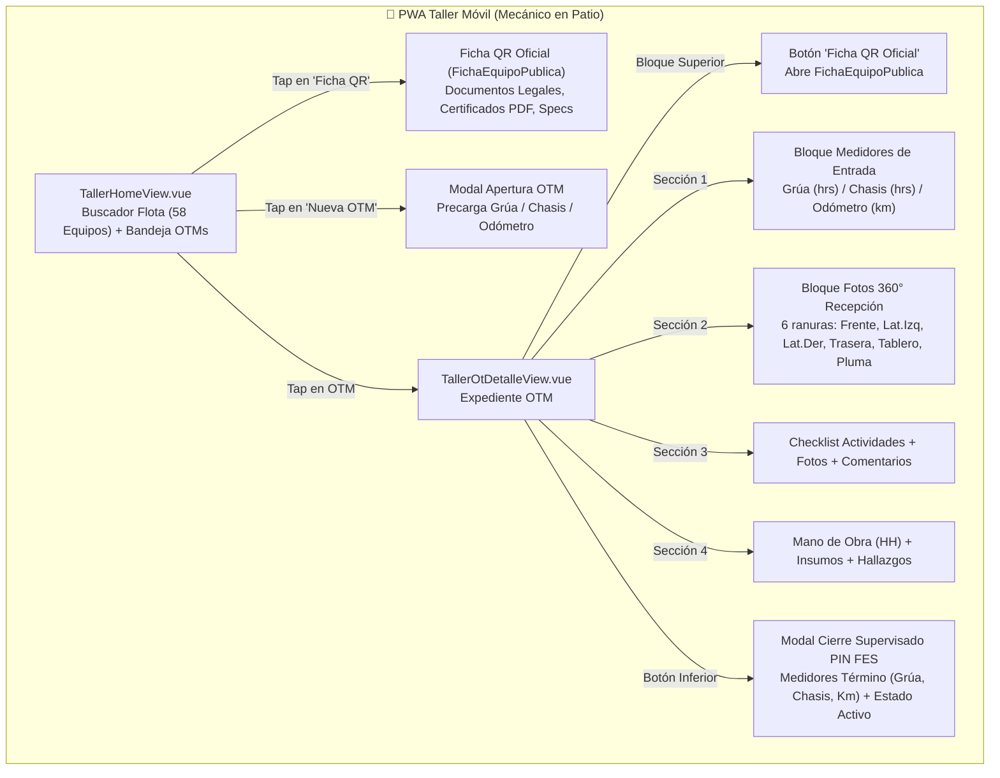

# 🛠️📱 ESPECIFICACIÓN TÉCNICA CANÓNICA N° 71: TALLER MÓVIL PWA — FICHA QR OFICIAL, DOBLE HORÓMETRO INICIO/TÉRMINO Y REGISTRO FOTOGRÁFICO 360°

> **Spec N°**: 71  
> **Módulo**: Mantenimiento de Flota (Taller Móvil PWA & Consola Web)  
> **Sistema**: Grúas San Pablo (GSP) / LeanGlobal Platform  
> **Esquemas DB**: `sch_leangsp` (DEV) & `sch_leangsp_prod` (PROD)  
> **Rutas PWA**: `/taller`, `/taller/ot/:id`  
> **Ruta Ficha QR Oficial**: `/lg-gsp-dev/equipo/:patente` (DEV) / `/equipo/:patente` (PROD)  
> **Estado**: 📝 ESPECIFICACIÓN FORMAL APROBADA PARA IMPLEMENTACIÓN  
> **Fecha**: 2026-10-10  

---

## 1. Declaración del Problema y Objetivos de Negocio

En la operación de taller interno de Grúas San Pablo, el mecánico o jefe de taller que interviene una máquina en faena o patio requiere tres capacidades operacionales críticas que garantizan la integridad técnica, legal y de seguridad:

1. **Acceso Inmediato a la Documentación Oficial vía QR:** El técnico debe acceder con 1 solo toque a la misma Ficha Oficial que despliega el código QR físico pegado en el parabrisas de la grúa (`FichaEquipoPublica.vue`), sin duplicar lógica ni reinventar modales vacíos. Dicha ficha contiene toda la documentación legal (Permiso de Circulación, Revisión Técnica, SOAP), técnica (Tablas de carga, Bureau Veritas, certificados de izaje) con visor PDF, y especificaciones mecánicas.
2. **Registro Obligatorio de Medidores de Entrada y Salida (Doble Horómetro & Odómetro):** Grúas complejas (e.g. Liebherr LTM, Grove, Demag) disponen de horómetros independientes para la superestructura de izaje y para el motor del chasis/carretera, además del odómetro en kilómetros. La OTM debe exigir y permitir registrar de forma clara:
   - Lecturas de Entrada (al recepcionar la grúa para el trabajo).
   - Lecturas de Cierre / Liberación (al terminar la OTM y liberar el activo).
3. **Inspección Visual 360° de Recepción de la Máquina:** Registro fotográfico formal de ingreso al taller en 6 posiciones predefinidas (Frente, Lateral Izquierdo, Lateral Derecho, Posterior, Tablero de Medidores, Pluma/Gancho) para registrar el estado cosmético y estructural antes de intervenir.

---

## 2. Arquitectura de Navegación y Componentes Frontend



---

## 3. Especificación Detallada de Requerimientos (RF)

### RF-01: Acceso Unificado a la Ficha Oficial del QR (`FichaEquipoPublica`)
* **Ubicación:** 
  1. En `TallerHomeView.vue`: en cada tarjeta de grúa del catálogo de flota (botón `[ 📄 Ficha QR ]`).
  2. En `TallerOtDetalleView.vue`: en la cabecera de la OTM (botón `[ 📄 Ficha Técnica y Documentación Legal QR ]`).
* **Comportamiento:**
  * Al hacer clic, abre la URL canónica de la Ficha Pública del activo:
    * En DEV: `https://servidor.leanglobal.cl/lg-gsp-dev/equipo/${patente}` (o ruta router `/equipo/${patente}`).
    * En PROD: `https://servidor.leanglobal.cl/lg-gsp-prod/equipo/${patente}`.
  * También se integra como diálogo modal responsive de pantalla completa dentro de la PWA para evitar abandonar el flujo de trabajo del taller.
* **Datos Mostrados:**
  * Documentación Legal: Permiso de Circulación, Revisión Técnica, SOAP con badge de vigencia (Vigente / Por Vencer / Vencido) y botón directo de apertura de PDF (`/api/archivo/ver/:id_doc` o `/api/v1/storage/view/:id_doc`).
  * Documentación Técnica y Certificados: Certificación de Operatividad Bureau Veritas, Tablas de Carga, Ensayos No Destructivos (NDT).
  * Ficha Técnica: Patente, Marca, Modelo, Capacidad en Toneladas, Número de Serie, Año, Estado.

---

### RF-02: Registro de Medidores de Entrada (Inicio de OT)
* **Campos en `tmnt_ot`:**
  * `horometro_grua_inicio` (NUMERIC 10,2): Horómetro de la superestructura de levante. Obligatorio.
  * `horometro_chasis_inicio` (NUMERIC 10,2): Horómetro del motor del chasis (visible y obligatorio si `tiene_doble_horometro = true`).
  * `odometro_inicio` (NUMERIC 10,2): Kilometraje del chasis en camiones grúa / grúas todo terreno.
* **Comportamiento en `TallerOtDetalleView.vue`:**
  * Si los medidores de inicio aún no han sido fijados (o la OT está en estado ABIERTA / EN_PROCESO), se despliega una tarjeta interactiva destacada:
    * Muestra los últimos valores acumulados del activo (`horometro_grua_acumulado`, `horometro_chasis_acumulado`, `odometro_acumulado`).
    * Permite al técnico editar las lecturas reales tomadas en el patio con validación de no-regresión (la lectura no puede ser menor a la acumulada en la base de datos).
    * Botón `[ 💾 Guardar Medidores de Entrada ]` que realiza un `PUT /api/mantenimiento/ots/:id/medidores-inicio`.

---

### RF-03: Registro Fotográfico 360° de Recepción del Activo
* **Estructura de las 6 Ranuras Fotográficas:**
  1. `FRENTE`: Frontal y cabina de control.
  2. `LAT_IZQ`: Lateral izquierdo y orugas/estabilizadores izquierdos.
  3. `LAT_DER`: Lateral derecho y estabilizadores derechos.
  4. `POSTERIOR`: Posterior, motor de cola y contrapesas.
  5. `TABLERO`: Tablero de horómetro(s) y odómetro (evidencia empírica de lecturas).
  6. `SIST_IZAJE`: Pluma telescópica, pasteca, gancho y cables de izaje.
* **Modelo de Datos:**
  * Se almacena en la tabla de evidencias o como metadato JSONB estructurado en `tmnt_ot.fotos_recepcion_360`:
    ```json
    {
      "frente": { "id_doc": 1204, "url": "https://...", "fecha": "2026-10-10T16:00:00Z" },
      "lat_izq": { "id_doc": 1205, "url": "https://...", "fecha": "2026-10-10T16:01:00Z" },
      "lat_der": { "id_doc": 1206, "url": "https://...", "fecha": "2026-10-10T16:02:00Z" },
      "posterior": { "id_doc": 1207, "url": "https://...", "fecha": "2026-10-10T16:03:00Z" },
      "tablero": { "id_doc": 1208, "url": "https://...", "fecha": "2026-10-10T16:04:00Z" },
      "sist_izaje": { "id_doc": 1209, "url": "https://...", "fecha": "2026-10-10T16:05:00Z" }
    }
    ```
* **UX Táctil Móvil:**
  * Ranuras visuales 2x3 con ícono de cámara y placeholder representativo.
  * Al pulsar sobre una ranura vacía, se dispara la cámara del dispositivo móvil (`capture="environment"`).
  * Al capturar, se sube vía `POST /api/v1/storage/upload` y se vincula a la OT.
  * Al pulsar sobre una ranura con foto, abre modal de pantalla completa con opción de zoom y botón de reemplazo / eliminación.

---

### RF-04: Cierre Supervisado con Medidores Finales y PIN FES
* **Modal de Cierre en `TallerOtDetalleView.vue`:**
  * Campos obligatorios:
    * `horometro_grua_cierre` (NUMERIC 10,2): Validado `>= horometro_grua_inicio`.
    * `horometro_chasis_cierre` (NUMERIC 10,2): Validado `>= horometro_chasis_inicio` (si `tiene_doble_horometro = true`).
    * `odometro_cierre` (NUMERIC 10,2): Validado `>= odometro_inicio`.
    * `estado_equipo_resultante`: Selector (🟢 OPERATIVO, 🟡 OPERATIVO_CON_RESTRICCION, 🔴 FUERA_DE_SERVICIO).
    * `observacion_final`: Justificación de la liberación o detalle de restricciones.
    * `checklist_liberacion_ok`: Checkbox de verificación final de seguridad y prueba operacional.
    * `pin`: PIN numérico de 4 dígitos del supervisor de taller.
* **Persistencia en Backend:**
  * Al cerrar (`POST /api/mantenimiento/ots/:id/cerrar`), la base de datos actualiza `tmnt_ot` y activa el trigger `fn_sync_equipo_odohoro()` para sincronizar los nuevos acumulados en `tequ_equipo`.

---

## 4. Endpoints y Contratos de API Backend

| Método | Endpoint | Descripción | Body / Parámetros |
|---|---|---|---|
| `GET` | `/api/tequ-equipos/:patente` | Ficha técnica y catálogo del equipo | Param `:patente` |
| `GET` | `/api/tequ-equipos/:id/certificados` | Listado oficial de certificados y documentos legales/técnicos | Param `:id` |
| `PUT` | `/api/mantenimiento/ots/:id/medidores-inicio` | Actualiza lecturas de entrada en la OT | `{ horometro_grua_inicio, horometro_chasis_inicio, odometro_inicio }` |
| `POST` | `/api/mantenimiento/ots/:id/fotos-360` | Sube o actualiza una toma de la inspección 360° | `{ posicion: 'frente'\|'lat_izq'..., id_doc, url }` |
| `POST` | `/api/mantenimiento/ots/:id/cerrar` | Cierre formal supervisado con PIN FES y medidores de término | `{ pin, horometro_grua_cierre, horometro_chasis_cierre, odometro_cierre, estado_equipo_resultante, observacion_final, checklist_liberacion_ok }` |

---

## 5. Criterios de Aceptación Deterministas (QA Gates)

1. **Gate 1 - Ficha QR:** Al presionar `[ Ficha QR ]` desde cualquier grúa en el catálogo o en la OT de detalle, se visualizan de forma inmediata los certificados reales vigentes y vencidos con descarga directa de PDF sin errores 404 ni pantallas vacías.
2. **Gate 2 - Medidores de Inicio:** El técnico puede modificar y guardar los horómetros (grúa/chasis) y odómetro iniciales. Los valores persisten en `tmnt_ot` y se reflejan en la cabecera.
3. **Gate 3 - Fotos 360°:** El técnico puede capturar las 6 posiciones fotográficas (Frente, Lat. Izq, Lat. Der, Posterior, Tablero, Pluma), previsualizarlas en miniatura y visualizarlas a tamaño completo.
4. **Gate 4 - Cierre con Doble Horómetro:** El modal de cierre exige el ingreso de las lecturas finales de grúa, chasis y odómetro, validando que no retrocedan respecto al inicio, validando el PIN FES y actualizando el estado de la grúa.
