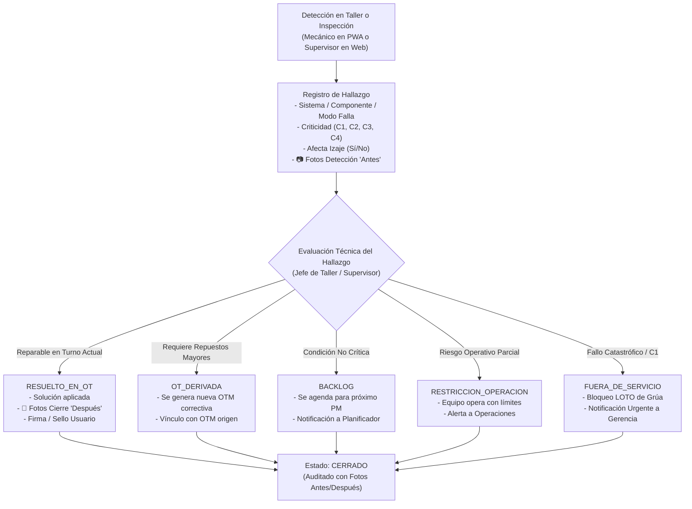

# 🛠️🔬 ESPECIFICACIÓN TÉCNICA CANÓNICA N° 72: CICLO DE VIDA, RESOLUCIÓN TÉCNICA Y EVIDENCIAS FOTOGRÁFICAS (ANTES/DESPUÉS) DE HALLAZGOS EN TALLER Y EXPEDIENTE DE OT

> **Spec N°**: 72  
> **Módulo**: Mantenimiento de Flota (Taller Móvil PWA & Consola Web)  
> **Sistema**: Grúas San Pablo (GSP) / LeanGlobal Platform  
> **Esquemas DB**: `sch_leangsp` (DEV) & `sch_leangsp_prod` (PROD)  
> **Rutas Consola Web**: `/mantenimiento` (Pestaña OTs ➔ Subtab Hallazgos, y Pestaña 4 Hallazgos Globales)  
> **Rutas PWA Móvil**: `/taller/ot/:id` (Sección Hallazgos Imprevistos)  
> **Requerimiento Backlog**: `REQ-1027` (Gestión/tareas.md)  
> **Estado**: 📝 ESPECIFICACIÓN FORMAL APROBADA PARA IMPLEMENTACIÓN  
> **Fecha**: 2026-10-11  

---

## 1. Declaración del Problema y Objetivos de Negocio

Durante la ejecución de una Orden de Trabajo (preventiva o correctiva) en taller o faena, los mecánicos frecuentemente detectan anomalías o averías no planificadas (desgaste de cables de izaje, fugas hidráulicas en cilindros de levante, fisuras estructurales, pernos cortados, fallas de sensores LMI/PAT).

Bajo las normativas de izaje y estándares de confiabilidad (ISO 14224 y ASME B30.5), el tratamiento de hallazgos exige un ciclo de vida cerrado con estricta trazabilidad:

1. **Captura Obligatoria de Evidencia Inicial ("Antes"):** Al reportar el hallazgo, el técnico o supervisor debe adjuntar fotografías que demuestren fehacientemente la anomalía detectada antes de intervenir.
2. **Visibilidad Simétrica e Inmediata en el Expediente de la OT:** El supervisor o jefe de taller que audita la OT en la Consola Web Desktop debe ver de inmediato las fotografías del hallazgo dentro del subtab `"Hallazgos en esta OT"`, con previsualización en miniatura y zoom a pantalla completa, eliminando el punto ciego actual donde solo se mostraban textos planos.
3. **Resolución Técnica Estructurada con Evidencia Final ("Después"):** Un hallazgo no puede simplemente "cerrarse"; debe ser resuelto mediante una decisión de ingeniería de mantenimiento explícita, registrando:
   - **Decisión Técnica:**
     - `RESUELTO_EN_OT`: Corregido y reparado dentro de la misma OT de origen.
     - `OT_DERIVADA`: Requiere la apertura de una nueva OT correctiva específica.
     - `BACKLOG`: Se programa para atención en la próxima detención o mantenimiento preventivo.
     - `RESTRICCION_OPERACION`: El equipo puede operar únicamente con restricciones operacionales documentadas.
     - `FUERA_DE_SERVICIO`: Condición crítica que obliga a la detención y bloqueo inmediato de la máquina.
   - **Solución Aplicada:** Detalle técnico de la acción correctiva ejecutada (torque, reemplazo, soldadura calificada, calibración).
   - **Evidencias Fotográficas de Cierre ("Después"):** Fotografía(s) que comprueben la solución terminada y en conformidad.
   - **Responsabilidad y Sello Temporal:** `id_user_cierra`, `fecha_cierre` y trazabilidad del usuario que autoriza la resolución.

---

## 2. Diagrama de Ciclo de Vida y Transiciones



---

## 3. Especificación Detallada de Requerimientos Funcionales (RF)

### RF-01: Evidencias Fotográficas de Detección ("Antes")
* **PWA Móvil (`TallerOtDetalleView.vue`):**
  - Formulario de nuevo hallazgo con selector de fotos: cámara directa (`capture="environment"`) o galería.
  - Subida asíncrona hacia `/api/v1/storage/upload` (`modulo: mantenimiento`, `tipo_doc: HALLAZGO_EVIDENCIA`).
  - Persistencia de arreglo de objetos `{ id_doc, url, nombre }` en la columna `tmnt_hallazgo.fotos`.
* **Consola Web Desktop (`MantenimientoView.vue`):**
  - Modal de nuevo hallazgo (`showNuevoHallazgoModal`) con botón `[ 📷 Adjuntar Foto ]`, carga asíncrona y miniaturas con botón de borrado (`✕`).

### RF-02: Visualización y Acceso en el Expediente de la OT (Consola Web)
* **Ubicación:** `MantenimientoView.vue` ➔ Panel Lateral de Detalle de OT (`selectedOt`) ➔ Subtab `activeOtSubTab === 'hallazgos'`.
* **Diseño y Componentes:**
  - Cada tarjeta de hallazgo debe desplegar:
    1. Encabezado con badge de criticidad (`C1`, `C2`, `C3`, `C4`), código de sistema (`HID`, `MOT`, `PLU`, `SEG`), componente y alerta `⚠️ Afecta Izaje` si aplica.
    2. Descripción textual de la anomalía observada.
    3. Bloque de **Evidencias Iniciales (Antes)**: Miniaturas de `h.fotos` con hover interactivo y clic para zoom en pantalla completa (`abrirVisorFotoModal(url)`).
    4. Bloque de **Resolución Técnica (Después)** (si `h.estado === 'CERRADO'`):
       - Badge de Decisión (`RESUELTO_EN_OT`, `OT_DERIVADA`, etc.).
       - Texto explicativo de `h.solucion_aplicada`.
       - Miniaturas de `h.fotos_cierre` con clic para visor modal.
       - Metadatos de auditoría: `h.usuario_cierra` y `h.fecha_cierre`.
    5. Botón de acción técnica:
       - Si `h.estado !== 'CERRADO'`: Botón `[ 🛠️ Resolver Hallazgo ]` que abre el modal interactivo `abrirModalResolverHallazgo(h)`.

### RF-03: Modal Unificado de Resolución Técnica de Hallazgos
* **Campos del Modal (`showResolverHallazgoModal`):**
  - **Decisión Técnica:** Selector obligatorio:
    - `RESUELTO_EN_OT`: Resuelto en esta OT.
    - `OT_DERIVADA`: Generar OT correctiva derivada.
    - `BACKLOG`: Posponer para próximo mantenimiento preventivo.
    - `RESTRICCION_OPERACION`: Equipo operativo con restricciones técnicas.
    - `FUERA_DE_SERVICIO`: Equipo no apto para operar / Fuera de servicio.
  - **Solución Aplicada:** Textarea obligatorio describiendo los trabajos o justificación técnica.
  - **Evidencias Fotográficas (Después):** Control de carga de fotografías de la reparación/solución final.
* **Cierre y Persistencia:**
  - Envío a `PUT /api/mantenimiento/hallazgos/:id/resolver`.
  - Actualización reactiva tanto en la lista interna de la OT (`selectedOt.hallazgos`) como en la tabla global de hallazgos (`realHallazgos`).

### RF-04: Paridad Completa en PWA Taller Móvil (`TallerOtDetalleView.vue`)
* Sección de hallazgos dentro del detalle de la OT con acordeón o tarjetas que presenten:
  - Miniaturas de fotos iniciales (`h.fotos`) con `resolverFotoUrl()`.
  - Miniaturas de fotos de solución (`h.fotos_cierre`).
  - Botón táctil `[ 🛠️ Resolver ]` para permitir al mecánico en terreno documentar la solución y fotografiar el componente reparado antes de abandonar el patio.

---

## 4. Modelo de Datos y Esquema PostgreSQL

### 4.1. Extensión de la Tabla `sch_leangsp.tmnt_hallazgo`
```sql
ALTER TABLE sch_leangsp.tmnt_hallazgo 
ADD COLUMN IF NOT EXISTS fotos_cierre JSONB DEFAULT '[]'::jsonb,
ADD COLUMN IF NOT EXISTS solucion_aplicada TEXT NULL,
ADD COLUMN IF NOT EXISTS id_user_cierra INTEGER REFERENCES sch_leangsp.tsec_users(id_user),
ADD COLUMN IF NOT EXISTS fecha_cierre TIMESTAMP WITH TIME ZONE NULL,
ADD COLUMN IF NOT EXISTS decision VARCHAR(50) DEFAULT 'RESUELTO_EN_OT';

CREATE INDEX IF NOT EXISTS idx_tmnt_hallazgo_ot_origen ON sch_leangsp.tmnt_hallazgo(id_ot_origen);
CREATE INDEX IF NOT EXISTS idx_tmnt_hallazgo_estado ON sch_leangsp.tmnt_hallazgo(estado);
```

---

## 5. Endpoints y Contratos de API Backend

### 5.1. `GET /api/mantenimiento/ots/:id`
En `mantenimientoModel.getOtById(idOt)`:
* La consulta de hallazgos debe incorporar los nombres de usuario y normalizar los arreglos de fotos:
```javascript
SELECT h.*,
       (SELECT u.name_frst || ' ' || u.apellido_pat FROM tsec_users u WHERE u.id_user = h.id_user_reporta) AS usuario_reporta,
       (SELECT u.name_frst || ' ' || u.apellido_pat FROM tsec_users u WHERE u.id_user = h.id_user_cierra) AS usuario_cierra
FROM tmnt_hallazgo h
WHERE h.id_ot_origen = $1
ORDER BY h.id_hallazgo DESC
```
* Mapeo obligatorio:
```javascript
const hallazgosLimpios = hallazgos.map(r => {
  let fList = r.fotos;
  if (typeof fList === 'string') { try { fList = JSON.parse(fList); } catch (_) { fList = []; } }
  let fcList = r.fotos_cierre;
  if (typeof fcList === 'string') { try { fcList = JSON.parse(fcList); } catch (_) { fcList = []; } }
  return {
    ...r,
    fotos: Array.isArray(fList) ? fList : [],
    fotos_cierre: Array.isArray(fcList) ? fcList : []
  };
});
```

### 5.2. `PUT /api/mantenimiento/hallazgos/:id/resolver`
* **Payload:**
```json
{
  "decision": "RESUELTO_EN_OT",
  "solucion_aplicada": "Se cambió manguera hidráulica de levante de 3/4 por una nueva Parker certificada.",
  "fotos_cierre": [
    { "id_doc": 1289, "url": "/api/v1/storage/view/1289", "nombre": "solucion_manguera.jpg" }
  ]
}
```
* **Acción DB:**
  - Actualiza `estado = 'CERRADO'`, `decision`, `solucion_aplicada`, `fotos_cierre = $fotos::jsonb`, `id_user_cierra = $idUser`, `fecha_cierre = NOW()`.
  - Retorna objeto hallazgo actualizado.

---

## 6. Criterios de Aceptación Deterministas (QA Gates)

1. **Gate 1 - Persistencia de Fotos "Antes":** Al crear un hallazgo en Web o PWA con 1 o más fotos, las imágenes se suben al Storage y quedan asociadas al registro en `tmnt_hallazgo.fotos`.
2. **Gate 2 - Visibilidad en Expediente de OT:** Al ingresar a cualquier OT con hallazgos en la Consola Web, la pestaña "Hallazgos en esta OT" despliega visualmente las miniaturas de las fotografías con resolución de URL válida (sin 404 ni rutas relativas rotas) y permite abrir el visor a pantalla completa con zoom al hacer clic.
3. **Gate 3 - Resolución con Fotos "Después":** El usuario puede hacer clic en `[ 🛠️ Resolver ]` tanto desde la tabla general como desde el expediente de la OT, seleccionar la decisión técnica, redactar la solución y subir fotos de término. Al guardar, el hallazgo pasa a `CERRADO` y muestra inmediatamente las fotos de la solución y los datos de auditoría.
4. **Gate 4 - Compilación y Rendimiento:** `npm run build:dev` compila con 0 errores tanto en `ejecucion/frontend` como en `ejecucion/pwa`.
