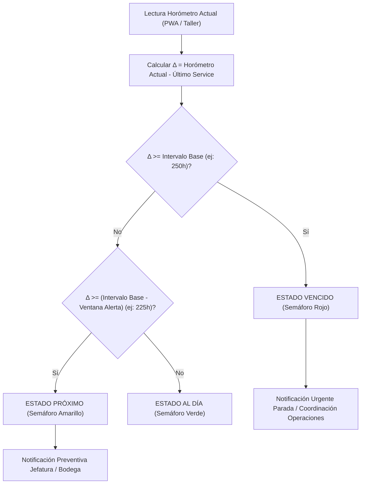

# SPEC-079: Parametrización Dinámica de Ciclos Preventivos (Horómetro / Odómetro), Criterios Tribológicos y Gobierno de Taller GSP

## 1. Contexto, Justificación y Problema Operacional
En la operación de grúas industriales y transporte de alto tonelaje de **Grúas San Pablo (GSP)**, la disponibilidad, confiabilidad y seguridad operativa dependen de un control riguroso de los ciclos de mantenimiento preventivo. 

Históricamente, los sistemas de gestión evalúan los mantenimientos utilizando únicamente kilometraje o calendarios mensuales fijos. Sin embargo, en el izaje industrial, este enfoque es **inoperante y peligroso**: una grúa móvil telescópica puede permanecer 10 horas continuas en faena operando a 1.800 RPM en maniobras de alto tonelaje con sus bombas hidráulicas a 320 bar de presión, mientras su odómetro registra **0 km** recorridos.

Asimismo, en el código backend (`mantenimientoModel.js`) y servicios de alerta (`mantenimientoAlertasService.js`), los umbrales de mantenimiento estaban codificados rígidamente (hardcoded a 250 hrs y 25 hrs de aviso previo), impidiendo que la gerencia técnica y jefatura de taller adapten los ciclos según las marcas de grúas (Liebherr, Grove, Tadano), el uso de lubricantes sintéticos de alto rendimiento o las condiciones severas de faena (polvo minero, salinidad costera, alta oscilación térmica).

Esta especificación formaliza los **criterios físico-químicos y tribológicos**, la **taxonomía de medición (Horómetro vs. Odómetro)**, el **modelo de datos paramétrico**, el **motor de radar de flota** y la **interfaz web corporativa** para el gobierno autónomo del taller.

---

## 2. Fundamentos Técnicos y Criterios Tribológicos de la Industria

### 2.1. ¿Por qué 250, 500, 1.000 y 2.000 Horas?
Los fabricantes de equipo original (**OEM**: Liebherr, Manitowoc/Grove, Tadano, Demag, Cummins, Mercedes-Benz OM, Caterpillar) y las normas internacionales de confiabilidad (**SMRP**, **ISO 14224**, **EN 13306**) han determinado intervalos armónicos múltiplos de 250 horas basados en cuatro factores físico-químicos insalvables:

1. **Agotamiento de la Reserva Alcalina (TBN - Total Base Number):**
   El combustible diésel genera azufre y ácidos de combustión que degradan los aditivos neutralizantes del aceite. A las 250 horas de operación continua bajo carga, el TBN desciende a menos del 50% de su valor inicial, perdiendo la capacidad de neutralizar ácidos nítricos y sulfúricos, acelerando la corrosión en metales amarillos y cojinetes.
2. **Saturación de Hollín (Soot Loading) y Dispersancia:**
   La combustión en motores de alta compresión transfiere micro-partículas de carbón al lubricante. Pasadas las 250 horas, los aditivos dispersantes se saturan; el hollín comienza a aglomerarse, provocando aumento de viscosidad, pulido de camisas y obstrucción de ranuras de anillos.
3. **Cizallamiento de Polímeros Mejoradores de Viscosidad:**
   Bajo las altas tensiones de corte mecánico entre émbolo y camisa, las cadenas moleculares de los polímeros del aceite multigrado se fracturan permanentemente, perdiendo la capacidad de mantener la película hidrodinámica a temperaturas superiores a 95°C.
4. **Colmatación de Medios Filtrantes y Presión Diferencial ($\Delta P$):**
   Los filtros de aceite y combustible retienen material particulado (hollín, sílice del ambiente, residuos de desgaste). Al aproximarse a las 250–300 horas, la presión diferencial interna supera el punto de calibración de la válvula de derivación (*bypass*). Si la válvula bypass se abre para evitar la cavitación, el aceite circula sin filtrar, circulando abrasivos por todo el circuito.

### 2.2. Jerarquía Armónica de Pautas Preventivas (PM1 a PM4)
El plan de mantenimiento preventivo de GSP se estructura en una cascada cíclica acumulativa:

```
[0 hrs] ──► [250 hrs: PM1] ──► [500 hrs: PM2] ──► [750 hrs: PM1] ──► [1.000 hrs: PM3] ──► ... ──► [2.000 hrs: PM4]
```

* **Pauta PM1 / PM250 (Cada 250 Horas - Servicio Básico de Lubricación):**
  - Cambio total de aceite lubricante de motor diésel.
  - Reemplazo de filtros de aceite de motor y filtros primarios de combustible / decantador de agua.
  - Engrase integral de chasis, crucetas, pernos de pivote, terminales de dirección y pistas de estabilizadores.
  - Inspección de fugas hidráulicas, tensión de correas y nivel de refrigerante.
* **Pauta PM2 / PM500 (Cada 500 Horas - Servicio Intermedio):**
  - Todo lo estipulado en la PM1.
  - Reemplazo de filtros secundarios de combustible y filtros de aire de admisión (primario/secundario).
  - Reemplazo de filtro de pilotaje y drenaje de caja de retorno hidráulico.
  - Engrase de corona de rotación y piñón de giro con grasa de extrema presión (EP).
  - Muestreo y análisis de laboratorio de aceite usado (espectrometría, viscosidad, hollín).
* **Pauta PM3 / PM1000 (Cada 1.000 Horas - Servicio Mayor):**
  - Todo lo estipulado en la PM1 y PM2.
  - Reemplazo de fluidos y aceites de transmisiones (cajas automáticas / Allison / ZF), cajas de transferencia y diferenciales.
  - Reemplazo de filtros de servotransmisión.
  - Calibración de holguras de válvulas de motor e inyectores.
  - Inspección no destructiva visual de soldaduras críticas de pluma y chasis.
* **Pauta PM4 / PM2000 (Cada 2.000 Horas / Anual - Overhaul y Fluido Hidráulico Integral):**
  - Todo lo estipulado en PM1, PM2 y PM3.
  - Vaciado, lavado y recambio completo del fluido hidráulico de izaje (aceite ISO VG 46 / 68, volúmenes de 400 a 1.200 litros por grúa).
  - Reemplazo de todos los filtros de succión, presión y retorno hidráulico.
  - Calibración de presiones de alivio en bancos de válvulas (bomba principal, basculamiento, telescopaje, winches y giro).
  - Pruebas operativas con limitador de momento de carga (LMI / PAT / Hirschmann) y preparación para re-certificación Bureau Veritas.

---

## 3. Taxonomía de Medición: Horómetro vs. Odómetro

### 3.1. Horómetro (Métrica Reina en Grúas Móviles e Izaje)
* **Definición:** Medidor de tiempo efectivo de ignición y funcionamiento del motor bajo régimen de giro (RPM).
* **Fundamento Operacional:** El 85% del desgaste del activo en grúas no ocurre en la carretera, sino en la faena. Durante el montaje de una viga o un estanque minero, la grúa permanece anclada en sus estabilizadores ($0\text{ km}$ recorridos). Sin embargo, el motor acciona la toma de fuerza (PTO) o el motor superior trabaja a máxima demanda térmica para accionar bombas axiales de pistones que sostienen cargas de hasta 200 toneladas.
* **Afectación Crítica:** Degradación del aceite de motor, fatiga térmica de sellos y o-rings en cilindros de basculamiento/telescopaje, desgaste de cojinetes de winches y fatiga por flexión de cables de izaje.

### 3.2. Odómetro (Métrica de Rodadura Cinemática en Carretera)
* **Definición:** Distancia longitudinal recorrida por las ruedas en traslados terrestres (kilómetros).
* **Fundamento Operacional:** Aplica prioritariamente para:
  - Tractocamiones de tiro y escolta.
  - Camiones pluma durante traslados interurbanos.
  - Ramplas cama baja, Dollys y convoyes de contrapesas.
  - Chasis rodante de grúas All Terrain / Rough Terrain durante viajes entre faenas.
* **Afectación Crítica:** Desgaste y vida útil de neumáticos, alineación y balanceo, temperatura y engrase de rodamientos de maza (cubos de rueda), zapatas/discos de freno, líquido de frenos y suspensión hidroneumática o de hojas de resorte.
* **Ciclo de Servicio:** Estandarizado por defecto en **10.000 km**.

### 3.3. Arquitectura de Doble Horómetro
Las grúas telescópicas pesadas (ej: Liebherr LTM 1100, Tadano ATF 130) poseen dos motores independientes o dos tacómetros segregados:
1. `horometro_chasis_acumulado`: Horas de operación del motor portador (traslado por carretera y posicionamiento).
2. `horometro_grua_acumulado`: Horas de operación de la superestructura e izaje (accionamiento de malacates, pluma, pasteca y sistema PAT).

El sistema GSP registra ambos medidores de manera diferenciada en la base de datos y en la Ficha QR Oficial del activo.

---

## 4. Fuentes de Ingesta y Trazabilidad Operativa

El sistema captura lecturas de avance mediante tres canales complementarios:

1. **Ingesta Diaria desde Faena (PWA Móvil del Operador):**
   - Al finalizar la jornada vespertina en faena, el operador registra en el **Reporte Diario de Izaje** (`tedp_reporte_avance`) el `horometro_termino` y `odometro_termino`.
   - La base de datos actualiza reactivamente el campo `horometro_grua_acumulado` del equipo y la fecha de última lectura.
2. **Ingesta en Taller / Patio (Checklist y Medidores de Entrada):**
   - Al ingresar la grúa a mantenimiento o retorno de faena, el mecánico verifica in situ el tablero y registra en la OT (`tmnt_ot`) los medidores de recepción: `horometro_grua_inicio`, `horometro_chasis_inicio` y `odometro_inicio`.
3. **Telemetría y GPS (Integración CAN-Bus J1939):**
   - Preparado para ingesta directa por API de horómetro de motor reportado por módem satelital / celular de la flota.

---

## 5. Radar de Flota y Motor de Alertas Preventivas

El Radar de Flota evalúa cada equipo de la empresa contra los parámetros institucionales configurados en `tmnt_parametro`:



### 5.1. Fórmulas de Cálculo Dinámico
1. **Delta de Horas Acumuladas desde el Último Servicio Cerrado:**
   $$\Delta = \max(0, \text{horometro\_actual} - \text{ultimo\_horometro\_service})$$
2. **Umbral de Alerta Temprana (Semáforo Amarillo):**
   $$\text{umbral\_alerta} = \max(0, \text{pm\_intervalo\_base\_horas} - \text{pm\_ventana\_alerta\_horas})$$
   *Ejemplo Canónico:* Con base de $250\text{ hrs}$ y ventana de alerta de $25\text{ hrs}$, el semáforo cambia a amarillo en cuanto el equipo alcanza **$225\text{ hrs}$** de operación.
3. **Horas Faltantes para el Próximo Servicio:**
   $$\text{horas\_faltantes} = \max(0, \text{pm\_intervalo\_base\_horas} - (\Delta \pmod{\text{pm\_intervalo\_base\_horas}}))$$
4. **Pauta Sugerida Automática:**
   Evaluación del múltiplo de ciclo acumulado para sugerir `PM250`, `PM500`, `PM1000` o `PM2000`.

---

## 6. Arquitectura de Parámetros de Taller (`tmnt_parametro`)

Los parámetros operacionales de taller residen en `sch_leangsp.tmnt_parametro` y `sch_leangsp_prod.tmnt_parametro`:

| Clave | Tipo | Valor Default | Descripción Operacional | Impacto en el Sistema |
| :--- | :---: | :---: | :--- | :--- |
| `pm_intervalo_base_horas` | NUMÉRICO | `250` | Ciclo estándar de horómetro para service preventivo básico. | Define el umbral rojo del Radar de Flota y el cálculo de pautas sugeridas. |
| `pm_ventana_alerta_horas` | NUMÉRICO | `25` | Horas de anticipación para advertir próximo mantenimiento. | Define el umbral amarillo del Radar de Flota (`base - ventana`). |
| `pm_intervalo_odometro_km` | NUMÉRICO | `10000` | Ciclo en kilómetros para rodadura en carretera. | Aplica para camiones de transporte, ramplas cama baja y vehículos de apoyo. |
| `tarifa_hh_default` | MONEDA | `15000` | Tarifa estándar de Mano de Obra interna ($ CLP / HH). | Multiplica las horas reales reportadas por mecánicos para calcular el costo total de la OT. |
| `umbral_costo_ot_clp` | MONEDA | `2000000` | Umbral financiero crítico por OT ($ CLP). | Si el costo acumulado de una OT supera este valor, se dispara alerta a Gerencia de Operaciones. |
| `cert_alerta_dias` | NUMÉRICO | `30` | Anticipación de alerta para certificaciones Dictuc / Bureau Veritas. | Advierte en el Radar si la certificación técnica de izaje vencerá en menos de 30 días. |

---

## 7. Interfaz Web Corporativa (`MantenimientoView.vue`)

En la pestaña **"PARÁMETROS OPERACIONALES"**, el usuario dispone de un centro de mando con:
1. **Bloque 1: Ciclos Preventivos (Horómetro / Odómetro):**
   - Input interactivo de Intervalo Base Horómetro (mínimo 50 hrs, paso 25 hrs).
   - Input interactivo de Anticipación Alerta Radar (mínimo 5 hrs, paso 5 hrs) con feedback en tiempo real del cálculo del semáforo amarillo.
   - Input interactivo de Intervalo Odómetro Carretera (mínimo 1.000 km, paso 1.000 km).
2. **Bloque 2: Capacidad, Tarifas y Alertas Financieras:**
   - Input de Tarifa HH Estándar ($ CLP).
   - Input de Umbral de Alerta Financiera ($ CLP).
   - Input de Días de Anticipación para Certificaciones Bureau Veritas / Dictuc.
3. **Acción de Persistencia:**
   - Botón `[💾 Guardar Parámetros de Taller]`.
   - Mutación atómica en lote vía `PUT /api/mantenimiento/parametros`.
   - Almacenamiento con `ON CONFLICT (id_empresa, clave) DO UPDATE`.
   - Refresco reactivo e inmediato del Radar de Flota sin requerir recargar el navegador.

---

## 8. Gobernanza y Protocolo de Hard Gate
* **Requerimiento Canónico:** `REQ-1045` (Tarea 27 en `Gestión/tareas.md`).
* **Versión Web:** `v1.0.138` en `ejecucion/frontend/package.json`.
* **Registro de Versión:** Documentado en `RELEASE_LOG.md` (`v1.0.138`).
* **Sincronización en Base de Datos:** Registrado en `tcfg_releases` y `tcfg_backlog` en esquemas `sch_leangsp` (DEV) y `sch_leangsp_prod` (PROD).
* **Criterios de Aceptación:**
  1. El Radar de Flota recalcula de inmediato los estados y horas faltantes al cambiar los parámetros en la UI.
  2. Los servicios nocturnos de notificación toman los valores de `tmnt_parametro` sin requerir despliegues de código ni reinicios de PM2.
  3. Todas las lecturas de horómetro capturadas en terreno por la PWA impactan en tiempo real en la consola de taller.
