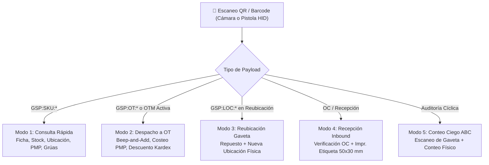

# 📱📦 ESPECIFICACIÓN TÉCNICA CANÓNICA N° 80: OPERACIÓN MOBILE WMS-LITE PWA — ESCANEO QR/BARCODE DUAL, DESPACHO A OT, REUBICACIÓN Y AUDITORÍA DE STOCK

> **Spec N°**: 80  
> **Módulo**: Gestión de Inventario WMS-Lite & Pañol Móvil (PWA)  
> **Sistema**: Grúas San Pablo (GSP) / LeanGlobal Platform  
> **Esquemas DB**: `sch_leangsp` (DEV) & `sch_leangsp_prod` (PROD)  
> **Rutas PWA**: `/bodega/scan`, `/taller/ot/:id`  
> **Tecnologías Frontend**: Vue 3, Vuetify 3, TailwindCSS, `vue-qrcode-reader` v5.7.2, Web Audio API  
> **Estado**: 📝 ESPECIFICACIÓN FORMAL PARA REVISIÓN Y APROBACIÓN  
> **Fecha**: 2026-10-15  

---

## 1. Declaración del Problema y Objetivos de Negocio

En la operación logística y de mantenimiento de Grúas San Pablo (~110 equipos móviles de izaje y camiones pluma), la bodega central y los pañoles satélites funcionan como un almacén de repuestos MRO de alta rotación y alto valor unitario (filtros Scania/Liebherr, turbos, aceites, neumáticos industriales, elementos de desgaste, EPPs).

Actualmente, el registro de movimientos en el ERP histórico (GeoSoft) se efectúa de manera manual y centralizada frente a un computador de escritorio al final del turno, lo que provoca:
1. **Desfase Temporal:** Salidas de repuestos entregadas a mecánicos que no se reflejan en el Kardex en tiempo real.
2. **Ubicaciones Fantasma:** Más del 80% de los productos figura con la ubicación plana `"BODEGA"`, obligando al pañolero a depender de la memoria visual para encontrar gavetas y piezas.
3. **Fricción en Despachos a OT:** Para imputar un repuesto a una Orden de Trabajo (OTM), el bodeguero debe anotar manualmente en papel la patente o número de OT y transcribirlo posteriormente, generando pérdidas de trazabilidad en el costeo real del mantenimiento de la flota.

### Objetivos Clave de la Solución Mobile (PWA):
* **Captura Inmediata en Terreno:** Operación 100% móvil desde smartphones Android/iOS de pañoleros y mecánicos mediante la PWA oficial instalada.
* **Arquitectura de Lectura Dual:** Soporte simultáneo para la cámara del dispositivo (`QrcodeStream` con linterna y enfoque continuo) y para pistolas lectoras 2D Bluetooth/USB (modo teclado HID de alta velocidad).
* **Escaneo Continuo Beep-and-Add:** En entregas de mesón, permitir el escaneo sucesivo de múltiples repuestos con feedback sonoro (audio beep sintético) y confirmación en menos de 200 ms.
* **Integración Nativa con Taller (OT):** Despacho directo con imputación de costo PMP en la OTM del equipo, vinculando automáticamente el repuesto a la grúa intervenida.

---

## 2. Protocolo Canónico de Payloads QR y Código de Barras

Para garantizar interoperabilidad y procesamiento instantáneo (incluso con conectividad degradada), todos los códigos QR generados o leídos por el sistema respetan el estándar canónico prefijado:

| Tipo de Identificador | Formato Canónico del Payload | Ejemplo Real GSP | Acción Disparada en PWA |
| :--- | :--- | :--- | :--- |
| **Repuesto / Producto** | `GSP:SKU:{sku}` | `GSP:SKU:FILT-00373` | Abre la ficha rápida de stock, precio PMP, ubicaciones físicas y compatibilidad. |
| **Ubicación / Gaveta** | `GSP:LOC:{codigo_ubicacion}` | `GSP:LOC:E1-A2` `GSP:LOC:CORRAL` | Filtra el inventario de la gaveta o selecciona la ubicación destino en reubicación. |
| **Lote / Etiqueta Térmica** | `GSP:LOT:{lote}:{sku}` | `GSP:LOT:REC-2026-42:FILT-00373` | Identifica el bulto específico con trazabilidad de proveedor y recepción OC. |
| **Orden de Trabajo (OT)** | `GSP:OT:{id_ot}` | `GSP:OT:104` | Carga la OT destino en el carrito de despacho para imputar consumos. |
| **Grúa / Equipo Flota** | `GSP:EQ:{patente}` | `GSP:EQ:GPT-135` | Identifica la grúa y consulta si posee OTs abiertas para imputación inmediata. |

> [!NOTE]
> El parser es tolerante: si la pistola escanea un código de barras plano sin prefijo (por ejemplo, el código legado `FAE0075` o el SKU crudo `FILT-00373`), el lector lo resuelve contra la base de datos local / API en milisegundos.

---

## 3. Modos de Operación en el Dispositivo Móvil

### 3.1. Modo 1: Consulta Rápida (Lookup In-Situ)
* **Caso de Uso:** El mecánico o pañolero encuentra un repuesto o llega a un rack y necesita saber existencias, costo y compatibilidad con la flota.
* **Flujo:**
  1. El operador apunta la cámara al QR del repuesto o gaveta.
  2. Disparo de Beep sonoro a 1.800 Hz.
  3. Despliegue de tarjeta flotante:
     * SKU Canónico + Código Legado GeoSoft.
     * Denominación y Familia MRO formal.
     * PMP Vigente (\$ CLP).
     * Stock Físico Disponible (unidades en almacén).
     * Ubicación Física exacta (Rack, Nivel, Posición).
     * Modelos de Grúa compatibles (ej: *Camión Pluma Scania G410*, *Liebherr LTM 1100*).
     * Botones de acción contextual: `[ Imputar a OT ]` y `[ Reubicar ]`.

### 3.2. Modo 2: Despacho y Consumo a Orden de Trabajo (OT Taller)
* **Caso de Uso:** Entrega de repuestos en el mesón del pañol para la mantención de una grúa.
* **Flujo:**
  1. El pañolero selecciona o escanea la OT (o el QR pegado en la grúa).
  2. La PWA entra en modo **"Escaneo Continuo a OT"**:
     * Cada escaneo de repuesto emite un Beep y suma 1 unidad a la lista de despacho.
     * Permite ajustar la cantidad con controles táctiles `[+]` y `[-]`.
     * Valida que la cantidad requerida no supere el stock libre disponible.
  3. Al presionar `[ Confirmar y Despachar ]`:
     * Genera la transacción atómica en `sch_leangsp.tinv_movimiento` (`tipo: DESPACHO_OT`).
     * Descuenta el stock en `tinv_stock`.
     * Registra el consumo con su costo PMP en `sch_leangsp.tmnt_ot_repuesto`.
     * Genera notificación push/in-app al supervisor de taller.

### 3.3. Modo 3: Reubicación de Gavetas (Putaway & Relocation)
* **Caso de Uso:** Mover repuestos desde la zona transitoria `SIN-UBICAR` hacia su estantería definitiva (ej: `E4-C2`), o trasladar piezas entre racks.
* **Flujo en 2 Pasos:**
  1. **Paso 1:** Escanear el repuesto (ej: `MEC-01237` Turbo).
  2. **Paso 2:** Escanear el QR de la gaveta de destino (ej: `E4-C2`).
  3. Digitar la cantidad a trasladar (por defecto la totalidad del saldo en esa posición).
  4. Confirmación instantánea: el backend actualiza `id_ubicacion` en `tinv_stock` y emite el movimiento de `TRANSFERENCIA_UBICACION` en el Kardex.

### 3.4. Modo 4: Recepción de Materiales e Impresión de Etiquetas Térmicas (Inbound)
* **Caso de Uso:** Recepción de bultos provenientes de proveedores (Scania, Liebherr, Dimasur).
* **Flujo:**
  1. Búsqueda o escaneo del código de la Orden de Compra (OC).
  2. Verificación de líneas recibidas vs pedidas.
  3. Generación directa de etiqueta térmica (50×30 mm) con el QR de lote `GSP:LOT:REC-YYYY-XXXX:SKU` para etiquetado inmediato del repuesto antes de almacenarlo en estantería.
  4. Envío de comando ZPL/TSPL a impresora térmica portátil vía Bluetooth o red local.

### 3.5. Modo 5: Toma de Inventario Cíclico Ciego (Auditoría ABC)
* **Caso de Uso:** Auditorías periódicas de exactitud de inventario por pasillo/rack sin detener la operación de la empresa.
* **Flujo:**
  1. El bodeguero escanea el QR de la gaveta (ej: `E1-A2`).
  2. La PWA muestra la gaveta activa, pero oculta las cantidades teóricas (**conteo ciego**).
  3. El operador escanea cada repuesto físico presente en la gaveta y digita la cantidad física contada.
  4. Al pulsar `[ Cerrar Conteo ]`, el sistema contrasta con el saldo teórico de base de datos y genera el informe de discrepancias para aprobación de la jefatura.

---

## 4. Componentes de Software y Arquitectura Frontend

### 4.1. Componente Reutilizable: `QrBarcodeScannerModal.vue`
* **Ubicación:** `ejecucion/pwa/src/components/inventario/QrBarcodeScannerModal.vue`
* **Características Técnicas:**
  * Basado en `QrcodeStream` (`vue-qrcode-reader` v5.7.2).
  * Control de antorcha / linterna móvil (`:torch="torchActive"`).
  * Listeners globales para pistolas lectoras HID (`keydown` con buffer temporal de lectura y detección de terminador `Enter` en < 200 ms).
  * Feedback auditivo instantáneo mediante Web Audio API (`AudioContext`, onda senoidal de 1.800–2.400 Hz), sin requerir archivos MP3 externos.
  * Selector de cámara (frontal vs trasera) y manejo robusto de permisos denegados con fallback manual a teclado.

### 4.2. Vista Dedicada: `BodegaScannerView.vue`
* **Ubicación:** `ejecucion/pwa/src/views/inventario/BodegaScannerView.vue`
* **Ruta Router:** `/bodega/scan`
* **Navegación:** Integrada en la barra inferior de la PWA (`App.vue`) para usuarios con roles de bodega o mantenimiento (`GSP_BODEGA_EJEC`, `GSP_BODEGA_APROB`, `GSP_TALLER_EJEC`, `Admin`).

### 4.3. Integración en Taller: `TallerOtDetalleView.vue`
* Incorpora el botón flotante `[ ➕ Escanear Repuesto a OT ]` en la sección de materiales/repuestos de la Orden de Trabajo, permitiendo al mecánico imputar piezas directamente mientras trabaja en la máquina.

---

## 5. Endpoints Backend Requeridos (API REST)

Todos los endpoints ya existen en el backend de DEV (`ejecucion/backend_remoto/src/routes/inventarioRoutes.js`) y han sido validados empíricamente:

1. `GET /api/inventario/productos?search={sku_o_codigo}`: Consulta rápida de ficha, PMP y compatibilidad.
2. `GET /api/inventario/existencias?id_producto={id}`: Consulta de stock disponible por bodega y ubicación.
3. `POST /api/inventario/despacho-ot`: Imputación atómica de repuestos a una OT (Kardex + saldo + costeo OT).
4. `POST /api/inventario/reubicacion`: Movimiento de existencias entre dos ubicaciones de la misma bodega.
5. `POST /api/inventario/recepciones`: Recepción de OC y registro de líneas de entrada.
6. `POST /api/inventario/conteo-ciego`: Envío de líneas contadas para auditoría de diferencias.

---

## 6. Criterios de Aceptación y Pruebas Empíricas (Hard Gate)

1. **Lectura con Cámara Trasera:** Escanear códigos QR impresos a una distancia de 15 a 40 cm en condiciones de baja iluminación con linterna activada, logrando lectura en < 500 ms.
2. **Lectura con Pistola Bluetooth/USB:** Al conectar una pistola láser inalámbrica, el escaneo debe capturarse en cualquier pantalla de la PWA sin necesidad de hacer foco táctil manual sobre un input de texto.
3. **Despacho a OT Verificado en BD:** Un despacho realizado desde el móvil debe reflejarse inmediatamente en la tabla `sch_leangsp.tinv_movimiento` con `tipo = 'DESPACHO_OT'`, disminuir el saldo en `tinv_stock` e imputar el costo a la OT en `tmnt_ot_repuesto`.
4. **Resistencia a Desconexión (Offline):** El catálogo de productos y ubicaciones debe quedar cacheado localmente en la PWA (IndexedDB / Pinia PersistedState) para permitir consulta de gavetas incluso en zonas de sombra de señal celular.
