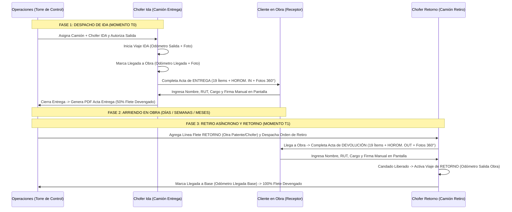

# SPEC-081: Registro de Entrega de Plataformas, Retorno Asíncrono e Inspección Obligatoria de Recuperación 360°

**Fecha:** 15 de Octubre de 2026  
**Empresas Alcance:** Bestmaq (BSM), Royal Rental, Grúas San Pablo (GSP), Logística del Sur  
**Módulos Afectados:**  
- `ejecucion/frontend/src/views/CRM/GestorOportunidades.vue` (Sub-tab 2: Asignación de Recursos, Sub-tab 4: Preparación Salida, Sub-tab 5: Reports & Actas)  
- `ejecucion/frontend/src/views/Operaciones/ViajeConductor.vue` (Hoja de Ruta del Chofer + Acta Digital de Entrega y Devolución)  
- Backend API `/operaciones/viaje` y Generador PDF Oficial (`Acta de Entrega y Recepción de Maquinaria`)

---

## 1. Contexto de Negocio y Reglas de Dominio

1. **Naturaleza del Arriendo de Plataformas (Caso 5):**
   - Las plataformas elevadoras (Alzahombres, Tijeras, Brazos Articulados) comercializadas por **Bestmaq (BSM)**, **Royal Rental** o **GSP** se arriendan **sin operador** por períodos prolongados (días, semanas o meses) dentro de las instalaciones del cliente, respaldadas por un **Contrato de Arrendamiento** (`SPEC-076`).
   - En el Estructurador de Servicios se configuran bajo el **Caso 5**, componiéndose de:
     1. **Partida de Arriendo de Plataforma** (Categoría `PLATAFORMAS`).
     2. **Partida de Servicio de Traslado Ida y Vuelta** (Categoría `TRASLADOS` -> `CAMIÓN PLATAFORMA` / `CAMA BAJA` / `RAMPLA`).

2. **Protagonismo del Chofer del Camión de Traslado:**
   - La plataforma física asignada en el Segmento 1 **no lleva operador asignado**.
   - El **Camión utilizado para el traslado o flete** (Segmento 2: `equipos_extra`) **DEBE tener asignado obligatoriamente un Chofer (`chofer_id`)**.
   - Este **Chofer del camión** es el responsable de:
     1. Ejecutar el **Registro de Viaje** estándar (Odómetro y foto de salida/llegada, telemetría GPS y solicitud de combustible si aplica).
     2. Tomar en terreno el **Acta de Entrega de Maquinaria** al concluir el viaje de `IDA`, y el **Acta de Devolución / Recuperación** antes de iniciar el viaje de `RETORNO`.

3. **Naturaleza Asíncrona de la Asignación de Retorno:**
   - Dado que la plataforma permanece en las instalaciones del cliente por tiempo prolongado, la **asignación del flete de retorno es asíncrona**:
     - **Momento T0 (Despacho Inicial / Ida):** Operaciones asigna únicamente la Plataforma (sin operador) y el Camión + Chofer del **Flete de Entrega (`IDA`)**. La OT puede avanzar y despacharse a terreno sin exigir que el camión de retorno esté definido aún.
     - **Momento T1 (Retiro Programado / Días o Meses Después):** Cuando el arriendo concluye y se coordina el retiro del equipo, Operaciones ingresa a la OT y agrega/asigna de forma independiente la línea de **Flete de Retorno (`RETORNO`)**, pudiendo seleccionar **otro camión (otra patente)**, **otro Chofer** y una **nueva fecha programada de retiro**.

---

## 2. Flujo Operacional Extremo a Extremo

---

## 3. Especificación del Documento: `Acta de Entrega y Recepción de Maquinaria`

El formulario digital en `ViajeConductor.vue` y su representación PDF A4 replican fielmente el documento físico oficial:

### 3.1 Encabezado y Datos Maestros (Autocompletados desde la OT y Contrato)
- **Empresa Emisora (Logo Dinámico):** Bestmaq (`id_empresa = 7`), Royal Rental (`id_empresa = 11`), Grúas San Pablo (`id_empresa = 9`) o Logística del Sur (`id_empresa = 8`).
- **Identificadores:** Folio correlativo (`N° 00215`) y **`N° CONTRATO`** (`CTR-YYYY-XXXX`).
- **Cuadro `ARRENDATARIO`:** `RAZÓN SOCIAL`, `R.U.T.`, `DIRECCIÓN`, `OBRA`, `CONTACTO`.
- **Cuadro `EQUIPO` (Datos de la Plataforma):** `MARCA`, `MODELO`, `AÑO`, `NRO SERIE`, `N° INTERNO`, **`HOROM. IN`** (Horómetro de Entrega) y **`HOROM. OUT`** (Horómetro de Devolución).

### 3.2 Matriz Oficial de 19 Ítems de `EQUIPAMIENTO`
Cada ítem se evalúa con **`[✓] SI`**, **`[X] NO`** o **`[NA] NO APLICA`** en dos momentos (`ENTREGA` en T0 y `RECEPCIÓN` en T1) más columna de **`COMENTARIO`**:
1. `Alarma Traslación`
2. `Baterías`
3. `Arrancador Motor Aéreo y Tierra`
4. `Interruptor de Parada de Emergencia`
5. `Llave de Contacto`
6. `Perillas de Tablero Control Bastidor`
7. `Perillas de Tablero Control Canastillo`
8. `Estado de Mangueras Hidráulicas`
9. `Estado General de la Pluma`
10. `Pintura de Equipo`
11. `Pintura de Canastillo`
12. `Puerta Canastillo`
13. `Estado de Capot`
14. `Estado de Neumáticos`
15. `Estado de Joystick`
16. `Baliza`
17. `Tapa de Combustible`
18. `Chapa de Contacto`
19. `Otros`
- **Indicador Lateral:** **`ESTANQUE DE PETRÓLEO` / Nivel de Energía** (`0`, `1/4`, `1/2`, `3/4`, `4/4 Lleno`) tanto en Entrega como en Devolución.

### 3.3 Evidencia Fotográfica 360° Obligatoria
- **En Entrega (`IDA`):** Mínimo 4 fotografías del estado de entrega (Frontal, Posterior, Costado Izquierdo, Costado Derecho / Canastillo) + Foto de `HOROM. IN`.
- **En Devolución / Recuperación (`RETORNO`):** Mínimo 4 fotografías 360° del estado en que se recupera la plataforma + fotos de daños (si existen) + Foto de `HOROM. OUT`.

### 3.4 Cuadros de Firmas y Vigencia del Arriendo
- **Bloque `ENTREGA`:**
  - `Recibido por` (Cliente): **Nombre**, **RUT**, **Cargo** y **Firma Manual (Canvas)**.
  - `Entregado por` (Chofer Ida): Nombre, RUT y Firma/Sello.
  - `Hora`, `Fecha`, `Lugar`.
- **Bloque `DEVOLUCIÓN`:**
  - `Entregado por` (Cliente): **Nombre**, **RUT**, **Cargo** y **Firma Manual (Canvas)**.
  - `Recibido por` (Chofer Retorno): Nombre, RUT y Firma/Sello.
  - `Hora`, `Fecha`, `Lugar`.
- **Bloque `ARRIENDO`:**
  - `Inicio` (`Fecha` y `Hora` de la Entrega en Obra) | `Término` (`Fecha` y `Hora` de la Devolución en Obra).

---

## 4. Reglas de Validación y Candados Operacionales

1. **Excepción de Operador en Plataforma (Sub-tab 2):**
   - Al confirmar la asignación de la OT (`confirmarAsignacionOT`), los equipos principales de categoría `PLATAFORMAS` **no exigen `operador_asignado_id`**.
   - En cambio, toda fila activa en `equipos_extra` (`CAMIÓN PLATAFORMA` / `CAMA BAJA` / `RAMPLA`) **sí exige `id_equipo` (Camión) y `chofer_id` (Chofer)**.
2. **Cierre de Viaje de Ida en Plataformas (`ViajeConductor.vue`):**
   - Al marcar llegada a obra en un viaje de entrega de plataforma, no se redirige a "Report Diario de Grúa". El viaje de `IDA` concluye al firmar y guardar el **Acta de Entrega**.
3. **Candado Obligatorio Previo al Viaje de Retorno (`ViajeConductor.vue`):**
   - En un viaje con `tipo_trayecto = 'RETORNO'` asociado a una plataforma, el formulario de **Salida de Obra hacia Base (Odómetro de Salida Retorno)** permanece bloqueado hasta que el **Acta de Devolución / Recuperación** (19 ítems + Fotos 360° + Firma Manual del Cliente) haya sido completada y guardada en el servidor.

---

## 5. Especificaciones de Experiencia de Usuario (UX), Ciclo de Vida y Consola PWA (`Surveys.vue`)

### 5.1 Visibilidad Condicional de la Tarjeta BSM (`tienePlataformaAsignada`)
- La tarjeta **Acta de Entrega y Retiro de Plataformas 360°** deja de ser estática en la consola de operaciones.
- Se condiciona mediante `v-if="tienePlataformaAsignada"`.
- La condición evalúa si el proyecto activo del usuario corresponde efectivamente a una OT con arriendo de plataformas (línea de servicio tipo `PLATAFORMA` en el estructurador, asignación en `equipos_extra` o existencia de acta en `tope_acta_plataforma`).
- Si el usuario no tiene ninguna plataforma asignada (por ejemplo, es un operador de grúa telescópica en faena minera), el módulo **no se presenta en pantalla**, evitando saturar la interfaz con procesos ajenos a su labor.

### 5.2 Higiene Visual en Galería de Fotos (Supresión de Botón Redundante)
- En el modal de captura de evidencias fotográficas (`dialogPlataformaBsm`), se elimina el botón verde superior redundante `[+ Agregar Foto Adicional]`.
- La experiencia de usuario se centraliza exclusivamente en los **6 slots base obligatorios** (`Frontal`, `Posterior`, `Lateral Izq`, `Lateral Der`, `Mandos/Canastillo`, `Horómetro/Placa`) y el botón dinámico inferior `+ Agregar Foto Adicional` ubicado al pie de la galería.

### 5.3 Resolución de Choque Tipográfico en Inputs Numéricos (Vuetify 3)
- En Vuetify 3 con `variant="outlined"`, la coexistencia de `label` y `placeholder` sin `persistent-placeholder` genera superposición del texto de reposo con el placeholder del navegador.
- En los campos **`horometro_in`** y **`horometro_out`** se suprime el atributo `placeholder="Ingrese horómetro"`, permitiendo que la etiqueta flotante se renderice limpia y centrada, desplazándose a la muesca superior al enfocar.
- En el campo **`numero_contrato`**, se incorpora el atributo `persistent-placeholder`, fijando la etiqueta en la muesca del borde superior para que no colisione con el texto de ejemplo `Ej: CTR-2026-001`.

### 5.4 Ocultamiento Automático del Viaje de Traslado al Arribar a Faena
- La tarjeta superior de **Desplazamiento & Traslado** se condiciona con `v-if="tieneViajeEnCurso"`.
- Solo se presenta cuando el viaje se encuentra en estado `ASIGNADO` (pendiente de iniciar salida) o `EN_RUTA` (en trayecto).
- Al marcar la llegada a faena (`ARRIBADO`), la tarjeta se oculta automáticamente y el contador de cabecera pasa al estado verde **`Al Día`**, despejando el espacio para la firma del acta y la operación en terreno.

---

## 6. Minimalismo Operativo, Desaparición de Actas Concluidas y Coherencia de Trayectos (REQ-1051 / PWA v1.0.50)

### 6.1 Desaparición Automática del Módulo de Actas tras Sellado Completo
- Una vez que tanto el Acta de Entrega como el Acta de Retiro han sido firmadas y selladas (`estadoPlataformaBsm.entregaSellada && estadoPlataformaBsm.retiroSellado`), el módulo **Acta de Entrega y Retiro de Plataformas 360°** debe desaparecer por completo de la pantalla principal de la PWA.
- La labor de inspección y formalización documental en terreno concluyó; las actas quedan archivadas en el servidor y accesibles vía web (Torre de Control / CRM).
- En la PWA móvil no debe persistir una tarjeta estática con botones de descarga PDF que ensucie la consola de operaciones.

### 6.2 Unificación Determinista del Viaje de Retorno en Bloque A (Desplazamiento & Traslado)
- Se erradica cualquier botón de inicio de viaje dentro de la tarjeta de actas (supresión del botón `3. Iniciar Viaje de Retorno a Patio`).
- Al sellar el retiro (`sellarActaRetiroBsm`) o al cargar una OT con retiro ya sellado, el sistema auto-asigna inmediatamente el registro de retorno (`tipo_trayecto = 'RETORNO'`) en `tlog_desplazamiento` con estado `ASIGNADO`.
- La tarjeta superior de **Desplazamiento & Traslado** (`Bloque A`) toma el control operativo del retorno con:
  - Categoría: `Retorno a Base / Patio`.
  - Título: `Registro de Viaje de Retorno`.
  - Chip: `RETORNO • ASIGNADO` (color índigo).
  - Destino: `📍 Destino: Base / Patio GSP`.
  - Botón de acción: `Iniciar Viaje de Retorno a Patio (Hoja de Ruta) ➔`.
- Al completarse el retorno (`ARRIBADO` a patio), la tarjeta superior se oculta automáticamente de forma coherente y minimalista.

