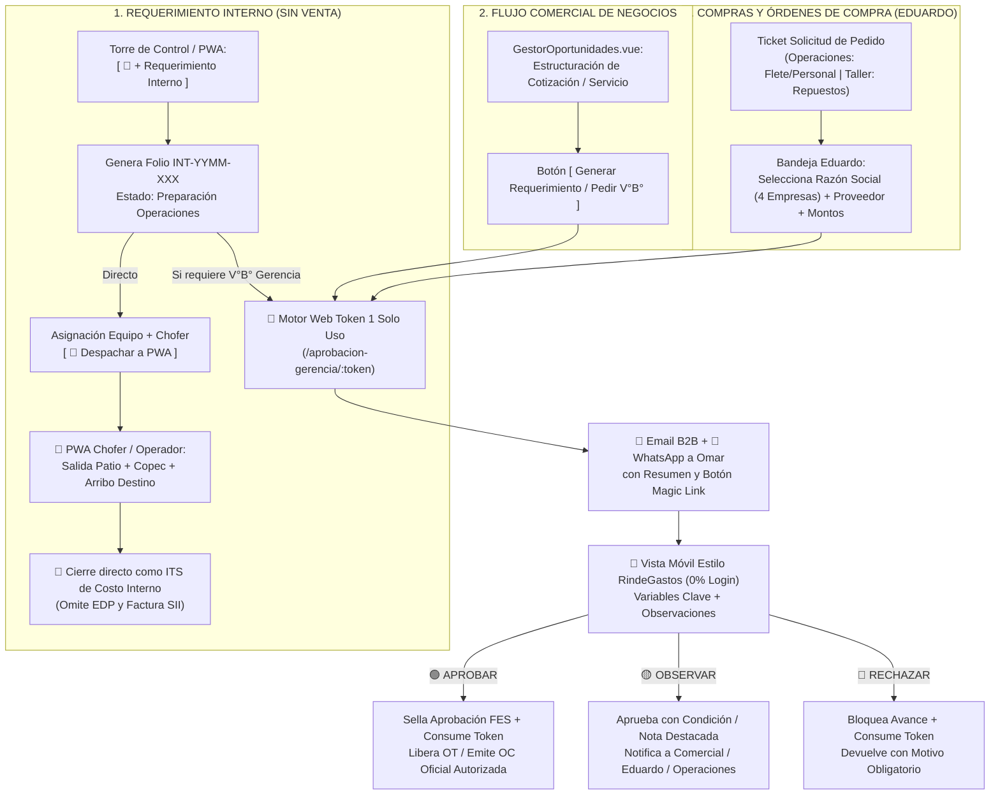

# 🔁📱 ESPECIFICACIÓN TÉCNICA CANÓNICA N° 87: FLUJO DE REQUERIMIENTOS INTERNOS DE OPERACIONES, APROBADOR MÓVIL EJECUTIVO CON WEB TOKEN DE 1 USO (ESTILO RINDEGASTOS) Y MÓDULO DE COMPRAS / OCs MULTI-EMPRESA

> **Spec N°**: 87  
> **Módulos**: Torre de Control (`Torre.vue`), CRM/Operaciones (`GestorOportunidades.vue`), Portal Público Web Token (`/aprobacion-gerencia/:token`), Adquisiciones (`ComprasOcView.vue`) y PWA Operador (`Surveys.vue` / `ViajeConductor.vue`)  
> **Sistema**: Grúas San Pablo (GSP) / LeanGlobal Platform  
> **Esquemas DB**: `sch_leangsp` (DEV) & `sch_leangsp_prod` (PROD)  
> **Estado**: 📝 ESPECIFICACIÓN CANÓNICA DE CIERRE DE PROYECTO  
> **Fecha**: 2026-10-19  

---

## 1. Propósito y Contexto de Negocio (Acuerdos Reunión 19-Oct-2026)

Para completar el cierre operativo, gerencial y administrativo de la plataforma GSP, se especifican de forma integrada los **tres circuitos críticos de cierre** definidos con Jorge Ponce:

1. **Requerimientos Internos de Operaciones (OT Interna sin Venta Asociada):** Movimientos operativos propios (traslado de grúas o camiones entre sucursales, movimientos a talleres externos, apoyo logístico de patio) que no nacen de una cotización comercial, pero exigen trazabilidad física en la PWA del chofer/operador y control de costos internos (combustible, peajes, viáticos, horas) sin pasar por facturación a clientes.
2. **Aprobaciones Móviles de Requerimientos de Negocios para Gerencia (Omar):** Circuito de visación ejecutiva sin fricción (0% login) mediante **Correo B2B + WhatsApp con Web Token de 1 solo uso (`/aprobacion-gerencia/:token`)** e interfaz estilo *RindeGastos* con botones de color (**Aprobar / Observar / Rechazar**) para negocios monetarios y no monetarios.
3. **Solicitudes de Pedido Digitales y Órdenes de Compra (OC) por Razón Social:** Sistema tipo ticket donde Operaciones (subcontrato de personal externo, fletes) o Taller/Inventario (repuestos, insumos) solicitan un pedido, **Eduardo** lo convierte en Orden de Compra bajo una de las **4 razones sociales del holding**, y **Omar** lo autoriza desde su teléfono celular eliminando la firma en papel.

---

## 2. Identidad Visual Especial para Requerimientos Internos (`MOVIMIENTO INTERNO`)

Para que cualquier usuario (Coordinador, Analista PMO, Gerencia u Operador en terreno) distinga en una fracción de segundo un **Requerimiento Interno** de un **Servicio Comercial Facturable**, se establece el siguiente estándar visual transversal:

| Atributo Visual | Servicio Comercial Regular (Cliente) | Requerimiento Interno de Operaciones |
| :--- | :--- | :--- |
| **Prefijo de Folio** | `GSP-YYMM-XXX` / `BMQ-YYMM-XXX` | **`INT-YYMM-XXX`** (ej. `INT-2610-001`) |
| **Borde de Tarjeta en Kanban (`Torre.vue`)** | Borde sólido estándar (`border-white/5`) | **Borde lateral izquierdo grueso y contorno discontinuo en Ámbar/Cian (`border-l-4 border-dashed border-amber-400 bg-amber-500/5`)** |
| **Badge Superior de Tarjeta** | `Oportunidad` / `Cotizando` / `OT Activa` | **`🔁 MOVIMIENTO INTERNO · COSTO PROPIO`** |
| **Indicador Económico en Tarjeta** | Monto Neto de Venta (`$X.XXX.XXX`) | **`🚫 NO FACTURABLE (C. COSTO INTERNO)`** |
| **Subtítulo Operativo** | Nombre del Cliente Externo | **`📍 [Sucursal/Lugar Origen] ➔ [Sucursal/Lugar Destino]`** |
| **Tarjeta en PWA Móvil (`Surveys.vue`)** | Tarjeta azul/púrpura de servicio a mandante | **Franja superior ámbar con ícono `🔁 ORDEN INTERNA GSP`** y supresión de firma de cliente externo |

---

## 3. Arquitectura E2E de los 3 Circuitos Integrados

---

## 4. Especificación Detallada por Módulo

### 4.1. Módulo 1: Requerimientos Internos de Operaciones (`INT-YYMM-XXX`)

#### A. Creación Rápida (Sin pasar por Preventa Comercial)
1. **Desde Torre de Control (`Torre.vue`):**
   * En la cabecera superior (junto a `+ Nueva Oportunidad`), se incorpora el botón **`[ 🔁 + Requerimiento Interno ]`** con estilo ámbar/cian.
   * Abre un modal ligero (`ModalRequerimientoInterno.vue`) con los campos del formulario operativo de GSP:
     * **Empresa / Razón Social Interna:** Selector de las 4 empresas del grupo (`Grúas San Pablo`, `Royal Rental`, `Bestmaq`, `Logística del Sur`).
     * **Tipo de Movimiento Interno:**
       * `TRASLADO_SUCURSAL` (Traslado entre sucursales/bases).
       * `MOVIMIENTO_TALLER` (Envío/retiro de taller externo o rescate mecánico).
       * `APOYO_LOGISTICO` (Movimiento interno de contrapesos, accesorios o patio).
       * `OTRO_INTERNO` (Otro requerimiento operativo no facturable).
     * **Origen y Destino:** Ej. `Patio Central Temuco` ➔ `Sucursal Puerto Montt` (con cálculo de distancia estimada `km`).
     * **Equipo(s) Requerido(s) y Conductor/Operador Sugerido.**
     * **Fecha y Hora Programada de Salida.**
     * **Motivo / Justificación Operativa y Solicitante.**
     * **Flag `requiere_vb_gerencia`:** Checkbox (por defecto activo si implica traslado interregional o gasto de flete/viático mayor).
2. **Persistencia en Base de Datos (`tpry_proyecto`):**
   * Se crea en `tpry_proyecto` con:
     * `codi_proyecto = 'INT-YYMM-XXX'`.
     * `id_proyecto_estado = 3` (nace directamente en *En Preparación Operaciones*, saltándose los estados 1 y 2 de cotización comercial).
     * `json_field.crm_v1.es_requerimiento_interno = true`.
     * `json_field.crm_v1.tipo_movimiento_interno = '...'`.
     * `json_field.crm_v1.monto_neto = 0` (no facturable).
3. **Ejecución en PWA del Operador / Chofer (`Surveys.vue` y `ViajeConductor.vue`):**
   * Al asignarse el equipo y despacharse el viaje en Sub-tab 5, el chofer recibe su WhatsApp y ve en su PWA la tarjeta con cabecera **`🔁 MOVIMIENTO INTERNO GSP`**.
   * Registra **Salida de Patio** (odómetro, horómetro, nivel de combustible y foto), **Carga de Combustible Copec** en ruta (si aplica) y **Llegada a Destino**.
   * Al marcar llegada a destino, **no se exige firma de cliente mandante**, sino confirmación de recepción interna, y el proyecto pasa a estado finalizado interno para consolidar únicamente sus costos reales en el **ITS Interno**.

---

### 4.2. Módulo 2: Aprobador Móvil de Negocios con Web Token de 1 Uso (Estilo *RindeGastos* para Omar)

#### A. Gatillo en el Flujo Comercial y Operativo
* **Cuándo se dispara:**
  1. **En Negocios Comerciales (`GestorOportunidades.vue`):** Cuando el vendedor presiona **`[ 🚀 Generar Requerimiento ]`** (o el botón **`[ 📱 Solicitar V°B° Gerencia (Omar) ]`**). El negocio queda con estado de visación `PENDIENTE_VB_GERENCIA` y envía automáticamente el correo + WhatsApp a Omar.
  2. **En Negocios No Monetarios / Especiales o Requerimientos Internos:** Cuando se marca un servicio sin cobro (canje, garantía, apoyo interno) o con condiciones especiales de tarifa/flete.
  3. **En Órdenes de Compra (`ComprasOcView.vue`):** Cuando Eduardo emite una OC que requiere firma de gerencia.

#### B. Estructura Criptográfica del Web Token (`tapr_gerencia_token`)
* Tabla relacional (o estructura JSONB indexada + tabla dedicada `tapr_gerencia_token`):
  * `id_token` (SERIAL PK)
  * `token_uuid` (UUID único indexado)
  * `tipo_entidad` (`'NEGOCIO_COMERCIAL'` | `'REQUERIMIENTO_INTERNO'` | `'ORDEN_COMPRA'`)
  * `id_entidad_ref` (ID del proyecto `id_proyecto` o ID de la OC `id_oc`)
  * `estado_token` (`'PENDIENTE'` | `'APROBADO'` | `'APROBADO_CON_OBS'` | `'RECHAZADO'` | `'EXPIRADO'`)
  * `snapshot_variables_json` (JSONB inmutable con los indicadores que Omar tuvo a la vista al decidir)
  * `decision_gerencia` (`VARCHAR(30)`)
  * `observacion_gerencia` (`TEXT`)
  * `fecha_creacion`, `fecha_resolucion`, `ip_resolucion`, `user_agent`

#### C. Interfaz Móvil Pública `/aprobacion-gerencia/:token` (`AprobacionGerenciaView.vue`)
* **Acceso:** 100% directo desde el link del correo o WhatsApp, **sin pantalla de login**, optimizado para pulgar en smartphone (estilo *RindeGastos*).
* **Variables Clave en Pantalla (Parametrizables según listado de Jorge Ponce):**
  1. **Cabecera de Clasificación:**
     * Badge grande de color: `🟢 NEGOCIO MONETARIO` | `🟣 NEGOCIO NO MONETARIO / ESPECIAL` | `🔁 REQUERIMIENTO INTERNO` | `🛒 ORDEN DE COMPRA`.
     * Folio (`GSP-2610-...` / `INT-2610-...` / `OC-2610-...`), Empresa Emisora (con logo) y Solicitante/Vendedor.
  2. **Bloque Cliente & Condición Comercial:**
     * Razón Social del Cliente y RUT.
     * Tipo de Cliente / Condición de Pago (`Contado`, `Crédito 30 días`, `OC / HES`).
     * Ubicación de la Obra y Fecha/Duración estimada.
  3. **Grilla Ejecutiva de Tarifas y Costos (Tarjetas de Alto Contraste):**
     * **Valor por Hora:** `$XX.XXX / hr` (indicando Piso Mínimo diario/mensual y Categoría de Grúa/Equipo).
     * **Costo de Flete / Traslado:** `$XXX.XXX` (indicando modalidad `Ida`, `Ida y Vuelta` y distancia en `km`).
     * **Combustible y Pensiones:** Indicadores rápidos (`Combustible: Cliente/GSP`, `Alojamiento/Alimentación: Cliente/GSP`).
     * **Total Neto del Requerimiento:** **`$X.XXX.XXX`**.
  4. **Caja de Observaciones de Gerencia:**
     * Input de texto rápido (con chips de respuesta rápida en 1 toque: *"Ajustar tarifa hora"*, *"Cobrar flete ida y vuelta"*, *"Exigir OC antes de salir"*, *"OK autorizado"*).
  5. **Botonera Tripartita Estilo *RindeGastos* (Fija al pie de pantalla):**
     * 🟢 **`[ ✓ APROBAR ]`** (1 toque: autoriza, quema el token de 1 uso y notifica al equipo).
     * 🟡 **`[ ⚠️ APROBAR CON OBS. ]`** (Autoriza dejando la instrucción de Omar anclada en un banner amarillo obligatorio en la OT).
     * 🔴 **`[ ✕ RECHAZAR ]`** (Exige observación, quema el token y devuelve la solicitud al emisor).

---

### 4.3. Módulo 3: Solicitudes de Pedido Digitales y Órdenes de Compra por Razón Social (`tcmp_solicitud_pedido` y `tcmp_orden_compra`)

Para cumplir el compromiso de cerrar el módulo de adquisiciones esta semana:

1. **Paso 1 — Solicitud de Pedido Digital (Tipo Ticket):**
   * Cualquier usuario autorizado de **Operaciones** (para subcontrato de flete externo, arriendo de grúa tercera o personal externo vinculado a una OT) o de **Taller/Inventario** (para compra de repuestos e insumos vinculados a una OTM o stock de bodega) puede crear un ticket de **Solicitud de Pedido (`SP-YYMM-XXX`)**.
   * Campos del ticket: Origen (`OPERACIONES_OT` o `TALLER_BODEGA`), OT vinculada (opcional o mandatoria según origen), Ítems solicitados (descripción, cantidad, urgencia), Proveedor sugerido (opcional) y Justificación.
2. **Paso 2 — Bandeja de Adquisiciones (Eduardo) y Conversión a OC por Razón Social:**
   * **Eduardo** visualiza todos los tickets pendientes en una bandeja centralizada.
   * Al convertir una Solicitud de Pedido en **Orden de Compra (`OC-YYMM-XXX`)**, Eduardo define obligatoriamente:
     * **Razón Social Facturadora (Multi-Empresa):** `Grúas San Pablo (9)`, `Royal Rental (11)`, `Bestmaq (7)` o `Logística del Sur (8)`.
     * **Proveedor:** RUT, Razón Social, Contacto, Condición de Pago.
     * **Líneas de Detalle (Conectadas al Catálogo WMS `tinv_producto`):** Buscador predictivo de los 2.854 SKUs de bodega (`id_producto`, `sku_codigo`, `descripcion`, `unidad_medida`, último precio/PMP) o ingreso de servicio libre, con Cantidad, Precio Unitario Neto, Descuento, Subtotal, IVA (19%) y Total Bruto.
     * **Centro de Costo / Imputación:** Vinculado a la OT operativa (para que alimente automáticamente la Sección 3 del **ITS** en los rubros *Subcontratación Flete Externo*, *Personal Externo* o *Gastos Extraordinarios*) o a Taller/Inventario (para recepción en bodega WMS-Lite y cruce con **Laudus ERP**).
     * **Plan de Cuentas y Centros de Costo Laudus ("Pegado a mano" / Importación Rápida):**
       * Tabla maestra `tcmp_plan_cuenta_laudus` (`id_cuenta_laudus`, `codigo_cuenta`, `nombre_cuenta`, `tipo_imputacion`, `rubro_its_sugerido`, `activo`) precargada con las cuentas operativas oficiales de Laudus (incluyendo las 8 cuentas de `Salidas de Bodega` de `SPEC-105`: *Mant. Maquinarias*, *Mant. Vehículos*, *Implementos Seguridad*, *Gastos de Oficina*, *Lubricantes y Filtros*, *Neumáticos*, *Servicios / Fletes*, *Existencias Bodega*).
       * Modal **`[ 📋 Plan de Cuentas Laudus (Pegar desde Excel) ]`** en `ComprasOcView.vue` que permite pegar con `Ctrl+V` bloques de columnas copiados directamente del Excel de Laudus (`Código Cuenta | Nombre Cuenta | Tipo`) o agregar cuentas manualmente (`POST /api/compras/plan-cuentas-laudus`).
       * Toda Solicitud de Pedido (`tcmp_solicitud_pedido`) y Orden de Compra (`tcmp_orden_compra`) persiste `codigo_cuenta_laudus`, `nombre_cuenta_laudus` y `centro_costo_laudus` (auto-sugerido desde la Patente/Código del Equipo `tequ_equipo` o Sucursal/Administración), mostrándose en el documento A4 oficial (`html-print`).
3. **Paso 3 — Autorización Móvil de Omar sin Papel:**
   * Al presionar Eduardo **`[ 📱 Enviar OC a Firma de Gerencia (Omar) ]`**, el sistema genera el Web Token de 1 solo uso y despacha el correo + WhatsApp a Omar (además de listar la OC en una pestaña dedicada **`[ ✍️ Aprobaciones Gerencia ]`** en la app móvil para cuando Omar quiera ver su cola completa).
   * Cuando Omar pulsa **`🟢 APROBAR`**, el sistema estampa su firma digital FES en el PDF A4 de la Orden de Compra (con el logo de la Razón Social seleccionada) y habilita su envío inmediato al proveedor y a Contabilidad (**Maritza / Laudus**).
4. **Paso 4 — Ficha de Pre-Imputación Contable y Registro de Factura emitida/recibida en Laudus (Tab 3 de `ComprasOcView.vue`):**
   * Mientras la integración API REST en línea con Laudus queda programada para la fase siguiente, la Pestaña 3 (`Integración Laudus ERP & Recepción`) opera como mesa de control contable con:
     * **Semáforo Match de 3 Vías:** `① OC Autorizada` + `② Recepción Bodega WMS (tinv_recepcion)` + `③ Factura Compra DTE en Laudus`.
     * **Ficha Lista para Laudus:** Despliega `Empresa Holding (RUT)`, `Proveedor (RUT)`, `Cuenta Contable Laudus (Código + Nombre)`, `Centro de Costo Laudus`, `Monto Neto / IVA / Total`, botón `[ 📋 Copiar Imputación ]` y exportación **`[ 📥 Exportar Sábana Laudus (.xlsx) ]`**.
     * **Registro de Factura DTE y Folio Laudus (`POST /api/compras/ordenes/:id_oc/sincronizar-its-laudus`):** Captura de `folio_laudus_oc`, `folio_dte_factura_compra`, `fecha_factura_dte`, `codigo_cuenta_laudus` y `centro_costo_laudus`, cambiando el estado a `FACTURADA_LAUDUS` e inyectando el costo neto en el ITS si tiene OT vinculada.
