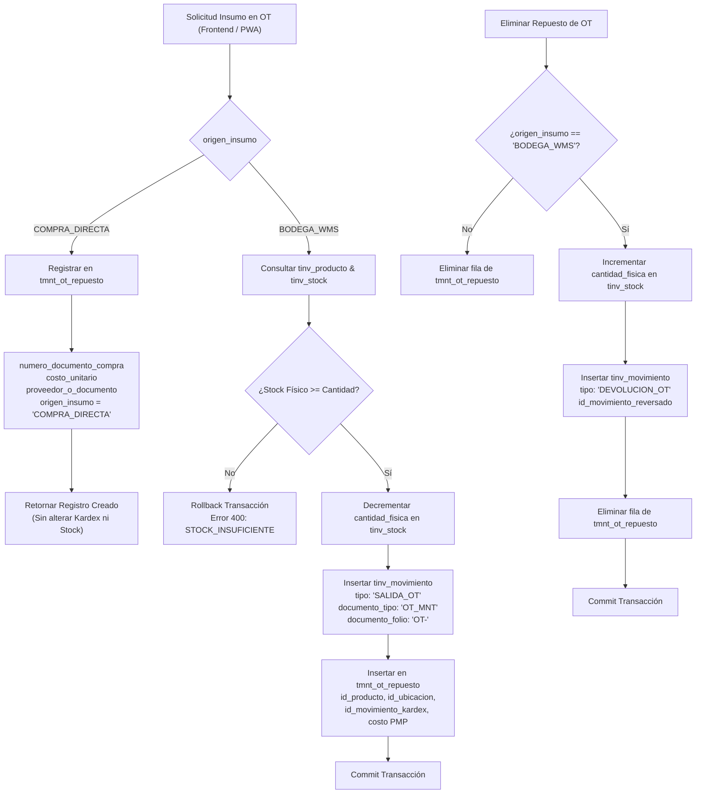

# 📦🔧 ESPECIFICACIÓN TÉCNICA CANÓNICA N° 89: INTEGRACIÓN HÍBRIDA DE MANTENIMIENTO ENTERPRISE E INVENTARIO WMS-LITE (BODEGA WMS VS COMPRA DIRECTA)

> **Spec N°**: 89  
> **Módulo**: Integración Mantenimiento (Taller) & WMS-Lite (Inventario / Pañol)  
> **Sistema**: Grúas San Pablo (GSP) / LeanGlobal Platform  
> **Entorno**: DEV (`sch_leangsp`, PM2 ID 10)  
> **Estado**: 📝 ESPECIFICACIÓN TÉCNICA CANÓNICA APROBADA PARA IMPLEMENTACIÓN  
> **Fecha**: 2026-10-21  

---

## 1. Declaración del Problema y Objetivos de Negocio

En la operación de mantenimiento de flota de Grúas San Pablo, las Órdenes de Trabajo (OT) requieren insumos y repuestos que provienen de dos fuentes operacionales bien diferenciadas:

1. **Repuestos de Bodega Central / Pañol Móvil (`BODEGA_WMS`):**
   * Artículos catalogados en el maestro `tinv_producto` con control de existencias en `tinv_stock` y valorización formal PMP (Precio Medio Ponderado).
   * Requieren validación estricta de existencias físicas disponibles, reserva/descuento inmediato de stock y emisión de asiento contable inmutable en el Kardex (`tinv_movimiento`).

2. **Compras Directas / Terreno / Servicios Locales (`COMPRA_DIRECTA`):**
   * Repuestos de emergencia, consumibles comprados en ferreterías o repuesteras locales con cargo directo a la OT (factura o boleta de compra inmediata).
   * No descuentan existencias del pañol central, pero deben quedar registrados en la OT con su número de documento de respaldo y costo unitario real para imputar con exactitud el costo de mantenimiento a la máquina.

### Objetivos Clave:
* **Modelo Híbrido Unificado:** Permitir al jefe de taller y mecánicos cargar insumos tanto del stock catalogado en bodega como de compras de terreno en una misma interfaz de OT.
* **Integridad Transaccional Inmutable:** Si el insumo proviene de Bodega WMS, ejecutar descuento atómico en `tinv_stock` e inserción en el Kardex (`tinv_movimiento` con tipo `SALIDA_OT` y documento `OT_MNT`), enlazando la clave foránea `id_movimiento_kardex` en `tmnt_ot_repuesto`.
* **Reversibilidad y Devolución Limpia:** Al eliminar un repuesto imputado desde Bodega WMS de la OT, reintegrar de forma atómica la cantidad física al stock en `tinv_stock` y registrar un movimiento de contracuenta `DEVOLUCION_OT` en el Kardex, enlazando `id_movimiento_reversado`.

---

## 2. Diagrama de Arquitectura Transaccional



---

## 3. Modelo de Datos y Migración DDL

### 3.1. Extensión No Destructiva de `sch_leangsp.tmnt_ot_repuesto`

La tabla existente `tmnt_ot_repuesto` ya cuenta con columna `id_producto BIGINT REFERENCES sch_leangsp.tinv_producto(id_producto)` y columnas de valorización (`costo_unitario`, `costo_total`, `cantidad`). Se añaden cuatro nuevas columnas para habilitar el modelo híbrido y la trazabilidad con Kardex y compras directas:

```sql
ALTER TABLE sch_leangsp.tmnt_ot_repuesto
  ADD COLUMN IF NOT EXISTS origen_insumo VARCHAR(25) DEFAULT 'COMPRA_DIRECTA' 
    CHECK (origen_insumo IN ('BODEGA_WMS', 'COMPRA_DIRECTA')),
  ADD COLUMN IF NOT EXISTS id_ubicacion BIGINT 
    REFERENCES sch_leangsp.tinv_ubicacion(id_ubicacion),
  ADD COLUMN IF NOT EXISTS id_movimiento_kardex BIGINT 
    REFERENCES sch_leangsp.tinv_movimiento(id_movimiento),
  ADD COLUMN IF NOT EXISTS numero_documento_compra VARCHAR(100);

-- Permisos y concesión de accesos para la API
GRANT ALL PRIVILEGES ON TABLE sch_leangsp.tmnt_ot_repuesto TO usr_leangsp, usrpglgbl;
GRANT ALL PRIVILEGES ON ALL SEQUENCES IN SCHEMA sch_leangsp TO usr_leangsp, usrpglgbl;
```

### 3.2. Diccionario de Nuevos Campos

| Columna | Tipo | Nulo | Default | Descripción |
| :--- | :--- | :--- | :--- | :--- |
| `origen_insumo` | `VARCHAR(25)` | NO | `'COMPRA_DIRECTA'` | Discriminador: `'BODEGA_WMS'` (stock pañol) o `'COMPRA_DIRECTA'` (compra terreno / ferretería). |
| `id_ubicacion` | `BIGINT` | YES | `NULL` | Ubicación física (`tinv_ubicacion`) de donde se extrajo el repuesto de bodega. |
| `id_movimiento_kardex` | `BIGINT` | YES | `NULL` | Asiento inmutable en `tinv_movimiento` asociado a la salida de stock. |
| `numero_documento_compra` | `VARCHAR(100)` | YES | `NULL` | Folio de factura, guía de despacho externa o boleta para compras directas. |

---

## 4. Lógica de Negocio y Endpoints Backend

### 4.1. `POST /api/mantenimiento/ots/:id/materiales`
Maneja tanto compras directas como salidas de bodega WMS.

#### Payload para `COMPRA_DIRECTA`:
```json
{
  "origen_insumo": "COMPRA_DIRECTA",
  "descripcion_material": "Correa Alternador Continental 8PK",
  "cantidad": 1,
  "unidad_medida": "UNIDAD",
  "costo_unitario": 28500,
  "proveedor_o_documento": "Ferretería Industrial Sur",
  "numero_documento_compra": "FAC-88392",
  "pendiente_valorizar": false
}
```

#### Payload para `BODEGA_WMS`:
```json
{
  "origen_insumo": "BODEGA_WMS",
  "id_producto": 2835,
  "cantidad": 1,
  "id_ubicacion": 10
}
```

*Si no se envía `id_ubicacion`, el backend busca automáticamente la primera ubicación con stock disponible (`cantidad_fisica >= cantidad`) para ese producto en la empresa.*

#### Comportamiento Transaccional para `BODEGA_WMS`:
1. Abrir transacción: `const client = await this.pool.connect(); await client.query('BEGIN');`
2. Consultar `tinv_producto`:
   * Obtener `sku`, `nombre`, `unidad_medida_base` o `unidad_medida`, `costo_pmp_vigente`.
3. Determinar o validar `id_ubicacion` y saldo en `tinv_stock`:
   * Consulta con `FOR UPDATE` sobre `tinv_stock` para prevenir condiciones de carrera.
   * Si `cantidad_fisica < cantidad`, abortar con `ROLLBACK` y retornar `HTTP 400: Stock insuficiente en bodega para el producto seleccionado.`
4. Actualizar `tinv_stock`:
   * `UPDATE sch_leangsp.tinv_stock SET cantidad_fisica = cantidad_fisica - $1, updated_at = NOW() WHERE id_stock = $2`
5. Insertar en `tinv_movimiento`:
   * `tipo_movimiento`: `'SALIDA_OT'`
   * `documento_tipo`: `'OT_MNT'`
   * `documento_folio`: `'OT-' || idOt`
   * `costo_unitario_pmp`: `producto.costo_pmp_vigente`
   * `cantidad`: `cant`
   * `stock_anterior`: `stock.cantidad_fisica`
   * `stock_nuevo`: `stock.cantidad_fisica - cant`
   * `id_ubicacion`: `ubicacion.id_ubicacion`
   * `id_bodega`: `ubicacion.id_bodega`
   * `id_usuario`: `user.id_user`
6. Insertar en `tmnt_ot_repuesto`:
   * `origen_insumo = 'BODEGA_WMS'`
   * `id_producto = producto.id_producto`
   * `id_ubicacion = ubicacion.id_ubicacion`
   * `id_movimiento_kardex = movimiento.id_movimiento`
   * `descripcion_material = producto.nombre`
   * `costo_unitario = producto.costo_pmp_vigente`
   * `costo_total = cant * producto.costo_pmp_vigente`
   * `estado = 'ENTREGADO'`
7. `COMMIT` y responder `HTTP 201 Created`.

### 4.2. `DELETE /api/mantenimiento/materiales/:idRepuesto`
Maneja la eliminación del repuesto y la reversión en bodega si aplica.

#### Comportamiento Transaccional:
1. Abrir transacción: `client = await this.pool.connect(); await client.query('BEGIN');`
2. Consultar fila en `tmnt_ot_repuesto WHERE id_ot_repuesto = $1 FOR UPDATE`.
3. Si `repuesto.origen_insumo === 'BODEGA_WMS'` y tiene `id_producto`:
   * Identificar o crear registro en `tinv_stock` para `(id_producto, id_ubicacion, id_empresa)`.
   * Reintegrar stock: `cantidad_fisica = cantidad_fisica + repuesto.cantidad`.
   * Registrar movimiento de contracuenta en `tinv_movimiento`:
     * `tipo_movimiento`: `'DEVOLUCION_OT'`
     * `documento_tipo`: `'OT_MNT'`
     * `documento_folio`: `'OT-' || repuesto.id_ot`
     * `cantidad`: `repuesto.cantidad`
     * `id_movimiento_reversado`: `repuesto.id_movimiento_kardex`
     * `id_producto`: `repuesto.id_producto`
     * `id_ubicacion`: `repuesto.id_ubicacion`
     * `id_usuario`: `user.id_user`
4. Eliminar registro: `DELETE FROM sch_leangsp.tmnt_ot_repuesto WHERE id_ot_repuesto = $1`.
5. `COMMIT` y responder `HTTP 200 OK`.

### 4.3. `GET /api/mantenimiento/ots/:id` (Enriquecimiento de Detalle)
En el query de repuestos (`repSql`) se agregan los nuevos atributos con `LEFT JOIN`:
* `r.origen_insumo`
* `r.id_ubicacion`
* `u.codigo AS codigo_ubicacion`
* `p.sku`
* `r.numero_documento_compra`
* `r.id_movimiento_kardex`

---

## 5. Matriz de Pruebas y Validación QA

| N° | Caso de Prueba | Entrada | Resultado Esperado |
| :--- | :--- | :--- | :--- |
| 1 | Insumo Compra Directa | `origen_insumo: 'COMPRA_DIRECTA'`, `numero_documento_compra: 'FAC-123'` | Inserta en `tmnt_ot_repuesto`, `id_movimiento_kardex` es `NULL`, `tinv_stock` inalterado. |
| 2 | Insumo Bodega WMS con Stock | `origen_insumo: 'BODEGA_WMS'`, SKU existente con saldo | Decrementa `tinv_stock`, crea fila en `tinv_movimiento` (`SALIDA_OT`), enlaza `id_movimiento_kardex`. |
| 3 | Insumo Bodega WMS sin Stock | `origen_insumo: 'BODEGA_WMS'`, cantidad > saldo | Falla con `400 STOCK_INSUFICIENTE`, stock no varía, transacción revertida. |
| 4 | Reversión / Eliminación Bodega | Eliminar repuesto Bodega de OT | Reintegra cantidad a `tinv_stock`, crea `DEVOLUCION_OT` en Kardex, borra repuesto de OT. |
| 5 | Consulta Detalle OT | `GET /api/mantenimiento/ots/:id` | Retorna lista de repuestos con `origen_insumo`, `codigo_ubicacion`, `sku`, y montos PMP. |
