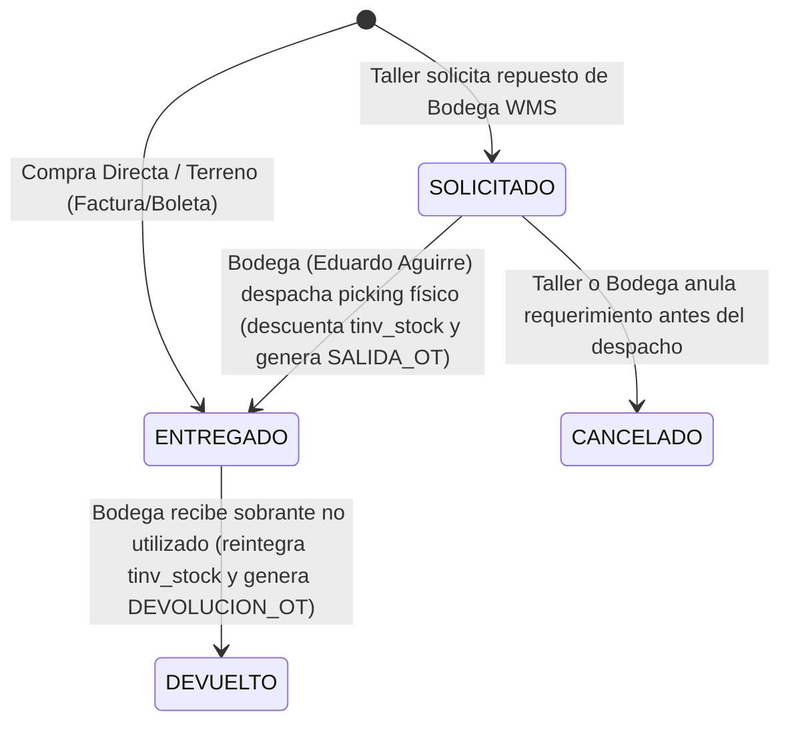

# 📦🔧 ESPECIFICACIÓN TÉCNICA CANÓNICA N° 95: FLUJO DE SOLICITUD DE REPUESTOS EN TALLER Y DESPACHO FÍSICO EN BODEGA WMS (SEGREGACIÓN DE FUNCIONES SoD)

> **Spec N°**: 95  
> **Módulo**: Integración Mantenimiento (Taller) & WMS-Lite (Inventario / Pañol)  
> **Sistema**: Grúas San Pablo (GSP) / LeanGlobal Platform  
> **Entorno**: DEV & PROD (`sch_leangsp_prod`, PM2 ID 13 y 10)  
> **Estado**: 📝 ESPECIFICACIÓN TÉCNICA CANÓNICA APROBADA PARA IMPLEMENTACIÓN  
> **Fecha**: 2026-10-22  
> **Autor**: LeanGlobal Engineering & QA Team  

---

## 1. Declaración del Problema y Objetivos de Negocio

En la operación de mantenimiento de flota de Grúas San Pablo existe una estricta Segregación de Funciones (Segregation of Duties - SoD) entre dos actores clave:

1. **Jefe de Taller / Mecánico (Leonel Vergara):**
   * Diagnostica la falla, abre la Orden de Trabajo (OT) y determina qué repuestos o insumos de pañol requiere la máquina para la mantención.
   * Emite un **Requerimiento / Solicitud** de materiales. En ese instante, los repuestos **no han salido físicamente de la bodega**, por lo que **no deben descontar existencias de pañol ni imputar costo financiero** a la OT hasta su entrega real.

2. **Encargado de Adquisiciones e Inventario Pañol (Eduardo Aguirre):**
   * Custodia las existencias físicas en el almacén central y pañoles móviles.
   * Recibe la solicitud de la OT en su consola de **Inventario (Despacho a OT)**.
   * Realiza el **picking físico**, verifica el estado del material, selecciona el casillero o estantería (`tinv_ubicacion`) desde donde extrae el ítem, y confirma el **Despacho**.
   * Solo en ese momento se descuenta el stock (`tinv_stock`), se genera el asiento inmutable en el Kardex (`tinv_movimiento` con `SALIDA_OT`) y se imputa el costo real (PMP) a la OT pasando la línea a estado `ENTREGADO`.

---

## 2. Máquina de Estados de Repuestos en OT (`tmnt_ot_repuesto`)



### Reglas de Negocio:
1. **Solicitud de Bodega WMS (`origen_insumo = 'BODEGA_WMS'`):**
   * Se inserta con `estado = 'SOLICITADO'`, `cantidad_solicitada = cant`, `cantidad_entregada = 0`.
   * `costo_unitario` = `costo_pmp_vigente` del producto (referencial).
   * `costo_total` = `0` (el costo devengado a la OT es 0 mientras esté pendiente).
   * `id_ubicacion` = `NULL`, `id_movimiento_kardex` = `NULL`.
   * **Cero alteración de stock ni Kardex.**
2. **Despacho Físico en Bodega (`despacharLineaOt`):**
   * **Eduardo Aguirre** visualiza la solicitud con badge `⏳ SOLICITADO`.
   * Al hacer clic en `[📦 Despachar]`, el sistema valida existencias en el casillero seleccionado (`tinv_stock.cantidad_fisica >= cantidad_despachar`).
   * Decrementa atómicamente `tinv_stock`.
   * Inserta asiento inmutable en `tinv_movimiento` (`SALIDA_OT`, `OT_MNT`, folio `OT-XX`).
   * Actualiza `tmnt_ot_repuesto`: `estado = 'ENTREGADO'`, `cantidad = cantidad_despachar`, `cantidad_entregada = cantidad_despachar`, `costo_total = cantidad_despachar * costo_unitario`, `id_ubicacion = idUbicacion`, `id_movimiento_kardex = idMovimiento`.
3. **Despacho Directo desde Bodega (`+ Despachar Repuesto`):**
   * Si **Eduardo Aguirre** realiza el despacho directamente desde la pantalla de bodega para una OT sin solicitud previa, la línea se inserta inmediatamente como `ENTREGADO` y descuenta stock.
4. **Devolución de Sobrantes:**
   * Las líneas en estado `ENTREGADO` pueden ser devueltas total o parcialmente a pañol (`↩️ Devolver`), reintegrando el stock e insertando `DEVOLUCION_OT`.

---

## 3. Especificación de Endpoints Backend

### 3.1. `POST /api/mantenimiento/ots/:id/materiales` (Solicitud de Taller)
- Cuando `origen_insumo === 'BODEGA_WMS'` y no es despacho directo de bodega:
  Inserta en `tmnt_ot_repuesto` con `estado = 'SOLICITADO'`, `cantidad_solicitada = cant`, `cantidad_entregada = 0`, `costo_total = 0`, sin transacción de Kardex ni decremento de `tinv_stock`.
- Cuando `origen_insumo === 'COMPRA_DIRECTA'`:
  Comportamiento actual: inserta con `estado = 'ENTREGADO'`, `numero_documento_compra`, costo real sin tocar Kardex.

### 3.2. `POST /api/inventario/despacho-linea-ot` (Despacho Físico por Bodeguero)
- **Ruta:** `/api/inventario/despacho-linea-ot`
- **Roles:** `GSP_BODEGA_EJEC`, `GSP_BODEGA_APROB`, `Admin`
- **Request Body:**
  ```json
  {
    "id_ot_repuesto": 12,
    "id_ubicacion": 10,
    "cantidad_despachar": 1.0
  }
  ```
- **Response Exitosa (200 OK):**
  ```json
  {
    "success": true,
    "data": {
      "id_ot_repuesto": 12,
      "estado": "ENTREGADO",
      "cantidad_entregada": 1.0,
      "costo_total": 27000,
      "id_movimiento_kardex": 15
    },
    "message": "Repuesto despachado exitosamente e imputado a la OT"
  }
  ```

---

## 4. Especificación de Interfaz de Usuario (UI)

### 4.1. Bodega WMS (`DespachoConsumoView.vue` - Eduardo Aguirre)
- Tabla **"Repuestos & Materiales de la OT"**:
  - Si `rep.estado === 'SOLICITADO'`:
    * Badge: `[⏳ PENDIENTE DESPACHO]` (Fondo ámbar / texto ámbar).
    * Columna Acción: Botón **`[ 📦 Despachar ]`** (resaltado en ámbar).
  - Si `rep.estado === 'ENTREGADO'`:
    * Badge: `[ 📦 ENTREGADO ]` (Fondo esmeralda / texto esmeralda).
    * Columna Acción: Botón **`[ ↩️ Devolver ]`** (púrpura).
- **Modal de Despacho de Línea:**
  * Al presionar `[ 📦 Despachar ]`, se abre modal con:
    - Título: `Despacho de Repuesto Solicitado: [SKU] - [Nombre]`
    - Cantidad solicitada por taller: `X UN`
    - Selector de casillero / estantería (`tinv_ubicacion`) con stock disponible.
    - Cantidad a entregar (default `X`).
    - Botón: `Confirmar Despacho Físico`.

### 4.2. Taller Web & PWA (`MantenimientoView.vue` & `TallerOtDetalleView.vue` - Leonel Vergara)
- En el modal / pestaña de repuestos:
  - Botón: `[ Solicitar Repuesto a Bodega ]`.
  - En la lista de repuestos de la OT:
    * Badge: `[ ⏳ SOLICITADO A PAÑOL ]` si está pendiente.
    * Badge: `[ ✅ ENTREGADO POR PAÑOL ]` una vez despachado por **Eduardo Aguirre**.


---

## 5. Actualización v1.1 (REQ-1075 / 26-Oct-2026): Segregación de Valorización (`$ CLP`) entre Taller y Adquisiciones/Bodega
- **Regla de Negocio:** El personal de Mantenimiento / Taller solicita repuestos por **ítem y cantidad**, sin digitar precios ni costos unitarios manuales. La asignación de valor unitario neto (`$ CLP`) y registro de factura/OC corresponde exclusivamente a **Adquisiciones / Bodega (`adquisiciones@arriendosanpablo.cl`)** al momento de la recepción.
- **Implementación (`MantenimientoView.vue` y `TallerOtDetalleView.vue`):** Se elimina el input manual `Costo Unitario CLP (Neto)` en el formulario de solicitud/compra de taller (Web y PWA), manteniendo `costo_unitario: 0` por defecto desde Taller y mostrando aviso informativo de valorización centralizada en Adquisiciones/Bodega.
