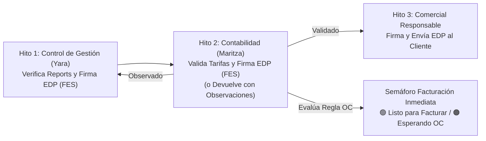

# SPEC-099: Desacoplamiento ITS vs. EDP, Circuito de 3 Firmas FES del Estado de Pago, Carga Comercial de OC con Constancia a Contabilidad y Homologación de Distancia/Pensiones

- **Código de Especificación:** `SPEC-099`
- **Requerimiento Asociado:** `REQ-1068`
- **Versión Portal Web GSP:** `1.0.158`
- **Ambientes Objetivo:** `DEV` (`sch_leangsp`) y `PROD` (`sch_leangsp_prod`)
- **Fecha:** 2026-10-25
- **Autor:** Sergio Gajardo / Arquitectura LeanGlobal

---

## 1. Propósito y Contexto de Negocio

Producto de las sesiones de alineación con el área de **Contabilidad y Facturación (Maritza Seguel)**, **Control de Gestión (Yara)** y **Operaciones / Comercial**, se establecen dos bloques de mejoras críticas para acelerar el flujo de caja y asegurar la consistencia documental:

1. **Homologación de Condiciones Comerciales en Documentos Oficiales (Cotización, OT e ITS):**
   - Incorporar la **Distancia Estimada por Comercial (`distancia_km` km)** y el **Régimen Operacional (`URBANO <= 30 km` / `RURAL > 30 km`)** en la Cotización PDF, la Orden de Trabajo (OT PDF y vista operativa) y el Informe de Término de Servicio (ITS PDF y Modal UI).
   - Incorporar el desglose explícito de **Responsabilidad de Pensiones y Alimentación** (*Alojamiento, Desayuno, Almuerzo, Cena, Traslado*: `CLIENTE` / `GSP` / `NO APLICA`) tal cual fue pactado en la Cotización dentro de la OT y del ITS.

2. **Desacoplamiento Estructural entre el ITS (Gestión Interna) y el Estado de Pago — EDP (Prefactura Comercial al Cliente):**
   - El **Estado de Pago (EDP)** tiene carácter comercial-administrativo de cara al cliente mandante (prefactura), mientras que el **Informe de Término de Servicio (ITS)** tiene carácter de control interno de costos y márgenes (combustible, peajes, viáticos, pensiones).
   - Se disuelve la dependencia lineal que bloqueaba el EDP y la Facturación DTE hasta el cierre del ITS. El EDP se emite y tramita apenas Control de Gestión (Yara) valida los Reports Diarios del servicio.

---

## 2. Arquitectura del Nuevo Circuito de 3 Firmas FES del Estado de Pago (`edp_flujo_v1`)

El Estado de Pago cuenta con su propio circuito formal de 3 hitos con Firma Electrónica Simple (FES) almacenado en `tpry_proyecto.json_field.edp_flujo_v1`:

### 2.1. Hito 1 — Control de Gestión / Analista (Yara)
- Verifica que todos los Reports Diarios del servicio estén registrados y conciliados.
- Da el OK y genera el EDP con su **Firma FES (`firma_1_analista`)**.
- Estado del flujo pasa a `EN_REVISION_CONTABILIDAD` (`paso_actual = 2`).
- Dispara notificación inmediata por correo B2B a **Contabilidad (`mseguel@arriendosanpablo.cl`)** indicando si el servicio requiere o no Orden de Compra (OC / HES) y si esta ya se encuentra cargada.

### 2.2. Hito 2 — Contabilidad (Maritza / Tesorería)
- Revisa los valores y tarifas del EDP generado por Control de Gestión.
- **Opción A — Devolver con Observaciones (`accion = 'DEVOLVER'`):**
  - Permite devolver el EDP al Hito 1 adjuntando observaciones obligatorias (`observacion_devolucion`), cambiando el estado a `OBSERVADO_CONTABILIDAD` y notificando a Control de Gestión sin obligar a Contabilidad a firmar un documento con inconsistencias.
- **Opción B — Validar y Firmar EDP (`accion = 'FIRMAR'`):**
  - Estampa la **Firma FES de Contabilidad (`firma_2_contabilidad`)**.
  - Estado del flujo pasa a `VALIDADO_CONTABILIDAD` (`paso_actual = 3`).
  - Notifica automáticamente al **Ejecutivo Comercial responsable** para que proceda a despachar el EDP al cliente mandante.
  - Evalúa de inmediato la **Regla Determinista de Habilitación Inmediata para Facturar**.

### 2.3. Hito 3 — Ejecutivo Comercial Responsable
- Recibe el EDP ya validado por Contabilidad y estampa la **Firma FES Comercial (`firma_3_comercial`)**.
- Despacha formalmente por correo B2B el Dossier PDF Oficial del EDP al **Cliente Mandante** (o lo archiva como expediente interno si la condición es Pago Anticipado).

---

## 3. Carga de Orden de Compra (OC / HES) por el Comercial y Constancia a Contabilidad

1. **Responsabilidad Comercial de Carga de OC:**
   - Se habilita al Ejecutivo Comercial para subir una o múltiples Órdenes de Compra (N° OC/HES, Fecha de Emisión, Monto Neto, Centro de Costo y Archivo PDF adjunto) tanto en el **Paso 3 (`③ Respaldo OC`)** de `GestorOportunidades.vue` como en `ModalCaratulaEDP.vue`.
2. **Constancia Formal y Copia Automática a Contabilidad:**
   - En el instante en que el Comercial registra o sube una OC en `POST /api/operaciones/edp/soporte-documental`, el backend guarda el documento en `json_field.ordenes_compra`, `json_field.oc_v1` y `json_field.crm_v1.ordenes_compra` registrando `registrado_por`, `registrado_por_nombre` y `fecha_registro`.
   - Simultáneamente, despacha un correo automático a **Contabilidad (`mseguel@arriendosanpablo.cl`)** con copia al Comercial y Operaciones, dejando **constancia formal de la recepción de la OC** con enlace directo al PDF y activando el semáforo verde si el EDP ya está validado.

---

## 4. Regla Determinista de Habilitación Inmediata para Facturar (Doble Gatillo)

La condición `habilitado_facturar` se evalúa de forma determinista según la configuración comercial de la preventa (`requiere_oc_hes`):

| Caso | `requiere_oc_hes` | ¿Tiene OC Cargada? | ¿EDP Validado? | Resultado (`estado_facturacion_inmediata`) | Acción del Sistema |
| :--- | :---: | :---: | :---: | :--- | :--- |
| **Caso 1** | `false` (No requiere OC) | N/A | Sí | `🟢 HABILITADO_FACTURAR` | Alerta inmediata a Contabilidad: **Listo para Facturar Inmediatamente**. |
| **Caso 2** | `true` (Requiere OC/HES) | `true` (OC disponible) | Sí | `🟢 HABILITADO_FACTURAR` | Alerta inmediata a Contabilidad: **Listo para Facturar Inmediatamente** (con monto OC). |
| **Caso 3** | `true` (Requiere OC/HES) | `false` (Pendiente OC) | Sí | `🟠 ESPERANDO_OC_CLIENTE` | No envía falso positivo de facturación; exige OC al Comercial y, apenas el Comercial sube la OC, dispara la alerta verde a Contabilidad. |

---

## 5. Componentes y Archivos Intervenidos

### 5.1. Backend (`ejecucion/backend_remoto/`)
- `src/routes/estadoPagoRoutes.js`: Exposición de ruta `POST /api/operaciones/edp/firmar-paso`.
- `src/controllers/estadoPagoController.js`:
  - `generarPdfEdp`: Inclusión de `em.giro`, `em.direccion`, `em.logo_empresa`, `edp_flujo_v1` y `ordenes_compra` en el payload del PDF oficial.
  - `firmarPasoEdp`: Controlador transaccional para los 3 hitos de firma FES del EDP, devolución con observaciones de Contabilidad a Control de Gestión, y notificaciones omnicanal por hito.
  - `guardarSoporteDocumentalEDP`: Registro enriquecido de OC subida por el Comercial, actualización automática del semáforo `habilitado_facturar` y despacho de correo de **Constancia de Recepción de OC** a Contabilidad.
- `src/services/edpPdfService.js`: Renderizado de las 4 columnas de certificación en la Sección 4 del PDF Oficial del EDP (*1. Control de Gestión*, *2. Validación Contable*, *3. Despacho Comercial*, *4. Respaldo OC / Mandante*).
- `src/controllers/reportDiarioController.js`: Enriquecimiento de `getPendientesAnalista` y `getResumenEDP` con `edp_flujo_v1`, `requiere_oc_hes`, `tiene_oc`, `numero_oc_principal`, `monto_total_ocs` y `habilitado_facturar`.
- `src/models/proyectoModel.js`, `src/controllers/itsController.js`, `src/services/itsPdfService.js`: Inclusión de `distancia_km`, régimen operacional y matriz de responsabilidad de pensiones en Cotización, OT e ITS.

### 5.2. Frontend (`ejecucion/frontend/`)
- `src/components/Operaciones/ModalCaratulaEDP.vue`: Panel interactivo del Circuito de 3 Firmas FES del EDP, botón de devolución con observaciones para Contabilidad, semáforo de facturación inmediata y formulario de carga de OC con envío de constancia a Contabilidad.
- `src/views/CRM/GestorOportunidades.vue`: Desacoplamiento del Paso 2 (`② EDP Mandante`) y Paso 4 (`④ Factura DTE`) respecto al ITS; habilitación del Paso 3 (`③ Respaldo OC`) para carga directa de OC por el Comercial conectada a `/operaciones/edp/soporte-documental`.
- `src/views/Torre.vue`: Actualización de la sub-vista `Pipeline de Estados de Pago (EDP) & Emisión DTE` mostrando los 3 hitos FES del EDP, la condición de OC/HES, el semáforo de facturación inmediata y el botón `📄 PDF` siempre activo sin depender del cierre del ITS.
- `src/components/Operaciones/ModalITS.vue`: Visualización de distancia estimada comercial y matriz de responsabilidad de pensiones en la cabecera del ITS.
