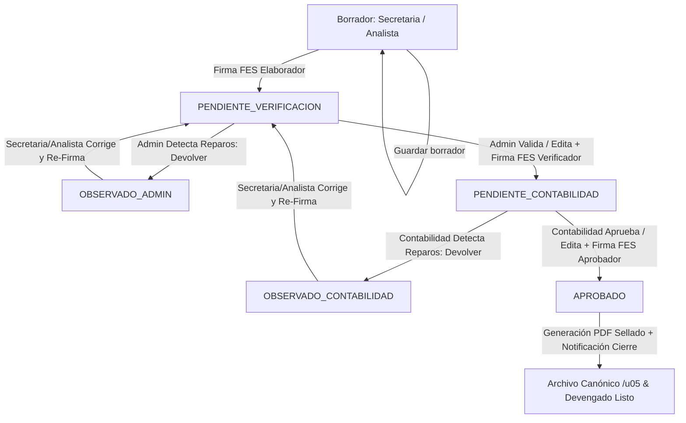

# 📐 Especificación Canónica: Flujo de Aprobaciones ITS Transición, Gobernanza Tripartita, Firmas FES y Notificaciones con Deep Link (Spec 67)

**Documento:** `67_its_transicion_flujo_aprobaciones_secretaria_admin_contabilidad_spec.md`  
**Ecosistema:** Grúas San Pablo (GSP) / LeanGlobal Platform  
**Módulo:** Operaciones & Contabilidad / Informe de Término de Servicio (ITS Transición)  
**Vistas Asociadas:** `ItsTransicionView.vue` (Portal Web)  
**Controladores Backend:** `itsController.js`, `itsRoutes.js`, `itsPdfService.js`, `notificacionService.js`  
**Fase de Dominio:** Cierre Operacional, Liquidación de Costos, Transición Documental y Devengado  
**Estado:** `CANÓNICO VIGENTE`  
**Fecha de Creación:** 9 de Octubre de 2026  
**Requerimiento Asociado:** `REQ-1017`  
**Estándares Canónicos Aplicados:**
- [`leanglobal_approval_flow_standard`](file:///D:/SGajardo/Google%20Drive/Antigravity/LeanGlobal%20-%20Product/.agents/skills/leanglobal_approval_flow_standard/SKILL.md) (Motor de transiciones, firmas FES y transaccionalidad).
- [`leanglobal_notification_standard`](file:///D:/SGajardo/Google%20Drive/Antigravity/LeanGlobal%20-%20Product/.agents/skills/leanglobal_notification_standard/SKILL.md) (Notificaciones omnicanal Email B2B + WhatsApp con Deep Linking).
- [`leanglobal_rbac_standard`](file:///D:/SGajardo/Google%20Drive/Antigravity/LeanGlobal%20-%20Product/.agents/skills/leanglobal_rbac_standard/SKILL.md) (Gobernanza de roles y scopes).
- [`generar_pdf_fes_sin_survey`](file:///D:/SGajardo/Google%20Drive/Antigravity/LeanGlobal%20-%20Product/.agents/skills/generar_pdf_fes_sin_survey/SKILL.md) (Validación PIN OTP SHA-256 en cliente, estampado digital y sellado de tiempo).
- [`leanglobal_file_storage_standard`](file:///D:/SGajardo/Google%20Drive/Antigravity/LeanGlobal%20-%20Product/.agents/skills/leanglobal_file_storage_standard/SKILL.md) (Particionado canónico `/u05/LeanDocs/GSP/{ambiente}/ITS-TRANSICION/{YYYY}/{MM}`).

---

## 1. 📌 Resumen Ejecutivo y Propósito de Negocio

El módulo de **ITS Transición** permite liquidar y conciliar los servicios operados con planillas operativas históricas (GeraldSoft / Excel) o reportes directos, calculando la rentabilidad neta (Venta, Costos Directos, Margen $ y Margen %) y emitiendo el Informe de Término de Servicio (ITS) con folio canónico `ITS-[COTIZACION]`.

Para garantizar la integridad jurídica, el control interno y la cuadratura contable antes de la emisión de la factura de venta, esta especificación formaliza el **Flujo de Gobernanza Tripartita**:
1. **Rol Elaborador (`ANALISTA` o `SECRETARIA`):** Digita, concilia horas/costos y estampa su firma digital FES (Elaboró).
2. **Rol Verificador (`ADMINISTRADOR`):** Revisa el informe operacional, cuenta con facultades de **edición**, puede **devolver con observaciones obligatorias** al elaborador o **validar con su firma digital FES**.
3. **Rol Aprobador (`CONTABILIDAD`):** Realiza la revisión financiera, cuenta con facultades de **edición**, puede **devolver al elaborador** o **aprobar definitivamente con su firma digital FES**, devengando el servicio y archivando el PDF oficial.
4. **Notificaciones Omnicanal en Cada Hito:** Envío automático de Email B2B enriquecido y mensaje de WhatsApp con **Deep Link** directo a la pantalla del informe.
5. **Erradicación del Pie Estático:** Sustitución de las firmas en duro por **3 sellos dinámicos oficiales FES** (Elaboró, Verificó, Aprobó) más la bitácora visible de observaciones resueltas.

---

## 2. 👥 Matriz de Roles y Responsabilidades (RBAC)

Se definen 3 etapas y 4 roles habilitados en el sistema:

| Rol del Sistema | Código Rol (`tsec_rol`) | Etapa de Intervención | Acciones Permitidas |
| :--- | :--- | :--- | :--- |
| **Secretaria** | `SECRETARIA` / `GSP_SECRETARIA` | **1. Elaboración** | Crear ITS, importar Excel, editar jornadas/costos, guardar borrador, firmar FES (Elaboró) y enviar a verificación. Subsanar observaciones si es devuelto. |
| **Analista** | `ANALISTA` / `GSP_PROG` | **1. Elaboración** | Idénticas atribuciones que Secretaria (Caso Yiara Mendoza). |
| **Administrador** | `ADMIN` / `ADMINISTRADOR` / `GSP_ADMIN` | **2. Verificación Operativa** | Recibe notificación de informe emitido. Puede **editar cualquier campo** del ITS, **devolver con observaciones obligatorias** (pasa a `OBSERVADO_ADMIN`), o **validar con PIN FES** (pasa a `PENDIENTE_CONTABILIDAD`). |
| **Contabilidad** | `CONTABILIDAD` / `GSP_CONTABILIDAD` | **3. Aprobación Financiera** | Recibe notificación de informe verificado. Puede **editar campos financieros**, **devolver al elaborador** con observaciones (pasa a `OBSERVADO_CONTABILIDAD`), o **aprobar con PIN FES definitivo** (pasa a `APROBADO`). |

---

## 3. 🔄 Máquina de Estados y Transiciones



### Detalle de Estados:
1. **`BORRADOR`:** Estado inicial mientras la Secretaria o Analista carga la planilla o digita jornadas y gastos. Solo editable por quien elabora o Admin.
2. **`PENDIENTE_VERIFICACION`:** El informe cuenta con la firma FES del Elaborador. Se notifica al Administrador. Bloqueado para el elaborador excepto lectura.
3. **`OBSERVADO_ADMIN`:** El Administrador rechazó la versión con un motivo obligatorio. Se desbloquea la edición para Secretaria/Analista con banner de advertencia mostrando las observaciones.
4. **`PENDIENTE_CONTABILIDAD`:** El Administrador verificó y firmó con FES. Se notifica a Contabilidad (Maritza / Finanzas).
5. **`OBSERVADO_CONTABILIDAD`:** Contabilidad devolvió el informe con observaciones. Se notifica al elaborador para subsanación.
6. **`APROBADO`:** Contabilidad estampó su firma final FES. El ITS queda cerrado e inmutable. Se compila el PDF oficial con los 3 sellos y se deposita en el gestor documental particionado.

---

## 4. 🗄️ Modelo de Datos y Esquema PostgreSQL

### 4.1. Catálogo de Roles (`tsec_rol`)
Asegurar la existencia del rol `SECRETARIA`:
```sql
INSERT INTO tsec_rol (nombre_rol, descripcion, codigo_rol, nivel_jerarquico)
VALUES ('Secretaria', 'Personal administrativo de operaciones para confección de informes y liquidaciones', 'SECRETARIA', 4)
ON CONFLICT (codigo_rol) DO NOTHING;
```

### 4.2. Estructura de `tits_transicion_historial`
La tabla soporta la persistencia estructurada del circuito FES mediante columnas dedicadas o campos JSONB auditables:

```sql
ALTER TABLE tits_transicion_historial 
  ADD COLUMN IF NOT EXISTS estado_flujo VARCHAR(50) DEFAULT 'BORRADOR',
  ADD COLUMN IF NOT EXISTS firmas_fes JSONB DEFAULT '{}'::jsonb,
  ADD COLUMN IF NOT EXISTS historial_observaciones JSONB DEFAULT '[]'::jsonb,
  ADD COLUMN IF NOT EXISTS id_usuario_elaborador INT,
  ADD COLUMN IF NOT EXISTS id_usuario_verificador INT,
  ADD COLUMN IF NOT EXISTS id_usuario_aprobador INT;
```

#### Estructura del objeto `firmas_fes`:
```json
{
  "elaborador": {
    "id_usuario": 14,
    "nombre": "Yiara Mendoza",
    "rut": "18.452.123-K",
    "cargo": "Analista de Operaciones",
    "rol": "ANALISTA",
    "codigo_fes": "FES-ELAB-20261009-8472",
    "timestamp": "2026-10-09T14:35:00-03:00",
    "ip": "190.161.45.12"
  },
  "verificador": {
    "id_usuario": 2,
    "nombre": "Administrador General",
    "rut": "12.345.678-9",
    "cargo": "Administrador",
    "rol": "ADMINISTRADOR",
    "codigo_fes": "FES-VERIF-20261009-9182",
    "timestamp": "2026-10-09T15:10:00-03:00",
    "ip": "190.161.45.12"
  },
  "aprobador": {
    "id_usuario": 28,
    "nombre": "Maritza Carvajal",
    "rut": "15.987.654-3",
    "cargo": "Jefa de Contabilidad",
    "rol": "CONTABILIDAD",
    "codigo_fes": "FES-APROB-20261009-9941",
    "timestamp": "2026-10-09T16:00:00-03:00",
    "ip": "190.161.45.12"
  }
}
```

#### Estructura del array `historial_observaciones`:
```json
[
  {
    "id_devolucion": 1,
    "etapa": "VERIFICACION_ADMIN",
    "estado_origen": "PENDIENTE_VERIFICACION",
    "estado_destino": "OBSERVADO_ADMIN",
    "id_usuario": 2,
    "nombre_usuario": "Administrador General",
    "rol": "ADMINISTRADOR",
    "motivo": "Inconsistencia en horas de viaje",
    "observaciones": "La jornada del día 03-Oct registra 14 hrs reales pero la cotización solo amparaba 9 hrs. Favor revisar respaldo.",
    "fecha": "2026-10-09T14:50:00-03:00"
  }
]
```

---

## 5. 🔌 Endpoints del Backend API (`itsRoutes.js` & `itsController.js`)

Todos los endpoints se montan bajo `/api/operaciones/its/transicion/`:

### 5.1. `POST /firmar-elaborador`
- **Roles permitidos:** `SECRETARIA`, `ANALISTA`, `ADMINISTRADOR`.
- **Payload:** `{ id_transicion, pin_fes, datos_actualizados }`.
- **Proceso:**
  1. Valida PIN OTP FES del usuario contra su hash SHA-256 en BD.
  2. Guarda modificaciones de jornadas/costos si fueron enviadas.
  3. Genera `codigo_fes` para el bloque `elaborador`.
  4. Transiciona `estado` a `PENDIENTE_VERIFICACION`.
  5. Dispara evento de notificación (Email + WhatsApp) dirigido a los usuarios con rol `ADMINISTRADOR`.

### 5.2. `POST /devolver`
- **Roles permitidos:** `ADMINISTRADOR` (desde `PENDIENTE_VERIFICACION`), `CONTABILIDAD` (desde `PENDIENTE_CONTABILIDAD`).
- **Payload:** `{ id_transicion, motivo, observaciones }`.
- **Proceso:**
  1. Valida que el texto de `observaciones` no venga vacío (mínimo 10 caracteres).
  2. Registra el evento en `historial_observaciones`.
  3. Transiciona a `OBSERVADO_ADMIN` o `OBSERVADO_CONTABILIDAD`.
  4. Dispara notificación inmediata (Email + WhatsApp) al elaborador responsable (`id_usuario_elaborador`) con el detalle de las observaciones y Deep Link.

### 5.3. `POST /validar-admin`
- **Roles permitidos:** `ADMINISTRADOR`.
- **Payload:** `{ id_transicion, pin_fes, datos_actualizados }`.
- **Proceso:**
  1. Valida PIN OTP FES del Administrador.
  2. Aplica actualizaciones realizadas por el Administrador en la liquidación.
  3. Estampa bloque `verificador` en `firmas_fes`.
  4. Transiciona a `PENDIENTE_CONTABILIDAD`.
  5. Dispara notificación (Email + WhatsApp) dirigida al equipo de `CONTABILIDAD`.

### 5.4. `POST /aprobar-contabilidad`
- **Roles permitidos:** `CONTABILIDAD`, `ADMINISTRADOR`.
- **Payload:** `{ id_transicion, pin_fes, datos_actualizados }`.
- **Proceso:**
  1. Valida PIN OTP FES de Contabilidad.
  2. Aplica actualizaciones finales en montos de venta o costos.
  3. Estampa bloque `aprobador` en `firmas_fes`.
  4. Transiciona a `APROBADO`.
  5. Compila el PDF final oficial reemplazando el pie estático por los 3 sellos dinámicos.
  6. Almacena físicamente el PDF bajo `/u05/LeanDocs/GSP/{ambiente}/ITS-TRANSICION/{YYYY}/{MM}` y registra `id_doc` en `tfmg_file`.
  7. Notifica cierre exitoso a Elaborador, Administrador y Contabilidad.

---

## 6. 📲 Notificaciones Omnicanal (Email B2B + WhatsApp) con Deep Link

### 6.1. Deep Link Canónico
El enlace redirige directamente a la pantalla de ITS Transición precargando la cotización y activando el modal correspondiente:
```
https://servidor.leanglobal.cl/lg-gsp-prod/its-transicion?folio=ITS-[COT]&cot=[COT]&id=[ID_TRANSICION]
```

### 6.2. Plantilla de Notificación por WhatsApp
```
🚨 *GRÚAS SAN PABLO - GESTIÓN OPERACIONES*
📋 *ITS [FOLIO_ITS] - [ESTADO_ACCION]*

Estimado(a) *[NOMBRE_DESTINATARIO]*,
Se requiere su atención para el siguiente Informe de Término de Servicio:

🔹 *Cotización:* #[NUMERO_COTIZACION]
🔹 *Cliente:* [CLIENTE_NOMBRE]
🔹 *Venta Total:* $[TOTAL_VENTA] CLP
🔹 *Margen Operacional:* [MARGEN]%
🔹 *Responsable Acción:* [NOMBRE_EJECUTOR] ([ROL_EJECUTOR])

[BLOQUE_OBSERVACIONES_SI_APLICA]

👉 *Revisar y Gestionar en Plataforma:*
[DEEP_LINK]
```

### 6.3. Plantilla de Correo Electrónico B2B
- Encabezado con logotipo corporativo oficial de GSP.
- Ficha resumen de la operación (Datos del cliente, faena, fechas, montos y margen).
- Caja de alerta contextual (Azul para revisión pendiente, Amarillo/Rojo para devolución con observaciones, Verde para aprobación final).
- Botón interactivo (Call To Action): **"Abrir y Gestionar ITS en Plataforma"**.

---

## 7. 📄 Estándar de Sellos Dinámicos FES en PDF y Vista Web

Se erradica definitivamente el pie estático en duro. En su lugar se renderiza un bloque de 3 columnas proporcionales al pie del documento:

```
┌─────────────────────────┬─────────────────────────┬─────────────────────────┐
│       ELABORADO POR     │      VERIFICADO POR     │       APROBADO POR      │
├─────────────────────────┼─────────────────────────┼─────────────────────────┤
│ [SELLO DIGITAL FES]     │ [SELLO DIGITAL FES]     │ [SELLO DIGITAL FES]     │
│                         │                         │                         │
│ Nombre: [Nombre Elab]   │ Nombre: [Nombre Admin]  │ Nombre: [Nombre Contab] │
│ Cargo: Secretaria/Anal. │ Cargo: Administrador    │ Cargo: Jefa Contabilidad│
│ RUT: [RUT]              │ RUT: [RUT]              │ RUT: [RUT]              │
│ Código: [FES-ELAB-...]  │ Código: [FES-VERIF-...] │ Código: [FES-APROB-...] │
│ Fecha: [DD/MM/YYYY HH:mm│ Fecha: [DD/MM/YYYY HH:mm│ Fecha: [DD/MM/YYYY HH:mm│
│ Estado: FIRMADO         │ Estado: FIRMADO         │ Estado: FIRMADO         │
└─────────────────────────┴─────────────────────────┴─────────────────────────┘
```

Si el estado aún no ha alcanzado la etapa correspondiente, el recuadro muestra:
`[PENDIENTE DE FIRMA - ROL REQUERIDO: ADMINISTRADOR]` con borde punteado gris tenue.

### Cuadro de Bitácora de Observaciones Resueltas (si hubo devoluciones):
Se añade inmediatamente debajo de las firmas una tabla compacta en fuente de 8pt:
`Observaciones Previas de Control: [Fecha] - Devuelto por [Nombre] ([Rol]): "[Texto Observaciones]"`

---

## 8. 💻 Experiencia de Usuario en Frontend (`ItsTransicionView.vue`)

1. **Detección Automática de Rol del Usuario Autenticado:**
   - La vista consulta el rol del usuario en la sesión (`useAuth` / `localStorage`).
   - Identifica si el usuario es `SECRETARIA`, `ANALISTA`, `ADMINISTRADOR` o `CONTABILIDAD`.
2. **Control Dinámico de Botones de Acción según Estado:**
   - **En `BORRADOR` o `OBSERVADO` (Secretaria/Analista):**
     - Botón `💾 Guardar Borrador`
     - Botón `✍️ Firmar y Enviar a Verificación` (Abre modal PIN FES Elaborador).
   - **En `PENDIENTE_VERIFICACION` (Administrador):**
     - Edición habilitada en la tabla y costos.
     - Botón `💾 Guardar Cambios`
     - Botón `⚠️ Devolver con Observaciones` (Abre modal de devolución).
     - Botón `✅ Validar y Enviar a Contabilidad` (Abre modal PIN FES Verificador).
   - **En `PENDIENTE_CONTABILIDAD` (Contabilidad):**
     - Edición habilitada.
     - Botón `💾 Guardar Cambios`
     - Botón `⚠️ Devolver al Elaborador` (Abre modal de devolución).
     - Botón `🏆 Aprobar Definitivo con FES` (Abre modal PIN FES Aprobador).
   - **En `APROBADO`:**
     - Todos los inputs en modo solo lectura (`disabled`).
     - Botón `📄 Ver / Descargar PDF Oficial`.
3. **Banner de Alerta de Devolución:**
   - Si el ITS está en `OBSERVADO_ADMIN` u `OBSERVADO_CONTABILIDAD`, se despliega un banner prominente color ámbar en la parte superior con el detalle del reparo y el autor.

---

## 9. 📋 Criterios de Aceptación y Certificación (QA)

1. **CA-1 (Rol Secretaria):** Usuario con rol `SECRETARIA` puede autenticarse, ingresar a `/its-transicion`, procesar planilla, guardar borrador y estampar FES Elaborador con su PIN OTP.
2. **CA-2 (Transición y Notificación a Admin):** Al firmar el elaborador, el estado pasa a `PENDIENTE_VERIFICACION` y se despacha Email + WhatsApp al Administrador con el Deep Link exacto.
3. **CA-3 (Edición y Devolución Admin):** Administrador puede editar cifras y, si presiona "Devolver", se le exige motivo u observación; el estado pasa a `OBSERVADO_ADMIN` y el elaborador recibe la alerta para corregir.
4. **CA-4 (Validación Admin a Contabilidad):** Administrador firma con su PIN FES; el estado pasa a `PENDIENTE_CONTABILIDAD` y se notifica al rol Contabilidad.
5. **CA-5 (Edición y Aprobación Contabilidad):** Contabilidad puede ajustar montos y estampa su PIN FES de cierre; el estado pasa a `APROBADO`.
6. **CA-6 (PDF Final sin Pie Estático):** El PDF final generado y el visor web muestran la cuadrícula de las 3 firmas dinámicas con nombres, cargos, RUT, códigos FES y marcas de tiempo oficiales, sin ningún texto en duro.
7. **CA-7 (Paridad DEV y PROD):** Verificación empírica con HTTP 200 OK y cero errores de compilación Vite en ambos ambientes.
