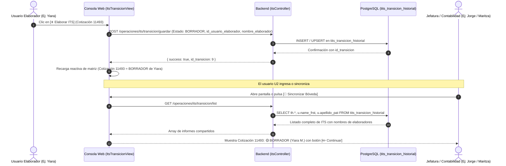

# 🏢🤝 ESPECIFICACIÓN TÉCNICA CANÓNICA N° 73: COLABORACIÓN UNIVERSAL, VISIBILIDAD MULTI-USUARIO Y AUTOGUARDADO EN NUBE DE INFORMES DE TÉRMINO DE SERVICIO (ITS TRANSICIÓN)

> **Spec N°**: 73  
> **Módulo**: Operaciones — ITS Transición (Informe de Término de Servicio)  
> **Sistema**: Grúas San Pablo (GSP) / LeanGlobal Platform  
> **Esquemas DB**: `sch_leangsp` (DEV) & `sch_leangsp_prod` (PROD)  
> **Rutas Consola Web**: `/its-transicion` (Matriz Operativa de Conciliación, Bandeja Histórica y Formulario)  
> **Requerimiento Backlog**: `REQ-1028` (Gestión/tareas.md)  
> **Versión Objetivo**: Consola Web `v1.0.126`  
> **Estado**: 📝 ESPECIFICACIÓN FORMAL PARA IMPLEMENTACIÓN  
> **Fecha**: 2026-10-13  

---

## 1. Declaración del Problema y Objetivos de Negocio

### 1.1 Contexto Operativo
En la versión `v1.0.120` (SPEC-070 / REQ-1022) se implementó la Bóveda Corporativa de Planillas Geralsoft (Controles y OTs), permitiendo que cualquier usuario suba planillas y que éstas queden centralizadas y visibles para toda la organización.

Sin embargo, en el circuito de elaboración de los Informes de Término de Servicio (ITS), los usuarios reportaron que:
> *"Las planillas de subida sí son almacenadas y visibles para todos los usuarios, pero los ITS que elaboran solo los puede ver el usuario que los genera."*

### 1.2 Diagnóstico Técnico de Causas Raíz
Tras auditar el Frontend (`ItsTransicionView.vue`), el Backend (`itsController.js`) y la Base de Datos (`tits_transicion_historial`), se verificó que:
1. **Ciclo de Vida Aislado en Memoria RAM:** Al presionar `[➕ Elaborar ITS]`, los datos de la cotización y jornadas se cargaban exclusivamente en variables reactivas del navegador (`informe` y `costos`). Mientras el usuario redactaba observaciones o ajustaba costos, **nada existía en el servidor**.
2. **Fallback Engañoso en `localStorage`:** Ante cualquier inconsistencia o al guardar borrador local, el frontend almacenaba una copia en el `localStorage` del navegador del usuario. El elaborador veía el informe en su propia pantalla y en su pestaña *"Control y Estados"*, pero ningún otro computador de la empresa tenía acceso a esa información.
3. **Ceguera de Autoría y Concurrencia:** La Matriz Operativa de Conciliación mostraba el estado como `⚪ PENDIENTE` o `BORRADOR` genérico, sin reflejar **quién estaba elaborando el informe**, impidiendo que jefaturas o contabilidad supieran si una cotización ya estaba siendo atendida.
4. **Desfase de Sincronización:** Si el usuario A guardaba un borrador en el servidor, el usuario B (con la página abierta previamente) no recibía la actualización hasta un refresco manual.

### 1.3 Objetivos de la Solución
1. **Visibilidad Universal y Colaborativa:** Todo ITS registrado (en borrador, en revisión o aprobado) debe ser accesible y gestionable por cualquier usuario con permisos (Secretaria, Analista, Administrador, Jefatura y Contabilidad).
2. **Autocreación Inmediata de Borrador en Servidor:** Al presionar `[➕ Elaborar ITS]`, se creará de inmediato un registro en PostgreSQL (`tits_transicion_historial`) con estado `BORRADOR`, asociando el `id_usuario_elaborador` y su nombre legible.
3. **Trazabilidad en la Matriz Operativa:** La tabla de servicios mostrará badges informativos con el autor del borrador (ej. `🟡 BORRADOR (Yiara M.)` o `⏳ PENDIENTE VERIF. (Jorge P.)`) y un botón claro `[✏️ Continuar / Editar]`.
4. **Erradicación de Falsos Respaldos Locales:** Toda la información (observaciones de servicio, sobreescrituras de tarifas y costos) se persistirá en `data_json` de PostgreSQL. Si la conexión al servidor falla, se emitirá una alerta visible en pantalla en lugar de silenciar el error.

---

## 2. Diagrama de Flujo de Datos Colaborativo

---

## 3. Especificación Detallada de Cambios

### 3.1 Backend (`itsController.js`)
1. **Endpoint `GET /api/operaciones/its/transicion/list`:**
   - Incorporar `LEFT JOIN tsec_users u_elab ON th.id_usuario_elaborador = u_elab.id_user`.
   - Incorporar `LEFT JOIN tsec_users u_verif ON th.id_usuario_verificador = u_verif.id_user`.
   - Incorporar `LEFT JOIN tsec_users u_aprob ON th.id_usuario_aprobador = u_aprob.id_user`.
   - Retornar campos normalizados:
     - `nombre_elaborador`: Nombre completo del elaborador (desde `tsec_users` o fallback `th.data_json->>'nombre_elaborador'`).
     - `nombre_verificador`: Nombre de quien verificó con FES.
     - `nombre_aprobador`: Nombre de quien aprobó en contabilidad.
2. **Endpoint `POST /api/operaciones/its/transicion/guardar`:**
   - Aceptar `nombre_elaborador` en el body y preservarlo en `data_json.nombre_elaborador` e `id_usuario_elaborador`.
   - Garantizar que si un borrador ya existe para esa cotización y versión, actualice los costos y jornadas sin perder la identidad del elaborador original a menos que se sobreescriba explícitamente.

### 3.2 Frontend (`ItsTransicionView.vue`)
1. **Método `seleccionarYElaborarIts(s)`:**
   - Al seleccionar una cotización no iniciada, derivar las jornadas y datos desde las planillas Geralsoft y ejecutar inmediatamente `guardarInformeConEstado('BORRADOR', true)` en segundo plano.
   - Asignar `informe.id_usuario_elaborador = currentUser.value?.id_user` y `informe.nombre_elaborador = currentUser.value?.nombre_completo || currentUser.value?.nombre`.
   - Refrescar `informesHistorial` desde el servidor para que la Matriz Operativa pase a `🟡 BORRADOR` instantáneamente.
2. **Método `cargarInformeParaEdicion(infSnapshot)`:**
   - Permitir a cualquier usuario con rol analista, supervisor, administrador o contabilidad cargar el snapshot completo (incluyendo observaciones, tarifas y costos) en el formulario de edición.
3. **Presentación Visual en la Matriz Operativa de Conciliación:**
   - En la columna **Estado ITS**:
     - Si está en `BORRADOR`: `🟡 BORRADOR` + subtítulo `👤 [Nombre Elaborador]`.
     - Si está en `PENDIENTE_VERIFICACION`: `⏳ PEND. VERIFICACIÓN` + `👤 [Nombre Elaborador]`.
     - Si está en `PENDIENTE_CONTABILIDAD`: `💰 PEND. CONTABILIDAD` + `👤 Visado: [Nombre Verificador]`.
     - Si está en `APROBADO`: `🟢 CONCLUIDO`.
   - En la columna **Acción**:
     - Botón `[✏️ Continuar]` visible para informes en trámite, con tooltip indicativo del último editor.
4. **Erradicación del Silenciamiento en `guardarInformeConEstado`:**
   - Si la llamada POST a `/operaciones/its/transicion/guardar` devuelve error o falla la red, alertar de inmediato:
     `alert('❌ Error al guardar en el servidor: ' + mensajeError)`
   - No realizar actualizaciones engañosas de éxito si no hubo respuesta 200 OK del backend.
   - Sincronizar las observaciones de servicio en `snapshot.informe.observaciones_servicio` y en `informe.observaciones_servicio`, eliminando la dependencia aislada de `localStorage`.

---

## 4. Matriz de Trazabilidad y Verificación

| ID | Criterio de Aceptación | Método de Prueba | Resultado Esperado |
|---|---|---|---|
| **AC-01** | Creación inmediata de borrador en servidor | Iniciar elaboración de una cotización y consultar DB | Fila insertada en `tits_transicion_historial` con estado `BORRADOR` e `id_usuario_elaborador`. |
| **AC-02** | Visibilidad multi-sesión | Iniciar borrador en Sesión A y abrir pantalla en Sesión B | Sesión B ve la cotización como `🟡 BORRADOR (Usuario A)` sin intervenir. |
| **AC-03** | Edición colaborativa | Sesión B pulsa `[✏️ Continuar]` | Se cargan íntegramente las jornadas, costos y observaciones de Sesión A. |
| **AC-04** | Erradicación de fallos silenciosos | Desconectar red y pulsar Guardar | Se alerta el fallo de red sin guardar localmente como falso positivo. |
| **AC-05** | Integridad de compilación | `npm run build` en Frontend | Compilación Vite con 0 advertencias críticas y 0 errores. |

---

## 5. Gobernanza y Control de Versiones

* **Requerimiento**: `REQ-1028` en `Gestión/tareas.md`.
* **Frontend Web**: Incremento a `v1.0.126` en `package.json`.
* **Sincronización**: Actualización de `RELEASE_LOG.md` y registro en `tcfg_releases` y `tcfg_backlog`.
