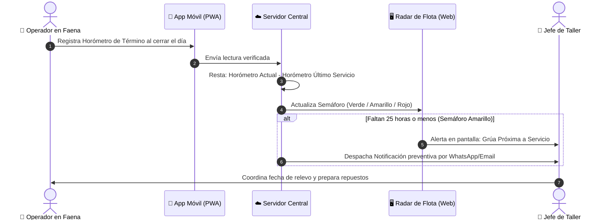

# 📖 Guía Didáctica para Humanos: Criterios, Horómetros y Pautas de Mantenimiento en Grúas San Pablo (GSP)

> **"Un auto recorre kilómetros; una grúa realiza esfuerzos."**  
> Esta guía explica en lenguaje claro, sencillo y corporativo por qué el mantenimiento de nuestras grúas no se maneja como el de un vehículo común, cómo calcula el sistema los vencimientos y de qué manera protegemos la vida de los equipos y la continuidad del negocio.

---

## 1. La Gran Diferencia: ¿Por qué un Automóvil no es igual a una Grúa?

En la vida cotidiana estamos acostumbrados a llevar el automóvil particular al taller cada **10.000 kilómetros** o **una vez al año**. Eso tiene sentido porque en un vehículo de calle el desgaste ocurre casi exclusivamente cuando las ruedas giran sobre el pavimento.

En una **grúa móvil industrial** (Liebherr, Grove, Tadano), esa lógica no funciona y resultaría en una catástrofe mecánica:
* Una grúa telescópica de 100 toneladas puede ser transportada hasta una faena minera o de construcción y permanecer anclada en sus estabilizadores durante **3 semanas seguidas sin rodar un solo metro**.
* Durante esas 3 semanas, su odómetro (kilometraje) marcará **0 kilómetros**.
* Sin embargo, el motor diésel habrá estado encendido 10 horas al día a 1.800 RPM, accionando bombas hidráulicas gigantescas a **320 bares de presión** para levantar cargas de decenas de toneladas bajo el sol, polvo y frío extremo.

> [!IMPORTANT]
> Si esperáramos a que la grúa acumule 10.000 kilómetros para hacerle su mantención, ¡el motor se fundiría y las bombas hidráulicas reventarían mucho antes del primer cambio de aceite!

---

## 2. Horómetro vs. Odómetro: Las Dos Formas de Medir el Trabajo

Para resolver esta realidad, en Grúas San Pablo diferenciamos con precisión dos tipos de medidores:

```
┌────────────────────────────────────────────────────────────────────────┐
│                   TAXONOMÍA DE MEDICIÓN EN GSP                         │
├───────────────────────────────────┬────────────────────────────────────┤
│       ⏱️ EL HORÓMETRO              │         🚗 EL ODÓMETRO             │
│    (Tiempo y Esfuerzo Real)       │     (Distancia de Rodadura)        │
├───────────────────────────────────┼────────────────────────────────────┤
│ • Mide horas exactas de motor     │ • Mide kilómetros recorridos       │
│ • Evalúa la fatiga bajo carga     │ • Evalúa desgaste de neumáticos    │
│ • Crucial para motor e hidráulica │ • Crucial para frenos y rodamientos│
│ • Aplica a: Grúas de Izaje        │ • Aplica a: Camiones y Ramplas     │
└───────────────────────────────────┴────────────────────────────────────┘
```

### A. El Horómetro (El reloj del esfuerzo)
* **¿Qué mide?** Las horas y minutos exactos en que el motor diésel ha estado en marcha.
* **Analogía:** Es como los latidos del corazón de un atleta de alto rendimiento: mide el esfuerzo físico real que hace el corazón, sin importar si está corriendo una maratón o levantando pesas sin moverse de su lugar.
* **¿Qué se desgasta aquí?** El aceite del motor, los filtros de combustible, las bombas hidráulicas, los malacates (winches) que suben el cable y los cilindros que estiran la pluma.

### B. El Odómetro (El kilometraje de carretera)
* **¿Qué mide?** La distancia física recorrida por los neumáticos sobre el asfalto.
* **¿Dónde se usa en GSP?**
  1. En los **tractocamiones** que tiran las ramplas de contrapesas.
  2. En las **ramplas cama baja** y dollys de transporte.
  3. En los vehículos de escolta y camionetas de supervisión.
  4. En el **chasis de la grúa** cuando se traslada por carretera entre Santiago y faenas regionales.
* **¿Qué se desgasta aquí?** Los neumáticos, los frenos de aire de las ruedas, los rodamientos de masa (cubos de rueda) y los amortiguadores de la suspensión.

### C. El Doble Horómetro (Dos máquinas en un solo cuerpo)
Las grúas telescópicas pesadas son tan complejas que muchas de ellas tienen **dos medidores independientes**:
1. **Horómetro de Chasis (Carrier):** Registra las horas en que el motor movió las ruedas para trasladar la máquina por el camino.
2. **Horómetro de Grúa / Superestructura (Upper):** Registra las horas en que la pluma estuvo trabajando levantando cargas.

El sistema de GSP guarda ambos medidores por separado para que el taller sepa exactamente qué parte de la máquina necesita atención.

---

## 3. El Misterio de las 250 Horas: ¿Por qué 250, 500, 1.000 y 2.000 Horas?

Una duda muy común es: *¿Por qué los mantenimientos se hacen cada 250 horas y no a las 300 o a las 100?*

Esta cifra no es un capricho. Ha sido establecida por los fabricantes mundiales de motores y grúas (Liebherr, Cummins, Mercedes-Benz, Caterpillar) tras décadas de pruebas científicas en laboratorios químicos de lubricación.

```
       CASCADA ARMÓNICA DE MANTENIMIENTO PREVENTIVO EN GSP
       
 [0 hrs] ───► [250 hrs] ───► [500 hrs] ───► [750 hrs] ───► [1.000 hrs] ───► [2.000 hrs]
                PM1            PM2            PM1             PM3              PM4
             (Aceite/       (Filtros de    (Aceite/       (Cajas/Diff/      (Overhaul
              Filtros)       Aire/Giro)     Filtros)       Válvulas)        Hidráulico)
```

Aquí está la explicación de lo que ocurre dentro de la máquina:

### 1. El Aceite es la Sangre del Motor (Se vuelve ácido)
El petróleo diésel contiene azufre. Al quemarse dentro del motor, genera ácidos corrosivos y micro-partículas de carbón (hollín negro). El aceite nuevo trae aditivos neutralizantes (llamados **TBN**). A las **250 horas continuas de trabajo**, esos aditivos protectores se agotan en más de un 50%. Si no cambiamos el aceite en ese momento, el lubricante se transforma en un líquido ácido que carcome los metales internos y los cojinetes.

### 2. Los Filtros son los Pulmones (Se tapan de mugre)
Un filtro retiene impurezas. Hacia las 250 horas, el papel filtrante se satura tanto que el aceite ya no puede pasar con facilidad. Si dejáramos el filtro puesto más tiempo, el motor abriría una válvula de emergencia para no ahogarse, dejando pasar **aceite sucio con partículas abrasivas directamente a los pistones**.

### 3. Las Pautas Armónicas de GSP (PM1 a PM4)
Para que el taller trabaje de forma ordenada y no se confunda, las pautas son múltiplos perfectos de 250:

* 🛠️ **PM1 / PM250 (Cada 250 Horas - "El Chequeo Rutinario"):**
  * Se cambia todo el aceite del motor.
  * Se cambian los filtros de aceite y los filtros primarios de petróleo.
  * Se engrasa completamente el chasis, estabilizadores y crucetas.
  * *Tiempo en taller:* 3 a 5 horas.

* ⚙️ **PM2 / PM500 (Cada 500 Horas - "La Revisión Intermedia"):**
  * Incluye todo lo de la PM1.
  * Se cambian los filtros de aire grandes (para que el motor respire aire puro).
  * Se cambian los filtros de combustible secundarios y filtros hidráulicos pequeños.
  * Se engrasa con grasa pesada la corona de giro (lo que permite que la grúa rote 360 grados).
  * Se toma una muestra de aceite para mandar a laboratorio y ver si hay desgaste de metales.

* 🏗️ **PM3 / PM1000 (Cada 1.000 Horas - "El Servicio Mayor"):**
  * Incluye todo lo de la PM1 y PM2.
  * Se cambia el aceite de las cajas de cambio pesadas, mandos finales y diferenciales.
  * Se revisan y calibran las válvulas del motor y los inyectores.
  * Se inspeccionan las soldaduras estructurales de la pluma telescópica.

* 🛡️ **PM4 / PM2000 (Cada 2.000 Horas o 1 Año - "La Cirugía Mayor"):**
  * Es la mantención más profunda y costosa.
  * Se vacían y reemplazan entre **400 y 1.200 litros de fluido hidráulico especial**.
  * Se cambian todos los filtros de succión y retorno hidráulico.
  * Se calibran las presiones de las válvulas de izaje.
  * Se prueba el computador limitador de carga (PAT / LMI) y se prepara la grúa para la recertificación oficial con **Bureau Veritas** o **Dictuc**.

---

## 4. ¿Cómo Sabe el Sistema Cuándo una Grúa Debe Entrar a Taller?

El software de Grúas San Pablo no adivina ni necesita que alguien lleve planillas Excel manuales. Todo funciona mediante un flujo de datos continuo y automático:



1. **Paso 1 (Captura en Faena):** Todas las tardes, al terminar la jornada, el operador anota en su celular (mediante la PWA móvil de GSP) la lectura real del horómetro en su **Reporte Diario**.
2. **Paso 2 (Cálculo Instantáneo):** El servidor toma esa lectura y la compara contra el horómetro que tenía la grúa la última vez que salió del taller:
   $$\text{Horas Trabajadas} = \text{Horómetro de Hoy} - \text{Horómetro de la Última Mantención}$$
3. **Paso 3 (El Semáforo del Radar de Flota):**
   * 🟢 **Semáforo VERDE (Al día):** La grúa tiene horas disponibles de sobra. Puede seguir trabajando en terreno con total seguridad.
   * 🟡 **Semáforo AMARILLO (Próximo - 25 horas antes):** Cuando la grúa llega a las **225 horas** (le faltan 25 para las 250), el sistema se enciende en amarillo. **Esta es la clave de la eficiencia de GSP**: le da al Jefe de Taller 2 o 3 días de aviso previo para apartar los filtros en bodega, pedir los tambores de aceite y coordinar con el cliente para que el mantenimiento no interrumpa un izaje crítico.
   * 🔴 **Semáforo ROJO (Vencido):** La grúa superó las 250 horas. La máquina entra en zona de riesgo y debe programarse inmediatamente su ingreso a taller.

---

## 5. El Panel de Control Web: ¿Qué Significa Cada Parámetro?

En la consola web de Grúas San Pablo ([`MantenimientoView.vue`](file:///d:/SGajardo/Google Drive/Antigravity/Grúas San Pablo/Propuesta Gestión Operación Grúas/ejecucion/frontend/src/views/MantenimientoView.vue)), en la pestaña **"PARÁMETROS OPERACIONALES"**, existe un panel donde la Jefatura puede ajustar las reglas del juego según cambie el negocio:

```
┌────────────────────────────────────────────────────────────────────────┐
│               PANEL DE PARÁMETROS OPERACIONALES GSP                    │
├───────────────────────────────────┬────────────────────────────────────┤
│ 1. CICLOS PREVENTIVOS             │ 2. CAPACIDAD Y ALERTAS             │
│ • Intervalo Horómetro: [ 250 ] hrs│ • Tarifa HH Mecánico: [ $15.000 ]  │
│ • Anticipación Radar:  [  25 ] hrs│ • Umbral Costo OT:    [$2.000.000] │
│ • Odómetro Carretera:  [10000] km │ • Alerta Certificación:[ 30 ] días│
└───────────────────────────────────┴────────────────────────────────────┘
```

1. **Intervalo Base Horómetro Grúas (`pm_intervalo_base_horas = 250 hrs`):**  
   *¿Para qué sirve?* Es el corazón del sistema. Si mañana GSP compra un lubricante sintético de ultra-larga vida que permite extender las mantenciones a 300 o 400 horas, basta cambiar este número en la pantalla, apretar `[💾 Guardar Parámetros]` y **todas las 58 grúas del Radar se recalculan automáticamente**.
2. **Anticipación Alerta Radar (`pm_ventana_alerta_horas = 25 hrs antes`):**  
   *¿Para qué sirve?* Define con cuánto tiempo de anticipación queremos que el semáforo se ponga amarillo. Si una faena en el norte está muy lejos y los repuestos tardan más en llegar, podemos subir este aviso a 40 horas antes.
3. **Intervalo Odómetro Carretera (`pm_intervalo_odometro_km = 10.000 km`):**  
   *¿Para qué sirve?* El ciclo en que llamamos a taller a los tractos y ramplas para rotación de neumáticos, engrase de masas y revisión de frenos.
4. **Tarifa Mano de Obra HH Estándar (`tarifa_hh_default = $15.000 CLP`):**  
   *¿Para qué sirve?* Cada vez que un mecánico anota que trabajó 4 horas en una grúa, el sistema multiplica $4 \times \$15.000 = \$60.000$. Así la gerencia sabe con exactitud cuánto dinero en personal costó mantener cada equipo.
5. **Umbral Financiero de OT (`umbral_costo_ot_clp = $2.000.000 CLP`):**  
   *¿Para qué sirve?* Es un "freno de mano financiero". Si en una reparación imprevista la suma de repuestos, servicios externos y horas hombre supera los 2 millones de pesos, el sistema dispara una alerta inmediata a la Gerencia de Operaciones para autorizar el sobrecosto.
6. **Alerta Certificación Bureau Veritas / Dictuc (`cert_alerta_dias = 30 días`):**  
   *¿Para qué sirve?* Ninguna faena minera o industrial seria permite que entre una grúa con su certificado de carga vencido. Si el certificado vence en menos de un mes, la pantalla avisa para agendar la visita del certificador antes de que la grúa quede paralizada.

---

## 6. Preguntas Frecuentes (FAQ)

**P: ¿Qué pasa si una grúa está en faena y le quedan solo 10 horas para el servicio?**  
*R:* Gracias a la alerta amarilla previa (a las 25 horas antes), el Jefe de Taller ya sabrá que la grúa está por cumplir su ciclo. Puede coordinar con Operaciones para mandar un mecánico con la camioneta de terreno para hacer la PM1 en el mismo sitio de la faena un fin de semana, o planificar el reemplazo con otro equipo sin detener la obra del cliente.

**P: ¿Por qué no dejamos que la grúa trabaje hasta que falle algo y recién ahí la reparamos?**  
*R:* Porque en grúas industriales, **el mantenimiento correctivo no planificado cuesta hasta 10 veces más caro** que el preventivo:
1. Una bomba hidráulica que falla por aceite sucio puede costar más de \$15.000.000 CLP y tardar 45 días en llegar desde Alemania o EE.UU.
2. Si la grúa falla en faena sosteniendo una estructura, se paraliza la faena del cliente, acarreando multas contractuales gravísimas y daños irreparables a la reputación de GSP.
3. El mantenimiento preventivo regular garantiza que el activo mantenga un valor de reventa alto y cumpla con las auditorías de seguridad más exigentes del país.

**P: ¿Quién puede modificar estos parámetros?**  
*R:* Únicamente los usuarios con perfil Administrador o Jefatura de Taller (`GSP_ADMIN` / `TALLER_ADMIN`) mediante el botón oficial en la Consola Web. Cualquier cambio queda auditado con fecha y hora en la base de datos corporativa.

---

*Documento formal de gestión interna — Grúas San Pablo (GSP) & LeanGlobal Platform.*
