# DOCUMENTO FUNCIONAL Y MATRIZ DE CASOS DE PRUEBA
## CIRCUITO INTEGRAL OPERACIONAL Y FINANCIERO (SPEC 57)
### Grúas San Pablo S.A. | LeanGlobal Platform

---

| Metadato | Detalle Técnico |
| :--- | :--- |
| **Cliente** | **Grúas San Pablo S.A.** |
| **Plataforma** | **LeanGlobal Platform** (Ecosistema Operacional-Financiero) |
| **Documento** | Especificación Funcional de Procesos y Guía de Casos de Prueba |
| **Referencia Técnica** | **Spec 57**: Ciclo Integral Reports ➔ PMO ➔ ITS ➔ EDP & Tesorería ➔ Facturación DTE |
| **Fecha de Actualización** | Octubre 2026 |
| **Versión** | 1.1 — Enfoque Funcional y de Pruebas de QA |

---

## 1. INTRODUCCIÓN Y PROPÓSITO DEL DOCUMENTO

El objetivo de este documento es presentar de forma clara, didáctica y estructurada el funcionamiento del **Circuito Operacional y Financiero Integral** desarrollado para **Grúas San Pablo S.A.**, junto con su **Matriz de Casos de Prueba**, para facilitar la revisión técnica y funcional entre los equipos de Operaciones, Tesorería y LeanGlobal.

### 1.1 El Reto de Gestión que Aborda el Circuito
En el negocio de arriendo de grúas y equipos de izaje, el control financiero depende críticamente de la velocidad y precisión con que la información viaja desde la faena física hasta la contabilidad:
* Evitar que reportes diarios queden sin validar o se extravíen.
* Conciliar en el mismo día las horas de trabajo reales versus las condiciones comerciales pactadas (pisos mínimos contractuales y sobretiempos).
* Integrar inmediatamente los costos directos de la operación (cargas de combustible Copec, peajes, camas bajas y viáticos de cuadrilla).
* Garantizar que las modificaciones de tarifas o descuentos sean atribución exclusiva de **Tesorería**, impidiendo alteraciones no autorizadas.
* Asegurar un despacho formal respaldado al mandante que agilice la recepción conforme y el pago.

### 1.2 Visión General del Circuito
El flujo conecta 5 etapas clave de manera sincronizada y protegida por reglas de control (*Hard Gates*):

$$\text{PWA Terreno} \longrightarrow \text{PMO \& SLA 13:00 hrs} \longrightarrow \text{ITS (Liquidación Real)} \longrightarrow \text{EDP \& Tesorería} \longrightarrow \text{Facturación SII (Estado 7)}$$

---

## 2. DESCRIPCIÓN FUNCIONAL DEL PROCESO

```mermaid
flowchart TD
    subgraph F1["1. TERRENO (PWA MÓVIL)"]
        A1["Operador abre servicio<br/>(Horómetro y Odómetro inicial)"] --> A2["Operador cierra faena<br/>(Horómetros finales, tiempos y notas)"]
        A2 --> A3["Supervisor Mandante firma en pantalla<br/>+ Registro de coordenadas GPS"]
        A3 --> A4{"¿OT con cuota de<br/>días agotada?"}
        A4 -- "Sí" --> A5["CANDADO DURO (403):<br/>Bloqueo de nuevos reportes"]
        A4 -- "No" --> A6["Reporte emitido con éxito"]
    end

    subgraph F2["2. TORRE DE CONTROL Y VALIDACIÓN PMO"]
        B1["Monitoreo matutino de reportes"] --> B2{"¿Reportes del día anterior<br/>pendientes a las 13:00 hrs?"}
        B2 -- "Sí" --> B3["Alerta automática WhatsApp + Correo<br/>a Yiara Mendoza y Jorge Ponce"]
        B2 -- "No" --> B4["Analista PMO concilia horas<br/>pactadas vs ejecutadas"]
        B4 --> B5["Estado: VALIDADO ANALISTA"]
    end

    subgraph F3["3. LIQUIDACIÓN TÉCNICA (ITS)"]
        C1["Consolidación incremental de jornales"] --> C2["Imputación de costos reales<br/>(Combustible, peajes, viáticos)"]
        C2 --> C3["Cálculo automático de margen bruto<br/>y anexo con firmas y GPS"]
        C3 --> C4["Paso 1 FES: Analista PMO firma con PIN"]
        C4 --> C5["Paso 2 FES: Jorge Ponce<br/>otorga V°B° técnico con PIN"]
        C5 --> C6["ITS aprobado para Contabilidad"]
    end

    subgraph F4["4. GOBERNANZA EDP Y TESORERÍA"]
        D1["Emisión de Carátula Oficial EDP"] --> D2{"¿Intento de modificar tarifas<br/>o aplicar descuentos?"}
        D2 -- "Operador / Técnico" --> D3["Acceso Denegado (403):<br/>Seguridad por rol"]
        D2 -- "Pamela / Tesorería" --> D4["Modificación de tarifas y descuentos<br/>autorizada formalmente"]
        D4 --> D5["Firma Comercial FES de Tesorería"]
        D5 --> D6{"Condición comercial<br/>del cliente"}
        D6 -- "Pago Previo / Contado" --> D7["Expediente Interno<br/>(No se envía cobro al cliente)"]
        D6 -- "Venta a Crédito" --> D8["Despacho formal al cliente<br/>con copia a GG, Contab y Operaciones"]
    end

    subgraph F5["5. FACTURACIÓN Y CIERRE SII"]
        E1{"¿Cliente cuenta con OC formal?"}
        E1 -- "Con OC" --> E2["Registro Folio OC + Archivo"]
        E1 -- "Sin OC" --> E3["Opción: Cliente Sin OC<br/>(Asume valor devengado en EDP)"]
        E2 --> E4["Emisión DTE en Laudus ERP"]
        E3 --> E4
        E4 --> E5["OT en ESTADO 7: FACTURADO CONFORME"]
    end

    A6 --> B1
    B5 --> C1
    C6 --> D1
    D7 --> E1
    D8 --> E1
```

---

### FASE 1: Terreno (PWA Móvil de Operadores)
* **Momento 1 — Apertura y Cómputo de Inicio de Servicio (Regla Urbano vs. Rural):**
  - **Servicio Urbano (≤ 30 km desde Base GSP):** El cómputo de horas del servicio y el horómetro inicial corren **desde que el equipo sale de la base de Grúas San Pablo** (cómputo base a base). El cobro de flete se aplica según las condiciones estipuladas en la cotización comercial (p. ej. transporte de contrapesos, cama baja para equipos pesados o flete urbano acordado).
  - **Servicio Rural (> 30 km desde Base GSP):** El cómputo de horas corre **exclusivamente en faena (portón a portón)**: inicia cuando la grúa arriba y se posiciona en obra/faena, y concluye al terminar la maniobra. Los traslados de ida y vuelta se facturan como flete / movilización según cotización (cama baja o traslado de apoyo).
  - En ambos regímenes, el operador o rigger registra en la PWA la fecha, hora de salida de base, hora de arribo a faena, horómetro inicial y odómetro del equipo con respaldo fotográfico del tablero.
* **Momento 2 — Término de Faena:** Al concluir la maniobra, se capturan los horómetros finales, horas de colación, horas de traslado y observaciones mecánicas del equipo.
* **Firma Digital del Mandante (Canvas Móvil):** El supervisor en terreno del cliente firma directamente en el dispositivo móvil. El sistema almacena:
  - Firma manuscrita en formato vectorial.
  - Nombre, RUT y cargo del supervisor mandante.
  - Geolocalización satelital (latitud, longitud y precisión GPS en metros) en el momento exacto de la firma.
* **Candado Duro de Término de Faena (Hard Gate):** Si la orden de trabajo fue contratada por una cantidad acotada de jornadas (por ejemplo, 1 día) y ya cuenta con su reporte emitido, el sistema **bloquea la emisión de reportes adicionales (HTTP 403)** bajo el estado *"Servicio Concluido"*. Esto previene que una cuadrilla continúe reportando jornadas no autorizadas comercialmente.

---

### FASE 2: Torre de Control y Validación de Reportes (PMO - 13:00 hrs)
* **Revisión y Conciliación Matutina:** Todo reporte emitido en faena debe ser revisado a primera hora por el Analista PMO para cotejar las horas registradas contra las condiciones comerciales de la cotización (piso mínimo de 8 hrs, 4 hrs o tarifa diaria).
* **Alarma Automática de las 13:00 hrs (SLA):**
  - Un servicio en segundo plano revisa automáticamente a las **13:00 horas** los reportes pendientes de validación del día anterior.
  - Si existen órdenes de trabajo sin conciliar, el sistema despacha una notificación prioritaria a:
    * **Yiara Mendoza** (Control de Flota y Programación): Alerta vía WhatsApp y Correo Electrónico.
    * **Jorge Ponce**: Alerta vía WhatsApp y Correo Electrónico.
  - El mensaje indica el número de OT, cliente, equipo y días de atraso, facilitando resolver discrepancias en el mismo día.

---

### FASE 3: Informe de Término de Servicio (ITS) — Liquidación Técnico-Económica
El ITS consolida la totalidad del servicio y calcula la rentabilidad real de la faena:
1. **Guardado Incremental:** Permite al analista registrar avances y actualizar información a medida que se reciben respaldos, sin pérdida de datos.
2. **Costos Operacionales Reales:** Consolida costos directos en 8 categorías:
   * *Combustible:* Integración de cargas con número de guía/comprobante Copec, litros y foto de respaldo.
   * *Peajes y Cama Baja / Traslados.*
   * *Viáticos, pensiones y alojamiento de la tripulación.*
   * *Costo de operador y sobretiempos.*
3. **Anexo Técnico Vinculante (Sección 7 del Informe PDF):**
   * El PDF compilado incorpora obligatoriamente las firmas manuales del mandante y las coordenadas GPS de cada reporte diario.
   * Este anexo dota a Grúas San Pablo de un respaldo técnico legal inobjetable ante cualquier revisión de los clientes.
4. **Doble Firma Electrónica Simple (FES):**
   * **Paso 1 (Elaboración):** Analista PMO ingresa su PIN FES (cifrado SHA-256). El ITS pasa a estado `EN_REVISION_OPERACIONES`.
   * **Paso 2 (2do Validador Técnico):** **Jorge Ponce** valida la consistencia técnica con su PIN FES. El ITS queda aprobado y avanza a Contabilidad.

---

### FASE 4: Gobernanza Financiera de Estados de Pago (EDP & Tesorería)
La Carátula del Estado de Pago reúne los montos finales a cobrar o facturar:
1. **Segregación de Funciones y Privilegios Exclusivos:**
   * La modificación de tarifas unitarias, la aplicación de descuentos comerciales y las notas de crédito están reservadas **exclusivamente a Pamela (Gerente de Tesorería)** y al área contable.
   * Cualquier intento de modificación desde un perfil técnico u operativo es rechazado de inmediato por el sistema (`403 Acceso Denegado`).
2. **Visación Comercial FES:**
   * Tesorería certifica el estado de pago mediante su PIN FES, generando un código único de validación.
3. **Despacho Condicional Inteligente:**
   * **Cliente con Pago Previo / Contado:** Si el mandante pagó por adelantado, el EDP se tramita como **Expediente Interno**. Se archiva para la carpeta contable **sin enviar cobro al cliente**, eliminando confusiones o reclamos por doble cobro.
   * **Cliente a Crédito:** Si el servicio es a crédito comercial, el sistema despacha automáticamente el EDP y su anexo técnico al mandante, con **copia obligatoria (CC) a Gerencia General (Omar Ghiselini), Contabilidad y Operaciones**.

---

### FASE 5: Cierre con Orden de Compra y Facturación SII
* **Servicios con Orden de Compra formal:** Se registra el número de OC o HES otorgado por el mandante y se adjunta el archivo digital de respaldo.
* **Mecanismo "Cliente Sin OC (Asumir EDP)":**
  - Para clientes sin orden de compra formal o servicios de emergencia, se diseñó la opción **"Cliente Sin OC — Asumir EDP"**.
  - El sistema toma el 100% del valor devengado en el EDP oficial y registra en el historial: `hes_oc_numero = 'S/OC - ASUME EDP'`.
* **Cierre en Estado 7 (`FACTURADO_CONFORME`):**
  - Se digita el número de factura electrónica emitido en Laudus ERP y la fecha fiscal.
  - La OT pasa formalmente al **Estado 7**, concluyendo el ciclo y liberando las conciliaciones contables.

---

## 3. MATRIZ DE CASOS DE PRUEBA (QA / VERIFICACIÓN DE FLUJO)

Esta matriz describe la secuencia de pruebas preparadas para verificar cada componente del circuito. Permite a los equipos de Grúas San Pablo y LeanGlobal auditar el comportamiento del sistema paso a paso:

| N° | Escenario de Prueba | Actor | Acción Realizada | Regla de Negocio Evaluada | Resultado del Sistema | Comportamiento |
| :---: | :--- | :--- | :--- | :--- | :--- | :---: |
| **01** | Visualización de OTs en Móvil | Operador | Consulta bandeja de pendientes en la PWA (`/reports/usuario/pendientes`). | La aplicación debe distinguir entre OTs con días disponibles y OTs que ya cumplieron su faena. | Lista OTs en faena y marca como concluidas las terminadas. | **Conforme** |
| **02** | Candado de Faena Concluida | Operador | Intento de registrar un 2° reporte en una OT contratada por 1 día. | **Hard Gate de Cuota:** Bloqueo estricto para evitar emitir reportes fuera de la cotización. | El sistema rechaza con **HTTP 403** y mensaje: *"Operación bloqueada por término de faena"*. | **Conforme** |
| **03** | Auditoría Automática de SLA | Sistema | Evaluación de la ventana de las 13:00 hrs de Santiago (`/sla/auditar`). | Identificar reportes del día previo que no han sido validados por el analista. | Genera el listado exacto de OTs en mora horaria. | **Conforme** |
| **04** | Alerta Omnicanal a Responsables | Sistema | Disparo de alertas de SLA (`/sla/ejecutar-alertas`). | Comunicación inmediata ante incumplimientos de tiempos de revisión. | **WhatsApp y Correos despachados** a Yiara Mendoza y Jorge Ponce con detalle de las OTs. | **Conforme** |
| **05** | Carga de Contexto ITS | Analista PMO | Apertura del módulo ITS para la OT (`GET /api/its/:id`). | Asociación automática de grúa, jornadas de terreno y tarifas pactadas en la cotización. | Carga pantalla con jornales, horas reales y costos asociados. | **Conforme** |
| **06** | Guardado Incremental ITS | Analista PMO | Guardado de jornadas y costos de combustible (`POST /its/guardar`). | Persistencia atómica de datos técnicos y económicos en PostgreSQL. | Guarda cabecera, jornadas y detalle de combustible sin errores. | **Conforme** |
| **07** | Firma FES Paso 1 (Elaboración) | Analista PMO | Ingreso de PIN FES del Analista (`POST /its/firmar-fes`). | Cifrado SHA-256 del PIN y habilitación del siguiente nivel de visación. | Firma estampada; ITS pasa a `EN_REVISION_OPERACIONES`. | **Conforme** |
| **08** | Firma FES Paso 2 (Validación Técnica) | Jorge Ponce | V°B° técnico con PIN FES (`POST /its/firmar-fes`). | Validación técnica previa a traspaso contable. | Firma estampada; ITS pasa a `EN_REVISION_CONTABILIDAD`. | **Conforme** |
| **09** | Compilación de Anexo Vinculante | Operaciones | Descarga de PDF del ITS (`GET /its/preview-pdf/:id`). | Verificación de que la Sección 7 incluya firmas canvas y telemetría GPS de cada reporte. | PDF generado con logos oficiales, detalle de jornales y firmas de terreno. | **Conforme** |
| **10** | Control de Acceso en EDP | Operador | Intento de usuario no autorizado de modificar tarifas o descuentos. | **Segregación de Funciones:** Modificaciones comerciales restringidas a Tesorería. | El sistema rechaza con **HTTP 403**: *"Acceso Denegado: Solo Pamela o personal de Tesorería pueden modificar tarifas"*. | **Conforme** |
| **11** | Ajuste Autorizado de Tesorería | Pamela | Aplicación de descuento comercial de $25.000 (`POST /edp/ajustes-tesoreria`). | Recálculo de totales, IVA y justificación del ajuste en bitácora. | Ajuste guardado exitosamente y carátula actualizada con nuevo total. | **Conforme** |
| **12** | Despacho: Cliente Pago Previo | Finanzas | Firma comercial FES con condición Pago Anticipado / Contado. | Evitar emisión de cobro a clientes que ya pagaron antes del servicio. | Certificación FES emitida; modo de despacho: **Expediente Interno**. | **Conforme** |
| **13** | Despacho: Cliente a Crédito | Finanzas | Firma comercial FES con condición Venta a Crédito. | Despacho formal al mandante con respaldo de las jefaturas internas. | Certificación FES emitida; correo despachado con **CC a Omar Ghiselini, Contabilidad y Operaciones**. | **Conforme** |
| **14** | Facturación: Asumir EDP Sin OC | Facturación | Cierre indicando "S/OC - ASUME EDP" y número de factura Laudus. | Flexibilidad para no frenar la facturación de servicios devengados. | Registro guardado y **OT actualizada a Estado 7 (`FACTURADO_CONFORME`)**. | **Conforme** |

---

## 4. PAUTAS PARA LA REVISIÓN CONJUNTA Y PRÓXIMOS PASOS

1. **Recorrido en Ambiente de Pruebas:**
   * La contraparte de Grúas San Pablo (Jorge Ponce, Yiara Mendoza, Pamela) puede recorrer los casos descritos en el ambiente de desarrollo para familiarizarse con las pantallas y validaciones.
2. **Ajuste Fino de Notificaciones:**
   * Confirmar si los números de contacto para alertas WhatsApp (`+56968320225` y `+56977501322`) y las direcciones de correo corporativo requieren añadir destinatarios adicionales para turnos específicos.
3. **Puesta en Marcha:**
   * Una vez completada la revisión funcional de los 14 casos de prueba, el circuito queda habilitado para su despliegue en la operación diaria de Grúas San Pablo.
