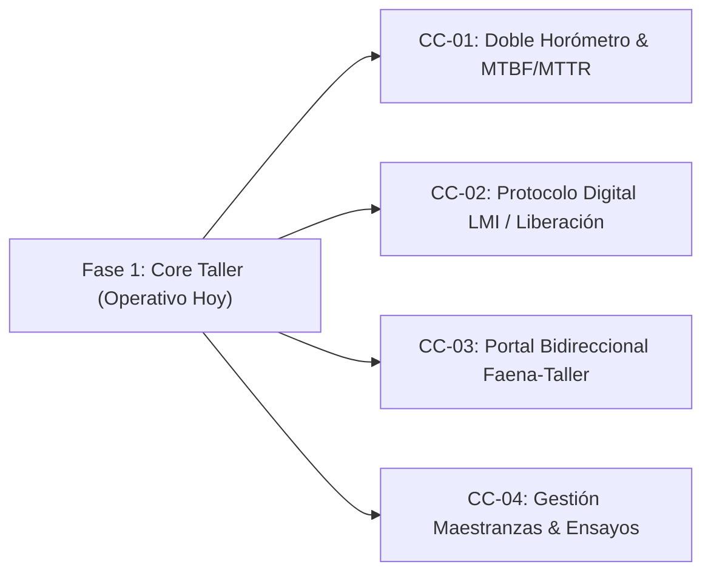

# 💼 Minuta Ejecutiva & Argumentario Comercial: Roadmap Fase 2
## Confiabilidad Operacional y Continuidad para Grúas San Pablo (GSP)
**Autor:** Sergio Gajardo / Senior ERP & Industrial Reliability Consultant  
**Destinatario:** Jorge Ponce (Gerente General) & Omar (Jefatura de Operaciones/Flota)  
**Fecha:** Octubre 2026  

---

## 1. Contexto Estratégico y Diagnóstico de Madurez

> *"Una cosa es que el software tenga la funcionalidad lista y otra es que los hábitos, prácticas y procesos de la empresa estén maduros para operarla. Para que el proyecto sea un éxito total, debemos implementar de forma gradual y práctica, evitando que se culpe a la tecnología por falta de rutinas operativas en terreno o taller."*

### Lo que Hoy Está 100% Operativo y Resuelto (Fase 1 / Core Transaccional)
1. **Bandeja Central de OTs:** Apertura, priorización, asignación de mecánicos y seguimiento de órdenes de trabajo internas.
2. **Medidores de Entrada y Recepción:** Horómetros (grúa/chasis), odómetros y registro fotográfico 360° del estado inicial de llegada al patio.
3. **Consumo Híbrido de Materiales (WMS vs Faena):** Imputación atómica de repuestos de pañol oficial con rebaja de stock en estantería física y costo PMP garantizado, conviviendo con compras directas de faena.
4. **Mano de Obra y Terceros:** Registro de horas hombre (HH) de técnicos y servicios externos con costeo automático consolidado por grúa.
5. **Cierre FES Supervisado:** Validación con firma electrónica y bloqueo de ediciones posteriores.

---

## 2. Los 4 Módulos de Alto Valor para la Fase 2 (Control de Cambios)

Para llevar la flota de Grúas San Pablo a un estándar de **Confiabilidad World-Class (ISO 14224 & SMRP)**, se presentan los siguientes 4 módulos complementarios como propuesta de continuidad y optimización operacional:

---

### Módulo 1: Confiabilidad y Telemetría de Doble Horómetro (CC-MNT-01)
* **El Dolor del Negocio:** En grúas móviles telescópicas (Liebherr, Grove, Demag), el motor de carretera (chasis) tiene un régimen de desgaste completamente distinto al motor de superestructura (izaje hidráulico). Tratar ambos motores con una sola pauta provoca cambios de aceite prematuros en carretera o sobregiro peligroso del circuito hidráulico de pluma.
* **Solución Propuesta:** Algoritmo que desacopla el desgaste por sistema, genera alertas preventivas independientes y calcula métricas deterministas de confiabilidad:
  - **MTBF (Mean Time Between Failures):** Tiempo medio entre fallas por modelo de grúa.
  - **MTTR (Mean Time To Repair):** Tiempo medio real de respuesta técnica.
* **Integración con Torre de Control:** Si una grúa entra a taller por falla crítica, el sistema la pasa automáticamente a estado `FUERA_DE_SERVICIO` en la Torre de Control y en Programación Comercial, impidiendo comprometer comercialmente un equipo en pana.

---

### Módulo 2: Protocolo de Liberación Técnica y Prueba de Carga / LMI (CC-MNT-02)
* **El Dolor del Negocio:** En izaje industrial, la mantención no termina cuando el mecánico guarda la herramienta. Entregar una grúa a faena sin prueba documentada de limitador de carga es un riesgo de siniestralidad severo.
* **Solución Propuesta:** Checklist digital obligatorio previo al cierre de la OT:
  - Prueba de corte por sobrecarga del limitador de momento (LMI/PAT).
  - Torque verificado de pernos de corona de giro.
  - Estanqueidad bajo presión de válvulas de retención en gatos estabilizadores.
  - Inspección de cables de izaje según norma ISO 4309.
* **Entregable:** Emisión del **Acta Oficial de Liberación Técnica** firmada digitalmente con FES por el Jefe de Taller, que acompaña a la grúa a la obra.

---

### Módulo 3: Portal Móvil Bidireccional de Averías en Terreno (CC-MNT-03)
* **El Dolor del Negocio:** Cuando un operador o rigger reporta una avería en faena, no tiene visibilidad de cuándo el taller tomará el caso ni cuándo llegará el camión de asistencia.
* **Solución Propuesta:** Conexión directa PWA Terreno ➔ Taller. El operador recibe notificaciones en tiempo real (Push / WhatsApp):
  - *"Tu reporte sobre la grúa G-12 fue asignado al técnico Juan Pérez (OT-2026-0045)"*.
  - *"Camión taller en tránsito a faena / Estimado arribo: 14:30 hrs"*.
  - *"Reparación concluida y grúa liberada para operar"*.

---

### Módulo 4: Gestión Técnica de Maestranzas y Terceros (CC-MNT-04)
* **El Dolor del Negocio:** Los trabajos externos de alta envergadura (cromado de vástagos de cilindros, alineación láser de camiones grúa, recertificaciones Bureau Veritas / TÜV) se manejan hoy mediante facturas sueltas sin respaldo técnico asociado al activo.
* **Solución Propuesta:** Expediente digital de servicio externo dentro de la OT:
  - Almacenamiento obligatorio de la cotización y Orden de Compra asociada.
  - Registro de informes de ensayos no destructivos (tintas penetrantes / ultrasonido).
  - Certificado de garantía comercial del proveedor y fecha de vigencia.

---

## 3. Estrategia de Presentación para Sergio Gajardo

1. **Reafirmar la Satisfacción Actual:** Validar que el Core de Taller e Inventario que Jorge ya aprobó está listo para salir a producción.
2. **Posicionamiento Consultor:** Presentar estos 4 módulos no como "cosas que faltan", sino como la **Evolución Natural hacia un Mantenimiento de Clase Mundial**.
3. **Mecanismo de Contratación:** Proponer la ejecución de la Fase 2 bajo un Control de Cambio acotado o un anexo de continuidad mensual que garantice horas de consultoría y desarrollo continuo para Grúas San Pablo.
