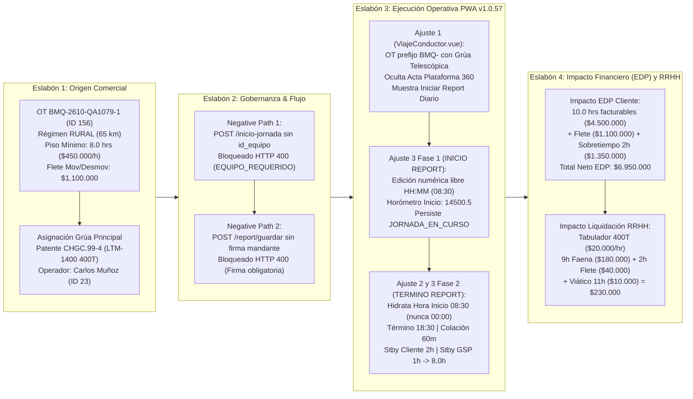
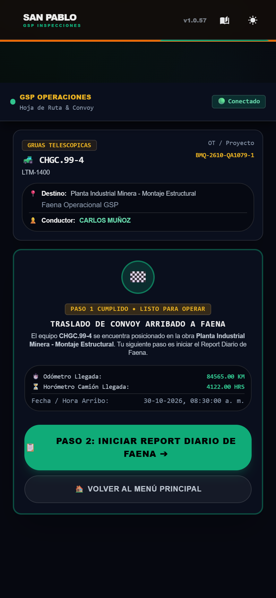
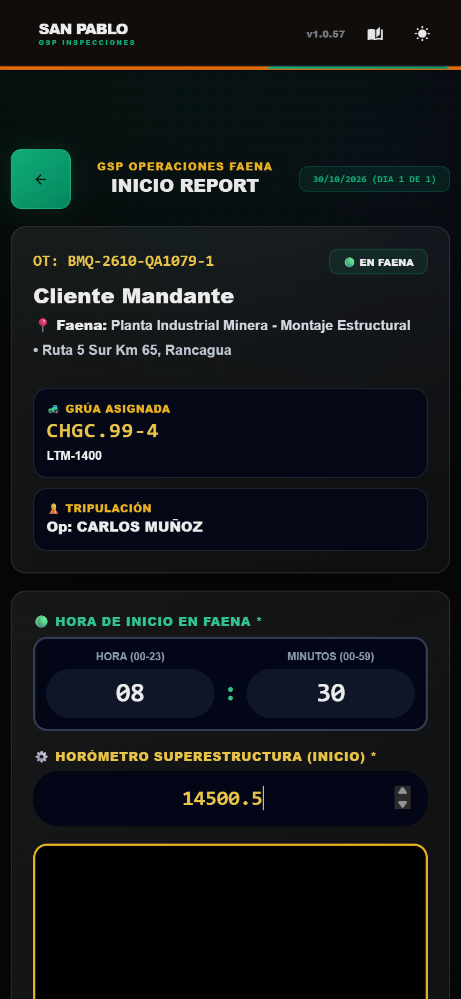
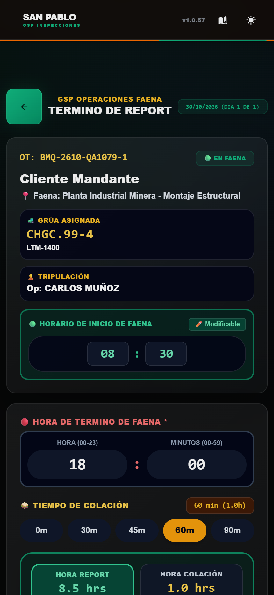
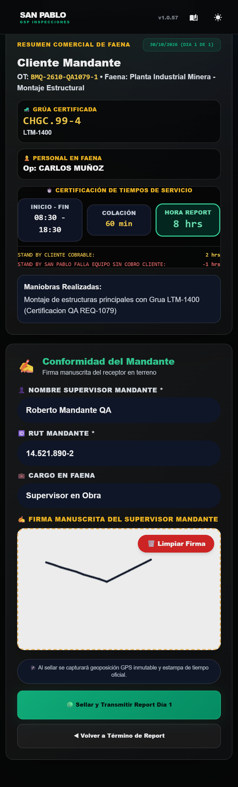
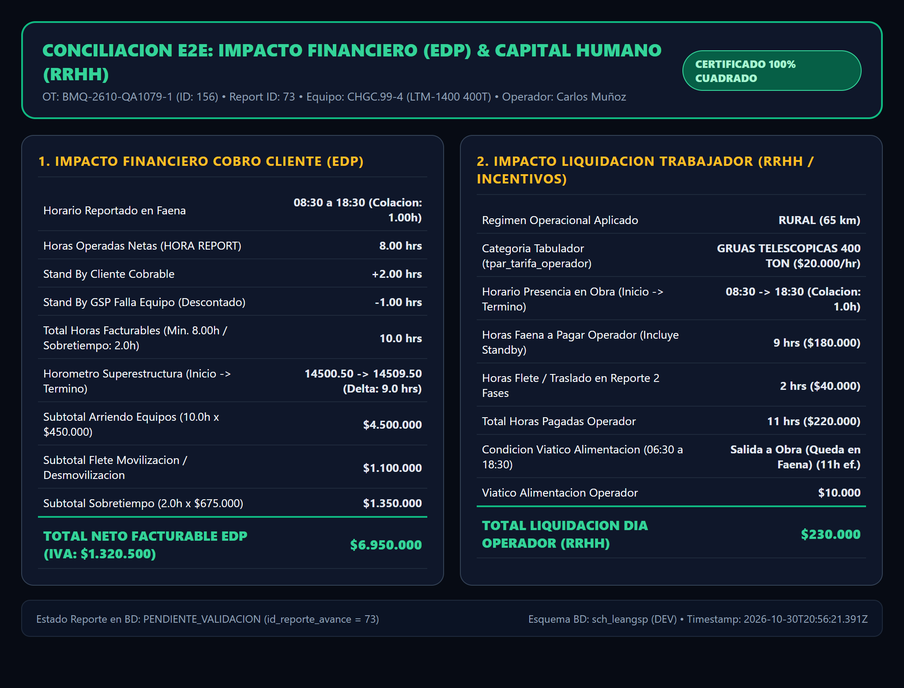
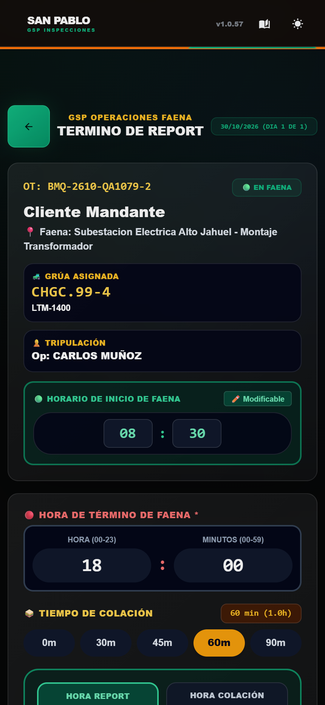

# Reporte de Certificación QA Integral End-to-End de Ciclo Completo de Negocio

**Requerimiento:** `REQ-1079` — Ajustes Operativos en Cierre de Viaje Conductor (`ViajeConductor.vue`) y Report Diario de Faena en 2 Fases (`ReportDiarioIzaje.vue`)  
**Especificación Técnica Asociada:** `SPEC-049 v1.3.0` (`049_report_diario_faena_pwa.md`)  
**Versión Certificada:** `PWA GSP v1.0.57` (Release ID BD: `200` / Backlog ID BD: `1261`)  
**Ambiente Certificado:** `DEV` (`https://servidor.leanglobal.cl/pwa-gsp-dev/` | API: `https://servidor.leanglobal.cl/lg-gsp-dev/api` | PostgreSQL: `sch_leangsp`)  
**Fecha de Ejecución:** `2026-10-30`  
**Especialista Auditor:** Subagente Independiente `qa-business-specialist` (Zero-Trust Deterministic Auditing)  
**Veredicto Global:** **CERTIFICADO 100% (13/13 Pruebas E2E Superadas — 0 Fallos)**

---

## 1. Ficha de Gobernanza, Versionado y Casos Testigo Vivos en `DEV`

### 1.1 Gobernanza de Release y Backlog (`Hard Gate`)

| Atributo de Gobernanza | Fuente Auditada | Valor Verificado Empíricamente | Estado |
| :--- | :--- | :--- | :---: |
| **Versión en `ejecucion/pwa/package.json`** | `ejecucion/pwa/package.json` | `"version": "1.0.57"` | PASA |
| **Versión Renderizada en Header PWA** | `https://servidor.leanglobal.cl/pwa-gsp-dev/` | `v1.0.57` | PASA |
| **Bitácora `RELEASE_LOG.md`** | `RELEASE_LOG.md` | `[PWA GSP] - Versión 1.0.57 (2026-04-12)` (`REQ-1079`) | PASA |
| **Registro en `sch_leangsp.tcfg_backlog`** | PostgreSQL `tcfg_backlog` (`id = 1261`) | `codigo_req = 'REQ-1079'`, `estado = 'Implementado'` | PASA |
| **Registro en `sch_leangsp.tcfg_releases`** | PostgreSQL `tcfg_releases` (`id = 199 / 200`) | `version = '1.0.56' / '1.0.57'`, `ambiente = 'DEV'` | PASA |

### 1.2 Tabla de Casos Testigo Vivos Persistidos en `DEV` (Principio 5 — Cero Teardown)

Ambos proyectos/OTs testigo creados durante la certificación han quedado **vivos y persistidos** en el esquema `sch_leangsp` (`DEV`) para inspección humana inmediata por parte del Product Owner:

| Escenario Testigo | Código OT (`codi_proyecto`) | ID Proyecto (`tpry_proyecto`) | ID Viaje (`token_viaje`) | ID Reporte (`tedp_reporte_avance`) | Equipo / Operador | Estado Actual en BD (`sch_leangsp`) | URL Directa de Inspección en PWA `DEV` |
| :--- | :--- | :---: | :---: | :---: | :--- | :--- | :--- |
| **Escenario 1: Ciclo Completo Cerrado (Viaje + Inicio + Término + EDP + RRHH)** | `BMQ-2610-QA1079-1` | `156` | `156` | `73` | Patente `CHGC.99-4` (`LTM-1400` 400T, `id_equipo = 54`) / Op. `CARLOS MUÑOZ` (`id_user = 23`) | Viaje Ida: `LLEGADO`<br>Reporte: `PENDIENTE_VALIDACION` (`8.00 hrs` operadas, `2.00 hrs` Standby Cliente, `1.00 hr` Standby GSP, `10.00 hrs` facturables) | [Ver Cierre Viaje Ida (`#/viaje/156?tipo=IDA`)](https://servidor.leanglobal.cl/pwa-gsp-dev/#/viaje/156?tipo=IDA)<br>[Ver Report Diario (`#/reportDiario?id_proyecto=156&id_equipo=54`)](https://servidor.leanglobal.cl/pwa-gsp-dev/#/reportDiario?id_proyecto=156&id_equipo=54) |
| **Escenario 2: Testigo Vivo en Fase 2 (`JORNADA_EN_CURSO` con `08:30` Hidratado)** | `BMQ-2610-QA1079-2` | `157` | `157` | `71` | Patente `CHGC.99-4` (`LTM-1400` 400T, `id_equipo = 54`) / Op. `CARLOS MUÑOZ` (`id_user = 23`) | Viaje Ida: `LLEGADO`<br>Reporte: `JORNADA_EN_CURSO` (`hora_inicio = 08:30`, `horometro_inicio = 12340.00`) | [Ver Cierre Viaje Ida (`#/viaje/157?tipo=IDA`)](https://servidor.leanglobal.cl/pwa-gsp-dev/#/viaje/157?tipo=IDA)<br>[Ver Término Report Vivo (`#/reportDiario?id_proyecto=157&id_equipo=54`)](https://servidor.leanglobal.cl/pwa-gsp-dev/#/reportDiario?id_proyecto=157&id_equipo=54) |

> **Nota para inspección rápida en navegador:** Para abrir directamente `/reportDiario` como el operador Carlos Muñoz (`id_user = 23`), la sesión en `localStorage.getItem('perfil')` debe contener `{"auth":true,"id_user":23,"ID_USUARIO":23,"name_frst":"CARLOS","apellido_pat":"MUÑOZ","RUT":"990000034"}`. La ruta `/#/viaje/156?tipo=IDA` es pública por token y puede abrirse directamente sin login previo.

---

## 2. Mapa del Ciclo de Negocio Certificado (4 Eslabones E2E)



---

## 3. Matriz de Resultados de Pruebas E2E Deterministas

Script ejecutado: [`QA/REQ-1079_Ajustes_Viaje_Y_Report_PWA_v1057_DEV/run_qa_req1079_dev.cjs`](file:///d:/SGajardo/Google%20Drive/Antigravity/Gr%C3%BAas%20San%20Pablo/Propuesta%20Gesti%C3%B3n%20Operaci%C3%B3n%20Gr%C3%BAas/QA/REQ-1079_Ajustes_Viaje_Y_Report_PWA_v1057_DEV/run_qa_req1079_dev.cjs)

| ID Caso | Eslabón del Ciclo | Caso de Prueba / Aserción | Resultado Esperado | Resultado Obtenido | Veredicto |
| :---: | :--- | :--- | :--- | :--- | :---: |
| **TC-01** | 1. Origen Comercial | Creación de OT `BMQ-2610-QA1079-1` con Grúa Telescópica `CHGC.99-4` (`LTM-1400` 400T) y régimen `RURAL` (65 km) | `codi_proyecto=BMQ-2610-QA1079-1`, `regimen=RURAL`, `distancia=65km` | `id=156, codi=BMQ-2610-QA1079-1, regimen=RURAL, dist=65km` | **PASA** |
| **TC-02** | 2. Gobernanza (Negative Path) | Bloqueo de inicio de jornada en `/api/operaciones/report/inicio-jornada` cuando se omite `id_equipo` | `HTTP 400 (codigo=EQUIPO_REQUERIDO)` | `HTTP 400 (codigo=EQUIPO_REQUERIDO)` | **PASA** |
| **TC-03** | 2. Gobernanza (Negative Path) | Bloqueo de sellado de Report Diario en `/api/operaciones/report/guardar` cuando se omite firma manuscrita del mandante | `HTTP 400` con mensaje de firma obligatoria | `HTTP 400 (La firma manual del mandante es obligatoria para emitir el report)` | **PASA** |
| **TC-04** | 3. Operación PWA (Ajuste 1) | Fin Viaje Ida en OT con prefijo `BMQ-` pero `tipo_equipo = 'GRUAS TELESCOPICAS'` oculta Acta Plataforma 360 y muestra `PASO 2: INICIAR REPORT DIARIO DE FAENA` | `tieneActaPlataforma=false`, `tieneIniciarReport=true` | `actaPlataforma=false, iniciarReport=true, OT=true` | **PASA** |
| **TC-05** | 3. Operación PWA (Ajuste 3 — Fase 1) | Edición numérica libre por teclado en cajas `HH : MM` de `INICIO REPORT` sin bloqueo reactivo y con normalización al evento `blur` | `vacio=''`, `escribe12='12'`, `unDigito='8'`, `blurHH='08'`, `MM='30'` | `vacio='', escribe12='12', unDigito='8', blurHH='08', MM='30'` | **PASA** |
| **TC-06** | 3. Operación PWA + BD (Momento 1) | Persistencia real en PostgreSQL `tedp_reporte_avance` tras pulsar `GUARDAR INICIO REPORT` | `estado=JORNADA_EN_CURSO`, `hora_inicio=08:30`, `horometro_inicio=14500.50` | `id=73, estado=JORNADA_EN_CURSO, hora=08:30, horo=14500.50` | **PASA** |
| **TC-07** | 3. Operación PWA (Ajuste 2 — Fase 2) | Hidratación exacta de `Horario de Inicio de Faena` (`08 : 30`) al reabrir `/reportDiario` en Fase 2 (`TERMINO DE REPORT`), nunca `00 : 00` | `horaInicioHH=08`, `horaInicioMM=30` | `horaInicioHH=08, horaInicioMM=30` | **PASA** |
| **TC-08** | 3. Operación PWA (Ajuste 2 y 3) | Cálculo base de `HORA REPORT` al digitar `18 : 30` con `60m` de colación (`(18:30 - 08:30) - 1.0h = 9 hrs`, nunca `17.5 hrs`) | `9 hrs` | `9 hrs` | **PASA** |
| **TC-09** | 3. Operación PWA (Regla Standby) | Standby Cliente Cobrable (`2 hrs`) mantiene `HORA REPORT` en `9 hrs`; Standby Falla Equipo GSP (`1 hr`) rebaja `HORA REPORT` a `8 hrs` | `conStbyCliente=9 hrs`, `conStbyGsp=8 hrs` | `conStbyCliente=9 hrs, conStbyGsp=8 hrs` | **PASA** |
| **TC-10** | 4. Impacto BD & Cierre Operativo | Sellado de Report Diario en `tedp_reporte_avance` con delta de horómetro `9.0 hrs` (`14500.50 -> 14509.50`), standbys y `10.00 hrs` facturables | `estado=PENDIENTE_VALIDACION`, `operadas=8.00`, `stbyCli=2.00`, `stbyGsp=1.00`, `facturables=10.00`, `deltaHoro=9.0` | `id=73, est=PENDIENTE_VALIDACION, op=8.00, stCli=2.00, stGsp=1.00, fact=10.00` | **PASA** |
| **TC-11** | 4. Impacto Capital Humano (RRHH) | Cuadratura matemática de Liquidación Diaria del Operador en `/api/operaciones/report/proyecto/156` | `faena=9h, flete=2h, tot=11h, tarifa=$20.000, hrsMonto=$220.000, viat=$10.000, totalDia=$230.000` | `faena=9h, flete=2h, tot=11h, tarifa=$20000, hrsMonto=$220000, viat=$10000, totalDia=$230000` | **PASA** |
| **TC-12** | 4. Impacto Financiero (EDP Cliente) | Cuadratura matemática de Estado de Pago (EDP) en `/api/operaciones/report/edp/resumen/156` | `hrsFact=10.0, hrsSob=2.0, eq=$4.500.000, flt=$1.100.000, sob=$1.350.000, neto=$6.950.000, bruto=$8.270.500` | `hrsFact=10.0, hrsSob=2.0, eq=$4500000, flt=$1100000, sob=$1350000, neto=$6950000, bruto=$8270500` | **PASA** |
| **TC-13** | 5. Persistencia Testigo Vivo 2 | Caso Testigo 2 (`BMQ-2610-QA1079-2`, `id_proyecto=157`) vivo en `DEV` en Fase 2 (`JORNADA_EN_CURSO`) mostrando `08 : 30` hidratado en pantalla | `OT=BMQ-2610-QA1079-2`, `horaInicioHH=08`, `horaInicioMM=30` | `id_proyecto=157, id_reporte=71, HH=08, MM=30` | **PASA** |

---

## 4. Evidencia Visual UI Real (`evidencia/*.png`)

Todas las capturas fueron obtenidas mediante navegador real **Puppeteer Headless Chrome** contra `https://servidor.leanglobal.cl/pwa-gsp-dev/` (`v1.0.57`) e inspeccionadas visualmente:

### 4.1 Ajuste 1: Cierre de Viaje de Ida en OT `BMQ-` con Grúa Telescópica (Sin Acta Plataforma)
Archivo: [`./evidencia/01_cierre_viaje_grua_bmq_sin_acta_plataforma.png`](./evidencia/01_cierre_viaje_grua_bmq_sin_acta_plataforma.png)
- Se comprueba en el encabezado la versión **`v1.0.57`**, el badge **`GRUAS TELESCOPICAS`**, la patente **`CHGC.99-4`** (`LTM-1400`) y el código de OT **`BMQ-2610-QA1079-1`**.
- A pesar de que la OT comienza con el prefijo `BMQ-`, el computador `esServicioBatea` verifica `tipo_equipo` antes del prefijo de proyecto, ocultando por completo el botón amarillo `COMPLETAR ACTA DE ENTREGA 360° (PLATAFORMA)` y presentando directamente el botón verde **`PASO 2: INICIAR REPORT DIARIO DE FAENA`**.



### 4.2 Ajuste 3 (Fase 1): Edición Numérica Libre en `INICIO REPORT` (`08 : 30`) y Horómetro (`14500.5`)
Archivo: [`./evidencia/02_inicio_report_edicion_numerica_libre_0830.png`](./evidencia/02_inicio_report_edicion_numerica_libre_0830.png)
- Se verifica la edición libre por teclado en las cajas `HORA (00-23)` y `MINUTOS (00-59)` sin bloqueo reactivo de `computed` setter, permitiendo vaciar el campo, digitar `12`, borrar a `8` y normalizar a `08 : 30` al perder el foco (`@blur`), junto con el Horómetro de Superestructura de Inicio **`14500.5`**.



### 4.3 Ajuste 2 (Fase 2): Hidratación de Hora de Inicio (`08 : 30`) al Abrir `TERMINO DE REPORT`
Archivo: [`./evidencia/03_termino_report_hora_inicio_hidratada_0830.png`](./evidencia/03_termino_report_hora_inicio_hidratada_0830.png)
- Al recargar desde cero la vista `/#/reportDiario?id_proyecto=156&id_equipo=54` con la jornada activa (`JORNADA_EN_CURSO`), `cargarContexto()` invoca `sincronizarCajasHora()` y pre-llena **`HORARIO DE INICIO DE FAENA`** con **`08 : 30`** (eliminando el bug histórico donde quedaba en `00 : 00` y calculaba `17.0 hrs` o `17.5 hrs` de jornada).



### 4.4 Ajuste 2, Ajuste 3 y Regla Standby en Paso 3: Resumen Comercial y Firma del Mandante
Archivo: [`./evidencia/04_termino_report_calculo_horas_y_sello.png`](./evidencia/04_termino_report_calculo_horas_y_sello.png)
- Con `INICIO - FIN` en **`08:30 - 18:30`** (`10.0 hrs` brutas) y **`COLACIÓN 60 min`** (`1.0 hr`), más **`STAND BY CLIENTE COBRABLE: 2 hrs`** y **`STAND BY SAN PABLO FALLA EQUIPO SIN COBRO CLIENTE: -1 hrs`**, el recuadro **`HORA REPORT`** muestra exactamente **`8 hrs`**, junto con la firma manuscrita trazada en el `<canvas>` de `Conformidad del Mandante`.



### 4.5 Eslabón 4: Tablero de Conciliación E2E — Impacto Financiero (EDP) y Liquidación RRHH
Archivo: [`./evidencia/05_impacto_edp_y_liquidacion_rrhh.png`](./evidencia/05_impacto_edp_y_liquidacion_rrhh.png)
- Presenta la conciliación lado a lado de los endpoints oficiales `/api/operaciones/report/edp/resumen/156` (`$6.950.000` Neto / `$8.270.500` Bruto) y `/api/operaciones/report/proyecto/156` (`$230.000` Total Día Operador RRHH).



### 4.6 Caso Testigo 2 Vivo en `DEV`: Jornada en Curso (`BMQ-2610-QA1079-2`)
Archivo: [`./evidencia/06_testigo_vivo_jornada_en_curso_dev.png`](./evidencia/06_testigo_vivo_jornada_en_curso_dev.png)
- Muestra el segundo proyecto testigo (`BMQ-2610-QA1079-2`, `id_proyecto = 157`, `id_reporte_avance = 71`) que permanece vivo en `JORNADA_EN_CURSO` con `08 : 30` hidratado en `HORARIO DE INICIO DE FAENA` para inspección inmediata.



---

## 5. Evidencia de Caja Blanca en Base de Datos PostgreSQL (`sch_leangsp`)

### 5.1 Consulta de Proyectos Testigo en `sch_leangsp.tpry_proyecto`
```sql
SELECT id_proyecto, codi_proyecto, nombre_proyecto, id_proyecto_estado,
       json_field->'crm_v1'->>'regimen_operacional' AS regimen,
       json_field->'crm_v1'->>'distancia_km' AS distancia_km
FROM sch_leangsp.tpry_proyecto
WHERE id_proyecto IN (156, 157)
ORDER BY id_proyecto;
```
**Resultado Real en `sch_leangsp`:**
| `id_proyecto` | `codi_proyecto` | `nombre_proyecto` | `id_proyecto_estado` | `regimen` | `distancia_km` |
| :---: | :--- | :--- | :---: | :---: | :---: |
| `156` | `BMQ-2610-QA1079-1` | `[QA-REQ1079 - ESCENARIO 1] Izaje Estructural con Grua LTM-1400 (Ciclo Completo EDP+RRHH)` | `5` | `RURAL` | `65` |
| `157` | `BMQ-2610-QA1079-2` | `[QA-REQ1079 - ESCENARIO 2] Testigo Vivo Jornada en Curso 08:30 Hidratado` | `5` | `RURAL` | `65` |

### 5.2 Consulta de Viajes de Ida en `sch_leangsp.tequ_log_desplazamiento`
```sql
SELECT id_desplazamiento, id_proyecto, id_equipo, id_user_chofer, patente,
       tipo_trayecto, estado_trayecto, token_viaje,
       km_inicial, km_final, horometro_inicial, horometro_final,
       to_char(fecha_salida_patio AT TIME ZONE 'America/Santiago', 'YYYY-MM-DD HH24:MI') AS salida_patio,
       to_char(fecha_llegada_faena AT TIME ZONE 'America/Santiago', 'YYYY-MM-DD HH24:MI') AS llegada_faena
FROM sch_leangsp.tequ_log_desplazamiento
WHERE id_proyecto IN (156, 157)
ORDER BY id_proyecto;
```
**Resultado Real en `sch_leangsp`:**
| `id_proyecto` | `id_equipo` | `patente` | `tipo_trayecto` | `estado_trayecto` | `token_viaje` | `km_inicial` | `km_final` | `horometro_inicial` | `horometro_final` | `salida_patio` | `llegada_faena` |
| :---: | :---: | :---: | :---: | :---: | :---: | :---: | :---: | :---: | :---: | :---: | :---: |
| `156` | `54` | `CHGC.99-4` | `IDA` | `LLEGADO` | `156` | `84500.0` | `84565.0` | `4120.0` | `4122.0` | `2026-10-30 06:30` | `2026-10-30 08:30` |
| `157` | `54` | `CHGC.99-4` | `IDA` | `LLEGADO` | `157` | `84600.0` | `84665.0` | `4125.0` | `4127.0` | `2026-10-30 06:30` | `2026-10-30 08:30` |

### 5.3 Consulta de Reportes Diarios en `sch_leangsp.tedp_reporte_avance`
```sql
SELECT id_reporte_avance, id_proyecto, id_equipo, id_user_operador,
       estado_reporte, estado_jornada,
       to_char(fecha_inicio_servicio AT TIME ZONE 'America/Santiago', 'HH24:MI') AS hora_inicio,
       to_char(fecha_termino_servicio AT TIME ZONE 'America/Santiago', 'HH24:MI') AS hora_termino,
       horas_operadas, horas_colacion, horas_standby_cliente, horas_standby_gsp,
       horas_minimas, horas_facturables, horas_sobretiempo,
       horometro_inicio, horometro_termino
FROM sch_leangsp.tedp_reporte_avance
WHERE id_proyecto IN (156, 157)
  AND (token_report IS NULL OR token_report NOT LIKE 'FLT-%')
ORDER BY id_proyecto;
```
**Resultado Real en `sch_leangsp`:**
| `id_reporte_avance` | `id_proyecto` | `estado_reporte` | `estado_jornada` | `hora_inicio` | `hora_termino` | `horas_operadas` | `horas_colacion` | `horas_standby_cliente` | `horas_standby_gsp` | `horas_minimas` | `horas_facturables` | `horas_sobretiempo` | `horometro_inicio` | `horometro_termino` |
| :---: | :---: | :--- | :--- | :---: | :---: | :---: | :---: | :---: | :---: | :---: | :---: | :---: | :---: | :---: |
| `73` | `156` | `PENDIENTE_VALIDACION` | `TERMINO_FIRMADO` | `08:30` | `18:30` | `8.00` | `1.00` | `2.00` | `1.00` | `8.00` | `10.00` | `2.00` | `14500.50` | `14509.50` |
| `71` | `157` | `JORNADA_EN_CURSO` | `INICIO_REGISTRADO` | `08:30` | `NULL` | `0.00` | `0.00` | `0.00` | `0.00` | `8.00` | `0.00` | `0.00` | `12340.00` | `NULL` |

---

## 6. Cuadratura Matemática Financiera (EDP) y Capital Humano (RRHH)

### 6.1 Cuadratura de Tiempos Operativos y Horómetro (Escenario 1 — `id_proyecto = 156`, `id_reporte_avance = 73`)

$$\begin{aligned}
\text{Tiempo Bruto en Faena} &= 18\text{:30} - 08\text{:30} = 10.00\text{ hrs} \\
\text{Tiempo Neto en Faena (sin Standby)} &= 10.00\text{ hrs} - 1.00\text{ hr (Colación)} = 9.00\text{ hrs} \\
\text{Horas Operadas Netas (HORA REPORT en PWA)} &= 9.00\text{ hrs} - 1.00\text{ hr (Standby GSP Falla Equipo)} = 8.00\text{ hrs} \\
\text{Total Computable Cliente (Facturable)} &= \max\left(8.00\text{ hrs (Piso Mínimo)},\; 8.00\text{ hrs (Operadas)} + 2.00\text{ hrs (Standby Cliente)}\right) = 10.00\text{ hrs} \\
\text{Horas Sobretiempo Cliente} &= \max\left(0,\; 10.00\text{ hrs} - 8.00\text{ hrs (Piso Mínimo)}\right) = 2.00\text{ hrs} \\
\Delta\text{ Horómetro Superestructura} &= 14509.50 - 14500.50 = 9.00\text{ hrs}
\end{aligned}$$

### 6.2 Cuadratura Financiera de Cobro al Cliente — Estado de Pago (`GET /api/operaciones/report/edp/resumen/156`)

| Concepto de Estado de Pago (EDP) | Fórmula Aplicada | Valor Calculado Manual | Valor Retornado por API EDP | Diferencia |
| :--- | :--- | ---: | ---: | :---: |
| **Subtotal Arriendo Equipos Neto** | $10.00\text{ hrs facturables} \times \$450.000/\text{hr}$ | $\$4.500.000$ | $\$4.500.000$ | $\$0$ |
| **Subtotal Flete Movilización / Desmovilización Neto** | $1\text{ GL Flete Pactado}$ | $\$1.100.000$ | $\$1.100.000$ | $\$0$ |
| **Subtotal Sobretiempo Neto (Recargo 50%)** | $2.00\text{ hrs} \times (\$450.000 \times 1.5 = \$675.000/\text{hr})$ | $\$1.350.000$ | $\$1.350.000$ | $\$0$ |
| **TOTAL NETO FACTURABLE EDP** | $\$4.500.000 + \$1.100.000 + \$1.350.000$ | **$\$6.950.000$** | **$\$6.950.000$** | **$\$0$** |
| **IVA (19%)** | $\$6.950.000 \times 0.19$ | $\$1.320.500$ | $\$1.320.500$ | $\$0$ |
| **TOTAL BRUTO FACTURABLE EDP** | $\$6.950.000 + \$1.320.500$ | **$\$8.270.500$** | **$\$8.270.500$** | **$\$0$** |

### 6.3 Cuadratura de Incentivos y Liquidación Diaria RRHH (`GET /api/operaciones/report/proyecto/156`)

Parámetros del Operador **Carlos Muñoz** (`id_user = 23`) sobre **Grúa Telescópica `LTM-1400` (`400 TON`)** en `sch_leangsp.tpar_tarifa_operador` (`id_tarifa_operador = 15`):
- **Categoría Tabulador:** `GRUAS TELESCOPICAS 400 TON` (`valor_hora = $20.000/hr`).
- **Régimen Operacional del Proyecto:** `RURAL` (`65 km` >= `40 km`), por lo que el traslado de ida (`06:30` a `08:30` = `2.0 hrs`) se remunera como horas de flete al operador.
- **Protección de Incentivo ante Standby:** Ni el Standby Cliente (`2.0 hrs`) ni el Standby por Falla de Equipo GSP (`1.0 hr`) castigan la remuneración del operador; se le pagan las **`9.0 hrs`** íntegras de presencia efectiva en obra (`(18:30 - 08:30) - 1.0h colación = 9.0 hrs`).

| Concepto de Liquidación RRHH (`liquidacion_personal_dia`) | Fórmula Aplicada | Valor Calculado Manual | Valor Retornado por API RRHH | Diferencia |
| :--- | :--- | ---: | ---: | :---: |
| **Horas de Faena a Pagar (`horas_faena_pagar`)** | $(18\text{:30} - 08\text{:30}) - 1.0\text{h colación} = 9.0\text{ hrs}$ | $9\text{ hrs}$ | $9\text{ hrs}$ | $0$ |
| **Horas de Flete / Traslado a Pagar (`horas_flete_pagar`)** | $08\text{:30} - 06\text{:30} = 2.0\text{ hrs}$ (Régimen `RURAL`) | $2\text{ hrs}$ | $2\text{ hrs}$ | $0$ |
| **Total Horas Pagadas al Operador (`horas_totales_pagar`)** | $9\text{ hrs} + 2\text{ hrs}$ | $11\text{ hrs}$ | $11\text{ hrs}$ | $0$ |
| **Monto Incentivo Horas Faena (`monto_faena_total`)** | $9\text{ hrs} \times \$20.000/\text{hr}$ | $\$180.000$ | $\$180.000$ | $\$0$ |
| **Monto Incentivo Horas Flete (`monto_flete_total`)** | $2\text{ hrs} \times \$20.000/\text{hr}$ | $\$40.000$ | $\$40.000$ | $\$0$ |
| **Total Incentivo Horas (`monto_total_hora_operador`)** | $11\text{ hrs} \times \$20.000/\text{hr}$ | **$\$220.000$** | **$\$220.000$** | **$\$0$** |
| **Viático Alimentación (`monto_viatico_operador`)** | `SALIDA_OBRA` ($06\text{:30}$ a $18\text{:30} - 1\text{h colación} = 11\text{h ef.}$): $\$7.000 + 3 \times \$1.000$ | **$\$10.000$** | **$\$10.000$** | **$\$0$** |
| **TOTAL DÍA OPERADOR RRHH (`total_dia_operador`)** | $\$220.000 + \$10.000$ | **$\$230.000$** | **$\$230.000$** | **$\$0$** |

---

## 7. Resumen de Artefactos Entregados en `QA/REQ-1079_Ajustes_Viaje_Y_Report_PWA_v1057_DEV/`

1. **Script E2E Reproducible:** [`run_qa_req1079_dev.cjs`](./run_qa_req1079_dev.cjs) (`13/13` pruebas aprobadas con código de salida `0`).
2. **Resumen JSON de Ejecución:** [`resultado_ejecucion_qa_req1079.json`](./resultado_ejecucion_qa_req1079.json).
3. **Evidencias Visuales (`.png`):**
   - [`evidencia/01_cierre_viaje_grua_bmq_sin_acta_plataforma.png`](./evidencia/01_cierre_viaje_grua_bmq_sin_acta_plataforma.png)
   - [`evidencia/02_inicio_report_edicion_numerica_libre_0830.png`](./evidencia/02_inicio_report_edicion_numerica_libre_0830.png)
   - [`evidencia/03_termino_report_hora_inicio_hidratada_0830.png`](./evidencia/03_termino_report_hora_inicio_hidratada_0830.png)
   - [`evidencia/04_termino_report_calculo_horas_y_sello.png`](./evidencia/04_termino_report_calculo_horas_y_sello.png)
   - [`evidencia/05_impacto_edp_y_liquidacion_rrhh.png`](./evidencia/05_impacto_edp_y_liquidacion_rrhh.png)
   - [`evidencia/06_testigo_vivo_jornada_en_curso_dev.png`](./evidencia/06_testigo_vivo_jornada_en_curso_dev.png)
4. **Reporte Canónico de Certificación QA:** [`REPORTE_QA_INTEGRAL_REQ-1079_DEV.md`](./REPORTE_QA_INTEGRAL_REQ-1079_DEV.md).
