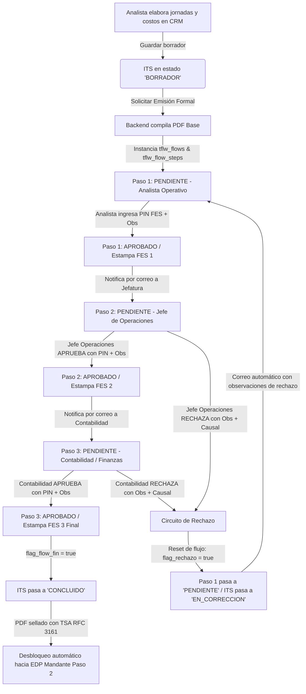

# 📑 Bosquejo de Arquitectura: Flujo de Aprobación FES y Generación de PDF para ITS

> **Documento:** `bosquejo_firma.md`  
> **Módulo:** Informe de Término de Servicio (ITS) — Sub-Tab 7 (Paso 1 de Liquidación)  
> **Sistema:** Grúas San Pablo (GSP) / LeanGlobal Platform  
> **Estándares Canónicos Aplicados:**
> - [`leanglobal_approval_flow_standard`](file:///D:/SGajardo/Google%20Drive/Antigravity/LeanGlobal%20-%20Product/.agents/skills/leanglobal_approval_flow_standard/SKILL.md) (Motor de flujos, transiciones y transaccionalidad `tflw_*`).
> - [`generar_pdf_fes_sin_survey`](file:///D:/SGajardo/Google%20Drive/Antigravity/LeanGlobal%20-%20Product/.agents/skills/generar_pdf_fes_sin_survey/SKILL.md) (PDF temporal, diálogo 2 columnas, cifrado SHA-256 en cliente, estampado `pdf-lib` y TSA RFC 3161).
> - [`gsp_pdf_and_email_standards`](file:///d:/SGajardo/Google%20Drive/Antigravity/Grúas%20San%20Pablo/Propuesta%20Gestión%20Operación%20Grúas/.agents/skills/pdf_and_email_standards/SKILL.md) (Logos Base64 paramétricos por empresa emisora, formato A4 imprimible y despacho Nodemailer).

---

## 1. 🎯 Objetivo y Alcance

El **Informe de Término de Servicio (ITS)** es el instrumento legal y económico que consolida las jornadas operadas en terreno y los costos directos incurridos (8 categorías), calculando el margen real y la rentabilidad del servicio.

Para garantizar su validez contractual, auditoría interna y posterior pase a facturación, este documento define la integración de:
1. **Generación de un documento PDF oficial** con la identidad corporativa de Grúas San Pablo o sus empresas asociadas (Bestmaq, Logística del Sur, Royal Rental).
2. **Flujo de aprobación formal de triple firma electrónica simple (FES)** con autenticación por PIN de 4 dígitos.
3. **Manejo transaccional de observaciones por cada firmante** y **circuito de rechazo estricto** que retorna el documento al responsable operativo (el Analista) para su corrección.

---

## 2. 🔄 Ciclo de Vida y Máquina de Estados del Flujo (`tflw_*`)

Dado que el ITS es una entidad relacional financiera y **no una encuesta o inspección móvil (`tsrv_survey`)**, se implementa bajo la arquitectura **FES Sin Survey**, desacoplando el motor de flujos para asociarlo al identificador único del ITS (`id_its`).



### 👥 Roles y Secuencia de Firmantes

| Paso | Denominación del Paso | Rol Responsable (`id_rol`) | Acción al Aprobar | Acción al Rechazar |
| :--- | :--- | :--- | :--- | :--- |
| **Paso 1** | **Elaboración & Liquidación Técnica** | `Analista de Operaciones` (`GSP_PROG`) | Emite el PDF base, estampa firma FES 1 e inicia el flujo. | N/A (Es quien origina o subsana el requerimiento). |
| **Paso 2** | **V°B° & Aprobación Jefatura** | `Jefe de Operaciones` (`GSP_ADMIN` / `GSP_JEFE_OPERACIONES`) | Valida coherencia de horas, tarifas, sobretiempos y márgenes. Estampa FES 2. | Dispara el circuito de rechazo hacia el Analista con observaciones. |
| **Paso 3** | **Recepción Conforme & Imputación** | `Contabilidad / Facturación` (`GSP_CONTABILIDAD` / `GSP_FINANZAS`) | Valida cuadratura de costos de compras, peajes y viáticos. Estampa FES 3 (final). | Dispara el circuito de rechazo hacia el Analista con observaciones. |

---

## 3. ↩️ Protocolo de Rechazo y Retorno al Analista Operativo

Cuando el **Jefe de Operaciones (Paso 2)** o **Contabilidad (Paso 3)** presiona la opción `RECHAZAR`:

1. **Captura Obligatoria de Motivo y Observaciones:**
   - Selección obligatoria de causal desde el catálogo `tflw_motivo_rechazo` (ej. *Inconsistencia en horas facturables*, *Falta respaldo de comprobante de peaje/pensión*, *Margen inferior al umbral pactado*).
   - Ingreso obligatorio de `observaciones` detallando exactamente qué debe modificarse.
2. **Mutación Transaccional en Base de Datos:**
   - El paso actual se actualiza a `estado = 'RECHAZADO'`, guardando su `id_motivo_rechazo`, `flow_step_obs` y `fecha_event = NOW()`.
   - La cabecera del ITS (`sch_leangsp.tits_informe_termino`) pasa a `estado_its = 'EN_CORRECCION'`.
   - **Reset de Pasos:** El **Paso 1 (Analista Operativo)** se reactiva a estado `'PENDIENTE'`, desbloqueando la edición de jornadas y costos en `ModalITS.vue`. Los demás pasos se restablecen a `'EN ESPERA'`.
3. **Despacho Inmediato de Alerta por Correo (Nodemailer):**
   - El sistema despacha una notificación por correo al Analista responsable (`id_user_elaborado`) con:
     * Nombre y rol de quien rechazó.
     * Causal formal y texto completo de las observaciones.
     * Enlace directo (Magic Link) a la pantalla del ITS en el CRM para su rápida subsanación.
4. **Reingreso al Flujo:**
   - Tras ajustar las jornadas o gastos, el Analista vuelve a ingresar su PIN FES para re-firmar el Paso 1, generando un nuevo PDF actualizado (versión incremental) que reinicia la secuencia hacia el Paso 2.

---

## 4. 📄 Estándar de Diseño del Documento PDF del ITS

El PDF se genera en el backend mediante `wkhtmltopdf` (vía `xvfb-run`) o Puppeteer headless, respetando rigurosamente el estándar visual de la plataforma:

### A. Anatomía del Documento (Hoja A4)

```
+-------------------------------------------------------------------------+
| [ LOGO EMPRESA BASE64 ]            INFORME DE TÉRMINO DE SERVICIO (ITS) |
| Grúas San Pablo SpA                Folio: ITS-2608-001 | Versión: 1     |
| Casa Matriz: Panamericana Norte    Fecha Emisión: 09/09/2026            |
+-------------------------------------------------------------------------+
| 1. ANTECEDENTES GENERALES DEL SERVICIO                                  |
| Mandante: Echeverría Izquierdo     RUT: 76.123.456-7                    |
| Faena / Obra: Hospital Buin        Cotización Origen: COT-2026-042      |
| Orden de Trabajo: OT-2608          Período: 01/09/2026 al 08/09/2026    |
+-------------------------------------------------------------------------+
| 2. RESUMEN ECONÓMICO Y BALANCE DE MARGEN                                |
| Tarifa Hora: $45.000 | Horas Facturables: 48.0h | Subtotal Horas: $2.160.000 |
| Tarifa Flete: $350.000 | Fletes Realizados: 2  | Subtotal Fletes: $700.000  |
| ----------------------------------------------------------------------- |
| TOTAL INGRESOS FACTURABLES (NETO):                   $ 2.860.000        |
| TOTAL COSTOS OPERACIONALES DIRECTOS:               - $   945.200        |
| ----------------------------------------------------------------------- |
| UTILIDAD BRUTA OPERACIONAL:                          $ 1.914.800        |
| MARGEN DE CONTRIBUCIÓN:                              66.95% [🟢 ÓPTIMO] |
+-------------------------------------------------------------------------+
| 3. CONCILIACIÓN DE JORNADAS DE TERRENO (REPORT DIARIO DIGITAL)         |
| Fecha      OT       Equipo / Patente  Salida  Llegada  Término Horas Nº Rep |
| 01/09/2026 OT-2608  LTM-1070 (GR-99)  07:30   08:15    18:00   9.5h  REP-01 |
| 02/09/2026 OT-2608  LTM-1070 (GR-99)  08:00   08:30    17:30   8.5h  REP-02 |
+-------------------------------------------------------------------------+
| 4. DESGLOSE DE COSTOS DIRECTOS (8 CATEGORÍAS OPERACIONALES)             |
| Cat. 1 Alimentación: $ 85.000      Cat. 5 Feriados / Domingos: $ 120.000 |
| Cat. 2 Peajes:       $ 42.500      Cat. 6 Subcontrato Fletes:  $ 450.000 |
| Cat. 3 Pensiones:    $ 90.000      Cat. 7 Gastos Extraord.:    $  38.700 |
| Cat. 4 Pers. Externo: $ 60.000     Cat. 8 Horas Operador:      $  59.000 |
+-------------------------------------------------------------------------+
| 5. HISTORIAL DE OBSERVACIONES Y TRAZABILIDAD                            |
| • [09/09 11:30] Analista (GSP): "Liquidación cerrada según reportes".   |
| • [09/09 14:15] Jefe Operaciones: "Aprobado conforme a bitácora GPS".  |
| • [09/09 15:40] Contabilidad: "Facturas de compras cotejadas".          |
+-------------------------------------------------------------------------+
| 6. CUADRO DE FIRMAS ELECTRÓNICAS FES (ESTAMPA LEGAL TSA RFC 3161)       |
| [ FIRMA 1: ELABORADO ]     [ FIRMA 2: V°B° JEFATURA ] [ FIRMA 3: CONTABLE ] |
| Juan Pérez                 Carlos Morales             María González        |
| Analista de Operaciones    Jefe de Operaciones        Jefa de Contabilidad  |
| RUT: 15.678.901-2          RUT: 12.345.678-9          RUT: 14.567.890-1     |
| Fecha: 09/09/2026 11:32    Fecha: 09/09/2026 14:20    Fecha: 09/09 15:45    |
| [ QR ] FES-UUID-889123     [ QR ] FES-UUID-889124     [ QR ] FES-UUID-889125 |
| Hash SHA-256 Sello TSA     Hash SHA-256 Sello TSA     Hash SHA-256 Sello TSA|
+-------------------------------------------------------------------------+
```

---

## 5. 🖥️ Experiencia de Usuario en Frontend (`ModalITS.vue`)

El componente `ModalITS.vue` integrará:

1. **Cabecera de Trazabilidad del Flujo:**
   - Un banner de progreso superior con los 3 firmantes y sus estados:
     * `① Elaboración (Analista)` ➔ `② Aprobación (Jefe Operaciones)` ➔ `③ Contabilidad (Cierre)`.
     * Badges de colores: Verde (`Aprobado`), Ámbar (`Pendiente de Firma`), Rojo (`Rechazado con Observaciones`).
2. **Botones de Acción según Rol del Usuario en Sesión:**
   - Si el usuario en sesión corresponde al paso actualmente `'PENDIENTE'`:
     * Botón Principal: `[ 🔏 Firmar ITS con PIN FES ]`.
     * Botón Secundario (solo Pasos 2 y 3): `[ ❌ Rechazar con Observaciones ]`.
3. **Diálogo de Firma de 2 Columnas (`<FirmaDialogFES>`):**
   - **Columna Izquierda (Panel de Control de Firma):**
     * Selector de Decisión: Radio buttons estilizados `[ APROBAR ]` / `[ RECHAZAR ]`.
     * Si selecciona *Rechazar*:
       - Desplegable de causas de rechazo (obtenido de `tflw_motivo_rechazo`).
       - Área de texto para observaciones obligatorias del rechazo.
     * Si selecciona *Aprobar*:
       - Área de texto para observaciones voluntarias de visto bueno.
     * Input de PIN FES de 4 dígitos (con formato visual `password` / disc).
     * **Seguridad Cliente:** Antes de enviar a la API, el PIN se hashea localmente con `crypto.subtle.digest('SHA-256', pin)`.
     * Botón: `[ Confirmar y Estampar Firma ]`.
   - **Columna Derecha (Previsualizador de PDF):**
     * Visor PDF interactivo que carga el documento generado en tiempo real para que el revisor examine números, tablas y comprobantes antes de emitir su firma.

---

## 6. 🗄️ Modelo de Base de Datos y Endpoints API

### A. Tablas PostgreSQL (`sch_leangsp`)

1. **`tits_informe_termino`**:
   - `estado_its`: Actualizar check para contemplar:
     `'BORRADOR'`, `'EN_REVISION_OPERACIONES'`, `'EN_REVISION_CONTABILIDAD'`, `'CONCLUIDO'`, `'EN_CORRECCION'`.
   - `id_flow`: Referencia a la instancia `tflw_flows`.
   - `id_doc_pdf_actual`: Referencia al archivo PDF vigente en `tfmg_file`.
2. **`tflw_flows` y `tflw_flow_steps`**:
   - Se reutiliza la estructura del motor de flujos canónico de LeanGlobal (`id_flow`, `id_flow_stp`, `flow_tmpl_step_orden`, `estado`, `id_user`, `id_rol`, `flow_step_obs`, `id_doc_in`, `id_doc_out`, `id_fes`).
3. **`tfes_signatures`**:
   - Persiste cada firma FES: `id_flow_stp`, `id_flow`, `id_user`, `hash_pdf`, `codigo_validacion`, `observaciones`, `aprueba_rechaza`, `id_motivo_rechazo`, `tsa_token`, `ip_firma`, `user_agent`.

### B. Endpoints REST (`/api/operaciones/its`)

1. `GET /api/operaciones/its/:id_proyecto/preview-pdf`:
   - Compila y entrega la URL del PDF del ITS en su estado actual para el visor de firma.
2. `POST /api/operaciones/its/firmar-fes`:
   - Recibe `{ id_its, id_flow_stp, pass_fes, aprueba_rechaza, id_motivo_rechazo, observaciones }`.
   - Valida PIN SHA-256 contra `tsec_users.pass_hash_fes`.
   - Si aprueba: estampa firma con `pdf-lib`, avanza el paso y, si es el último, concluye el ITS y genera el PDF definitivo con sello TSA.
   - Si rechaza: registra causal, devuelve el estado a `'EN_CORRECCION'`, reabre el Paso 1 para el Analista y envía correo de alerta.
3. `GET /api/operaciones/its/:id_proyecto/historial-flujo`:
   - Retorna la bitácora completa de pasos, quién firmó o rechazó, fechas y observaciones.

---

## 7. 🚀 Plan de Ejecución Futuro

Cuando se retome este requerimiento, los pasos de implementación serán:
1. **Paso 1 (DDL & Datos):** Crear el template de flujo ITS en `tflw_templates` y `tflw_template_steps` para los 3 roles de GSP.
2. **Paso 2 (Generador de PDF):** Maquetar la plantilla HTML corporativa con logos paramétricos y compilar con `wkhtmltopdf`.
3. **Paso 3 (Backend):** Implementar los endpoints en `itsController.js` para generación de PDF, validación de PIN FES, estampado `pdf-lib`, sellado TSA y circuito de rechazo.
4. **Paso 4 (Frontend):** Integrar el diálogo interactivo de 2 columnas (`FirmaDialogFES`) en `ModalITS.vue`.
5. **Paso 5 (QA & Pruebas):** Certificar el flujo completo de 3 firmas, la simulación de rechazo y el reingreso al Analista.
